# POKPET A+ 视觉标准 v02（Uta Style）

版本：v02 草案，2026-11-15 13:10（UTC+8）。状态：**待用户确认**。确认前不出图。  
适用范围：POKPET 不锈钢感应饮水机 Amazon US 电脑端 A+ 整页，8 个模块，每个 1464×600，另有 2928×1200 工作画布。  
替代：`uta_page_v01/UTA_TYPOGRAPHY_STANDARD.md`（v01）中的设计理念与卡片规则。v01 的字体、色板和图标家族继续沿用，改动处在文中标明。  
优先级：`AGENTS.md` 高于本文件，然后是 `APLUS_STANDARD_ONEISALL.md`（STYLE-APLUS-OIA-01），最后才是本文件。如有冲突，以 AGENTS.md 为准。

「Uta Style」是用户的叫法，指 **oneisall A+ 的版式结构**加上**小红书参考的观感**。它不是仓库里的正式样式代码。

---

## 0. v01 的问题与 v02 的核心原则

v01 的 8 张都用同一套公式：生活场景、人物、宠物、情绪，再加奶油卡。结果是整页节奏单一，功能讲不清楚，大块奶油卡显得笨重。宠物表情也太平静，没有小红书参考里那种拟人的戏剧感。

v02 的四条核心原则：

1. **不同卖点用不同的呈现类型、背景、机位和版式。** 先决定这个卖点用什么方式最容易看懂，再决定要不要人和宠物。
2. **人宠场景是少数。** 最多 3 个模块有宠物，其中只有 1 个有人。至少 4 个模块是纯色或干净背景、只拍产品。
3. **卡片是例外，不是默认。** 整页最多 2 个模块用卡片。其他模块的文字直接排在画面安静的区域上。
4. **有宠物就要有戏。** 每个宠物模块指定一种拟人表情，同时毛发和骨骼必须真实。

---

## 1. oneisall 参考图观察要点

素材来源：`amazon-visual-design/research/oneisall/aplus_modules/<ASIN>/`（A+ 模块）、`research/oneisall/gallery/<ASIN>/`（副图）、`STRUCTURE.md`、`VISUAL_CASE_STUDY.md`、`aplus_study.md`。下面每条都是逐张打开后的观察。最后一列「可学」只取结构；健康用语、徽章、商标和未核实的数字一律不学（见 APLUS §10）。

### 1.1 A+ 模块

| # | 源文件 | 画面内容 | 版式 | 背景 | 人/宠 | 字号感 | 卡片 | 卖点怎么视觉化 | 可学 / 不学 |
|---|---|---|---|---|---|---|---|---|---|
| 2 | `B0BN2Z5CDC/02_quiet_30dB_hotspot_carousel.jpg` | 夜间客厅：产品在左，曲线在中，猫在右边睡觉 | 标题左上，大数字在曲线顶点 | 暗暖室内，用台灯点光 | 有猫（睡），无人 | 标题属模块级；`30dB` 是英雄数字，参照值字小 | 无，只有两枚小胶囊热点 | 安静用「睡着的猫加大数字」表现 | 学：夜景、睡猫在产品后方、大数字。不学：60/70 dB 参照值 |
| 3 | `B0BN2Z5CDC/03_easy_clean_fullbleed.jpg` | 俯视洗碗机篮里的钢盆 | 全幅出血，字在左下 | 洗碗机内部，顶光 | 无 | 标题中等，副句小 | 无 | 易洗用「放进清洁场景」表现 | 学：功能模块不放人宠。不学：Dishwasher Safe 和 BPA 声明 |
| 5 | `B0BN2Z5CDC/05_faucet_design_carousel.jpg` | 驼色底，两张圆角小图，中间产品，右边吐舌大猫 | 左上标题，中间卡片，右侧出血大猫 | 纯驼色 | 有猫（舔舌），无人 | 标题中等，副句偏小 | 有 2 张圆角图卡 | 龙头吸引力用「猫的夸张舔舌」表现 | 学：拟人表情、纯色底配大猫。不学：手写体和星光 |
| 6 | `B0BN2Z5CDC/06_water_level_carousel.jpg` | 产品水位窗特写，产品从右侧出血 | 左约 40% 只有标题 | 暖棕渐变墙加木台 | 无 | 两行棕色标题，模块级 | **无** | 水位用「窗口特写」表现，不加图标 | 学：细节特写、无卡片、字直接排在安静的墙上 |
| 8 | `B0BN2Z5CDC/08_filtration_carousel_textbox_CTA.jpg` | 产品加猫，左边半透明深灰框，右边 8 Pack 橙卡 | 三段式 | 木地板窗光 | 有猫 | 框内小字 | 有，深灰框加橙卡 | 滤芯用「文字框加耗材包」表现 | 反例：大框加小字显得笨重，正是 v01 的问题；净化气泡也不学 |
| 10 | `B0FN7FQ7RJ/01_premium_hero_video_plus_bento.jpg` | 上半是厨房猫喝水的视频封面，下半是 6 格 bento | 1464×1175，上半场景，下半卡片网格 | 上半暖厨房，下半米色卡 | 上半有猫，无人 | 两行白色 Hero 标题；`20dB` 是英雄数字 | 有，6 张圆角卡 | 三模式在一张卡里，用 3 个圆形图标加短标签（Timer / Motion Sensor / Constant）；水位、清洁、指示灯各占一卡 | 学：三模式用「同级三项并列」；每卡只讲一个点。不学：TOP 1、Hygienic |
| 11 | `B0FN7FQ7RJ/02_scene_tab_carousel.jpg` | 窗台上猫趴在产品旁 | 左边猫和产品，右边标题 | 真实窗台，侧光 | 有猫，无人 | 模块级标题，一个词变色 | 无 | 摆放灵活用「真实房间」表现 | 学：字直接排在暗部，一个关键词用强调色 |
| 12 | `B0FN7FQ7RJ/03_silentflow_pump_tech_hotspot.jpg` | 深蓝底，透明泵 X 光剖视 | 左 45% 标题加 3 枚圆标，右 55% 剖视 | 纯深蓝渐变 | 无 | 模块级标题，标签小 | 无，只有两条胶囊热点 | 泵技术用「深色 X 光剖视」表现 | 学：纯色暗底、只放产品、剖视。不学：商标、专利章，也不学缺 Schematic 标注 |
| 13 | `B0FN7FQ7RJ/04_quiet_20dB_tab_carousel.jpg` | 暗室，猫在右边喝水，中间大数字 | 两行标题在左，`20dB` 在中间 | 暗室，暖点光 | 有猫，无人 | `20dB` 非常大 | 无 | 安静用「英雄数字」表现 | 学：数字是唯一主入口，字直接排在暗部 |
| 14 | `B0FN7FQ7RJ/05_filter_carousel_CTA.jpg` | 猫的爪子搭在实物滤芯上，右边爆炸图圆角卡 | 左场景，右卡片 | 客厅窗光 | 有猫 | 几乎没有标题 | 有 1 张爆炸图卡 | 滤芯用「实物加分层爆炸图」表现 | 学：滤芯要出现实物或标注过的示意。不学：没有标题，也不学 Get Filters 按钮 |
| 15 | `B0FN7FQ7RJ/06_comparison_chart.jpg` | 白底原生对比表 | 表格 | 纯白 | 无 | 表格字 | 不适用 | 规格用「原生表」表现 | POKPET 只有一个 SKU 时不做 |
| 18 | `B0C5X2G933/02_spacing_tab_carousel.jpg` | 俯拍两只猫在两边吃饭，地面上嵌着 `16 in` | 左约 35% 标题，右边一张圆角大图 | 奶油底加俯拍图 | 有猫，无人 | 大数字嵌在地面 | 有 1 张圆角图 | 距离用「地面标尺加数字」表现 | 学：距离类卖点用标尺，不用发光圈 |
| 19 | `B0C5X2G933/03_capacity_tab_carousel.jpg` | 深色场景，料仓上印大字，两边各一只猫 | 标题居中 | 金色逆光 | 有猫 | `10-Day` 加重 | 无 | 容量用「数字印在产品上」表现 | POKPET 容量待确认，不做 |
| 20 | `B0C5X2G933/04_freshness_3card_tab_carousel.jpg` | 标题居中，下面 3 张等宽圆角卡：顶盖、干燥剂、锁扣 | **三卡并列** | 暖棕棚拍 | 无 | 卡片标题在卡内左上，中等字号 | **有，这是用卡片的正例** | 同一主题的三个子点各占一卡，各配一张产品局部图 | 学：三模式直接套用这个结构 |
| 26 | `B0C5X4N132/03_spacing_16in_tab_carousel.jpg` | 俯拍，两只猫，中间一枚 `16 inch` 黑胶囊 | 标题居中 | 暖木顶光 | 有猫 | 胶囊里的数字 | 无 | 距离用「两点连线标尺」表现 | 学：标尺加数字，不画雷达 |

### 1.1 附图

下图与上表同一路径，链接到仓库里已有的研究文件，不另存副本。

#### #2 `B0BN2Z5CDC/02_quiet_30dB_hotspot_carousel.jpg`

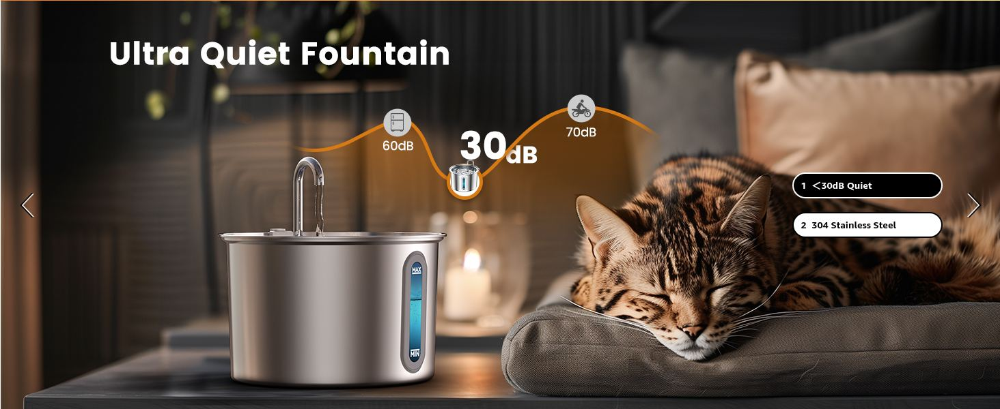

夜间客厅：产品在左，曲线在中，猫在右边睡觉。学夜景、睡猫在产品后方、大数字。不学 60/70 dB 参照值。

#### #3 `B0BN2Z5CDC/03_easy_clean_fullbleed.jpg`

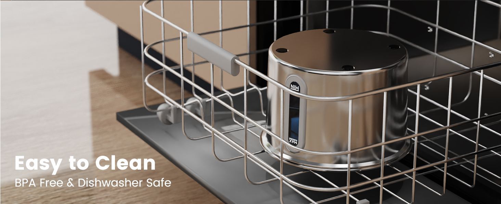

俯视洗碗机篮里的钢盆。学功能模块不放人宠。不学 Dishwasher Safe 和 BPA 声明。

#### #5 `B0BN2Z5CDC/05_faucet_design_carousel.jpg`

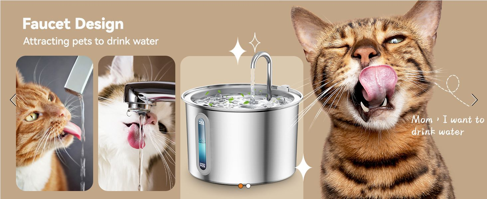

驼色底，圆角小图、中间产品和右侧吐舌大猫。学拟人表情和纯色底。不学手写体和星光。

#### #6 `B0BN2Z5CDC/06_water_level_carousel.jpg`

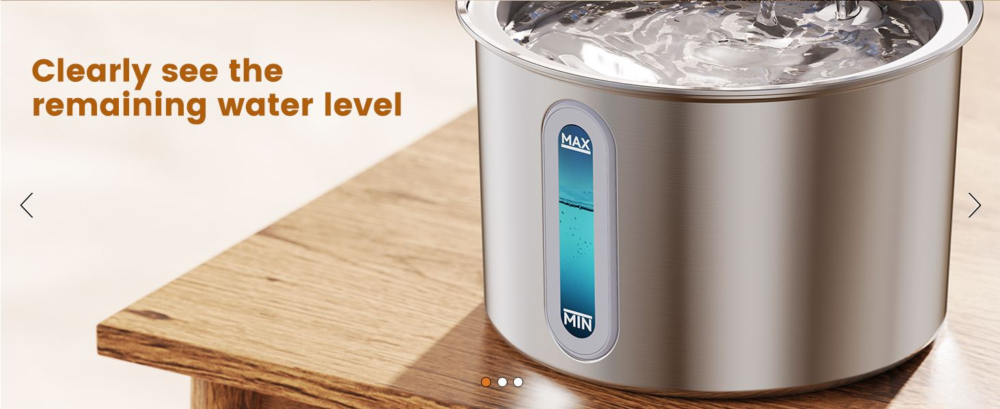

水位窗特写从右侧出血。学细节特写、无卡片、字直接排在安静的墙上。

#### #8 `B0BN2Z5CDC/08_filtration_carousel_textbox_CTA.jpg`

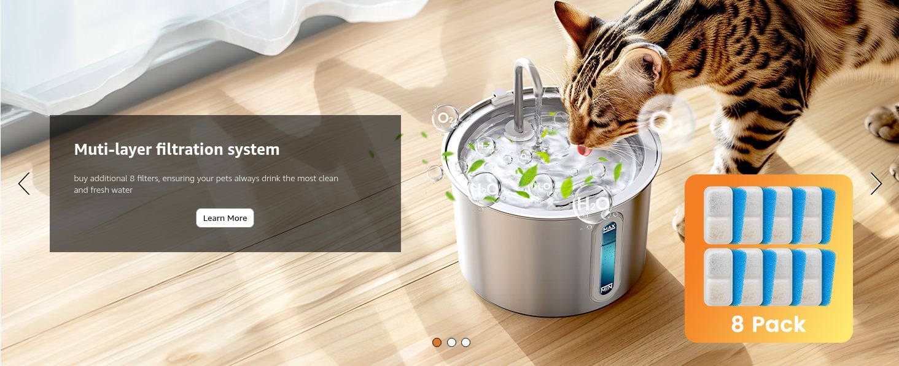

左深灰框、右橙卡。反例：大框加小字，以及净化气泡。

#### #10 `B0FN7FQ7RJ/01_premium_hero_video_plus_bento.jpg`

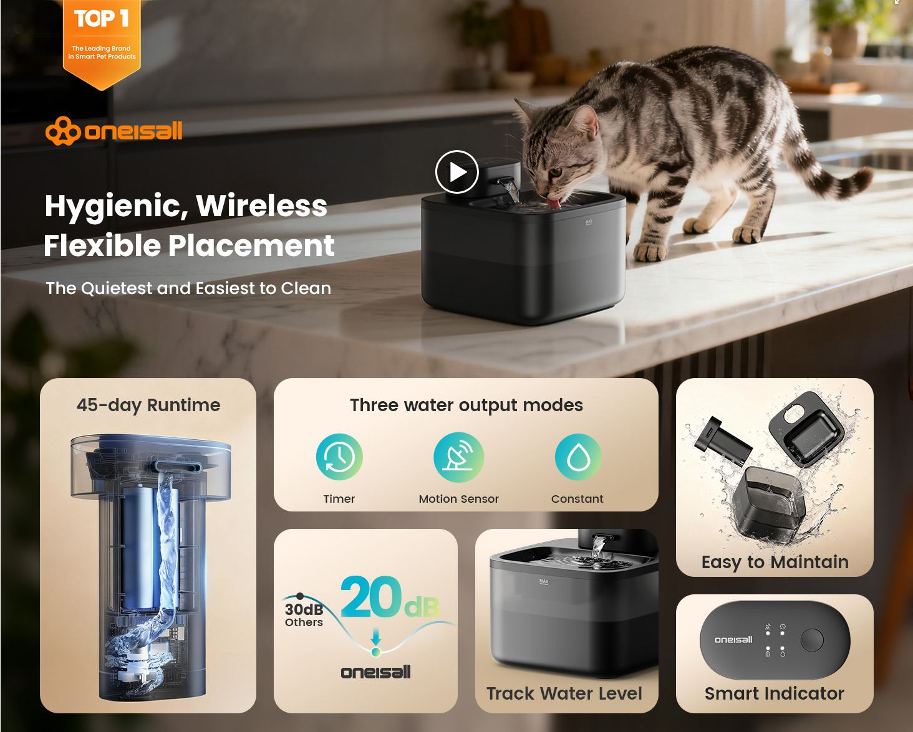

上半厨房场景，下半 6 格 bento。学同级三项并列。不学 TOP 1 和 Hygienic。

#### #11 `B0FN7FQ7RJ/02_scene_tab_carousel.jpg`

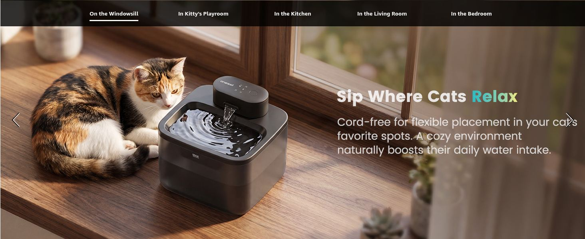

窗台上猫趴在产品旁。学字直接排在画面上，一个关键词用强调色。

#### #12 `B0FN7FQ7RJ/03_silentflow_pump_tech_hotspot.jpg`

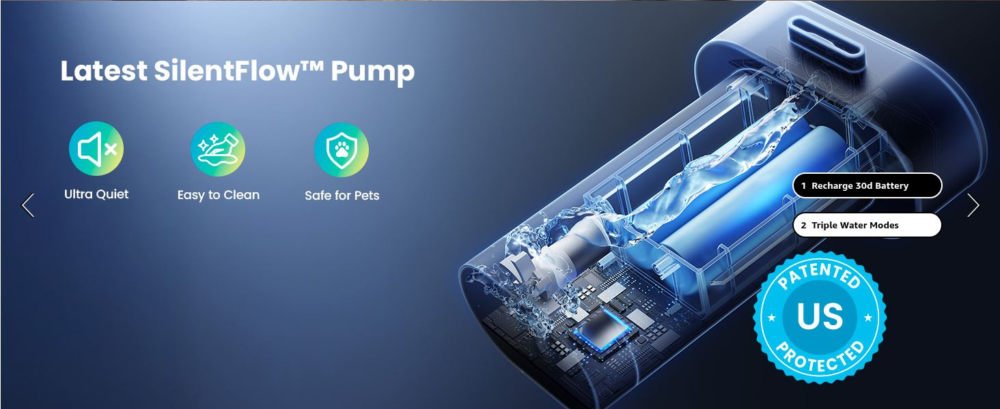

深蓝底透明泵剖视。学纯色暗底和剖视。不学商标、专利章，以及缺 Schematic 标注。

#### #13 `B0FN7FQ7RJ/04_quiet_20dB_tab_carousel.jpg`

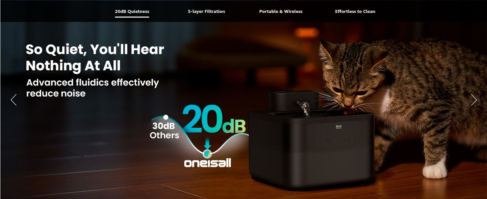

暗室，中间大数字，猫在右侧。学数字作为唯一主入口。

#### #14 `B0FN7FQ7RJ/05_filter_carousel_CTA.jpg`

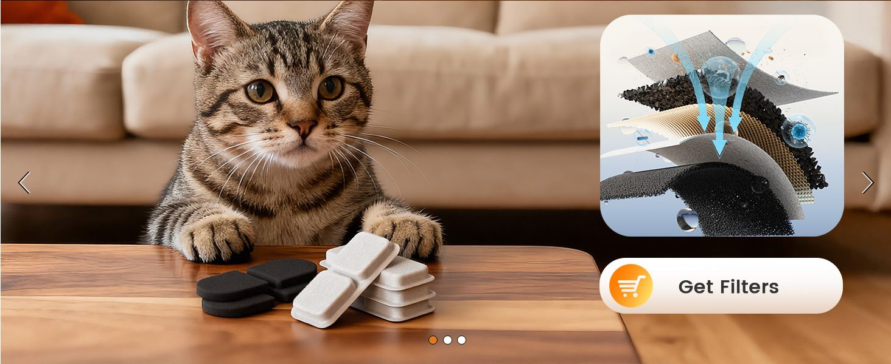

实物滤芯加右侧爆炸图卡。学滤芯要有实物或已标注的示意。不学无标题和 Get Filters 按钮。

#### #15 `B0FN7FQ7RJ/06_comparison_chart.jpg`

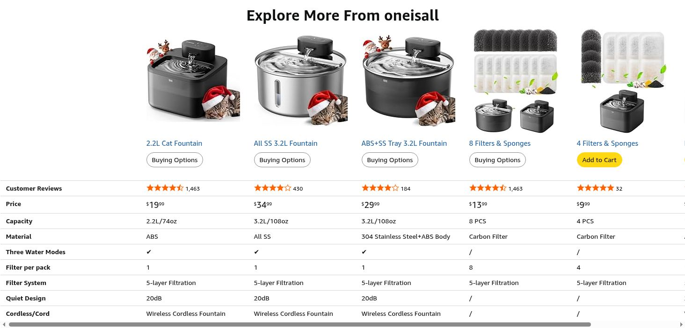

白底原生对比表。POKPET 只有一个 SKU 时不做。

#### #18 `B0C5X2G933/02_spacing_tab_carousel.jpg`

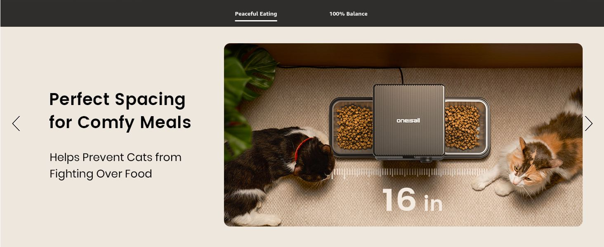

俯拍，地面嵌着距离数字。学距离用标尺，不用发光圈。

#### #19 `B0C5X2G933/03_capacity_tab_carousel.jpg`

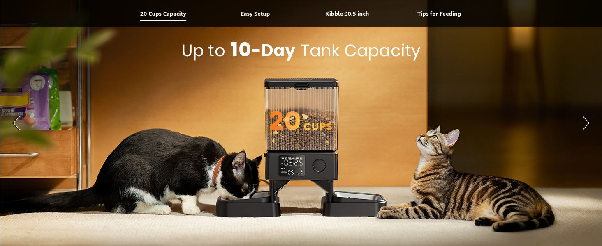

深色场景，数字印在料仓上。POKPET 容量待确认，不做。

#### #20 `B0C5X2G933/04_freshness_3card_tab_carousel.jpg`

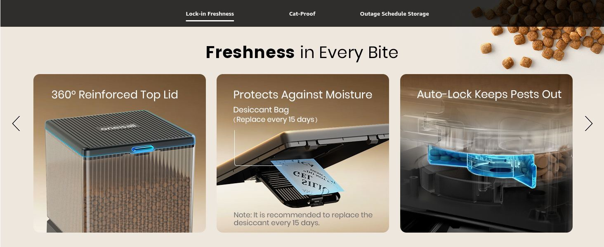

三张等宽圆角卡。学：三模式直接套用这个结构。

#### #26 `B0C5X4N132/03_spacing_16in_tab_carousel.jpg`

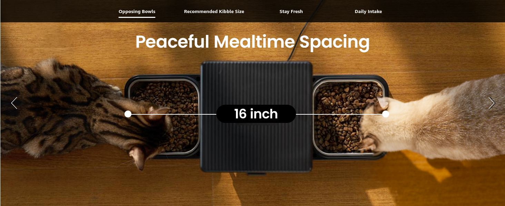

俯拍两点连线标尺。学标尺加数字，不画雷达。

### 1.2 副图（同样的卖点在副图里怎么拍）

| 源文件 | 画面 | 背景 | 人/宠 | 卖点的视觉方式 |
|---|---|---|---|---|
| `gallery/B0FN7FQ7RJ/03.jpg` | 3 个部件悬浮、散开，带水花 | 奶油棚拍 | 无 | 易拆洗用「部件爆炸悬浮」表现，俯视 |
| `gallery/B0FN7FQ7RJ/06.jpg` | 左右两个面板，中间 VS 圆 | 左暖右灰 | 无 | 对比用「同部位左右面板」表现 |
| `gallery/B0FN7FQ7RJ/07.jpg` | 猫从左边走向产品，下方 3 枚模式圆标，当前模式那枚更大 | 地板窗光，同心圆是后期加的 | 有猫 | 感应用「猫走近的动作」表现；模式用底栏 3 枚圆标 |
| `gallery/B0FN7FQ7RJ/08.jpg` | 深蓝 X 光泵 | 深蓝纯色 | 无 | 技术用剖视表现（专利章是反例） |
| `gallery/B0BN2Z5CDC/03.jpg` | 吐舌猫喝水，标题下面一条胶囊 | 木地板窗光 | 有猫 | 材质卖点用标题点名，靠场景带出 |
| `gallery/B0BN2Z5CDC/06.jpg` | 洗碗机里的钢部件 | 洗碗机内 | 无 | 易洗用清洁场景表现 |
| `gallery/B0BN2Z5CDC/08.jpg` | 透明机身，滤层叠片放在左上卡里 | 浅灰蓝 | 无 | 过滤用「透明剖视加分层标签」表现（Purifying 是反例） |

### 1.2 附图

下图与上表同一路径。

#### `gallery/B0FN7FQ7RJ/03.jpg`

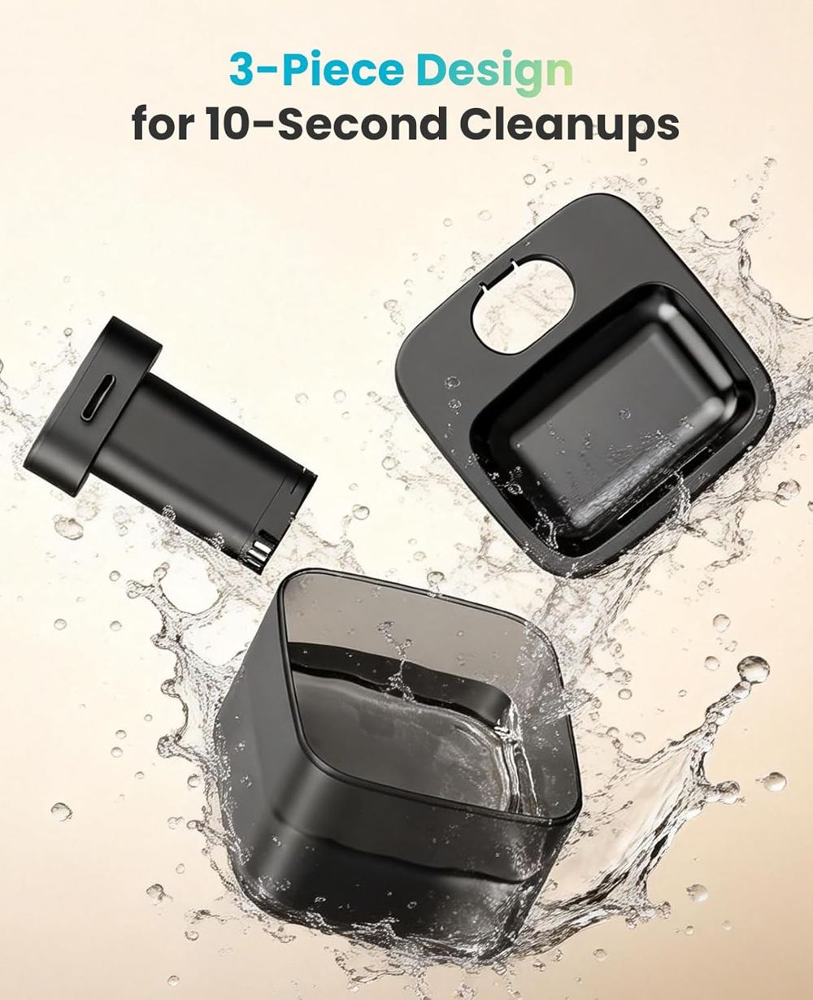

3 个部件悬浮散开。易拆洗用俯视爆炸表现。

#### `gallery/B0FN7FQ7RJ/06.jpg`

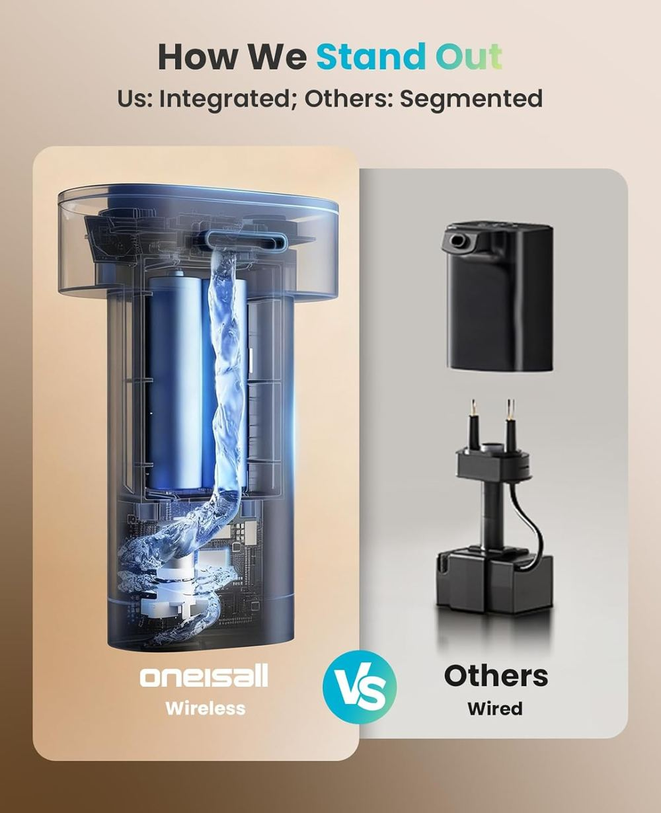

左右面板，中间 VS 圆。对比用同部位左右面板。

#### `gallery/B0FN7FQ7RJ/07.jpg`

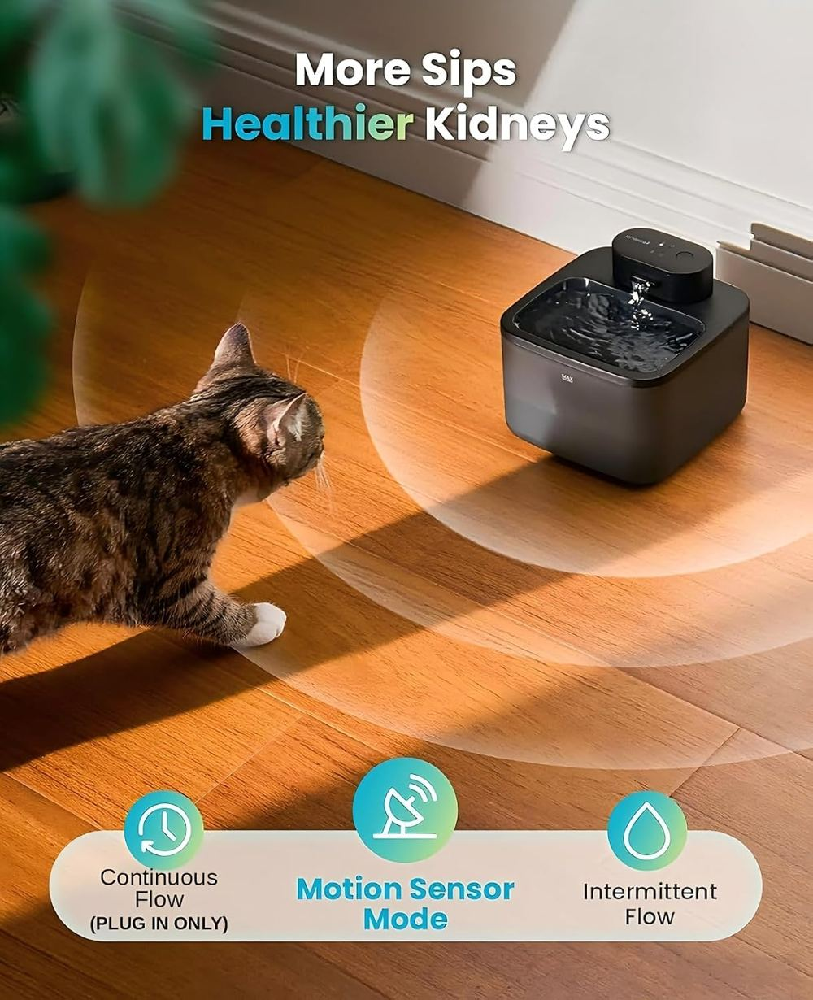

猫从左边走向产品，底栏 3 枚模式圆标，当前项更大。

#### `gallery/B0FN7FQ7RJ/08.jpg`

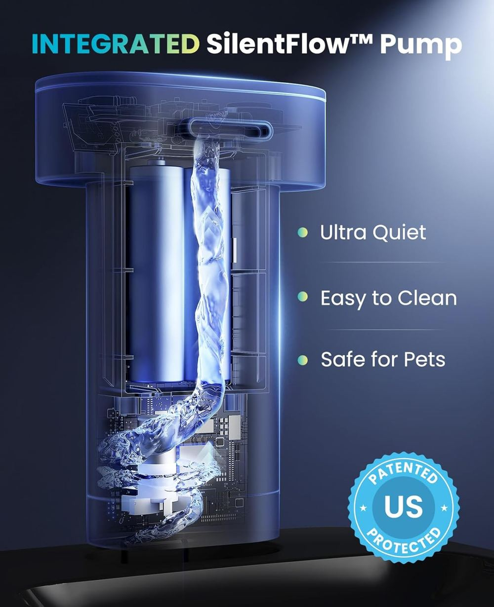

深蓝 X 光泵。技术用剖视。专利章是反例。

#### `gallery/B0BN2Z5CDC/03.jpg`

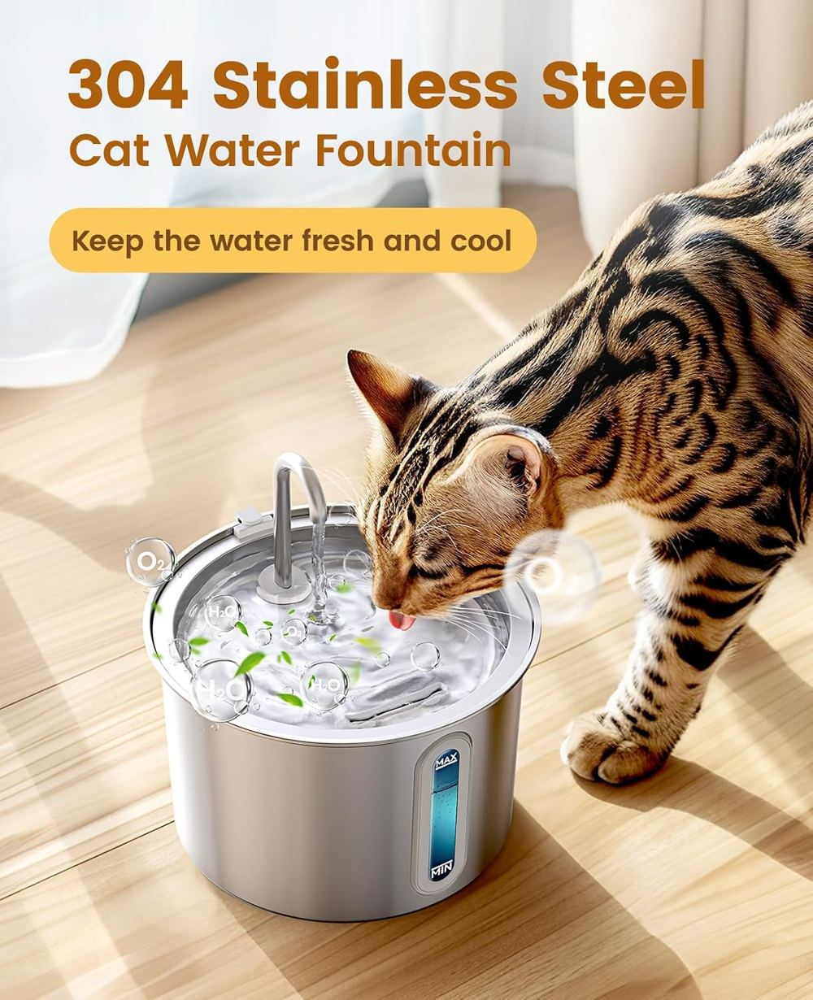

吐舌猫喝水，标题下一条胶囊。材质卖点用标题点名。

#### `gallery/B0BN2Z5CDC/06.jpg`

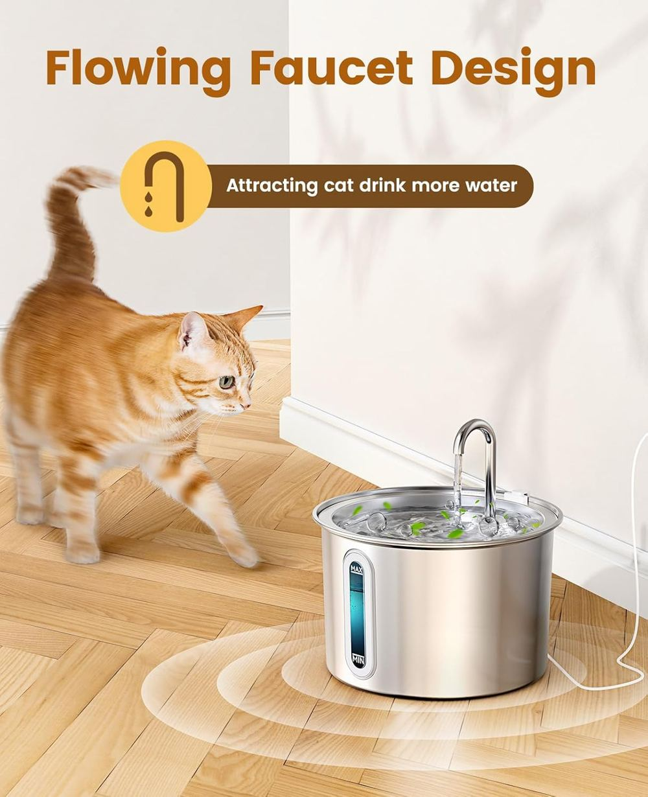

表中写的是洗碗机里的钢部件。图按该路径嵌入。

#### `gallery/B0BN2Z5CDC/08.jpg`

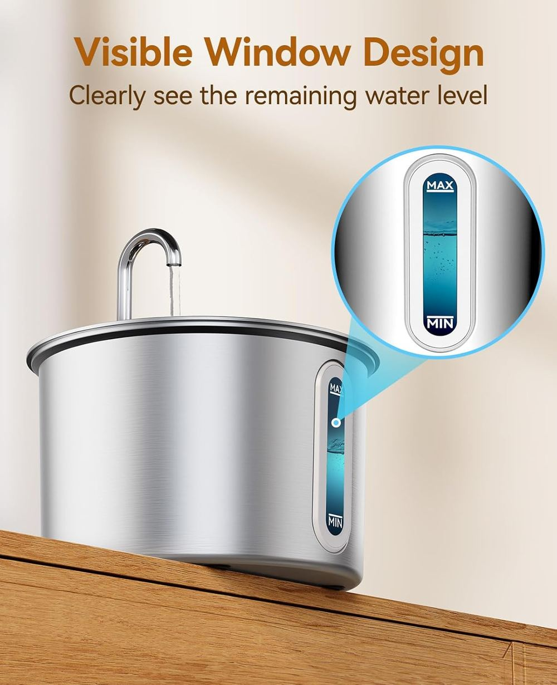

表中写的是透明机身和滤层。图按该路径嵌入。Purifying 是反例。

### 1.3 观察结论（v02 由此推出）

1. **人宠只出现在讲「使用时刻」的模块里**，即 Hero、摆放、饮水、安静。讲结构的模块全部只有产品：泵、清洁、滤芯、水位、对比。
2. **三模式在 oneisall 里用「三个同级项」表现**：bento 卡里的 3 个圆标（#10）、副图底栏 3 枚圆标（gallery 07）、三卡结构（#20）。v02 用三卡。
3. **距离用地面标尺加数字表现**（#18、#26），不用发光圈。感应的戏剧性来自猫的动作和表情（gallery 07）。
4. **oneisall 大多数模块不用卡片**（#2、#3、#6、#11、#12、#13）。卡片只出现在三卡、bento 和滤芯爆炸图里。字直接排在安静的墙面、暗部或纯色底上。#8 的大框加小字是反例。
5. **背景有轮换**：真实场景、纯色（驼色、深蓝）、暗室、棚拍。整页明暗交替。
6. **宠物表情明显拟人**：#5 的大舔舌、gallery 03 的吐舌、#2 的睡相。小红书参考里更夸张（见第 5 节）。

---

## 2. 呈现类型库（Presentation Types）

| 代码 | 类型 | 适合的卖点 | 背景 | 人/宠 | 典型版式 | oneisall 对应 |
|---|---|---|---|---|---|---|
| T1 | Lifestyle Scene 生活场景 | 开场、使用时刻 | 真实家居，单一窗光 | 可以有人加宠 | 字在安静墙面，图标标签一行 | #10 上半、#11、#17 |
| T2 | Solid Backdrop Product Hero 纯色底产品英雄 | 安静、外观、清洁 | 纯色或渐变（暗或亮） | 无 | 左文右物或右文左物 | #12、gallery 03 |
| T3 | 3-Card Split 三卡 | 同一主题下的三个同级子项（三模式） | 纯奶油底 | 无 | 居中标题加 3 张等宽卡 | #20、#10 bento |
| T4 | Cutaway / Exploded Schematic 剖视示意 | 滤芯、水路 | 亮色或暗色纯底 | 无 | 示意图居中或偏右，标签用引线 | #12、gallery 08 |
| T5 | Big Number + Reference 大数字加参照 | 1 m、<25 dB、1–2 weeks | 场景或纯色都可以 | 视卖点而定 | 数字 110–160 px，是唯一主入口 | #2、#13、#18 |
| T6 | Step Sequence 步骤 | 拆洗 | 纯色 | 无 | 2–3 个编号步骤，每步一个图标加短标签 | gallery 03 |
| T7 | Material Macro 材质微距 | 304 不锈钢 | 浅灰纯底，侧逆光 | 无 | 大字加微距 | #6 的拉丝表现 |
| T8 | Detail Callouts 细节引线标注 | 水位窗、低水断电、防干烧 | 干净墙面或纯色 | 可选 1 只宠物 | 引线指向部位，标签直接排，不加底卡 | #6 |
| T9 | At-a-glance Spec Grid 规格速览 | 汇总（可选第 9 个模块） | 纯色 | 无 | 2×3 或 3×2 网格 | #10 bento、#15 |

---

## 3. 卖点到模块的映射（8 个模块）

| 模块 | 卖点（已确认事实） | 类型 | 背景 | 机位（唯一） | 人 | 宠物与表情 | 卡片 | 版式 | 对应 oneisall |
|---|---|---|---|---|---|---|---|---|---|
| **M01 开场** | 品牌加 3 个卖点：304、1 m、<25 dB | T1 | 真实北欧客厅，左侧窗光，浅橡木地板 | **贴地低机位，前右 3/4**，相机高约 25 cm | **有**：一位欧美年轻女性，盘腿坐在后景大笑，视线在猫身上 | 橘猫，**吐舌陶醉饮水**（眯眼，舌头接水流） | 无 | 左上标题加一行 3 枚图标标签，直接排在墙上 | #10 上半、#17；XHS_003、XHS_008 |
| **M02 1 m 感应** | 1 m 感应；宠物离开后约 10–15 s 停水 | T5 + 场景 | 干净浅灰墙加浅木地板，极简 | **地面正侧面（profile）**，镜头与地面平行 | 无 | 奶牛猫走向产品，**瞪圆眼的惊讶**（一只前爪抬起，像在说「它自己出水了？」） | 无 | 大数字 `1 m` 在左上；地面上画 1 m 标尺；产品旁加 2–3 条示意弧线并标 Schematic | #18、#26、gallery 07；XHS_004 |
| **M03 三种模式** | SENSOR（1 m）、NORMAL（常流）、TIMER（15 分钟一档） | **T3 三卡** | 纯奶油底 `#F1EAE0` | 每张卡机位不同：卡 1 **前右 3/4，俯 25°**；卡 2 **出水口俯视 90° 近景**；卡 3 **控台正面近景，俯 60°** | 无 | 无 | **有（第 1 个卡片模块）** | 标题居中，下面 3 张等宽圆角卡，卡内左上是卡片标题，下面一行说明 | #20、#10 bento |
| **M04 安静** | 低于 25 dB | T2 + T5 | 深海军蓝到炭灰的纯色渐变，一盏暖色侧光 | **低于盖沿的仰角，前左 3/4** | 无 | 无 | 无 | 左侧大数字 `<25 dB`，白色标题直接排在暗部 | #12 的暗底、#13 的大数字 |
| **M05 滤芯** | 滤芯 1–2 周更换一次 | **T4 剖视** + T5 | 浅灰蓝纯色渐变 | **正交侧剖面（orthographic）**，由 PIL 矢量绘制，不生成图片 | 无 | 无 | 无 | 中右是剖视线稿，引线标注 Tray / Filter / Pump，左边大数字 `1–2 weeks`，右上角标 `Schematic` | #12、gallery B0BN2Z5CDC/08 |
| **M06 易拆洗** | 托盘和水泵都可拆 | T6 + 悬浮爆炸 | 纯鼠尾草绿 `#DCE3D6` | **高位前左 3/4，俯约 45°**，托盘悬浮在机身上方 | 无 | 无 | 无 | 左侧 3 个编号步骤（图标加短标签），直接排在纯色底上 | gallery B0FN7FQ7RJ/03 |
| **M07 304 不锈钢** | 304 不锈钢机身 | **T7 微距** | 浅暖灰纯底 `#ECE8E2` | **盖沿高度沿侧面看过去的转角微距**，景深很浅 | 无 | 无 | 无 | 左侧巨型 `304`（橙色）加两行标题 | #6 的拉丝质感 |
| **M08 水位与保护** | 水位窗；低水位自动断电；水泵防干烧 | **T8 引线标注** | 暖白墙加浅木地板 | **正面平视，相机高度对准四叶窗**，近景 | 无 | 英短蓝猫从右边探头，**歪头好奇**（铜色圆眼盯着窗，一只耳朵微微后折，像在问「还剩多少？」） | 无 | 3 条引线：窗→Water-level window，底部→Low-water auto power-off，控台→Pump dry-run protection | #6；XHS_004 的抬眼 |
| *M09（可选）* | 规格速览 | T9 | 纯奶油底 | 无照片，或用 M03 卡 1 的抠图 | 无 | 无 | **有（第 2 个卡片模块）** | 2×3 网格，只放已确认的项目 | #10 bento |

### 整页预览（v02 案例）

八个模块的整页预览。各模块源文件为放大后的 1464×600；图像模型原生约 1280×720。此 JPG 为约 1200 px 宽的网页预览。

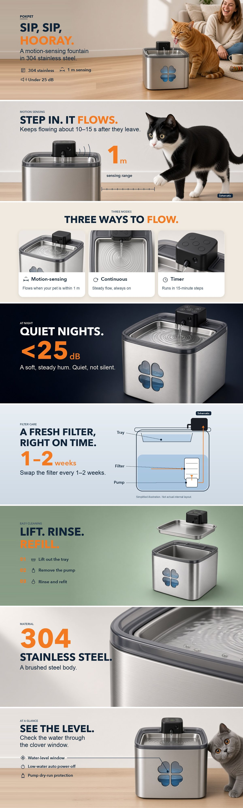

### 各模块示例（v02 案例）

#### M01

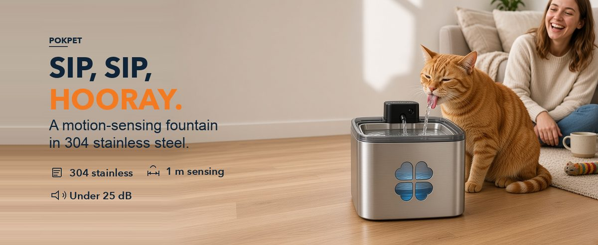

开场。v02 案例。图像模型原生约 1280×720，1464×600 为放大裁切；此 JPG 为约 1200 px 宽的网页预览。

#### M02

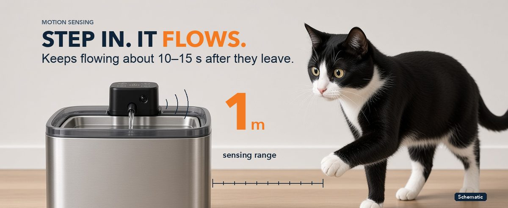

1 m 感应。v02 案例。原生约 1280×720，1464×600 为放大裁切；此 JPG 为约 1200 px 宽的网页预览。

#### M03

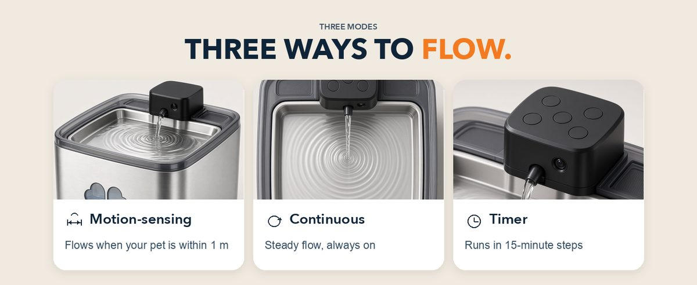

三种模式。v02 案例。原生约 1280×720，1464×600 为放大裁切；此 JPG 为约 1200 px 宽的网页预览。

#### M04

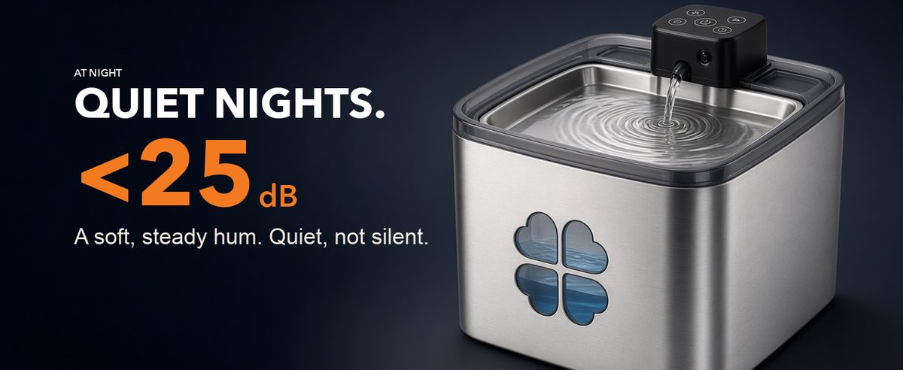

安静。v02 案例。原生约 1280×720，1464×600 为放大裁切；此 JPG 为约 1200 px 宽的网页预览。

#### M05

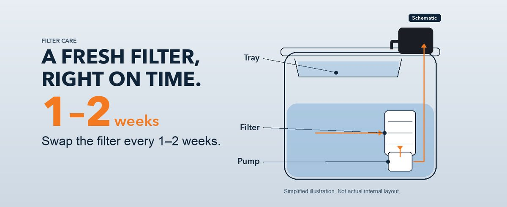

滤芯。v02 案例。原生约 1280×720，1464×600 为放大裁切；此 JPG 为约 1200 px 宽的网页预览。

#### M06

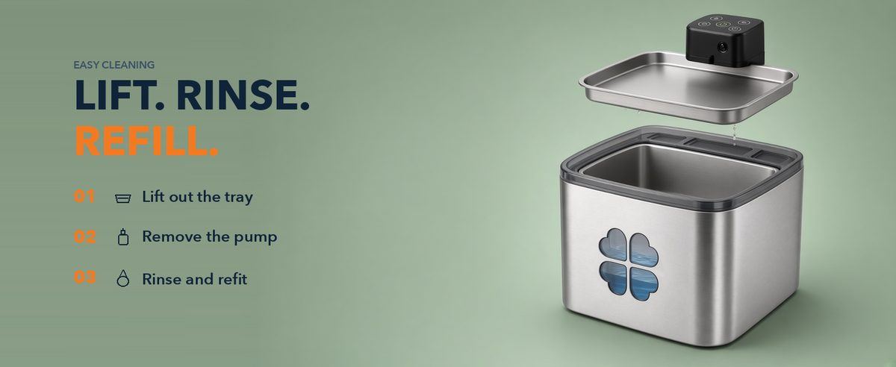

易拆洗。v02 案例。原生约 1280×720，1464×600 为放大裁切；此 JPG 为约 1200 px 宽的网页预览。

#### M07

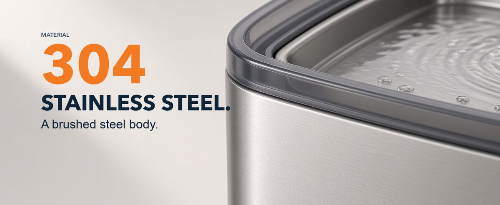

304 不锈钢。v02 案例。原生约 1280×720，1464×600 为放大裁切；此 JPG 为约 1200 px 宽的网页预览。

#### M08

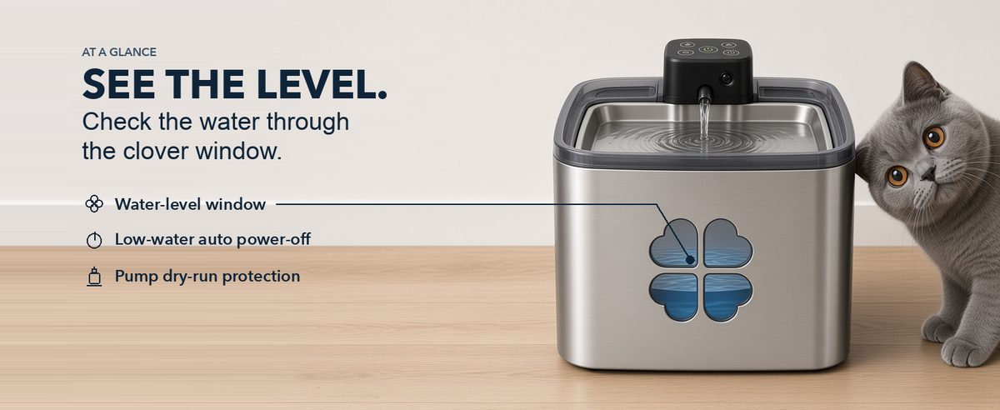

水位与保护。v02 案例。原生约 1280×720，1464×600 为放大裁切；此 JPG 为约 1200 px 宽的网页预览。

**整页配比**
- 有宠物的模块 3 个：M01、M02、M08。其中只有 M01 有人。
- 纯色或干净背景、只拍产品的模块 5 个：M03、M04、M05、M06、M07。
- 卡片模块：M03，加可选的 M09。

**明暗节奏**：M01 暖亮 → M02 冷亮 → M03 奶油 → M04 **暗** → M05 灰蓝 → M06 鼠尾草绿 → M07 浅灰 → M08 暖白。相邻两个模块的背景色系不重复。

**M03 的模式名**：沿用 aplus_v03 的 SENSOR / NORMAL / TIMER。按键上的真实名称、NORMAL 的措辞和 TIMER 的具体行为**仍待用户确认**。确认之前，卡片说明只写已确认的事实：`Within 1 m`、`Always-on flow`、`15-min steps`。

---

## 4. 机位不重复清单

| 模块 | 机位 | 俯仰 | 方位 | 距离 |
|---|---|---|---|---|
| M01 | 贴地低机位 | 约 0°（25 cm 高） | 前右 3/4 | 中景，人在后景 |
| M02 | 地面正侧面 | 0°，与地面平行 | 90° 侧面 | 全景横向 |
| M03-卡1 | 棚拍 3/4 | 俯 25° | 前右 | 产品全身 |
| M03-卡2 | 俯视 | 俯 90° | 正上方 | 出水口近景 |
| M03-卡3 | 控台近景 | 俯 60° | 正前 | 特写 |
| M04 | 仰拍 | 仰约 5°，镜头低于盖沿 | 前左 3/4 | 产品全身 |
| M05 | 正交剖面（矢量线稿） | 无透视 | 正侧 | 示意 |
| M06 | 高位 | 俯 45° | 前左 3/4 | 全身加悬浮托盘 |
| M07 | 沿侧面看的转角微距 | 0°（盖沿高度） | 前右转角 | 微距 |
| M08 | 正面平视 | 0°（窗口高度） | 正前 | 近景 |

规则：同一个「俯仰加方位加距离」组合整页只出现一次。前右 3/4 出现在 M01、M03-卡1，但俯仰和距离不同；前左 3/4 出现在 M04、M06，一个仰拍、一个高俯。

---

## 5. 宠物表情要求

参考：`research/references/xiaohongshu/`（XHS_001–008 及笔记），重点是 XHS_002 NAP MODE、XHS_003 SIP BREAK、XHS_004 CAUGHT SNIFFING、XHS_007 吐舌、XHS_008 人宠互动。

1. **每个宠物模块只指定一种拟人表情**，写进 prompt，并在交付报告里列出。可选的表情：
   - 吐舌陶醉：眯眼，舌头伸出接水。
   - 瞪圆眼惊讶：被撞见、愣住，前爪抬起。
   - 慢眨眼得意：半闭眼，嘴角像在上扬。
   - 心虚侧眼：头不动，眼睛斜向镜头。
   - 歪头好奇：头明显侧倾，眼睛盯住一个点。
   - 安睡打呼：嘴微张，身体完全放松。
2. **表情必须和功能一致。** 惊讶配感应（M02），陶醉配饮水（M01），好奇配水位窗（M08）。「被撞见」不能用在安静或饮水的模块（XHS_004 笔记）。
3. **戏剧感来自五官和姿态，不来自变形。** 头身比例、眼睛位置、牙和舌的解剖结构都要真实。不画卡通大眼，不画人类嘴型，不加拟人道具。
4. **毛发要真实**：能看到一缕一缕的毛和自然的毛流方向，胡须清楚，不糊成一团塑料感的「AI 毛」。prompt 里写明 natural realistic fur with individual strands, correct anatomy。
5. **宠物不抢产品。** 产品始终清晰对焦，四叶窗、出水口和控台不被宠物挡住。
6. 本页指定：M01 橘猫吐舌陶醉；M02 奶牛猫瞪圆眼惊讶；M08 英短蓝猫歪头好奇。三只猫的品种和毛色不重复。

---

## 6. 模特规则

- 只用**欧美（European / American）面孔**的模特，**绝不使用亚洲面孔**。prompt 里写明 European / Caucasian、发色和肤色。
- v02 只有 M01 出现人。人在后景或侧景，表情是真实的大笑或微笑，视线在宠物身上，不看镜头摆拍。
- 手部出镜（例如之后补拍的换滤芯图）同样按欧美肤色写 prompt。
- 每张出图后都要人工检查人物的族裔，不符合就重做，不靠后期修。

---

## 7. 文字排版层级（1464×600 设计尺寸；2928 上全部 ×2，并在 2928 上原生排字）

字体沿用 v01：Avenir Next Bold 700（标题、数字、字标），Avenir Next Demi Bold 600（标签、卡片标题、单位），Arial Regular 400（副句）。

| 角色 | English | 字体 | 1464 px | 颜色 | 规则 |
|---|---|---|---:|---|---|
| 字标 | Wordmark | Bold | 18–20 | Ink `#0F2438` 或白 | 只在 M01 使用 |
| 眉题 | Eyebrow | Demi | 16–18 | Ink 60% 或白 70% | 可选，最多 3 个词 |
| 主标题 | Headline | Bold | **64–72**（不低于 52） | Ink；暗底用白 | 最多 2 行，每行不超过 4 个词，只有一个词可以用 Amber |
| 副句 | Subline | Arial | **36–40**（不低于 36） | Ink 85% 或白 85% | 1 行优先，最多 2 行 |
| 英雄数字 | Hero number | Bold | **110–160** | Amber `#F47A21` | 每个模块最多 1 个，必须是这个模块唯一的主入口 |
| 单位 | Unit | Demi | 36–44 | Amber 或 Ink | 紧贴数字 |
| 图标标签 | Icon + label | 图标线宽 2 px，视觉框 36–40；标签用 Demi | 标签 **24–28** | Ink 或白 | 每个卖点都是「图标加 2–5 个词」，不写纯文字罗列；直接排在画面上时标签不低于 24（v01 是 18–20，而且必须有底卡，v02 改了） |
| 卡片标题 | Card title | Demi | 26–30 | Ink | 只在卡片模块使用 |
| 卡片说明 | Card line | Arial | 22–24 | Ink muted `#3A5166` | 只能出现在卡片里 |
| 引线标签 | Callout label | Demi | 24–26 | Ink | 引线 2 px，端点是直径 8 px 的圆点 |
| 示意标注 | Schematic tag | Demi | 14–16 | 白字，深色小条 | 只写 `Schematic` 或 `Illustration` |

重量顺序：英雄数字 > 主标题 > 副句 > 图标标签、卡片标题 > 眉题、字标。

位置：标题字顶约 100–115 px，左边距 120 px（AGENTS §10.2）；居中版式（M03）按画面中线对齐。文字区约占 35%–44% 宽度。字不能压在宠物的头、出水口、四叶窗或人手上。

强调色：Amber 只给英雄数字或一个关键词，面积约占画面 3%–8%。钢面、水面和皮肤不染橙色。

---

## 8. 卡片规则（v02 新规）

1. **默认不用卡片。** 文字直接排在画面安静的区域上：干净墙面、暗部、纯色底。
2. **整页最多 2 个模块用卡片。** v02 只有 M03 三模式，以及可选的 M09 规格速览。
3. **只有两种情况允许用卡片：**
   - 卡片本身就是信息结构，也就是同级的多项并列，例如三模式、规格网格。
   - 文字背后的画面太乱，换位置、换构图或压暗都解决不了可读性。这时只允许一块**局部的小底**，紧贴文字，内边距 12–16 px，不做大面积的奶油板。先改构图，这一条是最后的办法。
4. 卡片的样式：圆角 24–28 px，用白色或奶油 `#F1EAE0`。叠在照片上时不透明度 0.90；在纯色底上用 100% 不透明。只用极淡的投影，内边距 20–24 px，卡与卡之间间隔 16–20 px。
5. 不用卡片时保证可读性的办法：拍摄时就在 prompt 里留出安静区域；局部加很轻的明度渐变（不超过 15%，不能看出色块）；暗底用白字，亮底用 Ink。
6. 禁止：用大块奶油板盖住半张图；一张图里放多张小卡；像 oneisall #8 那样用深灰半透明框。

---

## 9. 各类型的版式模板

| 类型 | 网格 | 文字区 | 主视觉 | 图标与标签 |
|---|---|---|---|---|
| T1 场景 | 左 40% 文字，右 60% 场景出血 | 左上 | 宠物、产品和人在右侧 | 标题下面一行 3 组图标标签，组间距 28 px |
| T2 纯色产品英雄 | 左 45% 文字，右 55% 产品 | 左中 | 产品占画面高的 70%–80% | 0–2 组 |
| T3 三卡 | 标题居中，位于上方 120 px 内；3 张卡各宽约 400，高约 380，间隔 20，左右留白 112 | 居中 | 每张卡上半是产品图，下半是文字 | 卡内左上是图标加卡片标题 |
| T4 剖视 | 左 38% 文字，右 62% 示意图 | 左中 | 线稿居中偏右 | 引线标签 2–3 条，右上角放 Schematic |
| T5 大数字 | 数字和标题成一组，放在左栏 | 左 | 由场景或产品承托 | 数字下面 1 行副句 |
| T6 步骤 | 左 42% 步骤列，右 58% 产品 | 左 | 悬浮的部件 | 编号 01/02/03 用 Amber，后面是图标加标签，行距 64 px |
| T7 微距 | 左 40% 文字 | 左 | 微距质感占满右侧 | 0–1 组 |
| T8 引线 | 文字在左上，引线分布在产品周围 | 左上 | 正面近景 | 3 条引线，标签直接排，不加底卡 |
| T9 规格网格 | 2×3 卡片 | 标题居中 | 无 | 每格一个图标、一个数值或名称、一行说明 |

---

## 10. 硬性规则（不变，以 AGENTS.md 为准）

1. **产品保真**：以 `chatgpt_aplus/upload/product_reference.png` 为准，包括方形拉丝不锈钢机身、圆角、烟灰半透明盖沿、内置不锈钢托盘、后部黑色控台（按键加感应镜头）、细出水口、正面四心形的四叶草水位窗。不改比例，不加部件。不能确认的内部结构（滤芯形状、泵的外形）不画进真实产品里，只用标注为 Schematic 的示意图表现（AGENTS §5.1、§13.5）。
2. **只写已确认的事实**：1 m 感应；约 10–15 s 延时停水；TIMER 15 分钟一档；低于 25 dB；滤芯 1–2 周更换；304 不锈钢；托盘和水泵可拆；低水位自动断电；水泵防干烧；品牌 POKPET。
3. **禁止**：加热；容量数字（待确认）；重量；健康、化学、净化、杀菌类用语；徽章、TOP 1、专利、销量；竞品商标或竞品外形；站外联系方式（AGENTS §15、APLUS §10）。
4. **感应只用后期绘制的示意弧线**，并标 Schematic。不画 Wi-Fi 符号，不画发光锥或雷达。产品永远不发光，按键灯也不亮。
5. **文字和图标全部用 PIL 后期排版**，图像模型只出无字的底图。prompt 里写明 no text, no letters, no logos, no badges。
6. **尺寸如实标注**：图像模型原生输出 1280×720（1:1 时约 1024×1024）。1464×600 是放大后裁切的成品，2928×1200 是放大后的工作画布，**都不能称为原生 2× 母版**。如果文件低于目标尺寸，按 `BELOW_TARGET_DELIVER_NATIVE` 记录（AGENTS §0.3–0.5、§13.4）。
7. **逐张自检**：文字有没有乱码、产品是否保真、人物族裔、宠物表情、有没有违规声明，最后看整页节奏。

---

## 11. 待用户确认的事项

1. 本标准的 8 模块映射，以及是否加可选的 M09 规格网格。
2. 三模式的按键真实名称、NORMAL 的措辞、TIMER 的具体行为。
3. 能否提供滤芯和水泵的实物照片。有照片，M05 和 M06 可以从示意图升级为实物图；没有照片，就维持示意图。
4. M01 里出现人是否合适；也可以改成只有宠物。
5. 三只猫的品种和表情是否认可。

确认之后再出图。已有的 v01 底图中，M01 和 M02 的构图可以参考，但需要按第 5 节换成拟人表情，所以要重新生成。
