# POKPET Uta Style 视觉标准（v3 · 唯一有效版）

> **状态：现行唯一标准。** 本文件取代此前所有 Uta / Yota Style 文档，包括 v01、v02（235 行纯文字稿和带图版），以及更早的风格草稿。以后出图只按本文件执行，不再参考旧版。
> 合规、尺寸、母版、产品保真和 QA 门槛仍以仓库 `AGENTS.md` 为准。本文件与 `AGENTS.md` 冲突时，以 `AGENTS.md` 为准。
> 编写日期：2026-11-15（Asia/Shanghai）。案例图片全部为第三方参考，只供内部学习。不复制画面、文案、商标或品牌元素。

---

## 0. 一页速览：10 条核心规则

1. **按卖点选画法。** 不是每张图都需要人、宠物、场景和情绪。每个卖点先查第 4 节“卖点 → 视觉画法库”，再决定用生活场景、纯产品、剖面、对比、数据还是步骤图。
2. **一套图的配比。** 7 张主图里：纯产品或白底/浅色底 2–3 张（主图、尺寸、包装清单、结构），只出宠物的场景 2–3 张，人和宠物同框 1–2 张。A+ 同理，暗场科技模块 1–2 个。依据：oneisall 26 款详情页中，白底/纯底图约占 21–32%，暗场约占 7–13%（第 9 节）。
3. **同一套图不重复机位。** 每张图从第 5 节机位库里选不同的机位，相邻两张的景别和高度至少要变一项。
4. **卡片是例外。** 一套图最多 1–2 个模块用卡片：并列 3 种模式/3 个场景，或者背景太花、文字放不住时才用。其余文字直接排在画面留白处。
5. **色调唯一标准是小红书 29 张。** 白天侧窗自然光，通透，有光影。生活场景的亮度均值在 0.55–0.69，R−B（暖度）在 +0.07~+0.15（中位数 +0.12），饱和度在 0.22–0.30，亮度标准差在 0.22–0.28，阴影不压死（p5≥0.12），高光不爆（p95≤0.97）。oneisall 偏黄的暖调**不作为**要求，oneisall 只用来学 A+ 的排版、模块结构和文案呈现。用 `tools/grade_check.py` 自检。
6. **尺寸：主图 1:1（2000×2000），副图一律 4:5 竖长图（1600×2000），A+ 1464×600，详见第 5A 节。字体以第 6A 节为准（2026-11-15 更新）。** 标题用 Poppins Bold，在 1600 px 宽的画布上约 96–128 px；副标题用 Poppins Regular，约为标题的 0.4 倍；hero 数字是标题的 2–3.5 倍，用琥珀色 #F47A21；浅底正文颜色 #0F2438 或深棕 #3B2A20。原定的 Avenir Next 在本机没有安装，所以改用开源的 Poppins。
7. **宠物要有戏。** 每套图至少 2 张出现拟人化、夸张但可信的表情（舔嘴、眯眼、歪头、吐舌、偷看、翻肚、扑人等），毛发要真实、可辨认。
8. **人物只用欧美模特，不用亚洲面孔。** 人的情绪是放松、安心、亲昵，不摆拍。只演示操作时，只出手或腿。
9. **场景要像有人住。** 加毯子、书、绿植、咖啡杯、拖鞋等日常物件，用窗光，木地板或燕麦色；可以有点乱，但不能脏。猫砂盆不能出现排泄物。
10. **硬规则。** 产品必须忠实于实物；不写健康或化学功效；不虚构内部结构；文字后期排版，不让模型生成文字；如实标注原生尺寸和放大尺寸；不出现竞品商标。

> **A+ 主框架（2026-11-15，锦浩要求）。** 第 6E 节的叙事结构现在是 A+ 整页的主框架：一个场景从上到下，视线沿一条主线走。第 2 节的模块顺序从属于第 6E 节，不再按 oneisall 的模块堆叠来排整页。

> 生活场景图必须有明确的明暗对比：暗部 p5 ≤ 0.12、跨度 ≥ 0.80（§6F）。

> 机位是视觉冲击的关键：一套图至少 1 张俯角、2 张低视角；视觉突出靠机位、颜色对比、明暗色调三要素（§6G）。

> **最终执行方案 v06（§6H）。** 锦浩已确认 A 家长页面结构与四类划分。副图 S1–S9 轮换机位与场景；详情页 P1–P8 用整页底色加 1–2 屏反差，并以参数屏收尾。与第 6E 节冲突时以第 6H 节为准。

---

## 1. 案例样本与统计口径

### 1.1 采集结果（实际数量，没有虚构）

| 类别 | 品牌 | 来源 | 款数（不同 ASIN / 页面） | 已存图片 |
|---|---|---|---:|---|
| 宠物饮水器 | oneisall | Amazon US 详情页 | **13** | 主图 141 张，A+ 272 张 |
| 自动喂食器 | oneisall | Amazon US 详情页 | **13** | 主图 129 张，A+ 309 张 |
| 智能猫砂盆 | Neakasa | Amazon US 详情页 | **3** | 主图 28 张，A+ 142 张 |
| 智能猫砂盆 | PETLIBRO | Amazon US 详情页 | **2** | 主图 38 张，A+ 76 张 |
| 智能猫砂盆 | oneisall | oneisall.com 官网商品页（Amazon US 未找到主商品 ASIN） | **2**（Ease S1 / S1 Pro） | 官网图库 56 + 34 张；页面图各 116 张（大部分是全站通用图，含其他产品） |
| 小红书 | — | 用户提供的截图 | **29** | XHS_001–029（009–029 为 2026-11-15 追加的宠物用品案例） |

- 要求是各找 10 款，实际饮水器和喂食器各找到 13 款。其中有几款是同系列变体，A+ 重合度很高：B0H2MDWLM5 和 B0FJX69D2R 重合 94%，B0H6M9Y6X9 和 B0FN7FQ7RJ 重合 93%，B0FH691TR6 和 B0D5B6RLYY 重合 100%，B0DPMNQJ2N、B0DGQ82RXK、B0C89MMFW1 三款共用 A+。去掉这些变体后，饮水器有 **9 套**、喂食器有 **10 套**不同的 A+ 设计。主图组则每个 ASIN 都不同。
- B0DCFY8SB4（Neakasa M1 Plus）抓取时 Amazon 返回了德语主图组，A+ 是英文。
- PETLIBRO B0FKT2J6PV 的主图组里有 2 张是“COMING SOON”占位图。
- 参考图存放位置：`refs/<fountain|feeder>/<ASIN>/`、`refs/litterbox/<brand>/<ASIN 或型号>/`。文件名中 g = 主图组，a = A+；每个目录里的 `source.json` 记录来源 URL。
- 每个 ASIN 的整页缩略总览在 `uta_style_v3/assets/sheets/<ASIN>.jpg`。

### 1.2 品牌拼写确认
- 用户说的“Nikasa”是 **Neakasa**（Amazon 店铺名 “Visit the Neakasa Store”）。
- 用户说的“Petlibero”是 **PETLIBRO**（全大写）。
- oneisall 的品牌名用全小写 **oneisall**，猫砂盆系列叫 **Ease S1 / Ease S1 Pro**。

---

## 2. 整页结构与模块顺序

### 2.1 饮水器（主图 7 张 + A+ 8–10 个模块）

oneisall 饮水器的共同顺序：主图白底（产品带水流，旁边放耗材）→ 容量/天数 → 材质（304 不锈钢）→ 静音 → 易清洗（洗碗机）→ 过滤 → 水位/模式 → 尺寸参数 → 包装清单。A+ 的结尾都是品牌故事模块（销量、媒体、奖项、客服、达人）。

**POKPET 饮水器标准顺序**

| # | 位置 | 卖点 | 画法 | 场景/底色 | 是否有人/宠物 | 是否用卡片 |
|---|---|---|---|---|---|---|
| 1 | 主图 | 产品全貌 | 3/4 前侧 15° 俯视，水流可见 | 纯白 | 无 | 否 |
| 2 | 主图 | 核心差异（一米感应/304 不锈钢） | 关键数字加生活场景 | 暖色客厅 | 猫喝水 | 否 |
| 3 | 主图 | 静音 | 暗场夜景，猫睡觉，显示 dB 数字 | 暗场 | 宠物睡觉 | 否 |
| 4 | 主图 | 过滤/循环 | 分层爆炸图 | 浅暖色纯底 | 无 | 否 |
| 5 | 主图 | 3 种模式 | 3 张卡片并排 | 浅暖色底 | 小图里有猫 | **是（1/2）** |
| 6 | 主图 | 易清洗 | 手部操作或洗碗机俯拍 | 厨房 | 只出手 | 否 |
| 7 | 主图 | 尺寸 + 包装清单 | 正交视图加尺寸线 | 纯白/浅灰 | 无 | 否 |
| A1 | A+ | 品牌开场 | 宽幅生活场景，人和宠物同框 | 暖色客厅 | 人 + 宠物 | 否 |
| A2–A8 | A+ | 每个卖点一张，画法按第 4 节 | — | 生活场景 / 暗场 / 纯底交替 | 按第 4 节 | 最多再用 1 次 |

### 2.2 喂食器

oneisall 喂食器的共同顺序：主图（产品 + 手机 App 界面）→ 远程/App → 容量（巨型数字，如 20 Cups、32 Cups）→ 多猫分食（俯拍，标双碗间距 16–17 in）→ 防卡粮/出粮精准（转子爆炸图）→ 断电备份（暗场）→ 防偷吃锁 → 出行（拖行李箱的人）→ 推荐喂食量表 → 尺寸。

**POKPET 喂食器标准顺序：** 主图白底 → App 远程（人拿手机，背景虚化）→ 容量 hero number → 双猫俯拍间距 → 出粮机构剖面（暗场或浅底）→ 断电/电池（暗场夜间蓝）→ 出行/多日（生活场景 + 行李箱）→ 防偷吃/稳固（猫扒机身的动作）→ 喂食量表（唯一允许用表格卡片的模块）→ 尺寸/包装。

### 2.3 猫砂盆（三品牌综合，详见第 8 节）

**POKPET 猫砂盆标准顺序：** 主图白底（猫坐在舱内，旁边放 App 小图）→ 安全传感（剖面透视 + 猫正在进入）→ 开放大空间（顶视俯拍，标注尺寸）→ 集便仓容量 + 免清理天数（抽屉拉出特写，hero number 14 days）→ 密封/防臭（剖面标出密封条，不写化学功效）→ 静音（暗场夜景）→ App 记录（手机界面，人在生活场景里）→ 适配猫砂（颗粒宏观网格）→ 尺寸三视图 → 拆洗（手部操作）→ 包装清单。

---

## 3. 何时出现人和宠物

| 内容类型 | 人 | 宠物 | 背景 | 依据 |
|---|---|---|---|---|
| 主图、尺寸、包装清单、参数 | 否 | 否 | 纯白 / 浅灰 | 26 款 oneisall 第 1 张经目视确认全部是白底 |
| 结构、机构、过滤、剖面 | 否 | 否 | 浅暖色纯底或暗场 | F_filter_layers、D_rotor_explode |
| 静音、夜间 | 否 | 宠物睡觉 | 暗场 | F_quiet_heronum、L_oneisall_quiet |
| 喝水、进食、使用体验 | 否 | 是（有表情） | 暖色生活场景 | F_lifestyle_relax、XHS_003 |
| App、远程、出行 | 是 | 可选 | 生活场景，背景虚化 | D_human_phone、D_travel_human |
| 清洗、安装、拆卸 | 只出手 | 否 | 厨房 / 浅底 | F_clean_vs、L_petlibro_drawer |
| 品牌开场、情感收尾 | 是 | 是 | 暖色客厅 | A+ 第 1 屏和最后一屏 |

---

## 4. 卖点 → 视觉画法库（核心）

格式：**主推画法**（必须遵守）/ 可选画法 / 禁止的画法，后面附证据（ASIN·模块编号）和缩略图。字段说明：场景 = 生活场景还是纯产品；底 = 背景；机位；数字 = hero number；剖面；对比；步骤；图标行；宠物 = 宠物的动作和情绪。

### 4.1 静音 / dB
- **主推：** 暗场或夜景（亮度均值约 0.30），产品发出局部光，宠物在旁边熟睡或闭眼。dB 数字用琥珀色 hero number，可加一条声波曲线。机位为平视低位或 3/4 中景。
- **可选：** 和“图书馆 / 耳语”做 dB 刻度对比条。猫砂盆用 50dB 加猫在旁边睡觉。
- **禁止：** 用白底表现静音；画大面积声波特效；把多个宠物都摆出“醒着看镜头”。
- **证据：** fountain B0FJX69D2R a12「Feel the True Silence 20dB」暗场；B0FN7FQ7RJ g05、B0FJWV49LP g05「20dB」产品顶光暗场；B0DPMNQJ2N a03 曲线；B0GYZQ79CY a07「Silent for Sensitive Pets」暗场里猫躺平；B0C89MMFW1 g05 深蓝夜景；litter Neakasa B0DCFY8SB4 a46「Ultra-Quiet ≤50dB」猫在旁边睡；oneisall Ease S1 g16「Quiet Sweep. Peaceful Sleep. 45dB」暗室；Neakasa M9 用暗金戏剧光表现安全（同类手法）。

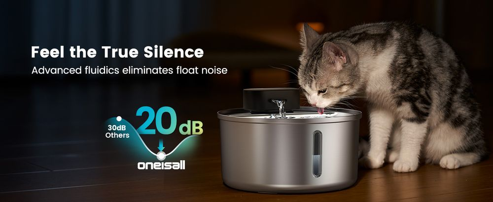 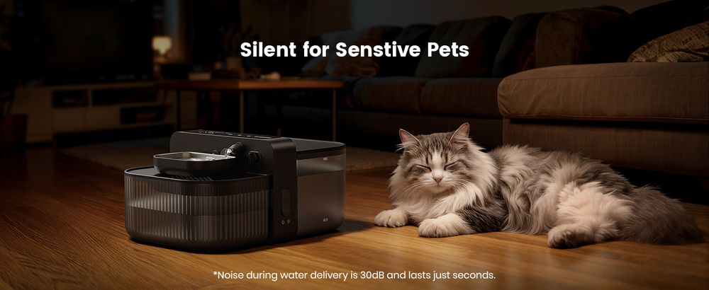  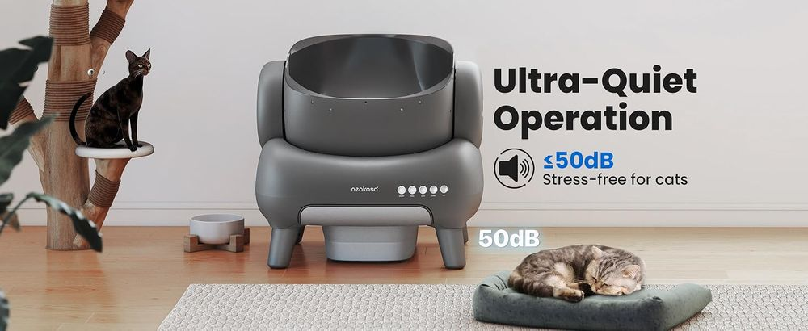 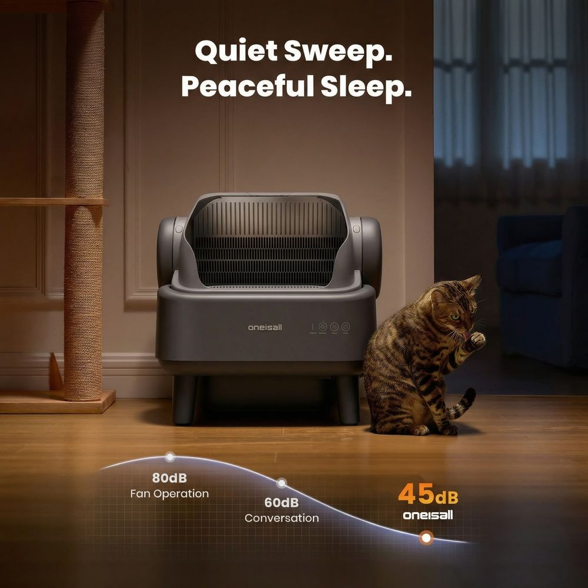
路径：`docs/uta_style_v3/assets/key/F_quiet_heronum_FJX69D2R.jpg`
路径：`docs/uta_style_v3/assets/key/F_silent_night_GYZQ79CY.jpg`
路径：`docs/uta_style_v3/assets/key/F_quiet_curve_DPMNQJ2N.jpg`
路径：`docs/uta_style_v3/assets/key/L_neakasa_quiet_DCFY8SB4.jpg`
路径：`docs/uta_style_v3/assets/key/L_oneisall_quiet_EaseS1.jpg`

### 4.2 容量 / 续航天数
- **主推：** 巨型数字（20 Cups、7L、7.17L、14 days）直接压在产品或画面上。产品取正面或顶视，配一句换算文字（“2 只猫可用 10 天”）。
- **可选：** 柱状图（容量 vs 天数，加宠物剪影）；体重/只数梯度；俯拍倾倒猫砂或粮食。
- **禁止：** 4 个以上数字堆在一起；数字由模型生成。
- **证据：** feeder B0C5X4N132 g06「20 Cups」压在透明粮桶上；B0GFDCYGFM g04「40% Bigger 32 Cups」；B0DZCHN51D g05「15 Days」；fountain B0D5B6RLYY g01「7L」大字 + a11 柱状图；B0DS2N3T3X a02 柱状图「60%」+ 狗剪影；B0BN2Z5CDC g02 用 3 个小卡片列「5 / 10 / 15 lbs → 天数」；litter Neakasa g05「7.17L」俯拍倾倒猫砂、a43「7–14 Days 11.2L」抽屉拉出；PETLIBRO B0GTM9P94B g09「2.9-gallon / 14 days」；oneisall Ease S1 g11「14 Days 11L」。

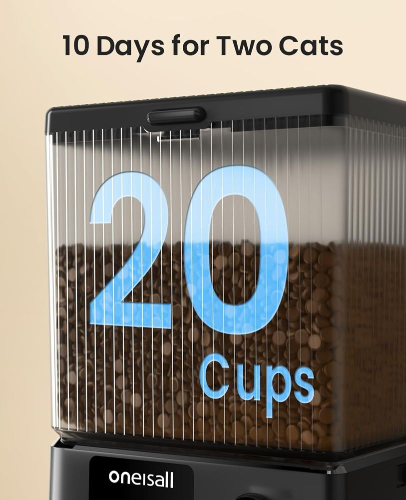   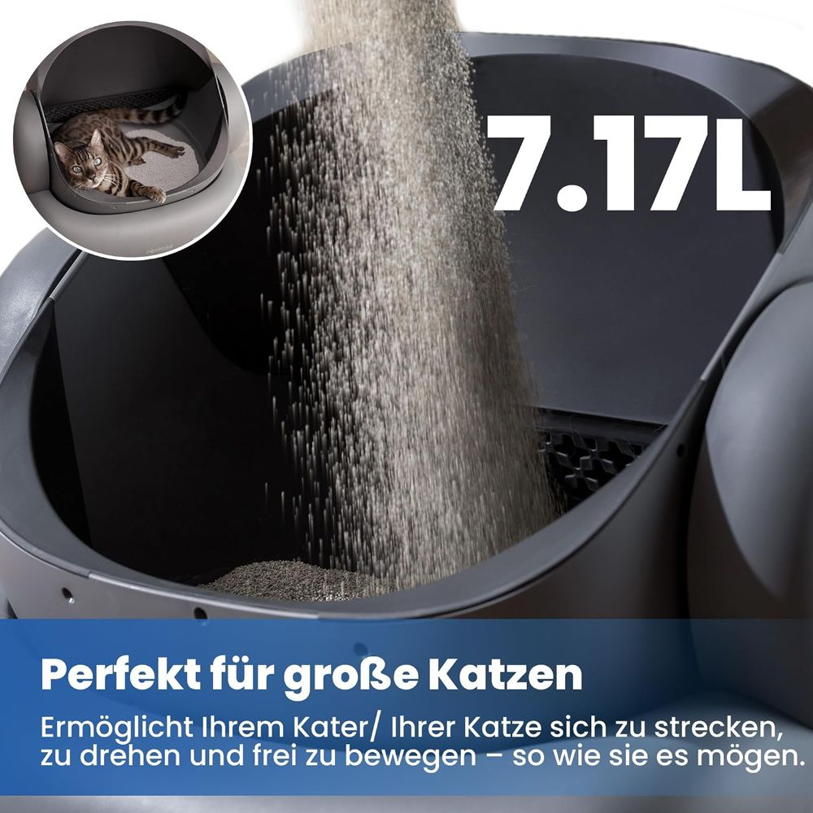 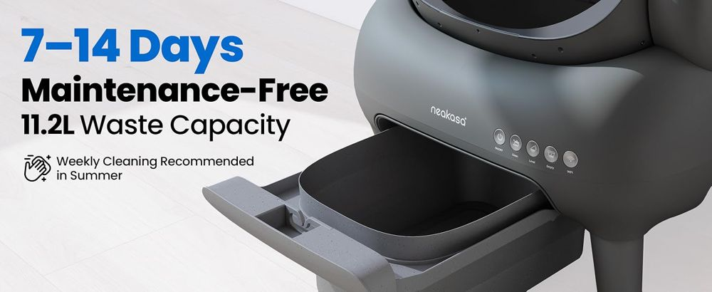 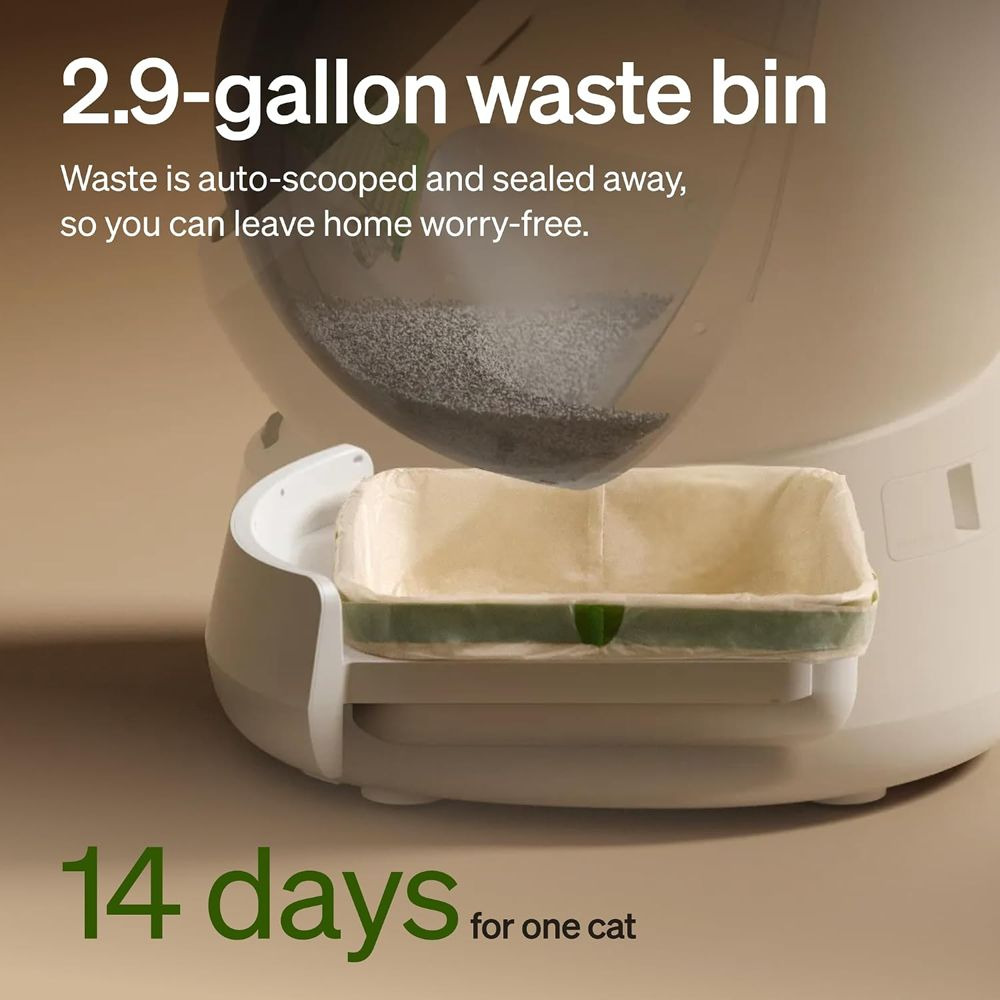 
路径：`docs/uta_style_v3/assets/key/D_20cups_C5X4N132.jpg`
路径：`docs/uta_style_v3/assets/key/F_capacity_chart_D5B6RLYY.jpg`
路径：`docs/uta_style_v3/assets/key/F_bars60_DS2N3T3X.jpg`
路径：`docs/uta_style_v3/assets/key/L_neakasa_717L_DCFY8SB4.jpg`
路径：`docs/uta_style_v3/assets/key/L_neakasa_14days_DCFY8SB4.jpg`
路径：`docs/uta_style_v3/assets/key/L_petlibro_bin_GTM9P94B.jpg`
路径：`docs/uta_style_v3/assets/key/L_oneisall_14days_EaseS1.jpg`

### 4.3 感应 / 智能 App / 远程
- **主推：** 欧美女性（或男性）在沙发、办公桌或通勤途中看手机，露出放松的微笑，背景虚化里有家和猫。手机界面后期合成，UI 用浮层卡片。
- **可选：** 只出手持手机的特写，配 3 个功能图标行；用分屏表现“远程 → 家里猫在吃”；猫砂盆用数据曲线（使用次数 / 时长）。
- **禁止：** 手机屏幕上出现模型生成的乱码；同一套图里出现 3 张以上 App 图。
- **证据：** feeder B0GFDCYGFM a02 女性看手机 + 参数小卡；B0DF2RPGDW g02 通勤女性；B0GFDH3WD5 a04 视频通话；B0DZCLG3SP a06 实时警报；litter PETLIBRO g06「Wi-Fi enabled control」手机特写，a23 女性在餐桌看「Monitor urinary habits」柱状图；oneisall Ease S1 g13 女性在笔记本旁看手机；Neakasa a38 只放 App 界面平铺（偏冷）。

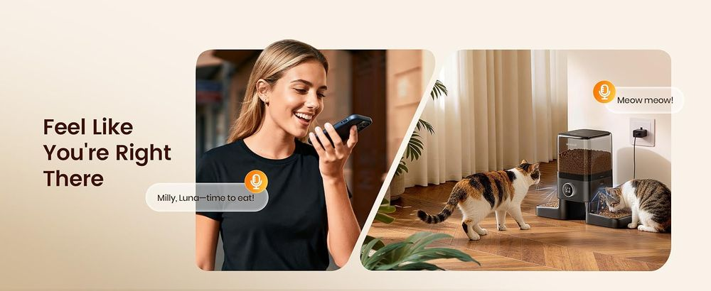     
路径：`docs/uta_style_v3/assets/key/D_human_phone_GFDH3WD5.jpg`
路径：`docs/uta_style_v3/assets/key/D_plan_DF2RPGDW.jpg`
路径：`docs/uta_style_v3/assets/key/L_petlibro_app_GTM9P94B.jpg`
路径：`docs/uta_style_v3/assets/key/L_petlibro_woman_FKT2J6PV.jpg`
路径：`docs/uta_style_v3/assets/key/L_oneisall_app_EaseS1.jpg`
路径：`docs/uta_style_v3/assets/key/L_neakasa_app_DCFY8SB4.jpg`

### 4.4 过滤 / 净水
- **主推：** 滤芯分层爆炸图，层片斜向飞散，每层配一个短标签，背景是浅暖色或浅灰纯底。
- **可选：** 产品透明化剖面，水流用蓝色箭头；放在水龙头下冲洗滤芯。
- **禁止：** 显微镜、实验室、细菌或“除菌 %”这类健康化学暗示（B0D5B6RLYY a06 的实验室画面是反例，不学）；写“除氯 / 软化水”的功效数字。
- **证据：** fountain B0FJX69D2R a13「Ultra Fresh」毛刷层飞散；B0DPMNQJ2N a05、B0C89MMFW1 a05 层片爆炸；B0BN2Z5CDC a09「3-layer filter system」；B0GYZQ79CY 主打无滤芯，用「Purely Fresh」分屏表现。

 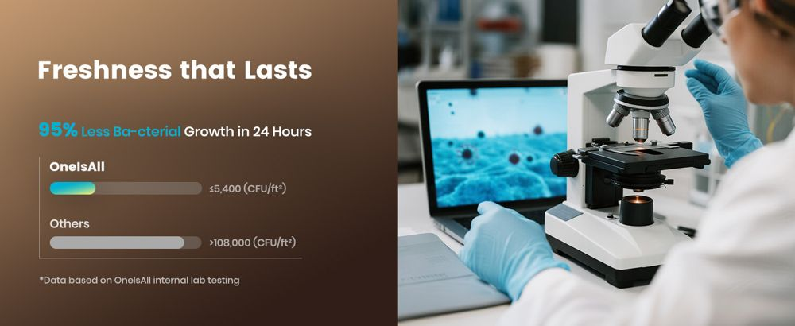（右图为反例：实验室暗示）
路径：`docs/uta_style_v3/assets/key/F_filter_layers_FJX69D2R.jpg`
路径：`docs/uta_style_v3/assets/key/F_lab_D5B6RLYY.jpg`

### 4.5 易清洗 / 可拆部件
- **主推：** 手部操作特写：提起泵、拉出抽屉、在水槽冲洗。机位为 45° 俯拍，场景是厨房台面。或者用洗碗机内部俯拍。
- **可选：** VS 分屏（我们的部件少 vs 对手部件多，对手不得出现品牌）；2–3 步编号步骤图。
- **禁止：** 部件数量和实物不一致；画出不存在的拆卸方式。
- **证据：** fountain B0FJX69D2R a10/a14 洗碗机 + 手洗，a15「Crafted for Easier Cleaning」VS 分屏；B0BN2Z5CDC a04 洗碗机；B0FH691TR6 g07 女性在水槽清洗；feeder B0DZCHN51D a08 厨房水槽；B0GFDCYGFM g08 拆解平铺；litter oneisall Ease S1 g07「Deep Cleaning Made Easy」手提内胆、g10 硅胶垫；Neakasa a41 草地上冲洗猫砂床、M9 g07「Easy to Detach」3 步；PETLIBRO B0FKT2J6PV 抽屉特写，只出手。

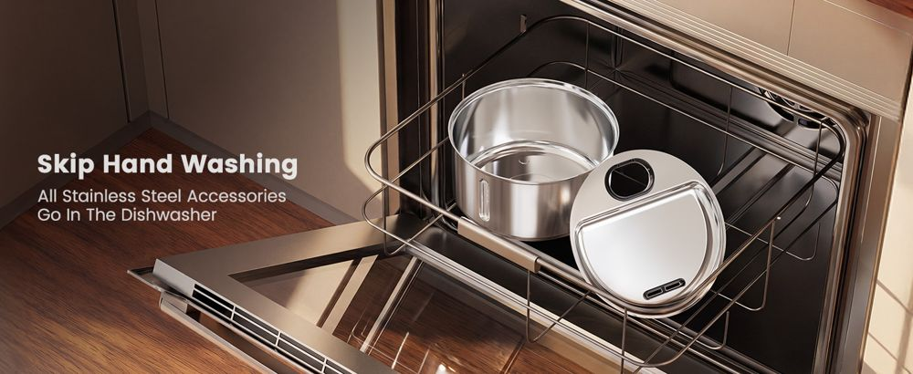  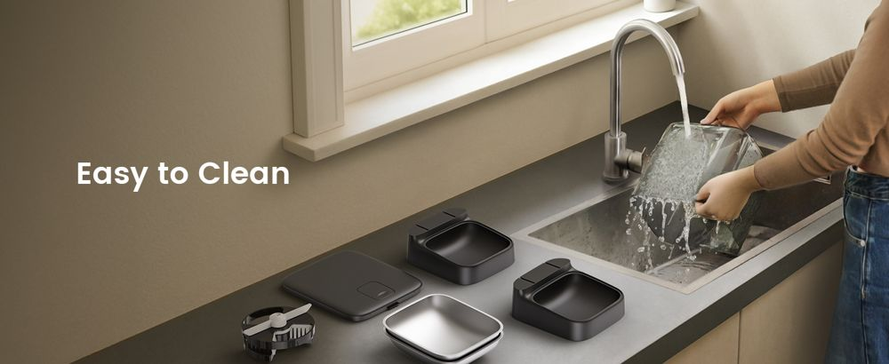 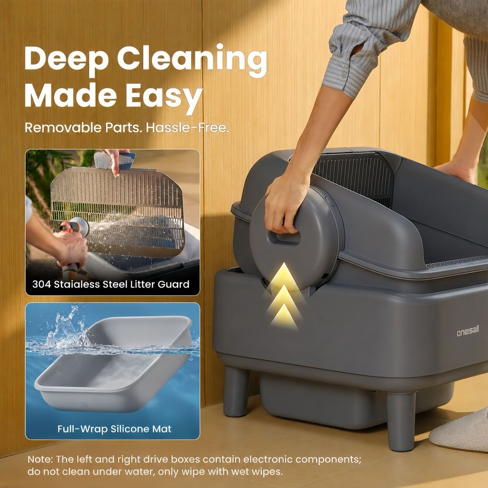 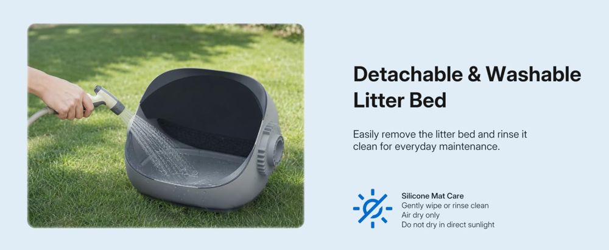  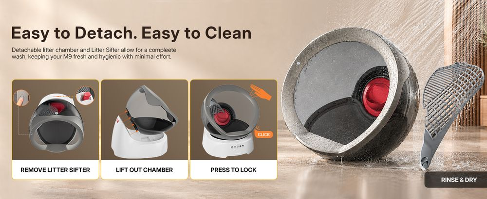
路径：`docs/uta_style_v3/assets/key/F_dishwasher_FJX69D2R.jpg`
路径：`docs/uta_style_v3/assets/key/F_clean_vs_FJX69D2R.jpg`
路径：`docs/uta_style_v3/assets/key/D_sinkclean_DZCHN51D.jpg`
路径：`docs/uta_style_v3/assets/key/L_oneisall_deepclean_EaseS1.jpg`
路径：`docs/uta_style_v3/assets/key/L_neakasa_washbed_DCFY8SB4.jpg`
路径：`docs/uta_style_v3/assets/key/L_petlibro_drawer_FKT2J6PV.jpg`
路径：`docs/uta_style_v3/assets/key/L_neakasa_m9_steps_HC6Y2MS3.jpg`

### 4.6 材质（304 不锈钢等）
- **主推：** 金属微距特写：拉丝纹理清楚，加受控高光，表面可带水珠。「304」等材质字样做成大号字体后期排版（字体或浮雕效果）。猫舔水做辅助。
- **可选：** 和塑料对比分屏（对手不放品牌）；放材质证书（必须有真实证书才能用）。
- **禁止：** 写“抑菌 / 更健康”这类功效；证书造假；磨皮金属。
- **证据：** fountain B0FJX69D2R a11「SUS 304」水面微距；B0DPMNQJ2N a06 碗体 + 304 字样；B0C89MMFW1 g04 304 vs plastic；B0FJX69D2R a08 猫戴帽持证书（拟人）；feeder B0G4DX3QR8 a11「Cleaner Chin」304 碗加大字；litter oneisall Ease S1 g19 不锈钢筛网对比。

 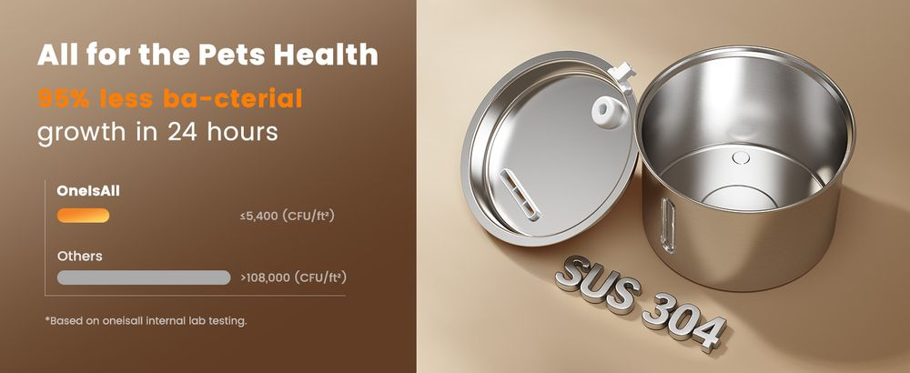 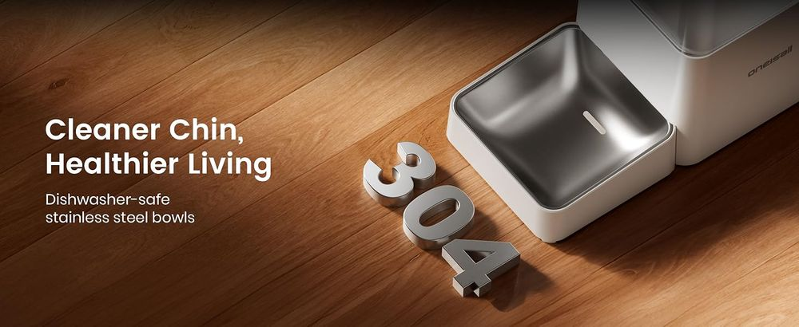  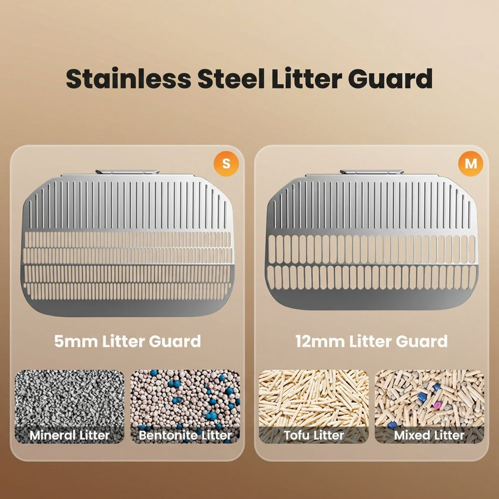
路径：`docs/uta_style_v3/assets/key/F_steel_macro_FJX69D2R.jpg`
路径：`docs/uta_style_v3/assets/key/F_steel_bowl_DPMNQJ2N.jpg`
路径：`docs/uta_style_v3/assets/key/D_steel_304_G4DX3QR8.jpg`
路径：`docs/uta_style_v3/assets/key/F_vs_plastic_C89MMFW1.jpg`
路径：`docs/uta_style_v3/assets/key/L_oneisall_guard_EaseS1.jpg`

### 4.7 水位 / 缺水提醒 / 自动断电
- **主推：** 产品近景，水位窗或指示灯发光（蓝 = 正常，红 = 缺水），背景浅色或暗场。可放一个红灯局部放大圈。
- **可选：** 双状态分屏（满水蓝 vs 缺水红）。
- **证据：** fountain B0BN2Z5CDC a07/g08 水位窗；B0DS2N3T3X a03「No need to lift the lid」蓝/红灯；B0D5B6RLYY a10「Alert and Auto Shut-Off」红灯。

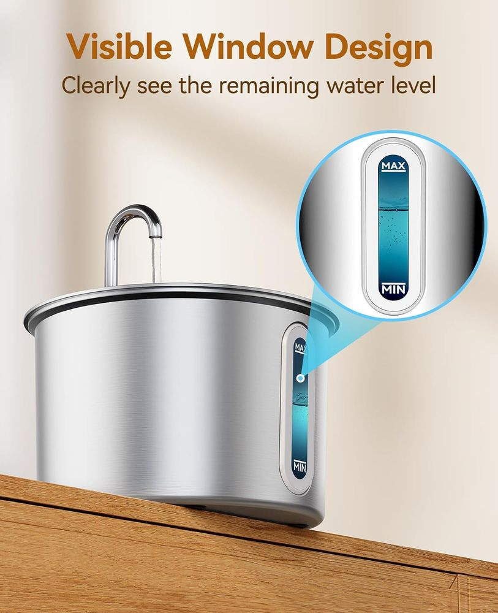 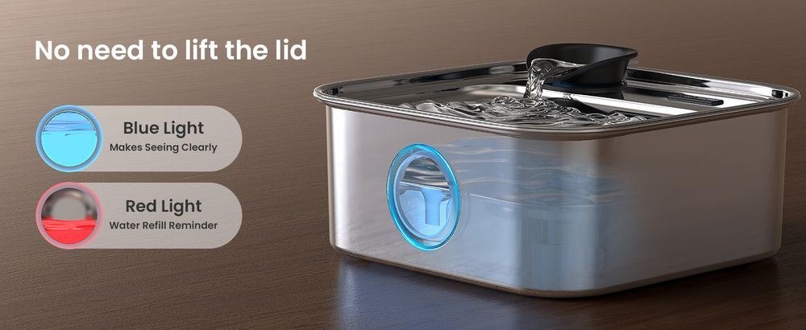 
路径：`docs/uta_style_v3/assets/key/F_level_window_BN2Z5CDC.jpg`
路径：`docs/uta_style_v3/assets/key/F_level_light_DS2N3T3X.jpg`
路径：`docs/uta_style_v3/assets/key/F_lowwater_shutoff_D5B6RLYY.jpg`

### 4.8 模式切换（水流 / 出粮模式）
- **主推：** **3 张卡片并排**（每种模式一张卡，卡里是同一机位的小场景，下方放图标和短标签）。这是允许使用卡片的典型情况。
- **可选：** 2 种模式时用左右分屏，中间不加卡片框。
- **证据：** fountain B0FJX69D2R a08「Explore the Favorite Flow」3 卡；B0D5B6RLYY a09 两模式分屏；B0BN2Z5CDC a08。

 
路径：`docs/uta_style_v3/assets/key/F_modes_3card_FJX69D2R.jpg`
路径：`docs/uta_style_v3/assets/key/F_modes_split_D5B6RLYY.jpg`

### 4.9 电源 / 电池续航 / 断电备份
- **主推：** 电池续航用巨型数字（30 days、100 days）加产品，场景是“插座够不到的地方”（窗台、走廊）。断电备份用夜间暗蓝场景，产品微亮，配电池图标。
- **证据：** fountain B0FJWV49LP g06「30 days」；B0FJX69D2R g04「Peace of Mind, No More Charging Hassles」；feeder B0DZCLG3SP a02「100」电池；B0GGZZJ3RV a04「100 Days」；B0G4DX3QR8 a10「Never Miss A Meal」夜间蓝；B0C5X2G933 g06 断电。

 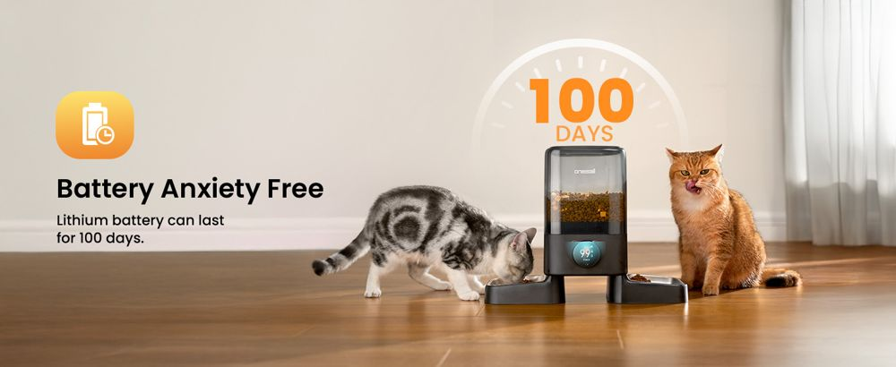 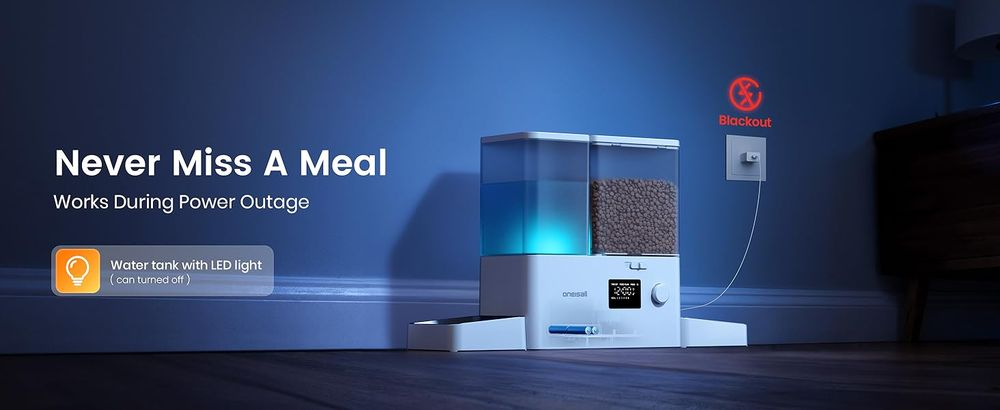
路径：`docs/uta_style_v3/assets/key/F_battery30_FJWV49LP.jpg`
路径：`docs/uta_style_v3/assets/key/D_battery100_DZCLG3SP.jpg`
路径：`docs/uta_style_v3/assets/key/D_night_blue_G4DX3QR8.jpg`

### 4.10 防卡粮 / 出粮精准 / 颗粒兼容
- **主推：** 出粮转子或机构的悬浮爆炸图（浅暖色纯底或暗场），配粒径标注（0.2–0.7 in）。兼容性用 3–4 种粮袋或颗粒并排的图标行。
- **可选：** 双碗俯拍，中间放天平图形「Balanced」表示分量均等；喂食量表（表格卡片）。
- **禁止：** 虚构内部齿轮结构；出现真实粮食品牌的包装商标（参考图里的粮袋都要换成无牌包装）。
- **证据：** feeder B0GFDCYGFM a10「Meals On Time」转子爆炸；B0C5X2G933 a06「Every Kibble Hits the Bowl」；B0DPZV3S7T a03 四袋兼容；B0D4DL67CV a03「Fair Feeding」天平俯拍；B0GFDH3WD5 a12 推荐喂量表；B0C5X2G933 a10 芯片暗场「Feeding Plan Never Lost」。

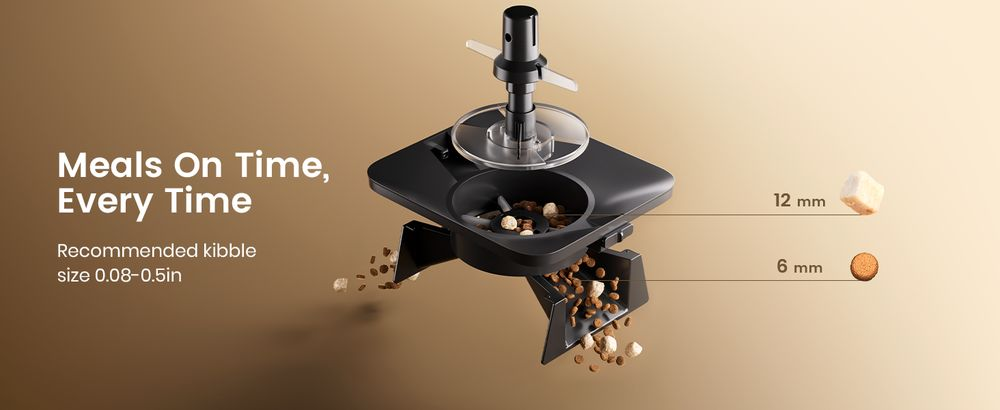 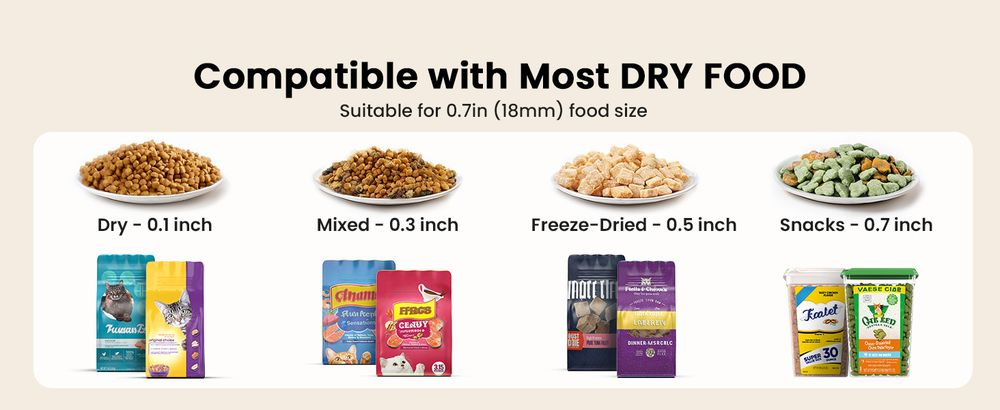 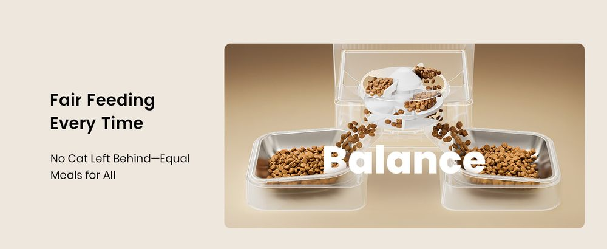  
路径：`docs/uta_style_v3/assets/key/D_rotor_explode_GFDCYGFM.jpg`
路径：`docs/uta_style_v3/assets/key/D_kibble_chart_DPZV3S7T.jpg`
路径：`docs/uta_style_v3/assets/key/D_balance_overhead_D4DL67CV.jpg`
路径：`docs/uta_style_v3/assets/key/D_table_GFDH3WD5.jpg`
路径：`docs/uta_style_v3/assets/key/D_chip_dark_D4DL67CV.jpg`

### 4.11 防臭 / 密封（猫砂盆）
- **主推：** 产品剖面或局部透视，用蓝色线条标出密封圈、封闭集便仓的位置，配 “Sealed” 类结构性描述。也可以用生活场景：猫在旁边放松，人在近处做家务，暗示“家里闻不到”。
- **可选：** 3 个分区小图（防漏垫 / 360° 锁边 / 导液结构），PETLIBRO 的做法。
- **禁止：** 画绿色毒气或臭味波纹；写“去除 99% 异味 / 杀菌 / 负离子”等化学或健康功效；写 PETLIBRO 那种 “97% odor reduction” 的数字，除非有我方实测报告且 `AGENTS.md` 合规通过。
- **证据：** Neakasa B0DCFY8SB4 a40「Upgraded Seal」剖面蓝线、a39「Enhanced Odor Isolation」；PETLIBRO B0GTM9P94B g03「Always-on odor control 97%」（数字型，谨慎）、g08「Complete leak protection」分区；Neakasa M9 g05「PureTower」把耗材横放展示。

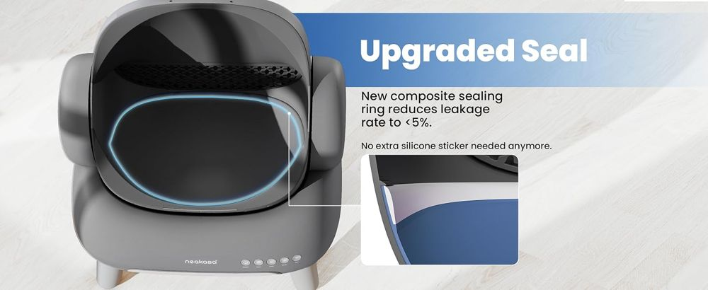   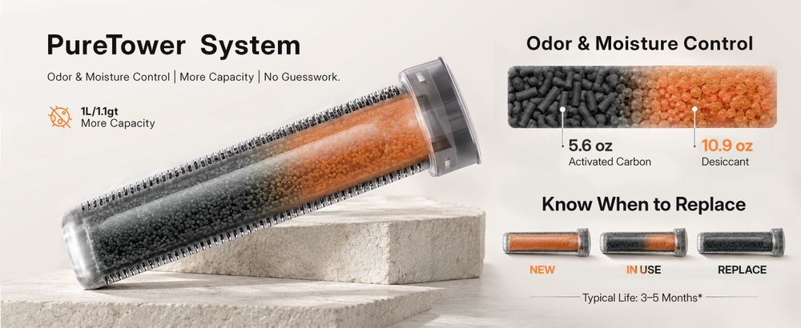
路径：`docs/uta_style_v3/assets/key/L_neakasa_seal_DCFY8SB4.jpg`
路径：`docs/uta_style_v3/assets/key/L_petlibro_odor_GTM9P94B.jpg`
路径：`docs/uta_style_v3/assets/key/L_petlibro_leak_GTM9P94B.jpg`
路径：`docs/uta_style_v3/assets/key/L_neakasa_m9_tower_HC6Y2MS3.jpg`

### 4.12 安全传感（猫砂盆 / 防夹）
- **主推：** 产品半透视，传感器位置用发光点或红框标出，同时有一只猫正在进入或站在边缘，机位是低位 3/4。
- **可选：** 暗场戏剧光加产品轮廓光（Neakasa M9「Safe by Design」）；把旋转角度画成刻度盘（「Controlled Rotation」）；图标行列出 4 项保护。
- **禁止：** 夸大传感器数量；画猫被夹的危险场景。
- **证据：** Neakasa B0DCFY8SB4 a37「High-Precision Detection」红框传感器，a36 旋转刻度；M9 g02 暗场；PETLIBRO g02「Multi-layer safety」猫进入；oneisall Ease S1 g04「Pet Safety First」夜间蓝光，猫低位走近，配 4 项图标。

 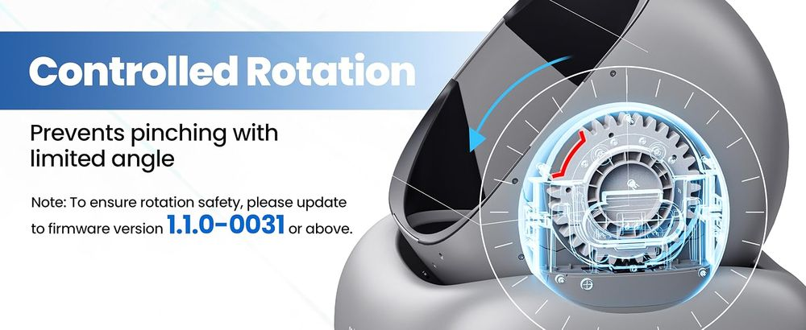 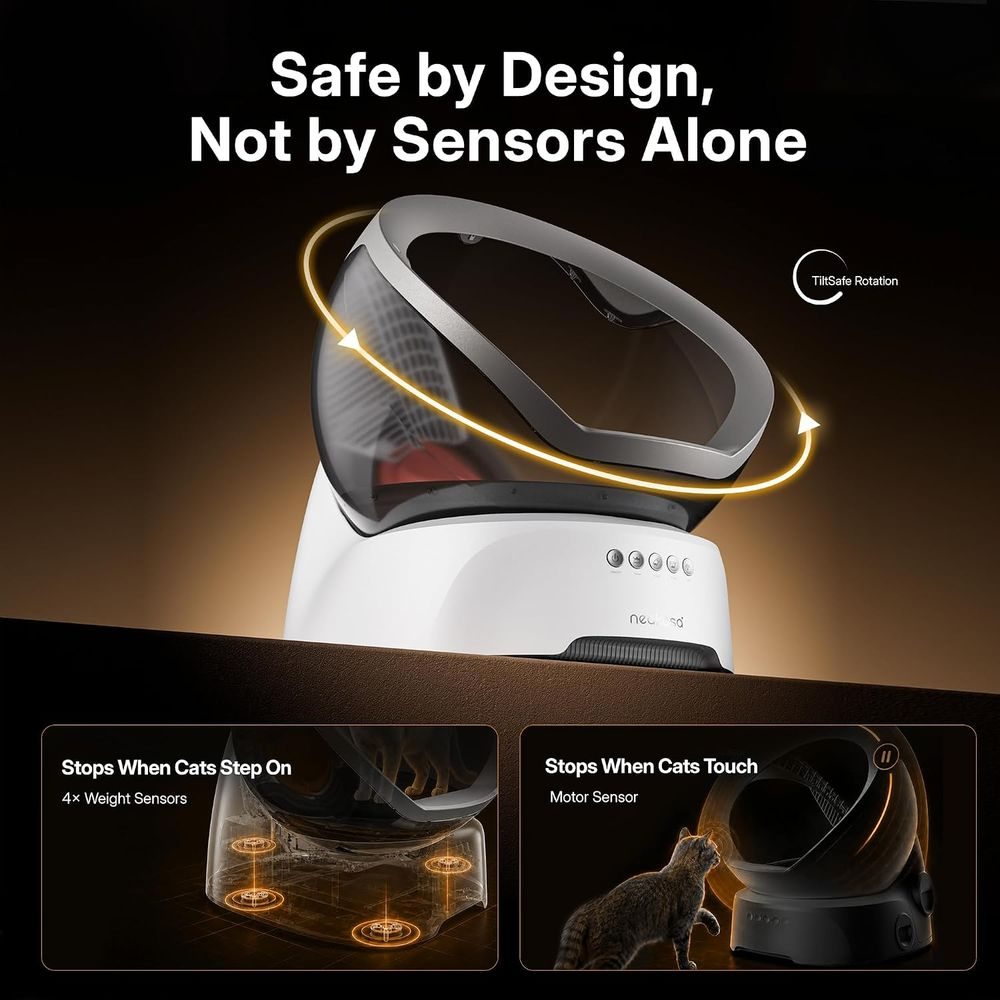 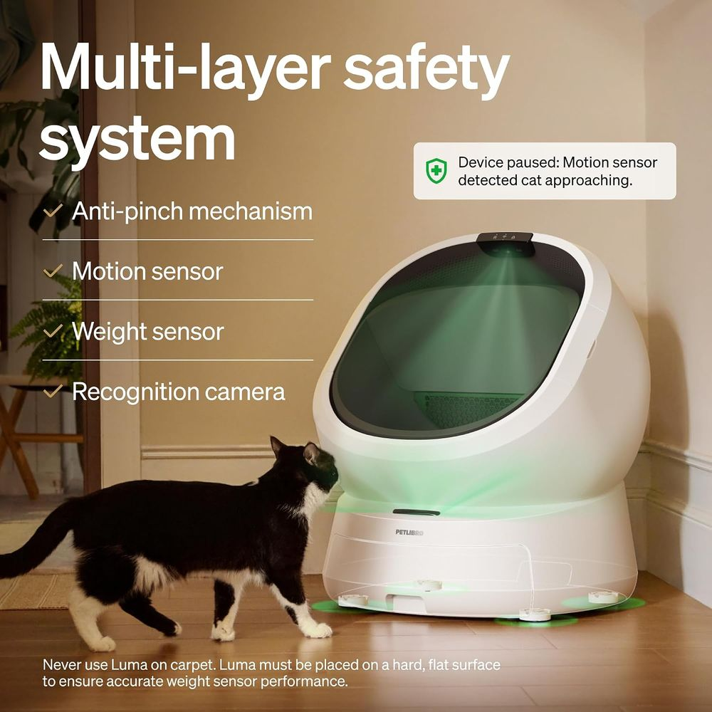 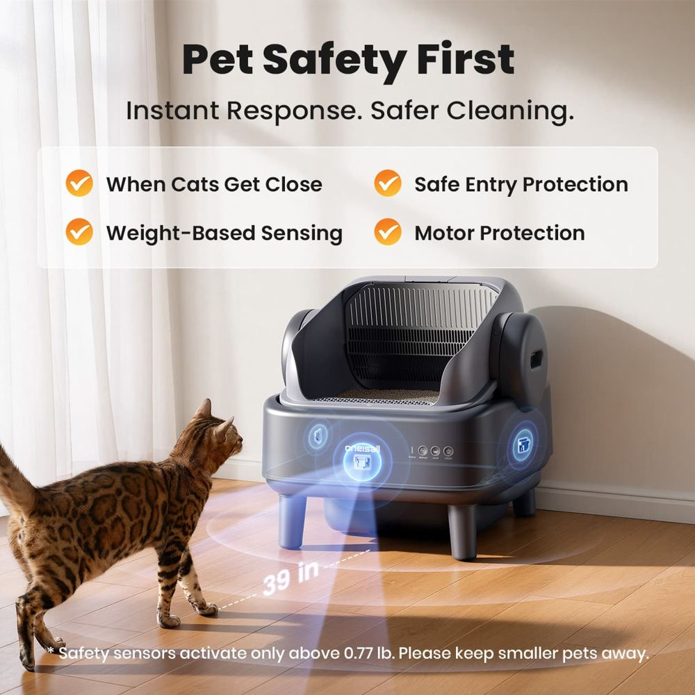
路径：`docs/uta_style_v3/assets/key/L_neakasa_sensors_DCFY8SB4.jpg`
路径：`docs/uta_style_v3/assets/key/L_neakasa_rotation_DCFY8SB4.jpg`
路径：`docs/uta_style_v3/assets/key/L_neakasa_m9_safe_g02.jpg`
路径：`docs/uta_style_v3/assets/key/L_petlibro_safety_GTM9P94B.jpg`
路径：`docs/uta_style_v3/assets/key/L_oneisall_safety_EaseS1.jpg`

### 4.13 自清洁周期 / 省猫砂
- **主推：** 猫砂颗粒宏观特写（筛网把结团和干净砂分开）加 hero number（「30% Litter Saving」）。时间设定用 3–4 个时间胶囊图标（5 / 10 / 15 分钟）配一只猫离开的场景。
- **可选：** 抽屉里装满封好的垃圾袋，配“14 天不铲”。
- **禁止：** 出现排泄物或脏污；剖面里画不存在的筛分结构。
- **证据：** oneisall Ease S1 g17「The Highest Litter Efficiency 30%」宏观颗粒，g12「Custom Cleaning, On Your Schedule」时间胶囊，g08「EaseClean™ 10s / 20s」；PETLIBRO B0FKT2J6PV 换袋：只拍腿 + 垃圾袋。

 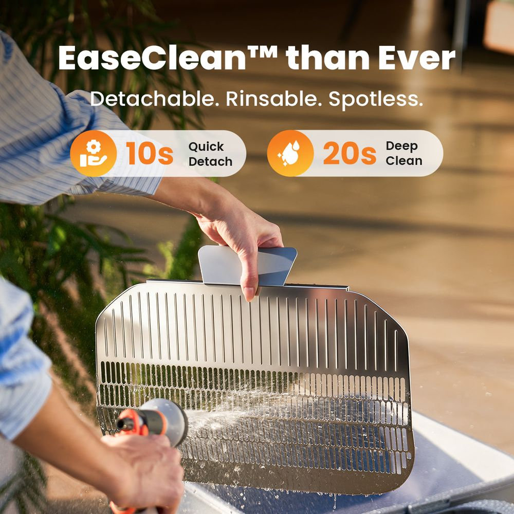 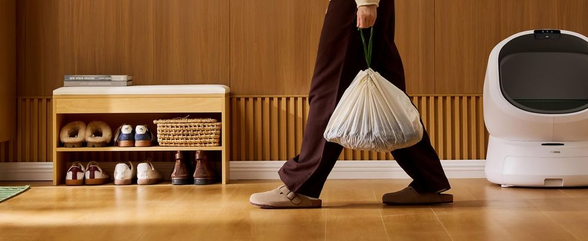
路径：`docs/uta_style_v3/assets/key/L_oneisall_30pct_EaseS1.jpg`
路径：`docs/uta_style_v3/assets/key/L_oneisall_easeclean_EaseS1.jpg`
路径：`docs/uta_style_v3/assets/key/L_petlibro_legs_FKT2J6PV.jpg`

### 4.14 尺寸 / 是否放得下 / 开放空间
- **主推：** 正交或 3/4 视图加尺寸线（in + cm），白底或浅灰底；猫砂盆再加一张“开顶俯拍，猫在里面转身”，配面积 hero number。
- **可选：** 放在洗衣机旁、走廊等真实空间，表现占地小（Neakasa M9 g06）；「Will it fit? Measure before you buy」三视图（Neakasa）。
- **证据：** Neakasa B0DCFY8SB4 a44、B0DK6RSFG2 g05/a07 三视图；M9 g06 洗衣机旁；oneisall Ease S1 g05「More Usable Space」顶视俯拍，g24「32% Open-Top Larger」，g31 尺寸；PETLIBRO g10「Large, open-top design」顶视猫；feeder B0GFDCYGFM g09、fountain B0FJX69D2R g07 参数图。

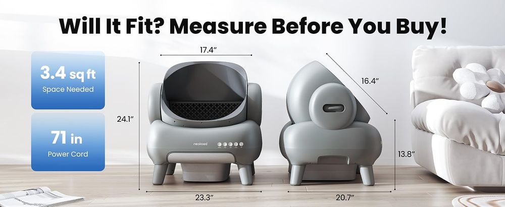 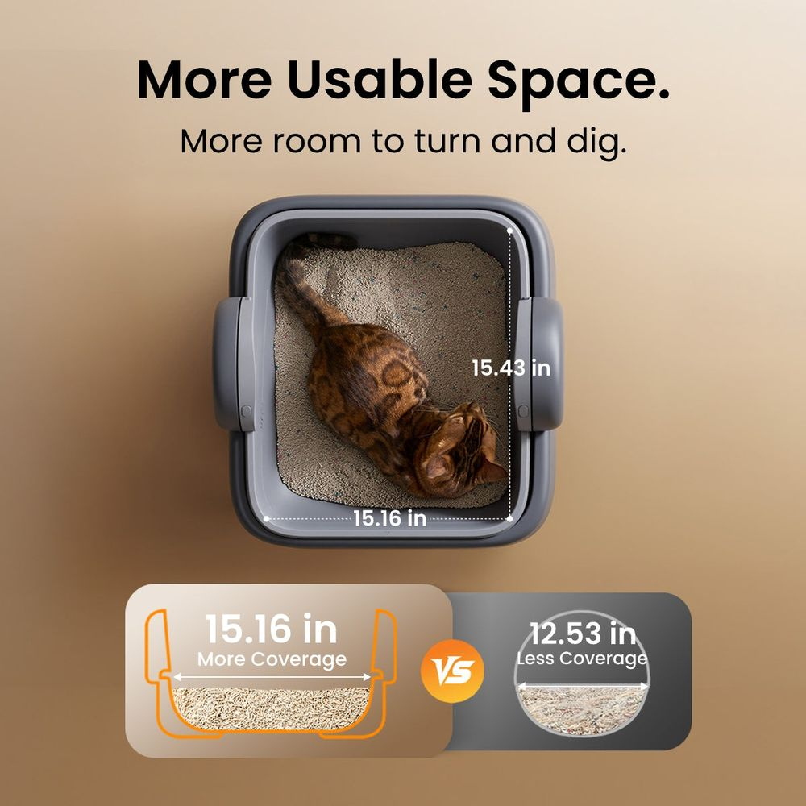   
路径：`docs/uta_style_v3/assets/key/L_neakasa_measure_DCFY8SB4.jpg`
路径：`docs/uta_style_v3/assets/key/L_oneisall_space_EaseS1.jpg`
路径：`docs/uta_style_v3/assets/key/L_oneisall_32pct_EaseS1.jpg`
路径：`docs/uta_style_v3/assets/key/L_oneisall_dims_EaseS1.jpg`
路径：`docs/uta_style_v3/assets/key/L_petlibro_opentop_GTM9P94B.jpg`

### 4.15 多宠
- **主推：** 俯拍双碗或双猫同时进食，间距标注（16–17 in）和「Balanced / 2X」；猫砂盆用 3 只不同体型的猫站成梯度，配体重范围。
- **可选：** 多猫识别：每只猫配一个头像标签和 App 卡片（PETLIBRO）；多宠家庭沙发群像。
- **证据：** feeder B0C5X2G933 a01「Dual Bowls Mealtime in Harmony」，B0DZCLG3SP a11「17 inches」俯拍，B0GFDCYGFM a09「15% Wider」；fountain B0D5B6RLYY g01 两只狗；litter Neakasa a42「Up to 3 cats 3.3–33 lbs」；PETLIBRO g05「Multi-pet recognition」。

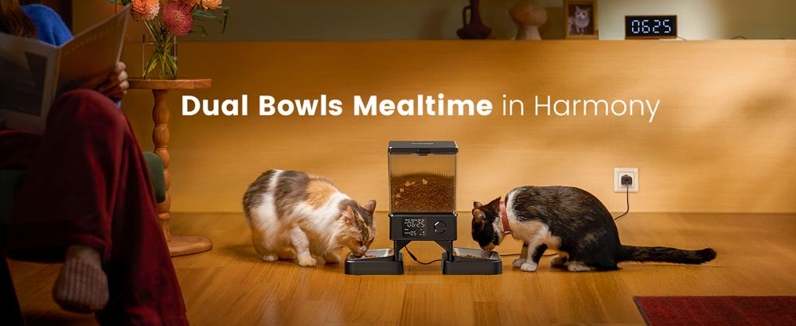    
路径：`docs/uta_style_v3/assets/key/D_multipet_C5X2G933.jpg`
路径：`docs/uta_style_v3/assets/key/D_overhead_17in_DZCLG3SP.jpg`
路径：`docs/uta_style_v3/assets/key/D_wider_GFDCYGFM.jpg`
路径：`docs/uta_style_v3/assets/key/L_neakasa_multicat_DCFY8SB4.jpg`
路径：`docs/uta_style_v3/assets/key/L_petlibro_multicat_GTM9P94B.jpg`

### 4.16 进食姿势 / 舒适
- **主推：** 侧面平视，猫低头进食，碗高或倾角用弧线和角度标注；「2X Higher」类数字。
- **证据：** feeder B0GFDCYGFM a08「Comfortable Eating Posture 2X」；B0GFD9YWF2 a03；litter oneisall Ease S1 g29「Comfort for All Cats」猫在舱内，加 2 张小图。

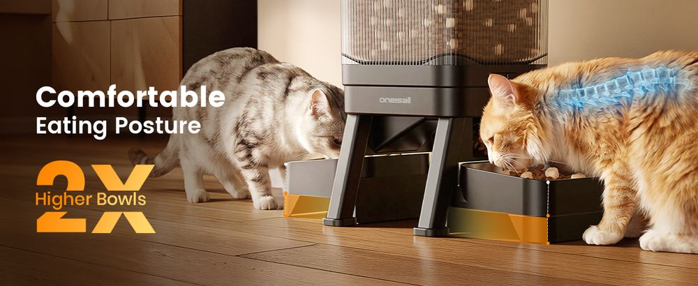 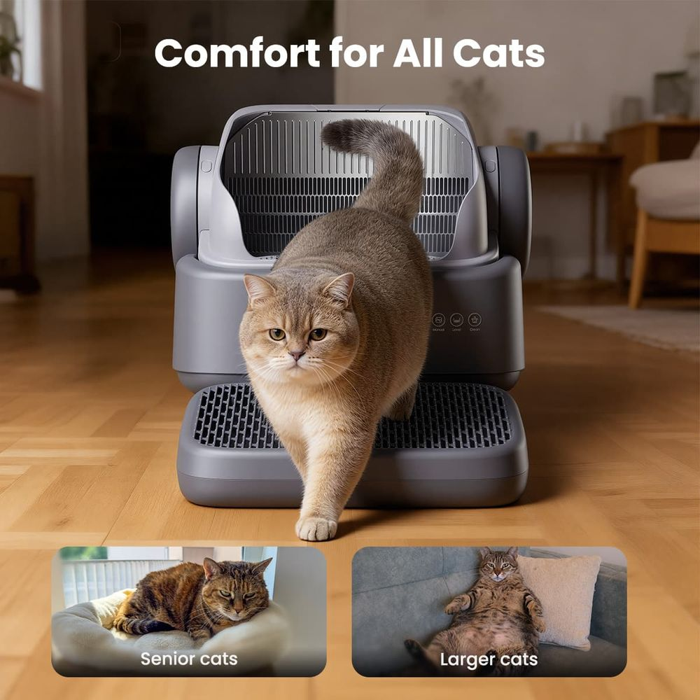
路径：`docs/uta_style_v3/assets/key/D_posture_2x_GFDCYGFM.jpg`
路径：`docs/uta_style_v3/assets/key/L_oneisall_comfort_EaseS1.jpg`

### 4.17 稳固 / 防偷吃 / 防打翻
- **主推：** 用动作抓拍：猫扒机身、站到机器上、伸爪掏粮口，产品纹丝不动。猫的表情要“偷看、得逞失败”。
- **证据：** feeder B0D4DL67CV a09「Security Pet-Proof Lock」黑猫掏食；B0DPZV3S7T g05「Superbly Stable」猫站上去；fountain B0C89MMFW1 g02「Safety Snap Lid」暹罗猫推盖。

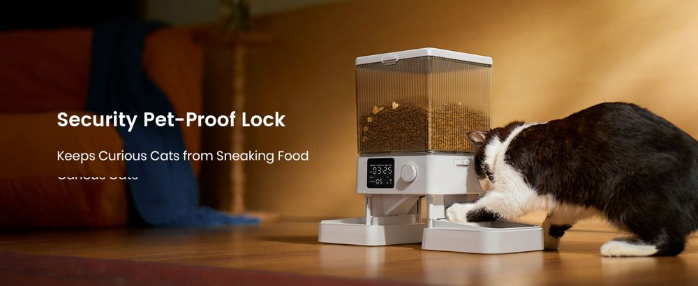 
路径：`docs/uta_style_v3/assets/key/D_lock_D4DL67CV.jpg`
路径：`docs/uta_style_v3/assets/key/F_snaplid_C89MMFW1.jpg`

### 4.18 出行 / 多日无人 / 摆放灵活
- **主推：** 人拖着行李箱出门，猫在后面安心进食，配天数 hero number；无线产品用三联场景（客厅 / 卧室 / 厨房），这是允许用卡片的第二种情况。
- **证据：** feeder B0G4DX3QR8 a05「14-Day Hassle-Free Feeding」；fountain B0C89MMFW1 g03 海滩度假「24hrs running 7 days」；B0GYZQ79CY a10「Places Your Cats Prefer」三联。

  
路径：`docs/uta_style_v3/assets/key/D_travel_human_G4DX3QR8.jpg`
路径：`docs/uta_style_v3/assets/key/F_vacation_C89MMFW1.jpg`
路径：`docs/uta_style_v3/assets/key/F_places_3panel_GYZQ79CY.jpg`

### 4.19 适配猫砂 / 粮食类型
- **主推：** 3–4 种颗粒宏观小方块排成网格，下方 ✔/✕ 标签，背景浅色纯底，旁边放产品。
- **证据：** Neakasa a47「Recommended litter」网格；PETLIBRO a30「Works with most litter types」；oneisall Ease S1 g18；feeder B0DPZV3S7T a03。

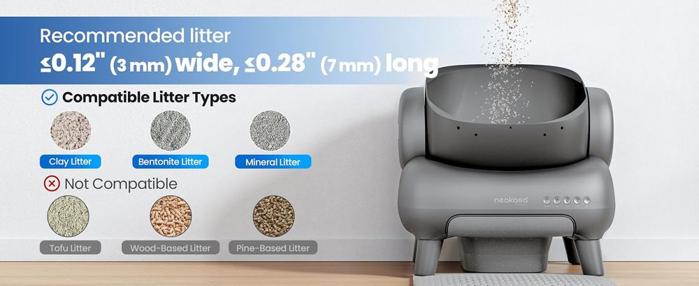 
路径：`docs/uta_style_v3/assets/key/L_neakasa_litter_DCFY8SB4.jpg`
路径：`docs/uta_style_v3/assets/key/L_petlibro_litters_GTM9P94B.jpg`

### 4.20 操作简单 / 按键
- **主推：** 手指按键微距，浅灰底，图标印刷要清楚。
- **证据：** Neakasa a45「Clear Functions, No Guesswork」；feeder B0DZCHN51D g07「Simple Setting」；B0DPZV3S7T a05 小男孩操作（POKPET 若用儿童，须为欧美儿童且有成人在场）。

 
路径：`docs/uta_style_v3/assets/key/L_neakasa_buttons_DCFY8SB4.jpg`
路径：`docs/uta_style_v3/assets/key/D_child_DPZV3S7T.jpg`

### 4.21 宠物爱用（情绪型卖点）
- **主推：** 近景或特写，宠物舔嘴、舌头卷水、眯眼，可加 2–3 张小图拼成连续动作。
- **证据：** fountain B0DPMNQJ2N a02「CAT'S LOVE IN IT」舔嘴大特写 + 3 小图；B0FJX69D2R a02–a06「Sip Where Cats Relax / Joyful / Secure / Unbothered / Sleep Soundly」用 5 个不同机位讲同一个情绪主题；feeder B0GFDH3WD5 a08 翻肚。

  
路径：`docs/uta_style_v3/assets/key/F_emotion_lick_DPMNQJ2N.jpg`
路径：`docs/uta_style_v3/assets/key/F_lifestyle_relax_FJX69D2R.jpg`
路径：`docs/uta_style_v3/assets/key/D_cute_cat_GFDH3WD5.jpg`

### 4.22 VS 对比（通用）
- **规则：** 左边是我方，用暖光、色彩和清晰画面；右边是“Others”，去饱和、偏灰，绝不放品牌、Logo 或可识别外观。对比项不超过 3 条。
- **证据：** fountain B0GYZQ79CY a01、a05「0 pump & parts vs 1 pump & 4 parts」；B0FJX69D2R g08「How We Stand Out」。

路径：`docs/uta_style_v3/assets/key/F_vs_hero_GYZQ79CY.jpg`

---

## 5. 机位库（同一套图不能重复）

| 代码 | 机位 | 用途 | 示例 |
|---|---|---|---|
| C1 | 3/4 前侧，俯视 15° | 主图、白底 | 所有主图 g01 |
| C2 | 正面平视 | 尺寸、参数 | Neakasa a44 |
| C3 | 正顶视 90° | 双碗间距、开顶空间、平铺包装清单 | D_overhead_17in、L_oneisall_space |
| C4 | 45° 俯拍台面 | 清洗、拆卸、手部操作 | F_dishwasher |
| C5 | 低位平视（宠物视线高度） | 喝水、进食、进入猫砂盆 | F_lifestyle_relax、L_oneisall_safety |
| C6 | 宠物面部特写 / 微距 | 舔嘴、情绪 | F_emotion_lick、XHS_003 |
| C7 | 材质微距 | 不锈钢、颗粒、水面 | F_steel_macro、L_oneisall_30pct |
| C8 | 宽幅环境中景（人 + 宠物 + 家） | 品牌开场、App、出行 | D_travel_human |
| C9 | 越肩 / 手持手机 POV | App 远程 | L_petlibro_app |
| C10 | 悬浮爆炸 / 剖面（渲染） | 过滤、转子、密封 | F_filter_layers、D_rotor_explode |
| C11 | 暗场轮廓光 3/4 | 静音、夜间、断电、科技感 | F_quiet_heronum、L_neakasa_m9_safe |
| C12 | 腿部 / 局部人物（无脸） | 换袋、走动、规模参照 | L_petlibro_legs |
| C13 | 抓拍动作（扑、扒、站） | 稳固、防偷吃、搞怪情绪 | D_lock、XHS_005 |
| C14 | 分屏 / 三联 | 模式、场景、VS | F_modes_split、F_places_3panel |

**规则：** 7 张主图至少用 6 种不同的机位代码；同一机位代码最多出现 2 次，且不能相邻。

机位对视觉冲击的要求见第 6G.1 节：一套图至少 1 张明显俯角、至少 2 张明显低视角。

---

## 5A. 图片尺寸规范（2026-11-15 用户确认，沿用最早 AGENTS.md 的比例）

| 图位 | 比例 | 交付尺寸 | 高清目标 | 说明 |
|---|---|---|---|---|
| 主图（第 1 张） | 1:1 方图 | 2000 × 2000 | 2508 × 2508 或更高 | 纯白底、无字、产品完整 |
| 副图（第 2–7 张） | **4:5 竖长图** | **1600 × 2000** | 2000 × 2500 或更高 | 一律做竖图，不再做方图 |
| A+ 电脑端 | 2.44:1 | 1464 × 600 | 2928 × 1200 | — |
| A+ 手机端 | 4:3 | 600 × 450 | 1200 × 900 | — |

- **A+ 每个模块都要同时交付电脑端（1464 × 600）和手机端（600 × 450）两版。** 手机端按 4:3 重新构图：文字放上方或下方，字号放大到手机上能看清，产品和宠物不能缩得太小，不能直接从电脑端裁切。
- 副图要按 4:5 竖幅独立构图（结构性缩放）：上方留文字区，产品和宠物放在中下部，不能把方图拉伸、裁切或补白得到竖图。
- 字号按画布宽度换算：第 6 节的 px 以 2000 px 宽为基准，1600 宽的副图按 0.8 倍换算（标题约 52–58 px，副标题不小于 29 px，hero number 约 88–128 px）。
- 生成工具原生出图尺寸不够时，如实标注哪些是放大得到的。

## 6. 版式与字体

- 标题：Poppins Bold（原 Avenir Next，已被第 6A 节取代），在 1600 px 宽画布上约 96–128 px，最多 2 行，句首大写；口号类标题可以全大写。
- 副标题：Poppins Regular，约为标题的 0.4 倍，最多 2 行。详见第 6A 节。
- 图标 + 短标签：图标 56–72 px，标签 28–32 px，每个标签不超过 3 个词，一行最多 4 个。
- Hero number：琥珀色 #F47A21，110–160 px，旁边配单位小字。一张图最多 1 个 hero number。
- 文字颜色：#0F2438。在暗场里反白（#FFFFFF），hero number 仍用琥珀色。
- 文字位置：放在画面留白最干净的一侧（通常是左上或上 1/3），不压在宠物脸上或产品关键部位上。
- 参考：oneisall 的标题都放在左上或顶部居中；PETLIBRO 用小写句子式标题，左上对齐，留白很大，编辑感强，可以学它的留白；Neakasa 用蓝色色条衬标题，偏工具感，不学。

## 6A. 字体规范（2026-11-15，从小红书 29 张逐张观察总结）

> 说明：字体名称是**按字形外观判断的近似款**，不是从文件里读出来的。字号比例按手机截图实测像素估算，误差大约 ±10%。

### 6A.1 字体家族（只用 2 类，最多再加 1 个点缀）

| 角色 | 字形特征 | 近似字体（免费可商用） | 依据案例 |
|---|---|---|---|
| **主标题，几何无衬线** | 圆 O、单层 a，字面宽，SemiBold 到 Bold | Poppins SemiBold / Bold | XHS_016、020、021、024、025、026、005、007、010 |
| **口号标题，粗体全大写** | 全大写，Black 或 ExtraBold，字距收紧，结尾带句号 | Montserrat ExtraBold / Black，或 Poppins ExtraBold | XHS_002「NAP MODE: ON.」、003「SIP BREAK.」、027、028「NO THOUGHTS. JUST PLAY.」、029「FETCH FACE.」、023、017 |
| **副标题** | 和主标题同一家族，Regular 或 Medium，句首大写 | Poppins Regular | 几乎全部 |
| 点缀衬线（可选） | 优雅衬线，只用在副标题或情感收尾 | Playfair Display / DM Serif | XHS_025「Love on Time, Every Time」、024 金色副标题、008「How Pets Redefine Family?」 |
| 斜体动感（可选，一套最多 1 张） | 宽体粗斜体 | Poppins Bold Italic | XHS_022「Sturdy Nylon-66」、012 |

- 一套图只用一个无衬线家族，衬线只做点缀。禁止三种以上字体混用。
- XHS_016 里的“15000PA”**不是毛刷或手写风格的字**。它是几何无衬线 ExtraBold，加上橙到黄的竖向渐变填充，毛刷感来自产品刷头压在数字前面的前后层次。可以学的是“产品挡住数字一角”这种叠层做法，而不是去找毛刷字体。

### 6A.2 粗细层级与字号比例（以主标题字高 = 1.0 计）

| 层级 | 字重 | 相对字号 | 颜色 | 依据案例 |
|---|---|---|---|---|
| 品牌小标签（可选，放在主标题上方） | Regular / Medium | 0.30–0.40 | 和主标题同色或灰 | XHS_024–028 顶部的小字 |
| **主标题** | Bold / ExtraBold | 1.0 | 浅底用深棕 #3B2A20 或深炭 #1E1E1E；暗底或天空用白 | XHS_024–028（深棕或深炭）、016、020、029（白） |
| 副标题 | Regular | 0.35–0.45 | 主标题颜色降低约 20% 的透明度，或者用同色系的浅色 | XHS_016、024、025、028 |
| **参数 hero 数字** | ExtraBold / Black | 2.0–3.5 | 强调色或渐变 | XHS_016（约 2.2）、021「2」（约 3.5）、009「300ml」 |
| 数字单位 | Bold | 数字高度的 0.35–0.50，底边和数字对齐 | 白或主色 | XHS_016「PA」、020「dB」、011「ml」 |
| 数字说明 | Regular | 0.30–0.40 | 白或灰 | XHS_016「Powerful Suction」、020「Whisper Quiet」 |

- **标题和副标题字号比约 2.5:1**，两者间距约为副标题字高的 0.5–0.8 倍（依据 XHS_016、024、025、028）。
- 主标题最多 2 行，每行不超过 5 个英文单词（依据 XHS_016 共 2 行、027 共 2 行、024 共 1 行）。

### 6A.3 排列方式

1. **默认是顶部居中**：品牌小标签、主标题、副标题三层居中堆叠，放在画面顶部干净的墙面或天空上，占画面高度的 15–22%（依据 XHS_002、003、005、007、024–029）。
2. **副标题两侧加短横线**，写成“—— Cat tunnel ——”，用来标注品类名（依据 XHS_028、025、023）。
3. **左上对齐**：用在产品放在右侧、左侧有空白的构图里（依据 XHS_010、011、012、021）。
4. **数字放在产品旁边**：hero 数字放在产品右上或左上，说明文字在数字下方右对齐（依据 XHS_016、020）。
5. 主标题里**只把一个关键词换成强调色**，句子其余部分不变色（依据 XHS_016「Captures **99.99%** Loose Hair」）。

### 6A.4 参数数字的强调方式（从强到弱，一张图只用一种主强调）

| 做法 | 怎么做 | 适合 POKPET 的卖点 | 依据案例 |
|---|---|---|---|
| 渐变巨型数字 + 产品叠层 | ExtraBold 加竖向渐变（暖橙到浅黄），产品挡住数字一角 | 一般不用（我们没有吸力、功率这类参数） | XHS_016 |
| 巨型单数字 + 侧边标题 | 1 个数字占画面 1/4，标题放在数字右侧，左对齐 | 「3 Modes」三种模式 | XHS_021「2 Speeds」 |
| 数字 + 曲线 / 指示图标 | 数字沿一条发光弧线排列，配一个圆点和向下箭头 | 「&lt;25 dB」静音 | XHS_020「49dB」 |
| 圆环进度 + 数字 | 数字放在圆环中间 | 「1 m」感应范围（用弧线示意，不用 Wi-Fi 图标） | XHS_011「140ml」 |
| 3D 金属数字 | 数字做成立体镜面金属，立在场景里 | 「304」不锈钢 | XHS_013 |
| 半透明压底数字 | 超大数字压在画面底部，透明度 60–80% | 「10–15 s」离开后继续出水的时长 | XHS_009「300ml」 |
| 小号 +百分比 | 白色粗体加小说明，放在辅助位置 | 次要参数 | XHS_016「+36%」 |
| 图标行 | 3–4 个线性图标，每个配 2 行短标签，放在标题下 | 304 / 可拆 / 断电保护 / 滤芯 | XHS_027、010 |

- 强调色：POKPET 沿用第 6 节的琥珀色 #F47A21，第二强调色只允许用冷蓝或青色，用在静音和水相关的卖点上（依据 XHS_016 的青色关键词、020 的青绿曲线）。
- **数字只写已确认的事实**：<25 dB、1 m、10–15 s、3 Modes、304、1–2 周换滤芯。不写别家的参数，也不写容量。

### 6A.5 不学

- 别家的品牌字样，比如 Chuhai-Design 和 ERAMONG（XHS_013、014、024–029）。
- 「Healthier」「Better Digestion」「BPA-Free」这类功效标题（XHS_027）。
- 手机 App 界面上的字（XHS_010、011、012），因为我们没有 App 功能。

## 6B. 两条顶尖设计要求（锦浩本人确认，2026-11-15）

> 这两条是锦浩本人确认的硬性要求，优先级高于本标准的其他条款。每张主图、副图和 A+ 出图前都要逐条自检，任何一条不达标就重做。

### 6B.1 首帧停驻力【锦浩本人确认】

宠物表情和场景必须足够抓人，让用户刷到时停下来看。只是“好看”“干净”不算达标。

1. **表情要有戏**：每张图必须选用第 10 节情绪表里的一种强表情，比如闭眼享受、凝视水柱、走向镜头、腾空扑击、表情管理失败。中性、发呆、只是站着的表情不合格（依据 XHS_002、016、021、024、026、029）。
2. **机位要有冲击**：优先用贴地低机位、超近特写、正顶视、腾空抓拍这类机位，同一套图里不重复（依据 XHS_005、007、021、026、029）。
3. **场景要真实、有光影**：用白天侧窗光的真实家居或户外场景，光线和阴影要有层次。棚拍感、纯色假背景不合格，主图 G1 除外（依据 XHS 29 张的色调，见第 9 节）。
4. **自检标准**：把成图缩到手机缩略图大小，1 秒内能看清宠物表情和卖点动作才算通过。

### 6B.2 图上文字层级【锦浩本人确认】

“粗标题、小副标题、加大加重的参数数字”这三层节奏要立住，层级一眼可辨。具体数值见第 6A 节。

1. **粗标题**：Bold 或 ExtraBold，最多 2 行，是画面里最先被读到的文字（依据 XHS_016、024–029）。
2. **小副标题**：Regular，字号约为标题的 0.4 倍，颜色比标题浅一档，紧贴在标题下方（依据 XHS_016、024、025、028）。
3. **参数数字特殊处理**：功率、分贝、距离、时间这类数值一律加大加重，是标题的 2–3.5 倍，用琥珀色 #F47A21 或渐变色。单位缩小到数字高度的约一半，并和数字底边对齐，必要时配图标（依据 XHS_016、020、021、011、013）。
4. **不合格情形**：三层字号接近、没有主次；数字和正文同样大小；一张图里超过 3 层文字。
5. 数字只用已确认的事实（见第 0 节），不借用别家的参数。

## 6C. 宠物表情收藏（可复用表情库，锦浩要求建立，2026-11-15）

> 用法：每次出图，先从这张表里选表情，再按第 6B.1 条检查首帧停驻力。“首帧停驻力”分三档：**强**，可以当首屏或主打副图；**中**，适合做卖点说明图；**弱**，只做辅助或 A+ 的叙事图。
> 编号规则：小红书案例记作 XHS_###；锦浩之后在聊天里发来的新表情图或描述，记作 **EXP_###**（从 EXP_001 起编），图片存到 `uta_style_v3/assets/key/EXP_###.jpg`，并在本表加一行。

| 编号 | 表情类型 | 表情或动作描述 | 喂水器场景 | 喂食器场景 | 参考案例 | 首帧停驻力 |
|---|---|---|---|---|---|---|
| E01 | 兴奋 / 冲向镜头 | 张嘴、耳朵后飞，正面奔向镜头 | 听到出水声跑过来（感应） | 到点开饭狂奔过来（定时） | XHS_007、025 | **强** |
| E02 | 腾空 / 扑击 | 四脚离地，爪子张开，毛发飞起 | 三种模式之类的活力图 | 出粮瞬间扑过来 | XHS_021、026 | **强** |
| E03 | 表情管理失败 / 夸张惊讶 | 眼睛瞪圆、嘴张大，拟人化的夸张表情 | 第一次见到流动水 | 慢食、出粮这类“哇”的瞬间 | XHS_027 | **强** |
| E04 | 得意 / 叼物 | 嘴里叼着东西，眼神得意 | 待补充 | 叼着食盆或玩具等开饭 | XHS_029 | **强** |
| E05 | 闭眼享受 | 闭眼抬下巴，嘴角放松 | 静音、夜间安睡 | 吃饱后满足 | XHS_020、002 | 中到强 |
| E06 | 舌尖碰水 / 舔食 | 舌头伸出，水珠或食物飞溅，用微距拍 | 爱喝流动水（核心卖点） | 吃得香 | XHS_003、009 | **强** |
| E07 | 专注凝视 | 瞳孔放大，盯着一个点 | 盯着水柱或水位窗 | 盯着出粮口等开饭 | XHS_028、012 | 中 |
| E08 | 好奇探头 | 歪头，从边上探出半张脸 | 拆洗时在旁边看 | 探头看粮仓 | XHS_022、018 | 中 |
| E09 | 警觉 / 微凶（可信又带点幽默） | 耳朵竖起，眼神认真，爪子搭在物件上 | 304 结实耐用 | 防扒、防翻 | XHS_023 | 中 |
| E10 | 满足 / 熟睡 | 侧躺，舌头微微露出，身体完全放松 | 夜间静音 | 不打扰睡眠 | XHS_006、002 | 中 |
| E11 | 人宠亲密 | 宠物贴脸、亲吻，人在笑（欧美模特） | A+ 品牌开场 | A+ 品牌开场 | XHS_008、017 | 中（A+ 为强） |
| E12 | 回头一望 | 边走开边回头，嘴边带水或食物 | 离开后水还继续流 10–15 s | 吃完离开 | 待补充 | 中 |
| E13 | 撒娇抬爪 | 抬一只爪去碰产品 | 感应出水 | 碰一下讨粮（只作情绪表达，不说成功能） | XHS_018、024 | 中 |

**做首帧停驻力优先选**：E01、E02、E03、E04、E06。E05 要配超近特写才算强。
**不合格**：中性站立、发呆、背对镜头又没有动作、只拍到半个身体的表情。

### 6C.1 锦浩新增收藏（EXP_###）

| 编号 | 日期 | 来源 | 表情类型 | 适用产品 | 首帧停驻力 | 备注 |
|---|---|---|---|---|---|---|
| EXP_001 | 2026-11-15 | 锦浩聊天 | 拟人道具 / 专注侦探（猎鹿帽、放大镜，墨绿背景） | 喂水器：盯着水位窗；喂食器：盯着粮仓 | 强 | 用道具讲卖点，比如放大镜对应“看得见水位” |
| EXP_002 | 2026-11-15 | 锦浩聊天 | 变装搞笑 / 斗鸡眼惊喜（头顶龙虾，码头） | 喂食器：开饭的“哇”瞬间 | 强 | 超近广角，眼睛占画面 1/3 |
| EXP_003 | 2026-11-15 | 锦浩聊天 | 变装搞笑 / 斜眼憨笑（头顶蟹壳，草地） | 喂食器、喂水器户外 A+ | 强 | 户外草地，冷暖对比 |
| EXP_004 | 2026-11-15 | 锦浩聊天 | 翻白眼向上看（头顶榴莲） | 喂食器：仰头等粮 | 强 | 低头仰拍，眼白要露出 |
| EXP_005 | 2026-11-15 | 锦浩聊天 | 酷 / 墨镜下滑，冷眼斜视（棚拍深蓝底） | 喂水器 304：“硬核”气质 | 强 | 宠物穿衣、戴道具时要合理，不遮住表情 |
| EXP_006 | 2026-11-15 | 锦浩聊天 | 酷 / 墨镜推上额头，正视镜头 | 品牌态度图、A+ 开场 | 强 | 同 EXP_005 |
| EXP_007 | 2026-11-15 | 锦浩聊天 | 偷笑捂嘴、伸爪碰镜头（黑底） | 喂食器：偷吃；感应：伸爪 | 强 | 爪子贴近镜头，前后景深夸张 |
| EXP_008 | 2026-11-15 | 锦浩聊天 | 吐舌比耶（黑底） | 收尾、情绪图 | 强 | 吐舌、比耶的拟人感 |
| EXP_009 | 2026-11-15 | 锦浩聊天 | 张大嘴长舌、仰头喘气（青蓝底） | 喂水器：“渴了”，接 E06 | 强 | 仰拍、舌头是视觉焦点 |
| EXP_010 | 2026-11-15 | 锦浩聊天 | 闭眼 chill，拟人双手端咖啡（街景） | A+ 品牌态度图 | 中到强 | 拟人化程度高，只用在品牌情绪图，不用在功能图 |
| EXP_011 | 2026-11-15 | 锦浩聊天 | 门边探头、鼻子贴镜头（鱼眼） | 喂水器：拆洗时好奇探头；喂食器：探头等粮 | 强 | 接 E08，鱼眼超近 |
| EXP_012 | 2026-11-15 | 锦浩聊天 | 鱼眼冲向镜头、伸爪吐舌（草地） | 感应 1 m：冲过来 | **强** | 接 E01，S1 和 S3 可以直接参考 |
| EXP_013 | 2026-11-15 | 锦浩聊天 | 斜眼怀疑、鼻子超近（鱼眼） | 喂食器：“怎么还没开饭” | 强 | 鱼眼加斜眼 |
| EXP_014 | 2026-11-15 | 锦浩聊天 | 慵懒厌世，趴沙发、戴帽子、穿毛衣 | 静音：躺平不受打扰 | 中 | 接 E10 |
| EXP_015 | 2026-11-15 | 锦浩聊天 | 尖叫惊吓，站立张嘴（复古胶片） | 缺水提醒、“没水了？！” | **强** | 接 E03，表情管理失败 |
| EXP_016 | 2026-11-15 | 锦浩聊天 | 超大脸、不爽眯眼（橘猫，俯拍大头，配海报大字） | 首屏海报、A+ 开场 | **强** | 巨字压在头顶后面（同 AP_001 的巨字叠物） |
| EXP_017 | 2026-11-15 | 锦浩聊天 | 超大脸、不爽眯眼（银虎斑） | 同 EXP_016，换毛色做系列 | **强** | 同一构图换品种，可以做成系列 |

**EXP 共同规律（新增）**：① 鱼眼或广角超近，鼻子、眼睛占画面 1/3 以上（EXP_002、011–013、016、017）；② 拟人道具，比如帽子、墨镜、衣服、头顶食物（EXP_001–006、010、014）；③ 纯色棚拍底（深蓝、黑、青蓝、墨绿），用来突出表情（EXP_001、005–009），这种只用在 A+ 情绪模块，副图仍然用 XHS 日光场景；④ 宠物和产品同框时，道具不能遮住产品，也不能遮住宠物的眼睛。

## 6D. A+ 排版参考（锦浩提供的 7 组长图，2026-11-15，AP_001–AP_007）

> 来源：锦浩发来的小红书 A+ 长图截图，图存在 `uta_style_v3/assets/key/AP_###.jpg`。案例都是数码 3C（充电器、耳机、移动电源），只学版式结构、字体层级和产品展示方式。别家品牌字样（Baseus、UGREEN、threekey、LISEN 等）、认证标志和参数一律不搬。

### 6D.1 逐张拆解

| 编号 | 模块顺序（从上到下） | 标题 / 正文层级 | 配色 | 产品展示 | 可借鉴点 |
|---|---|---|---|---|---|
| AP_001 | 巨字开场「Qi2 ERA」，产品嵌在字中间 → 胶囊黑卡三设备同充 → 三组数字（35 Min / 60 Min / 45 Min） → 芯片 3D 示意 → 巨字「Mini」，产品放在字前 → 出行场景双圆角卡 | 超大粗体词当背景，产品压在字上；数字用荧光绿放大，单位缩小，下面配一行小标签 | 冷灰、白，黑卡配荧光绿强调 | 产品悬浮在棚拍里，配爆炸示意，最后落到出行场景 | 巨字叠产品；三数字一行；胶囊形黑卡 |
| AP_002 | 生活场景开场，带胶囊标签「JUST PICK UP AND GO」和全大写标题 → 对比卡（我方高亮，其余变灰） → 场景大圆角卡 → 磁吸微距 → 「1200 mAh」配多设备 → 超大字「PORTABLE」收尾 | 小胶囊标签 → 全大写粗标题 → 细正文；结尾的超大字占满版宽 | 深色电影调，暖木色配蓝色强调 | 真实场景加微距，产品和使用物件同框 | 胶囊标签；结尾一个超大单词；整页统一深色调 |
| AP_003（左） | 运动人像开场，下面一排参数小卡 → 深绿底微距加参数 → 低音波纹示意 → 侧脸声波示意 → 骑行生活图 → 多设备连接 | 左对齐粗标题，下接 2–3 行正文，数字单独放大 | 深墨绿渐变，统一同一个色相 | 人像佩戴、产品微距和示意图交替出现 | 整页只用一个主色相；人像和微距交替 |
| AP_003（右） | 人像手持开场，下接 2×4 参数格 → 大数字盾牌「13」配防护列表 → 插墙实拍「1.9H」 → 户外野餐场景 → 高铁场景 → 耐弯折测试数字 | 每格一个短标题加一个大数字；场景模块左边文字、右边图 | 暖米色、浅金，深灰卡片 | 真实场景、实拍、参数格三种混排 | 2×4 参数格；大数字配图形（盾牌） |
| AP_004 | 夜空舞台开场配标语 → 爆炸分层图配引线标注 → 对比条形图 → 人像使用场景 → 桌面场景配 3 个安全图标 → 支架照片配两张兼容卡 → 包装清单 | 居中标语两侧加装饰；引线标注用小字；图标下配两行标签 | 深蓝夜色贯穿全页，绿色强调 | 舞台光棚拍、爆炸图、场景三种交替 | 爆炸引线图；图标行；包装清单收尾 |
| AP_005 | 户外草地，女孩和金毛自拍开场 → 一张大卡配三张小卡拼贴 → 三张竖卡并排（人像、认证、手指演示） | 左上角粗标题「Feels Like Nothing」，下接小字；卡片上写短标题 | 自然绿、白、天空蓝 | 人宠场景开场，再用手持、手指演示产品轻薄 | **人宠户外开场**；大卡加小卡的拼贴网格 |
| AP_006 | 行李箱俯拍开场，叠「Mini Travel Charger」 → 人像场景配电量气泡 → 2×2 功能格 → 草地躺拍 → 黑底兼容表 → 质保和认证收尾 | 细体大标题配粗体关键词；功能格用小标题加一行说明 | 浅灰白为主，中段换一块深色 | 俯拍、场景、功能格节奏交替 | 白底加一块深色模块的节奏；2×2 功能格 |
| AP_007 | 暖光产品微距开场，标题叠在产品下方 → 4 格细节拼贴 → 圆角场景卡（问题→解决） → 「45W」大数字配笔记本场景 → 暗场产品加右侧文字 → 全家福产品阵列 | 细体加粗体混排；大数字「45W」左对齐，下接两行说明 | 暖橙光和深棕黑 | 微距、拼贴、场景、全家福 | 问题→解决的对照卡；最后用全家福阵列收尾 |

### 6D.2 共同规律（条文）

1. **开场模块要么是情绪场景，要么是巨字叠产品**（AP_001、002、005、007）。宠物产品优先用人宠情绪场景开场（AP_005），对应 E01、E11 和 6B.1。
2. **整页统一一个主色调**，强调色只用一个（AP_001 冷灰配绿、AP_003 深绿、AP_004 深蓝、AP_007 暖橙）。POKPET 用 XHS 日光侧窗主调，强调色用琥珀色 #F47A21，深色模块只出现 1 次，放在夜间静音模块（AP_006 的节奏）。
3. **模块形状以大圆角卡、胶囊为主**，模块之间留白统一（AP_001、002、005、007）。
4. **参数模块用三种写法**：一行三个数字（AP_001）、2×4 参数格（AP_003 右）、大数字配一个图形（AP_003 右的盾牌「13」）。字号层级按第 6A 节执行。
5. **讲结构用爆炸引线图，讲安全用图标行**（AP_004）。示意图和爆炸图不加「Illustration」或任何英文小字标注，画面只保留标题、副标题、参数数字和简短卡片文字（锦浩 2026-11-15）。
6. **收尾用产品全家福、包装清单，或一个超大单词**（AP_002「PORTABLE」、AP_004、AP_007）。
7. 不学：竞品对比卡里点名或变灰别家产品（AP_002）、认证证书（AP_001、004、005）、竞品参数。

### 6D.3 适合喂水器 / 喂食器的模块

| 模块写法 | 依据 | 喂水器卖点 | 喂食器卖点（事实待确认） |
|---|---|---|---|
| 人宠情绪场景开场 | AP_005、002 | 品牌开场：猫走向流动的水 | 到点开饭，狗冲过来 |
| 巨字叠产品 | AP_001 | 「QUIET」叠产品，配 <25 dB | 「ON TIME」叠产品 |
| 一行三个数字 | AP_001 | 1 m / 10–15 s / <25 dB | 待补充 |
| 2×4 参数格 | AP_003 右 | 304、可拆、缺水断电、防干烧、3 种模式、1–2 周换滤芯 | 待补充 |
| 爆炸引线图 | AP_004 | 水泵、托盘、滤芯结构 | 出粮结构（待确认） |
| 图标行（安全） | AP_004 | 缺水断电 / 防干烧 / 水位窗 | 防卡粮等（待确认） |
| 深色单模块 | AP_006、003 | 夜间静音 <25 dB | 夜里定时不打扰 |
| 问题→解决对照卡 | AP_007 | 积水不新鲜 → 流动水，不写健康功效 | 定时喂食，不怕忘 |
| 大圆角场景卡加文字 | AP_002、007 | 一拆就洗 | 待补充 |
| 全家福 / 包装清单收尾 | AP_004、007 | 产品、滤芯、配件清单（以实物为准） | 待补充 |

### 6D.4 锦浩精选（锦浩口述的三张最喜欢的 A+ 参考，2026-11-15）

> 来源：锦浩本人的口头要求，优先级高于 6D.1–6D.3 的一般规律。三张原图已经入库：IMG_0540 同 AP_007，IMG_0541 同 AP_006，IMG_0542 同 AP_005。文件分别是 `uta_style_v3/assets/key/IMG_0540.png`、`IMG_0541.png`、`IMG_0542.png`。只学版式和机位，不把参考图上的商标、英文标题和参数写进我们的画面。

| 编号 | 锦浩喜欢的做法 | 写成规则 | 用在我们的哪里 |
|---|---|---|---|
| IMG_0540 | 首图用斜向上机位，直接用拉线标出卖点；后面几张图文并茂，简洁 | ① 首屏用低机位斜着往上拍产品，让产品显得高大有分量；② 卖点用细引线直接指到产品的部位，不另做说明框；③ 后面的模块每张只讲一个点，一张图配一句话 | A+ 首屏，副图 S2 的结构标注（引线指向水位窗、顶部控制台、304 机身） |
| IMG_0541 | 人在橱窗外，产品用斜向上机位，突出产品和人的关系；下方草坪用突然的撞色丰富画面 | ① 人和产品同框时，产品在前景、低机位仰拍，人在后景，把两者的关系讲清楚；② 画面下方可以放一块和主色对比强的撞色区（比如草坪绿），让整张图更丰富 | A+ 首屏或中段的情绪模块：产品在前景，主人和宠物在后面 |
| IMG_0542 | 人和宠物相处融洽，蓝绿配色，标题字体有设计感，机位突出产品；下方一排方方正正的小方块，每块讲一个细致卖点，整齐、色调突出 | ① 人宠和谐场景加蓝绿主色（仍然保持 XHS 日光调）；② 标题用有设计感的字体处理（参考 6A 的字号层级）；③ 底部放一排大小统一的方形小卡，每张卡只讲一个卖点，颜色统一、和主色呼应 | A+ 首屏加卖点小卡；喂水器小卡写 1 m 感应 / 10–15 s 延时 / <25 dB / 304 / 可拆洗 / 缺水断电；喂食器卖点待补充 |

**共同点（锦浩精选）**：斜向上的低机位突出产品；卖点直接标在产品上，或者放进整齐的小方块里；画面要有一个色彩亮点（撞色或者蓝绿主色）；版面简洁，一块只讲一个点。

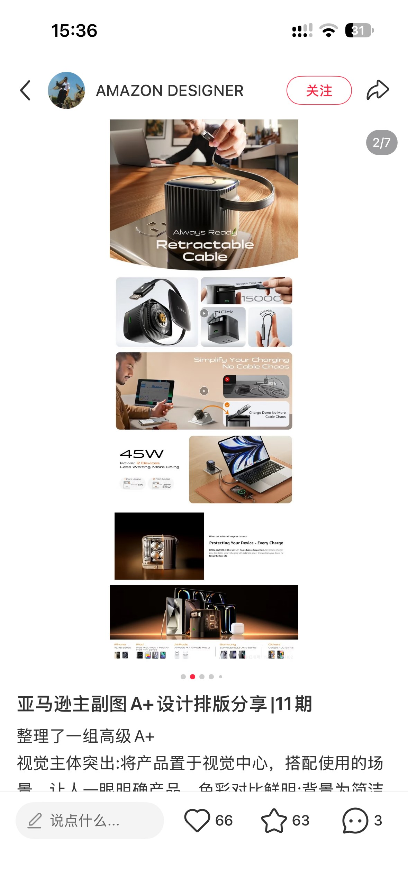
路径：`docs/uta_style_v3/assets/key/IMG_0540.png`

<table>
<tr>
<td> <code>docs/uta_style_v3/assets/key/IMG_0540.png</code></td>
<td>同 AP_007。开场是低机位斜向上。产品放在木台面上，暖的侧光，一只手把线拉出来，卖点是当场做出来的，引线从产品延伸出去。参考图底部的弧边上有英文标题，那是参考图自己的字，不抄进我们的画面。后面是四格细节拼贴、人在场景里的问题与解决、左边大数字右边场景、暗调微距，最后全家福收尾。给我们的规则：首帧用低机位仰拍；卖点用引线直接指到水位窗、顶部控制台和 304 机身。后面每个模块只讲一个点，一张图配一句话。</td>
</tr>
</table>

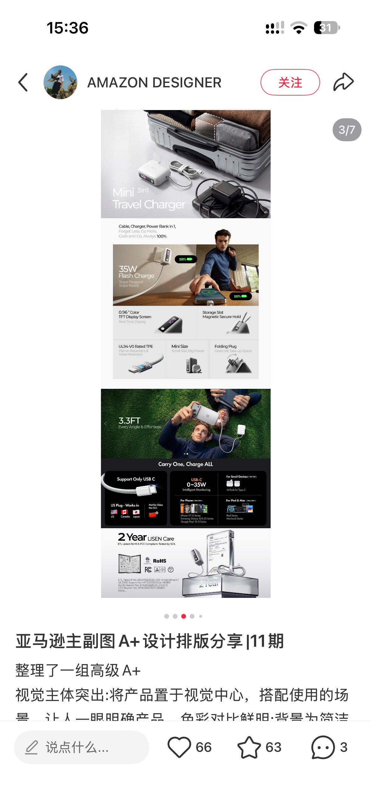
路径：`docs/uta_style_v3/assets/key/IMG_0541.png`

<table>
<tr>
<td> <code>docs/uta_style_v3/assets/key/IMG_0541.png</code></td>
<td>同 AP_006。人坐在产品后面和周围，产品在前景。页面中段突然出现一整条鲜绿的草坪，人躺在草地上拿着产品，用来打断白页。整页以白为主，只有一块深色规格。给我们的规则：人和产品同框时，产品在前景，低机位仰拍，关系要清楚。中段可以有一条撞色带，例如草绿，用来换节奏，但仍然要落在第 9.1 节的小红书日光调里。不抄参考图上的商标和参数。</td>
</tr>
</table>

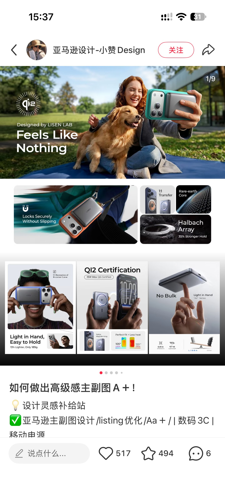
路径：`docs/uta_style_v3/assets/key/IMG_0542.png`

<table>
<tr>
<td> <code>docs/uta_style_v3/assets/key/IMG_0542.png</code></td>
<td>同 AP_005。开场是女人和金毛在户外靠得很近，蓝绿色调。标题做了设计过的字体处理，产品被举到镜头前。下面是一排整齐的方卡或圆角小卡，每张一个细卖点，同一个色系。给我们的规则：A+ 首屏是暖的人宠场景，蓝绿或日光统一；标题按第 6A 节处理；场景下面一排等大的方卡，每张一个点。喂水器写 1 m 感应、10–15 秒延时、低于 25 dB、304、水泵和水盘可拆、缺水断电。喂食器待补充。不抄参考图上的品牌字。</td>
</tr>
</table>

## 6E. 叙事式 A+ 主框架（锦浩要求，2026-11-15，参考 A 家 EMG 精选 IMG_0540/0541/0542）

> 2026-11-15 更新：本节「全部同一场景、同一构图」规则已被 §6H 覆盖；情绪递进与视线交接保留。

不是 oneisall 那种一块一块往下叠。一个场景从页顶走到页底，眼睛跟着一条主线。这条叙事结构是 A+ 整页的主框架。第 2 节的模块顺序、第 4 节的画法、第 6A 到第 6D 节的字体和版式，都嵌在这条主线里面，不再各自换背景另起一页。

喷水器整页用同一只布偶猫（蓝眼、奶油重点色，与副图 S1 一致），同一套奶白客厅，同一扇落地窗的白天侧光。喂食器整页用同一只金毛（依据 XHS_025）。中途不换宠物、不换房子。

### 6E.1 为什么换

| | 模块堆叠 | 叙事主线 |
|---|---|---|
| 例子 | oneisall 饮水器 A+（第 2.1 节：容量、材质、静音、清洗各自换一块底）；AP_001–AP_007 也是一段一个场景 | A 家 EMG 精选：IMG_0540 同 AP_007，IMG_0541 同 AP_006，IMG_0542 同 AP_005 |
| 整页 | 模块上下叠，每块重新介绍产品 | 一个场景从页顶走到页底 |
| 视线 | 每块自己结束 | 上一块的目光、水流、引线、光的方向接进下一块 |
| 房子和光 | 可以换房间、换白天黑夜 | 同一套房子、同一扇窗的日光；色调锁在第 9.1 节 A 档 |
| 宠物 | 可以换一只 | 喷水器全程同一只；喂食器全程同一只 |
| 已有材料 | 被当成一块块独立海报 | 嵌进这条主线里，当零件用 |

### 6E.2 主线规则

1. **一个连续场景。** 同一套房子、同一扇窗的日光、同一只宠物。静音也不把整页换成另一间暗房；闭眼安睡发生在同一扇窗边。
2. **出口接进口。** 每一拍结束时，宠物的目光、水流、引线或光的方向，必须指向下一拍。
3. **色调锁定。** 生活场景按第 9.1 节 A 档。整页不做暗黑科技风。中段最多一条撞色带（见 IMG_0541），仍然落在日光调里。
4. **低机位斜向上。** 来自第 6D.4 节。产品在前景时相机贴近桌面或地面，略微往上看。
5. **卖点的标法只有两种。** 细引线直接指到产品部位，或场景下方一排等大的方卡，每张卡一个点。不另做大说明框。
6. **只写已确认的事实。** 喷水器：低于 25 dB；感应 1 m；离开后继续出水约 10–15 秒；三种模式为感应、持续、定时（15 分钟一档）；304 不锈钢；水泵和水盘可拆；缺水自动断电和防干烧；滤芯每 1–2 周更换。不写容量、加热、补水量或任何健康功效。喂食器未确认的参数一律写待补充。

### 6E.3 叙事分镜（喷水器）

第 1 拍必须过第 6B.1 节的首帧停驻力：表情有戏、机位有冲击、窗光真实，缩成手机缩略图 1 秒内能看出猫在走近、水要出来。

| 拍 | 对应 S 分镜 | 卖点 | 表情 | 机位 | 字体层级（§6A） | 参考版式 | 衔接到下一拍的视线 |
|---|---|---|---|---|---|---|---|
| 1 猫走近 | S1 | 感应出水，1 m | E01，EXP_012；首帧停驻力强。依据第 14.8 节 | 贴地低机位仰拍，猫在前景 | 顶部 Poppins ExtraBold；琥珀色「1 m」，单位缩小底对齐 | IMG_0542 的人宠开场情绪；IMG_0540 的低机位 | 抬起的前爪和眼神指向出水口 |
| 2 出水 | S1 后半 | 靠近后水流出 | E07 凝视水柱；XHS_014 | 低机位，水柱在前景 | 引线指向出水口；一句说明 | IMG_0540 | 水柱把视线带向舌尖 |
| 3 舌尖碰水 | S2 | 爱喝流动水。不写容量、不写健康 | E06；XHS_009、XHS_003 | 超近略俯，脸和舌尖最大 | 全大写口号，句末句号；没有容量大数字 | IMG_0542 只学开场亲密，不学品牌字 | 水面高光留在盘里，身体开始离开 |
| 4 离开后水还在流 | S3 | 离开后再流约 10–15 秒 | E12 回头看水 | 低位侧后方，水盘在前景 | 半透明大数字「10–15 s」，单位底对齐 | IMG_0540，一图一句 | 回头的目光回到还在流的水 |
| 5 安睡 | S4 | 低于 25 dB | E05、E10；XHS_020、XHS_002。不用惊吓 | 同一房间、同一扇窗；闭眼特写，产品在旁边仍可辨 | 琥珀色「<25 dB」；不把整页改成暗场 | AP_006 的深色只允许这一拍局部压暗 | 闭着的头朝向同一台产品 |
| 6 三种模式 | S5 | 感应 / 持续 / 定时，定时按 15 分钟一档。本套唯一卡片 | 主画面仍是这只布偶；三张小卡用走近、持续喝、等待来区分 | 上为动作，下为三张等大方卡 | 巨型「3」加侧标题；小卡各一行 | IMG_0542 的方卡；AP_001 只学三个数字的层级 | 从左到右读完，最后一张的水流指向金属 |
| 7 304 不锈钢 | S6 | 304 不锈钢，结实。不写食品级、抑菌 | E09，爪子搭在机身上；XHS_013、XHS_022 | 低位近景，拉丝上有一条高光 | 立体「304」，不印在机身上 | IMG_0540 的引线指向机身 | 爪尖沿钢面向下，接到被提起的水盘 |
| 8 一拆就洗 | S7 | 水泵和水盘可拆 | E08，EXP_011 探头看手；EXP_007 只学伸爪，不学黑底棚拍 | 约 45° 俯拍，手把水盘提起来 | 图标行：提起、冲洗、水泵可拆。不用大数字 | AP_007 只学「手把零件拉出来」 | 提起的水盘把视线带到滤芯 |
| 9 按时换滤芯 | S8 | 每 1–2 周更换。不写过滤功效 | E07 嗅探；XHS_004。XHS_015 只学更换动作 | 本页唯一正顶视 | 巨型「1–2」，单位 weeks 底对齐 | AP_003 只学「一格一个点」 | 滤芯放进盘，水位的方向接到缺水 |
| 10 窗边缺水自停 | S9 | 缺水自动断电、防干烧、水位窗看得见 | E07 盯着水位窗。EXP_015 的惊吓不用 | 与水位窗齐平的近景；同一扇窗，门外可有一小块绿 | 三个短图标，不发明灯色 | IMG_0540 的引线指水位窗；IMG_0541 的一块绿色节奏 | 主线在这里收束，猫还看着同一台机器 |

### 6E.4 叙事分镜（喂食器）

列和喷水器相同。卖点只取第 14.9 节。容量、份数、时刻、分贝、锁的结构、可拆零件、App，全部待补充，不编数字。全程同一只金毛，同一间白天的客厅。

| 拍 | 对应 S 分镜 | 卖点 | 表情 | 机位 | 字体层级（§6A） | 参考版式 | 衔接到下一拍的视线 |
|---|---|---|---|---|---|---|---|
| 1 到点冲过来 | 无副图编号，对应第 14.9 节「定时出粮」 | 定时出粮。时刻待补充 | E01，EXP_012；XHS_025。要过第 6B.1 节 | 贴地低机位，狗从前景冲入 | 顶部粗标题。不写未确认的钟点 | IMG_0542 | 前爪和耳朵指向出粮口 |
| 2 粮落入碗 | 同上 | 粮食正在掉进碗。份数待补充 | E07 盯着落粮 | 低机位，碗在前景 | 引线指出粮口 | IMG_0540 | 下落的粮把视线带进碗 |
| 3 低头吃 | 同上，「适量」 | 适量、各吃各的。口径待补充 | E06 的吃相；XHS_004 | 45° 或略俯，嘴在碗里 | 一句说明，不放大未确认的克数 | IMG_0542 的小卡只留位置 | 吃完抬头，看向离开的方向 |
| 4 吃完人已离开 | 同上，「不怕打扰」 | 主人不在也吃完。是否有远程待补充 | E12，舔嘴；XHS_003 | 低位，狗在中景，行李箱只作远景且不写承诺 | 短标题加一句 | IMG_0541 的前后景关系 | 满足的眼神回到机器 |
| 5 旁边安睡 | 同上，「安静出粮」 | 如有此功能。分贝待补充 | E05、E10；XHS_020、XHS_002 | 同一房间，闭眼特写 | 不写未确认的分贝数字 | 局部压暗即可，不换房子 | 闭着的头朝向喂食器 |
| 6 模式 | 同上 | 模式名称和档位待补充 | 仍是这只金毛；小卡动作待有事实后再画 | 上动作、下方卡。没有确认的模式就不做三卡 | 有确认的数字才放大 | IMG_0542 | 待补充 |
| 7 伸爪但机身不动 | 同上，「防偷吃 / 稳固」 | 被扒仍稳。锁和材质待补充 | E09；XHS_022。EXP_007 只学伸爪 | 低位近景 | 一句，不写未确认的锁结构 | IMG_0540 | 爪尖沿机身往下 |
| 8 可拆 | 同上 | 哪些零件可拆待补充 | E08，EXP_011 | 只在确认可拆之后才拍手部 | 图标行，标签用已确认的零件名 | AP_007 只学手部动作 | 待补充 |
| 9 慢食贴碗 | 同上，「慢食」 | 如有此功能，待补充 | XHS_004 的专注；不学其功效词 | 超近，鼻子在碗沿 | 不写未确认的慢食时长 | EXP_011 的贴脸距离 | 待补充 |
| 10 看向产品 | 同上，「远程 / App」 | App 和摄像头待补充 | E07。没有事实就不画手机界面 | 宠物仰视产品 | 不画未确认的 App 界面 | IMG_0541 的人在后、产品在前，仅作关系 | 主线收束 |

### 6E.5 嵌入既有体系的对照

五条融合规则见第 14.5 节：动作演出卖点、宠物和产品有接触或视线、表情和卖点对应、低机位加前后景、场景就是使用证据。下表是喷水器每一拍怎么用。喂食器同一套规则，事实不够的格子保持待补充。

| 拍 | 第 14.5 节 | 第 6A 节 | 第 6B 节 | 第 6C 节 | 第 6D 节 |
|---|---|---|---|---|---|
| 1 | 走近这个动作就是感应 | 「1 m」是唯一大数字 | 必须过首帧停驻力 | EXP_012、E01 | IMG_0540 的低机位，IMG_0542 的开场 |
| 2 | 水柱是结果，不是另一套场景 | 引线小字，不和标题抢 | 机位仍低 | E07 | IMG_0540 的拉线 |
| 3 | 舌尖碰到水 | 口号，不造容量数字 | 表情是满足，不是摆拍 | E06 | 不学 AP_005 的品牌字 |
| 4 | 离开和还在流同时可见 | 「10–15 s」半透明压底 | 回头要看得懂 | E12 | 一图一句 |
| 5 | 闭眼就是安静 | 「<25 dB」琥珀色 | 不把睡觉画成惊吓 | E05、E10 | 不整页改成 AP_004 那种夜色舞台 |
| 6 | 三张小卡各演一种模式 | 巨型「3」，15 分钟只写在定时卡里 | 卡片是例外，本套只用这一次 | 小卡里的动作仍要能认 | IMG_0542 的等大方卡 |
| 7 | 爪子搭上去，机器不动 | 立体「304」 | 金属高光要真 | E09；XHS_013、XHS_022 | 引线指机身 |
| 8 | 手把水盘提起来，猫在看 | 图标行 | 手是操作，不是摆拍 | EXP_011、EXP_007 | AP_007 只学拉出零件 |
| 9 | 鼻子靠近刚放好的滤芯 | 「1–2」加 weeks | 不写功效 | E07；XHS_004、XHS_015 | 一格一个点 |
| 10 | 盯着水位窗 | 三个短标签 | 安全收尾，不是惊吓 | E07 | IMG_0540 指窗口，IMG_0541 留一块绿 |

第 6C.1 节的 EXP_001–017 是表情库，按上表选用。纯色棚拍底的 EXP 只借表情，背景仍用这套房子的窗光。

### 6E.6 图文拆解（嵌原图）

下面每张图都是仓库里的原文件。参考图上的商标、英文标题和参数只用来认出这张图，不写进我们的画面。

#### 锦浩精选

路径：`docs/uta_style_v3/assets/key/IMG_0540.png`

<table>
<tr>
<td> <code>docs/uta_style_v3/assets/key/IMG_0540.png</code></td>
<td>同 AP_007。低机位斜向上，木台面暖侧光，手把零件拉出来，引线从产品走出。接到第 1、2、7、10 拍：首帧仰拍，卖点指到水位窗、控制台和 304 机身。不抄英文标题。</td>
</tr>
</table>

路径：`docs/uta_style_v3/assets/key/IMG_0541.png`

<table>
<tr>
<td> <code>docs/uta_style_v3/assets/key/IMG_0541.png</code></td>
<td>同 AP_006。产品在前景，人在后面。中段一整条草绿打断白页。接到第 10 拍的窗外绿色，以及人和产品同框时的前后关系。不抄商标和参数。</td>
</tr>
</table>

路径：`docs/uta_style_v3/assets/key/IMG_0542.png`

<table>
<tr>
<td> <code>docs/uta_style_v3/assets/key/IMG_0542.png</code></td>
<td>同 AP_005。人宠靠得很近，蓝绿日光，标题有设计，下面一排等大方卡。接到第 1 拍的开场和第 6 拍的方卡。喂水器方卡只写已确认的六项；喂食器待补充。不抄品牌字。</td>
</tr>
</table>

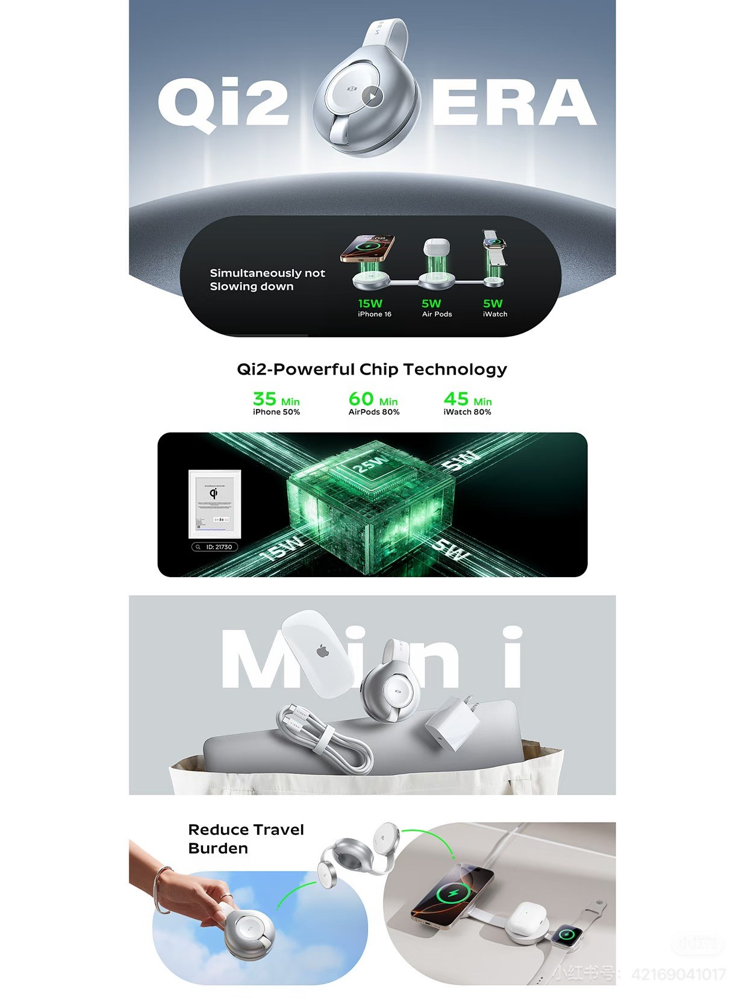
路径：`docs/uta_style_v3/assets/key/AP_001.jpg`

<table>
<tr>
<td> <code>docs/uta_style_v3/assets/key/AP_001.jpg</code></td>
<td>只学三个数字排成一行、以及巨字和产品的层级。不学认证、芯片示意和品牌字。喷水器用在第 6 拍的数字层级。</td>
</tr>
</table>

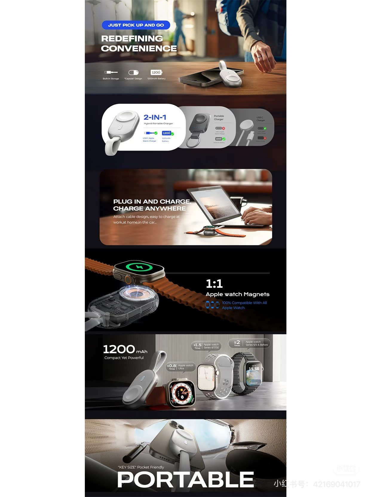
路径：`docs/uta_style_v3/assets/key/AP_002.jpg`

<table>
<tr>
<td> <code>docs/uta_style_v3/assets/key/AP_002.jpg</code></td>
<td>只学胶囊短标签和收尾一个大词的节奏。不学把别家产品变灰的对比卡。</td>
</tr>
</table>

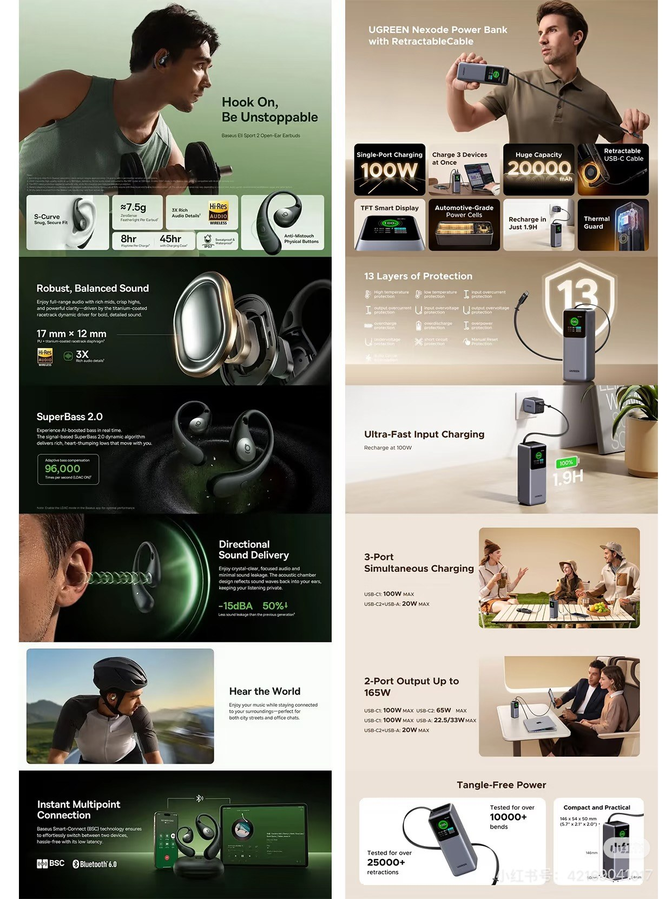
路径：`docs/uta_style_v3/assets/key/AP_003.jpg`

<table>
<tr>
<td> <code>docs/uta_style_v3/assets/key/AP_003.jpg</code></td>
<td>只学一格一个点和整页一个主色相。不学运动耳机的参数。滤芯拍用「一格一个点」。</td>
</tr>
</table>

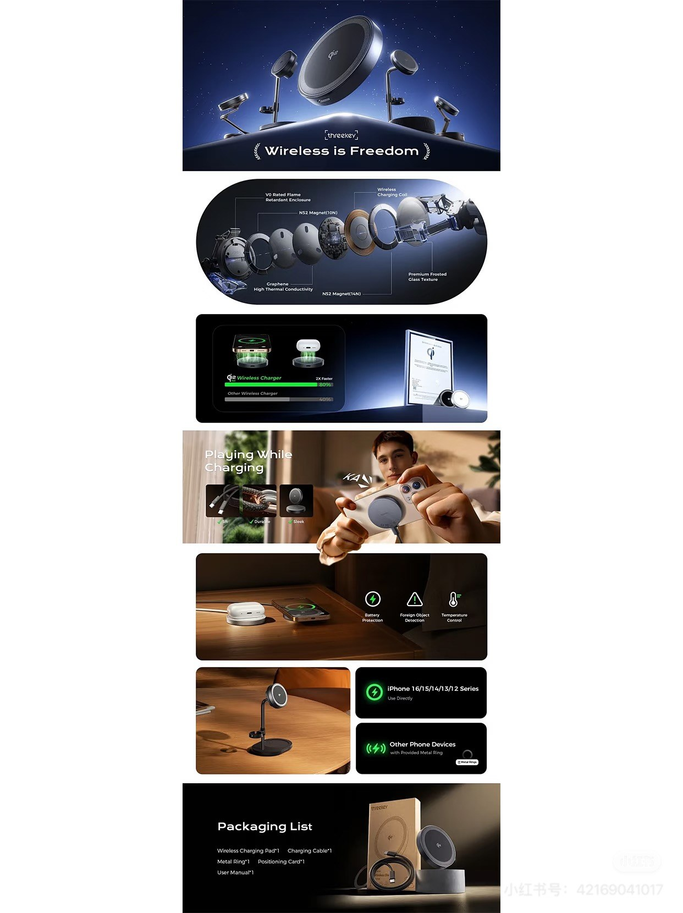
路径：`docs/uta_style_v3/assets/key/AP_004.jpg`

<table>
<tr>
<td> <code>docs/uta_style_v3/assets/key/AP_004.jpg</code></td>
<td>只学引线指向零件、以及图标行。不学夜色舞台当整页主调，不学认证。</td>
</tr>
</table>

路径：`docs/uta_style_v3/assets/key/AP_005.jpg`

<table>
<tr>
<td> <code>docs/uta_style_v3/assets/key/AP_005.jpg</code></td>
<td>同 IMG_0542。人宠开场加下方小卡。不抄标题原文和品牌。</td>
</tr>
</table>

路径：`docs/uta_style_v3/assets/key/AP_006.jpg`

<table>
<tr>
<td> <code>docs/uta_style_v3/assets/key/AP_006.jpg</code></td>
<td>同 IMG_0541。白页里一块深色、一块草坪。深色不铺满整页。</td>
</tr>
</table>

路径：`docs/uta_style_v3/assets/key/AP_007.jpg`

<table>
<tr>
<td> <code>docs/uta_style_v3/assets/key/AP_007.jpg</code></td>
<td>同 IMG_0540。手把零件拉出、四格细节、问题后接做法、最后收束。不抄线缆文案。</td>
</tr>
</table>

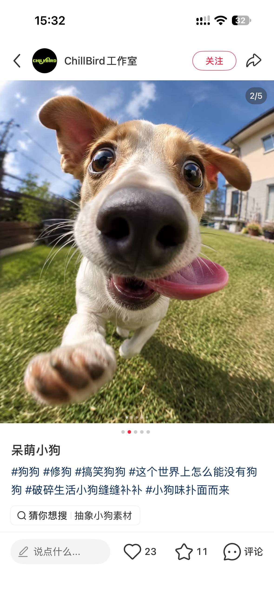
路径：`docs/uta_style_v3/assets/key/EXP_012.jpg`

<table>
<tr>
<td> <code>docs/uta_style_v3/assets/key/EXP_012.jpg</code></td>
<td>鱼眼冲向镜头、伸爪。第 1 拍的首帧停驻力直接参考这张。背景改成这套客厅的窗光，不留草地棚拍。</td>
</tr>
</table>

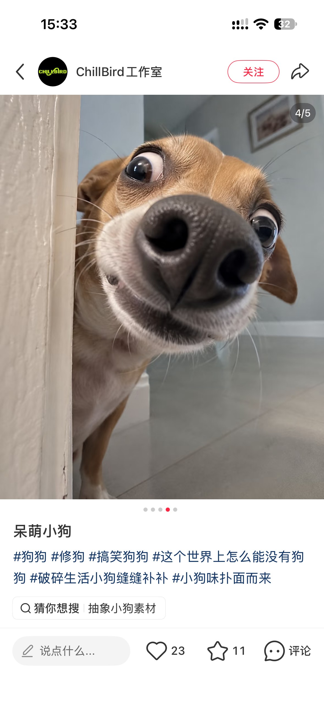
路径：`docs/uta_style_v3/assets/key/EXP_011.jpg`

<table>
<tr>
<td> <code>docs/uta_style_v3/assets/key/EXP_011.jpg</code></td>
<td>门边探头、鼻子贴镜头。第 8 拍拆洗时猫看着手。只学距离，不学门的身份。</td>
</tr>
</table>

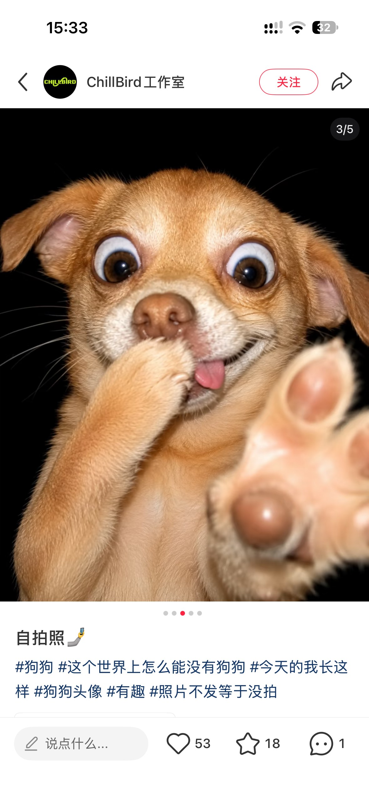
路径：`docs/uta_style_v3/assets/key/EXP_007.jpg`

<table>
<tr>
<td> <code>docs/uta_style_v3/assets/key/EXP_007.jpg</code></td>
<td>伸爪靠近镜头。第 8 拍和第 7 拍可借这个爪。黑底不用，改到窗边木台面。</td>
</tr>
</table>

路径：`docs/uta_style_v3/assets/key/EXP_016.jpg`

<table>
<tr>
<td> <code>docs/uta_style_v3/assets/key/EXP_016.jpg</code></td>
<td>超大脸、粗标题压在头后。可作第 1 拍的海报力度。不把参考图上的英文写进来。</td>
</tr>
</table>

路径：`docs/uta_style_v3/assets/key/XHS_024.jpg`

<table>
<tr>
<td> <code>docs/uta_style_v3/assets/key/XHS_024.jpg</code></td>
<td>低机位、正对走来、抬爪、奶白客厅。第 1 拍的场景和机位。</td>
</tr>
</table>

路径：`docs/uta_style_v3/assets/key/XHS_025.jpg`

<table>
<tr>
<td> <code>docs/uta_style_v3/assets/key/XHS_025.jpg</code></td>
<td>宠物和产品同时有分量，运动瞬间。喂食器第 1 拍的金毛冲刺。</td>
</tr>
</table>

路径：`docs/uta_style_v3/assets/key/XHS_014.jpg`

<table>
<tr>
<td> <code>docs/uta_style_v3/assets/key/XHS_014.jpg</code></td>
<td>凝视出水。第 2 拍。</td>
</tr>
</table>

路径：`docs/uta_style_v3/assets/key/XHS_009.jpg`

<table>
<tr>
<td> <code>docs/uta_style_v3/assets/key/XHS_009.jpg</code></td>
<td>舌尖碰到水的超近。第 3 拍。</td>
</tr>
</table>

路径：`docs/uta_style_v3/assets/key/XHS_003.jpg`

<table>
<tr>
<td> <code>docs/uta_style_v3/assets/key/XHS_003.jpg</code></td>
<td>舔水、满足。第 3 拍和第 4 拍的嘴边水光。</td>
</tr>
</table>

路径：`docs/uta_style_v3/assets/key/XHS_011.jpg`

<table>
<tr>
<td> <code>docs/uta_style_v3/assets/key/XHS_011.jpg</code></td>
<td>从画面一侧离开，墙上有树影。第 4 拍的离开。</td>
</tr>
</table>

路径：`docs/uta_style_v3/assets/key/XHS_020.jpg`

<table>
<tr>
<td> <code>docs/uta_style_v3/assets/key/XHS_020.jpg</code></td>
<td>闭眼享受。第 5 拍。不把整页做成这张的暗调。</td>
</tr>
</table>

路径：`docs/uta_style_v3/assets/key/XHS_002.jpg`

<table>
<tr>
<td> <code>docs/uta_style_v3/assets/key/XHS_002.jpg</code></td>
<td>半闭眼的睡相。第 5 拍的表情，房间仍是同一扇窗。</td>
</tr>
</table>

路径：`docs/uta_style_v3/assets/key/XHS_021.jpg`

<table>
<tr>
<td> <code>docs/uta_style_v3/assets/key/XHS_021.jpg</code></td>
<td>大数字加腾空。第 6 拍只学数字的重量，主画面不换宠物。</td>
</tr>
</table>

路径：`docs/uta_style_v3/assets/key/XHS_013.jpg`

<table>
<tr>
<td> <code>docs/uta_style_v3/assets/key/XHS_013.jpg</code></td>
<td>厨房里的金属和拆件。第 7、8 拍。不学功效文案。</td>
</tr>
</table>

路径：`docs/uta_style_v3/assets/key/XHS_022.jpg`

<table>
<tr>
<td> <code>docs/uta_style_v3/assets/key/XHS_022.jpg</code></td>
<td>用扒和推证明结实。第 7 拍。</td>
</tr>
</table>

路径：`docs/uta_style_v3/assets/key/XHS_004.jpg`

<table>
<tr>
<td> <code>docs/uta_style_v3/assets/key/XHS_004.jpg</code></td>
<td>专注嗅探。第 9 拍。</td>
</tr>
</table>

路径：`docs/uta_style_v3/assets/key/XHS_015.jpg`

<table>
<tr>
<td> <code>docs/uta_style_v3/assets/key/XHS_015.jpg</code></td>
<td>只学更换动作的清楚，不学分层名称和功效。第 9 拍。</td>
</tr>
</table>

路径：`docs/uta_style_v3/assets/key/XHS_012.jpg`

<table>
<tr>
<td> <code>docs/uta_style_v3/assets/key/XHS_012.jpg</code></td>
<td>室内看向窗外的天。第 10 拍的窗。</td>
</tr>
</table>

路径：`docs/uta_style_v3/assets/key/XHS_010.jpg`

<table>
<tr>
<td> <code>docs/uta_style_v3/assets/key/XHS_010.jpg</code></td>
<td>窗边的光和投影。第 10 拍只学光，不学界面。</td>
</tr>
</table>

路径：`docs/uta_style_v3/assets/key/ANCHOR_G1.jpg`

<table>
<tr>
<td> <code>docs/uta_style_v3/assets/key/ANCHOR_G1.jpg</code></td>
<td>产品外观和 304 质感的锚点。调色偏暖、宠物偏侧，不作为色调和表情的锚。几何以 product_reference.png 为准。</td>
</tr>
</table>

路径：`docs/uta_style_v3/assets/key/ANCHOR_G2.jpg`

<table>
<tr>
<td> <code>docs/uta_style_v3/assets/key/ANCHOR_G2.jpg</code></td>
<td>同 G1，第二张外观锚点。叙事页的猫、窗光和低机位按第 6E 节，不照这张的傍晚暖调。</td>
</tr>
</table>

### 6E.7 不做

- 不按 oneisall 的方式一块换一个无关背景。
- 模块和模块之间不跳场景、不换宠物、不换房子。
- 整页不做暗黑科技风。夜间静音只在同一房间里局部压暗。
- 不放认证、奖项、销量。
- 不和竞品比，不出现别家商标，不把参考图上的英文标题抄过来。
- 不写容量、加热、补水量和健康功效。喂食器没有确认的数字保持待补充。

## 6F. 渲染明暗对比（锦浩要求，2026-11-15）

> 来源：锦浩对 GPT v04（S1–S9）的反馈：文字、标题、场景、光线已经达到他 80% 的需求，但还不够高级，渲染的明暗对比不够。参考 A 家精选 [IMG_0540](uta_style_v3/assets/key/IMG_0540.png) 路径：`docs/uta_style_v3/assets/key/IMG_0540.png` / [IMG_0541](uta_style_v3/assets/key/IMG_0541.png) 路径：`docs/uta_style_v3/assets/key/IMG_0541.png` / [IMG_0542](uta_style_v3/assets/key/IMG_0542.png) 路径：`docs/uta_style_v3/assets/key/IMG_0542.png` 的光影处理。

### 6F.1 实测对比（200×200 下采样，亮度 L = 0.2126R + 0.7152G + 0.0722B）

| 图 | 平均亮度 | 亮度标准差 | 暗部 p5 | 亮部 p95 | p95−p5 跨度 | 暗像素占比（L<0.2） |
|---|---|---|---|---|---|---|
| [IMG_0540](uta_style_v3/assets/key/IMG_0540.png) 路径：docs/uta_style_v3/assets/key/IMG_0540.png（同 AP_007）首图 | 0.45 | 0.251 | 0.06 | 0.87 | 0.81 | 21% |
| [IMG_0541](uta_style_v3/assets/key/IMG_0541.png) 路径：docs/uta_style_v3/assets/key/IMG_0541.png（同 AP_006）首图 | 0.57 | 0.316 | 0.05 | 0.94 | 0.89 | 19% |
| [IMG_0542](uta_style_v3/assets/key/IMG_0542.png) 路径：docs/uta_style_v3/assets/key/IMG_0542.png（同 AP_005）首图 | 0.51 | 0.284 | 0.10 | 0.93 | 0.83 | 14% |
| 我们 S1–S9（S4 夜景除外） | 0.57–0.79 | 0.195–0.271 | 0.15–0.37 | 0.89–1.00 | 0.57–0.78 | 1–9% |

说明：A 家三张是从手机截图里裁出的首图区域，有压缩，数值是近似值。结论很清楚：我们的问题不是亮部不够亮，而是**暗部不够暗、暗部面积太少**，所以画面发灰发平，不够高级。

### 6F.2 规则

1. **暗部要压下去**：生活场景图暗部 p5 ≤ 0.12，暗像素（L<0.2）占 10–20%。暗部放在产品背光面、桌面投影、家具阴影、画面边角。
2. **明暗跨度**：p95−p5 ≥ 0.80，亮度标准差 ≥ 0.25。
3. **单一主光源、方向明确**：窗边侧光或侧逆光，产品一侧亮、一侧暗。304 拉丝面要有一条清晰高光带，加上渐暗过渡（参考 [IMG_0540](uta_style_v3/assets/key/IMG_0540.png) 路径：`docs/uta_style_v3/assets/key/IMG_0540.png` 机身的侧光和木桌反光）。
4. **投影要实**：产品和宠物落在桌面或地面上的投影要清晰、有方向，不能是平均的灰雾。
5. **视觉中心最亮**：最亮的位置留给产品和宠物的脸，背景和边角自然压暗（暗角），引导视线（配合 §6E 的叙事主线）。
6. **整页节奏**：可以有一块饱和、偏暗的撞色区打断白页（参考 [IMG_0541](uta_style_v3/assets/key/IMG_0541.png) 路径：`docs/uta_style_v3/assets/key/IMG_0541.png` 的草坪绿），但全页不做暗黑科技风。
7. **和 §9.1 调色的关系**：平均亮度仍然按 XHS 区间 0.55–0.69，饱和度 0.22–0.30，R−B +0.07~+0.15。也就是说，在平均亮度不变的前提下拉大明暗跨度，靠更暗的阴影加更亮的高光，不是整体压暗。
8. **不做**：整张过曝发白、无影平光、HDR 光晕、产品自发光（产品永远不发光，这条硬规则不变）。

具体范例见 §6G.3。

### 6F.3 给 GPT 的出图提示要点

"single directional window side light, deep soft shadows, strong tonal contrast, crisp contact shadows, specular highlight band on brushed stainless steel, subtle vignette, premium editorial look, no glow"

## 6G. 视觉突出三要素（锦浩要求，2026-11-15）

> 来源：锦浩口述。"详情案例里光影明暗对比拉得很开，对比度特别好；视觉冲击靠机位，机位很重要。"视觉要突出，靠三件事：机位、颜色对比、明暗色调。三条缺一不可，每张副图和每个 A+ 模块出图前都要逐条检查。
>
> 案例编号：[IMG_0540](uta_style_v3/assets/key/IMG_0540.png) 路径：`docs/uta_style_v3/assets/key/IMG_0540.png`（同 AP_007）、[IMG_0541](uta_style_v3/assets/key/IMG_0541.png) 路径：`docs/uta_style_v3/assets/key/IMG_0541.png`（同 AP_006）、[IMG_0542](uta_style_v3/assets/key/IMG_0542.png) 路径：`docs/uta_style_v3/assets/key/IMG_0542.png`（同 AP_005），以及锦浩发来的 image.png。image.png 是我们自己的 GPT v04 S1–S9 总览，入库为 [V04_S1-S9_overview.png](uta_style_v3/assets/key/V04_S1-S9_overview.png) 路径：`docs/uta_style_v3/assets/key/V04_S1-S9_overview.png`。

路径：`docs/uta_style_v3/assets/key/V04_S1-S9_overview.png`

### 6G.1 机位是视觉冲击的关键【锦浩本人要求，独立硬性要求】

一套图里**至少要有 1 张明显俯角、至少 2 张明显低视角**。平视、正面、居中的"证件照机位"一套图最多 1 张，主图白底除外。

| 机位 | 具体做法 | 参考 |
|---|---|---|
| 低视角仰拍 | 相机贴近桌面或地面，略微往上看产品，让产品显得高大有分量；地平线放低，前景带一点虚化的桌面或地板 | [IMG_0540](uta_style_v3/assets/key/IMG_0540.png) 路径：docs/uta_style_v3/assets/key/IMG_0540.png 首图（低机位仰看机身，手往外拉线）；v04 的 S1（猫走近，低机位）、S6（304 机身） |
| 俯角 | 从正上方或 45° 往下拍，看清水面、托盘、拆洗结构，或者宠物和人躺着、趴着的全身 | [IMG_0541](uta_style_v3/assets/key/IMG_0541.png) 路径：docs/uta_style_v3/assets/key/IMG_0541.png 草坪那一屏（俯拍人躺在草地上举着产品）和首图（俯拍行李箱）；v04 的 S8（俯拍换滤芯） |
| 贴脸特写 / 鱼眼 | 宠物脸或舌头几乎碰到镜头，产品在旁边清晰入画，用来做首帧停驻力（§6B.1） | v04 的 S2（舌尖碰水）；EXP_011、EXP_012、EXP_013 |
| 前景产品、后景人宠 | 产品在前景，低机位，人和宠物在后景，讲清两者的关系 | [IMG_0541](uta_style_v3/assets/key/IMG_0541.png) 路径：docs/uta_style_v3/assets/key/IMG_0541.png、[IMG_0542](uta_style_v3/assets/key/IMG_0542.png) 路径：docs/uta_style_v3/assets/key/IMG_0542.png |

不做：每张都同一高度、同一角度；广角把 304 方形机身拉变形（产品比例必须和 product_reference.png 一致）。

### 6G.2 颜色对比要有

| 做法 | 具体要求 | 参考 |
|---|---|---|
| 主体对背景的色相对比 | 银色 304 机身配暖木色或暖白墙；宠物毛色和背景拉开色相（橘猫配蓝绿背景，银渐层配暖木色） | [IMG_0540](uta_style_v3/assets/key/IMG_0540.png) 路径：docs/uta_style_v3/assets/key/IMG_0540.png（暖木桌配深色产品）；[IMG_0542](uta_style_v3/assets/key/IMG_0542.png) 路径：docs/uta_style_v3/assets/key/IMG_0542.png（金毛和红发对蓝天绿草） |
| 一块撞色区 | 每页或每套图允许出现 1 块饱和撞色（草坪绿、蓝绿天空），用来打断白页的节奏 | [IMG_0541](uta_style_v3/assets/key/IMG_0541.png) 路径：docs/uta_style_v3/assets/key/IMG_0541.png 草坪绿 |
| 强调色 | 数字和关键词统一用琥珀色 #F47A21（§6），一张图最多一个强调色 | v04 的 S1「1 m」、S3「10–15 s」、S4「<25 dB」 |
| 仍然遵守调色区间 | 饱和度 0.22–0.30，R−B +0.07~+0.15（§9.1）；撞色靠局部，不靠整体加饱和 | XHS_001–029 |

### 6G.3 明暗色调要有

按 §6F 执行：暗部 p5 ≤ 0.12，明暗跨度 ≥ 0.80，暗像素占 10–20%；单一方向的侧光，304 拉丝面要有高光带，投影要实，边角压暗。

| 参考 | 明暗做法 |
|---|---|
| [IMG_0540](uta_style_v3/assets/key/IMG_0540.png) 路径：docs/uta_style_v3/assets/key/IMG_0540.png | 暖色侧光打在机身一侧，另一侧压暗，桌面有反光和投影 |
| [IMG_0541](uta_style_v3/assets/key/IMG_0541.png) 路径：docs/uta_style_v3/assets/key/IMG_0541.png | 白页里放一块偏暗的草坪区，人物脸部最亮 |
| [IMG_0542](uta_style_v3/assets/key/IMG_0542.png) 路径：docs/uta_style_v3/assets/key/IMG_0542.png | 户外逆光、侧光，人和狗的轮廓有亮边 |
| image.png（v04）| 实测对比最好的是 S2（跨度 0.78）和 S4 夜景；S1、S5、S6 跨度只有 0.57–0.63，偏平偏白，下一版要按 6F 压暗部 |

### 6G.4 出图前检查表

- [ ] 机位：这张是低视角、俯角还是特写？整套图有没有满足"至少 1 张俯角、2 张低视角"？
- [ ] 颜色：主体和背景有没有拉开色相？强调色是不是只有一个？
- [ ] 明暗：暗部 p5 ≤ 0.12，跨度 ≥ 0.80 了吗？光的方向明确吗？

## 6H 最终执行方案 v06（锦浩 2026-11-15 确认，优先级高于 6E 中与之冲突的条款）

> 来源：锦浩 2026-11-15 16:30 语音确认「可以开工」。本节覆盖 6E 的「全部 9 张同一场景、同一构图」规则；6E 的情绪递进和视线交接仍然保留。案例编号：AP_001–AP_007（A 家 7 张 A+ 案例），EXP_001–017（表情库，§6C.1），IMG_0540–0542（§6D.4），XHS_###（§6C）。

### 6H.1 A 家 7 张实际结构（逐张拆解，依据缩略图目测，深浅为目测非测量）

| 案例 | 屏数 | 屏序与功能角色 | 人物位置 | 深浅分布 |
|---|---|---|---|---|
| AP_001 Qi2 | 5 | 产品单独巨字开场 → 卖点特写 ×2 → 产品在包里（特殊环境）→ 手持 + 天空（互动） | 末屏 | 浅 深 深 浅 浅 |
| AP_002 手表充 | 6 | 人 + 咖啡馆开场 → 对比卡 → 人用电脑场景 → 卖点特写 ×2 → 车内（特殊环境） | 开场、中段 | 几乎全深 |
| AP_003 左 耳机 | 6 | 人物大图 + 参数格开场 → 卖点特写 ×3 → 骑行场景 → 多设备 | 开场、中段 | 深为主，第 5 屏浅 |
| AP_003 右 移动电源 | 6 | 人持产品 + 2×4 宫格开场 → 卖点 ×2 → 野餐、火车场景 → 耐用测试 + 尺寸收尾 | 开场、后段 | 全暖浅 |
| AP_004 无线充 | 7 | 产品单独 + 星空（特殊环境）开场 → 爆炸图 → 对比 → 人边玩边充 → 桌面 + 安全图标 → 兼容 → 包装清单收尾 | 中段 | 深为主，第 4 屏暖 |
| AP_005 移动电源（副图） | 9 | 人 + 金毛开场 → 深色技术宫格 → 三张竖卡（手 / 人） | 开场 | 浅开场，深宫格 |
| AP_006 旅行充 | 6 | 产品在行李箱（特殊环境）开场 → 人伸手 → 浅灰功能宫格 → 人躺草坪 → 深色兼容表 → 保修收尾 | 中段 | 浅 浅 浅 绿深 深 浅 |
| AP_007 伸缩线 | 6 | 手拉线特写开场 → 细节宫格 → 人用场景 ×2 → 深色防护卖点 → 全家福收尾 | 中段 | 深 浅 浅 浅 深 深 |

结论：与锦浩四类划分基本一致（前面以产品和卖点为主），差异 4 点并已纳入本方案：① 人物互动在开场和中段都有，不集中在后面；② 没有严格一深一浅，而是整页一个底色、插 1–2 屏反差色；③ 多数有参数 / 兼容 / 包装 / 保修收尾屏，新增第五类「参数收尾」；④ 特殊环境视角与开场合并，不单独占屏。

### 6H.2 副图 S1–S9（4:5，交付 1600×2000；本轮只出缩略图）

规则：
- 不再统一角度。近景特写、远景全貌、俯视结构、拆开清洗、不同使用状态轮流出现（依据 AP_005、AP_007 宫格节奏；6G.1 机位要求仍有效：至少 1 张俯拍、至少 2 张低机位仰拍、最多 1 张平视正面）。
- 每张一个独立卖点，只用已确认事实。
- 场景和家具轮换：客厅（沙发、电视柜、地毯）→ 餐桌 / 书桌 → 收纳 / 出行箱包 → 插电使用 → 庭院户外（庭院要有装饰：花盆、木栅栏、户外椅、灯串等）。家居要有真实细节，允许一块视觉撞色，或者家居风格融入（北欧原木、法式奶油、中古胡桃木等）。
- 人物（欧美面孔）进入画面，至少 4 张有人或手。
- **美屏设计语言**（锦浩 2026-11-15 澄清定义）：借鉴数字屏幕 / 显示器的视觉美学——高对比度、锐利边缘、发光感、UI 元素感、干净的几何分区——融入家居场景设计。执行边界：发光感只用于画面中的 UI 元素、数字卡片、示意弧线和背景光效，产品本体永远不发光（沿用既有规则）；不出现 Wi‑Fi 图标。参考：AP_001 芯片屏、AP_004 爆炸图深色卡、AP_005 技术宫格。
- 「包里收纳」「充电」场景：只表现收纳 / 搬运和插电使用，不声称电池、无线或便携续航（未确认）。

| 编号 | 卖点（已确认） | 景别 / 机位 | 场景与家具 | 人宠 | 表情（EXP） | 色调 |
|---|---|---|---|---|---|---|
| S1 | 1 m 感应出水 | 贴地低机位仰拍、鱼眼超近 | 客厅：布艺沙发、羊毛地毯、电视柜虚化 | 布偶猫冲向镜头 | EXP_012 | 浅，窗侧光 |
| S2 | 宠物离开后再流 10–15 s | 低机位侧后 | 餐厅：原木餐桌、餐椅腿入画 | 猫回头，人坐在餐椅上 | EXP_011 | 浅 |
| S3 | 304 不锈钢 | 产品单独近景特写、拉丝高光带 | 胡桃木书桌，一抹撞色（芥末黄台灯） | 无 | — | 深（反差屏） |
| S4 | 三种模式：感应 / 常开 / 定时（15 分钟一档） | 远景全貌 + 三张等大卡片 | 北欧客厅全景 | 人手按顶部控制台 | EXP_016 巨脸可做卡片角 | 浅 |
| S5 | 25 dB 以下 | 平视（全套唯一一张） | 卧室黄昏，同一扇窗，局部压暗 | 猫闭眼睡在旁边 | EXP_014 | 暖深（反差屏） |
| S6 | 水泵、水盘可拆 | 45° 俯拍 | 厨房水槽 | 人手提起水盘，猫探头 | EXP_011 | 浅 |
| S7 | 滤芯 1–2 周一换 | 正俯拍（全套唯一顶视） | 木质台面，零件平铺 | 人手换滤芯 | — | 浅 |
| S8 | 收纳 / 搬运方便（只表现，不写容量） | 中景 | 出行箱包、玄关 | 人提包，猫在箱边 | EXP_007 伸爪 | 浅 |
| S9 | 缺水自动断电、防干烧 | 低机位仰拍 | 庭院：木栅栏、花盆、户外椅、灯串，草坪绿撞色 | 人蹲下，猫盯水位窗 | EXP_015 只取惊讶强度 | 浅，绿撞色 |

### 6H.3 详情页 P1–P8（A+ 1464×600，移动端 600×450；本轮只出缩略图）

底色：整页浅暖奶油（非纯白），插 2 屏深色反差屏（P3、P7）。卡片去掉纯白底，每张卡都有具体卖点和场景图。情绪递进：好奇 → 信任 → 安心 → 依赖 → 放心。

| 屏 | 类别 | 内容 | 对应 A 家 | 底色 |
|---|---|---|---|---|
| P1 | 产品单独 + 特殊环境（合并开场）+ 互动 | 超大 POKPET 字压在产品后，庭院黄昏光，猫走近；底部胶囊三参数：1 m / <25 dB / 304 | AP_001、AP_004、AP_006 开场；AP_005 人宠开场 | 浅 |
| P2 | 卖点特写 | 1 m 感应示意弧线 + 10–15 s 大数字，猫脸特写 | AP_003 左 Directional | 浅 |
| P3 | 卖点特写（结构证明） | 爆炸图：顶部控制台、水泵、水盘、滤芯、304 机身，引线标注 | AP_004 爆炸图 | 深 |
| P4 | 人宠互动（中段） | 客厅沙发，人和猫一起，三种模式三张场景卡 | AP_004 第 4 屏、AP_006 第 2 屏 | 浅 |
| P5 | 卖点特写 | <25 dB，卧室黄昏，猫睡着 | AP_003 场景屏 | 浅暖 |
| P6 | 卖点宫格 | 大卡 304 + 小卡：可拆水泵 / 可拆水盘 / 滤芯 1–2 周 / 缺水断电，每卡一张场景图 | AP_005、AP_006 宫格 | 浅 |
| P7 | 人宠互动 + 流程 | 厨房水槽三步：提起水盘 → 冲洗 → 换滤芯，箭头串联 | AP_007 Simplify | 深 |
| P8 | 参数收尾 | 三种模式汇总、缺水断电、防干烧；包装清单与尺寸「待补充」；不放认证徽章 | AP_004 包装清单、AP_003 右 尺寸、AP_006 保修 | 浅 |

### 6H.4 字体、表情、渲染

- 字体：Poppins，粗标题 + 约 0.4 倍小副标题（§6A）；参数加重：琥珀 #F47A21 数字为标题 2–3.5 倍，单位缩小底对齐。
- 表情：从 EXP_001–017 按首帧停驻力选最强（EXP_012、016、017、015、011、007 为首选；EXP_010 只用于品牌情绪，不用于功能图）。
- 渲染：§6F 明暗对比（p5 ≤ 0.12、暗部 10–20%、跨度 ≥ 0.80）；§6G 三要素：俯角和低视角机位、颜色对比、明暗色调。产品不发光，无 Wi‑Fi 图标，无认证徽章，无竞品。
- **双层标题（强制，2026-11-15 锦浩）**：主图 S1–S9 和 A+ P1–P8 每张都必须有长标题 + 副标题。长标题 Poppins Bold / ExtraBold，最多 2 行；副标题 Poppins Regular，字号约为标题 0.4 倍（标题与副标题字号比约 2.5:1），颜色比标题浅一档，紧贴标题下方，最多 2 行（见 §6A.2、§6A.3）。副标题不属于禁止的英文小字；禁止的只是示意图、爆炸图、卡片上的 Illustration 等标注小字。只有长标题、没有副标题判不合格。

### 6H.5 宠物表情、机位、特效与卖点连贯（锦浩 2026-11-15 补充，v06 必须执行）

**规则一：表情和机位。** 每张图的宠物表情从 EXP_001–017（§6C.1）里按首帧停驻力选最强的一个，并在下表写明编号；同一编号在 S1–S9 中最多用 2 次。机位必须有俯角或低视角：副图 9 张里至少 2 张俯拍（S6 45° 俯、S7 正俯），至少 4 张贴地低机位仰拍（S1、S2、S8、S9），平视最多 1 张（S5）。依据：§6G.1、IMG_0540 低机位、EXP_012 / EXP_016 鱼眼超近。

**规则二：特效。**
- 光影特效：单向窗侧光；体积光，就是窗光里可以看见的光束和浮尘；不锈钢拉丝面上一条高光带；地面清晰接触阴影；轮廓背光，让猫毛边缘透光；轻微暗角。
- 渲染特效：水流做出清晰的高速凝固感，水珠和水面都要有反光；浅景深焦外虚化；鱼眼或广角透视（只用在开场和冲镜头图）；表示动作的速度感可以用轻微动态模糊，但只用在宠物身上，产品必须清晰。
- 美屏特效：UI 卡片、示意弧线、参数数字可以有屏幕式的发光描边和细网格。
- 边界：产品本体永远不发光，不加 Wi‑Fi 图标，不做霓虹赛博风；特效不能遮住产品，也不能遮住宠物的眼睛。依据：§6F、§6H.2 美屏设计语言、AP_001 芯片屏、AP_004 爆炸图。

**规则三：动作和表情服务卖点。** 每张图的宠物动作必须是这张卖点的「证据」，看图不看字也能读懂这个卖点，不允许装饰性摆拍。下表是逐张对应，出图和验收都按这张表：

| 编号 | 卖点 | 宠物动作（证明卖点） | 表情 EXP | 机位 | 关键特效 |
|---|---|---|---|---|---|
| S1 | 1 m 感应出水 | 猫从 1 m 外冲向机器，前爪腾空，水刚开始涌出 | EXP_012 鱼眼冲镜头 | 贴地低机位鱼眼 | 示意弧线发光描边，猫身动态模糊，水流凝固 |
| S2 | 离开后再流 10–15 s | 猫已离开并回头看，水还在流 | EXP_011 探头回望 | 低机位侧后 | 水流反光，窗光体积光 |
| S3 | 304 不锈钢 | 猫爪搭在拉丝 304 机身上，好奇地看机身上自己的倒影（只表现材质，不声称防滑或稳固） | EXP_007 伸爪 | 低位近景 | 拉丝高光带，3D「304」字 |
| S4 | 三种模式 | 人按顶部控制台，猫抬头盯着手指，三张模式卡各有一个猫的状态（走近 / 喝水 / 等定时） | EXP_016 巨脸（放在卡片里） | 远景全貌，略俯 | 卡片屏幕式发光描边 |
| S5 | 25 dB 以下 | 猫紧贴机器闭眼熟睡，耳朵放松不竖起，说明不吵 | EXP_014 慵懒熟睡 | 平视（唯一） | 黄昏暖光、局部压暗、暗角 |
| S6 | 水泵、水盘可拆 | 人提起水盘，猫鼻子凑近看被提起的零件 | EXP_011 鼻子贴近 | 45° 俯拍 | 水滴飞溅凝固，水槽反光 |
| S7 | 滤芯 1–2 周一换 | 新旧滤芯平铺，猫爪伸向新滤芯 | EXP_007 伸爪 | 正俯拍（唯一） | 硬侧光投影，零件清晰阴影 |
| S8 | 搬动、收纳方便 | 人单手提起断电的机器，猫跟着仰头扒包 | EXP_013 斜眼怀疑 | 贴地低机位仰拍 | 门口逆光轮廓光 |
| S9 | 缺水自动断电、防干烧 | 猫盯着水位窗，看到水位低时瞪大眼睛 | EXP_015 惊讶（不尖叫） | 贴地低机位仰拍 | 草坪绿撞色，水位窗高光 |

详情页 P1–P8 同样执行：P1 用 EXP_012 或 EXP_016（巨字开场），P2 用 EXP_011（感应特写），P4 用 EXP_008 吐舌（人宠互动），P5 用 EXP_014，P7 用 EXP_011，P8 用 EXP_006（收尾态度）；每屏宠物动作对应这屏的卖点，规则同上表。

### 6H.6 出图双重验收（锦浩 2026-11-15 要求，每轮必须执行）

**第一道：GPT 自审。** 每张图生成后，GPT 必须先按下表逐项自查，并在回复里逐项写「通过 / 不通过」；任意一项不通过就自己重做，最多重做 2 次，不得直接提交。

**第二道：设计师验收。** 设计师（本 Bot）拿到图后逐张对照本标准和 A 家参考案例（AP_001–AP_007、IMG_0540–0542）复核，客观项用脚本实测，主观项看图判断；不合格的退回 GPT 重做（写明不合格项和改法），全部合格后才拼总览发给锦浩。发给锦浩时附验收表：每张图每项的结果，以及仍然存在的已知问题。

| # | 检查项 | 标准依据 | 合格线 |
|---|---|---|---|
| 1 | 产品外形 | product_reference.png | 方形拉丝 304 机身、四叶草水窗、黑色顶部控制台，不变形 |
| 2 | 事实与禁区 | §6H 已确认事实 | 只用已确认卖点；无电池 / 无线 / 容量 / 加热 / 健康功效 / 认证徽章 / Wi‑Fi 图标 / 竞品；产品不发光；无 Illustration 等英文小字 |
| 3 | 字体 | §6A、§6H.4 | Poppins 粗标题 + 约 0.4 倍副标题；参数琥珀 #F47A21，标题 2–3.5 倍，单位底对齐；文字无错字。必须有长标题 + 副标题两层。 |
| 4 | 首帧停驻力 | §6B | 缩成手机缩略图 1 秒内看懂主体和卖点 |
| 5 | 表情库 | §6C.1、§6H.5 | 用了指定 EXP，强度达到参考；同一 EXP 在 S1–S9 不超过 2 次 |
| 6 | 宠物动作服务卖点 | §6H.5 对照表 | 不看字也能读出卖点；无装饰性摆拍 |
| 7 | 机位 | §6G.1、§6H.5 | 俯拍 ≥ 2、低机位 ≥ 4、平视 ≤ 1（按整套统计） |
| 8 | 明暗对比 | §6F | 实测 p5 ≤ 0.12、暗部（L<0.2）10–20%、跨度 ≥ 0.80；深色反差屏除外看整页 |
| 9 | 颜色对比 | §6G.2 | 钢银对暖木；唯一琥珀强调色；最多一块撞色 |
| 10 | 光影与渲染特效 | §6H.5 规则二 | 体积光、钢面高光带、接触阴影、毛发逆光、水流凝固；特效不遮产品和眼睛 |
| 11 | 美屏设计语言 | §6H.2 | UI 卡片有屏幕式锐利边和发光描边，几何分区干净；发光只在 UI 上 |
| 12 | 家居真实细节 | §6H.2 | 沙发、电视柜、桌椅、地毯等真实细节；庭院有装饰；场景按表轮换 |
| 13 | 人物 | §6H.2 | 欧美面孔，手和身体自然，无多指、断手 |
| 14 | A+ 排版结构 | §6H.1、§6H.3 | 对得上指定的 A 家模块类型；卡片非纯白底且每张有卖点和场景图；整页一个底色加 2 屏反差 |
| 15 | 叙事与情绪递进 | §6E（保留部分）、§6H.3 | 同一只布偶猫；每屏出口（视线、水流、引线）引到下一屏；好奇 → 信任 → 安心 → 依赖 → 放心 |
| 16 | 画幅与安全区 | §6H.2、§6H.3 | 副图 4:5；A+ 约 2.44:1，文字和主体在中间横带，上下各 20% 不放重要内容 |
| 17 | 能联想到 | §6H.7 | 能联想到：不看标题也能从画面联想到本屏卖点（卖点、神态、表情、场景一体） |

出图顺序见 §6H.8：先出整套缩略图总览，锦浩审过以后，再逐张精做或修改。

### §6H.7 核心验收标准：能联想到（2026-11-15 锦浩）
1. 表情和光影是基础项（当前已满意），但不是验收核心。核心标准是「能联想到」：观众看画面就能自然联想到这一屏的卖点。
2. 卖点、宠物神态、表情、场景必须融为一体，宠物的动作和表情由卖点驱动；不能先有一个夸张表情再硬套到卖点上。
3. 卖点必须画出来，不能只靠标题数字或文案。距离、时长、静音等抽象卖点要用特效（示意弧线、计时环、声波等，发光只在这些 UI 元素上，产品不发光）加合适的机位来表现。
4. 范例 S2 一米感应屏：猫的扑击表情可以保留，但必须用感应弧线特效加远景 / 拉开距离的机位，把猫和饮水机之间约一米的感应距离画出来；只在标题写「1 m」判为不合格。
5. 用语：本产品的感应卖点统一写作「一米感应」（英文 1 m sensing），不写「无线」。
6. §6H.6 两道验收（GPT 自检、设计师验收）都把「能联想到」列为一票否决项：任何一屏若看不出卖点，直接打回重做。

### 6H.8 出图流程（强制，2026-11-15 锦浩）

- 第一步：每一轮先出这一套的全部缩略图总览（主图 S1–S9 或 A+ P1–P8 放在一张总览里），用来看整体节奏、卖点分布、深浅交替。缩略图同样要符合 v06 标准：长标题加副标题、只用已确认卖点（一米感应，不写无线），并对每格按 §6H.6 的 17 项自审。
- 第二步：锦浩审总览。确认没问题的格子直接进入下一轮；有问题的格子逐张修改。
- 第三步：逐张精做或修改时，每张照样执行 17 项自审，不合格最多重做 2 次。
- 锦浩确认总览之前，不出整套的完整大图。

### 6H.9 三件输入与案例读取（强制，2026-11-15 锦浩）

- 每轮给 GPT 的任务必须同时提供三件输入，缺一不可：① 案例图；② B-Brief 文本（BRIEF.txt）；③ 本标准（docs/UTA_STYLE_STANDARD.md 最新版）。
- **前置问卷（出图前第一步）**：出图前，设计师先向锦浩出示产品功能、卖点、场景的选择清单或问卷，由锦浩勾选和确认；确认后才据此生成 Brief 文档，Brief 定稿后才下发给 GPT。未经确认的清单不得生成 Brief，也不得发给 GPT。
- **第二步先读案例**：问卷确认后、任何设计工作之前，设计师先读本标准中的案例条目（文字拆解），并用 raw 链接打开匹配到的案例图。
- **Brief 驱动筛选**：GPT 逐条读本标准中各案例的文字拆解，与 Brief 里的品类、场景关键词匹配，挑出最匹配的案例，再打开这些案例图。
- **raw 链接读图，必须成功**：仓库 geoorood-beep/amazon-visual-design 已公开，案例图一律按 `https://raw.githubusercontent.com/geoorood-beep/amazon-visual-design/main/<路径>` 读取，路径即本标准写的 `docs/uta_style_v3/assets/key/…` 与 `docs/uta_style_v3/assets/sheets/…`。例：`https://raw.githubusercontent.com/geoorood-beep/amazon-visual-design/main/docs/uta_style_v3/assets/key/XHS_001.jpg`。要求从“必须尝试”升级为“必须成功”：任一链接打不开，GPT 须在生成前报告是哪几张，改为上传该图并确认看到画面后才继续；不得跳过案例，不得凭记忆、文件名或标准文字推测画面。
- **案例匹配表（强制输出）**：生成前输出表格，每个目标图位（S1–S9、P1–P8）对应案例图编号和借鉴的版式（机位、表情、参数写法等）；没有合适案例的写“无匹配”并说明原因。
- **卖点提示词文档**：读完仓库、生成之前，先整理一份商品卖点提示词文档，逐条把已确认卖点写成提示词，未证项标“待补充”，作为各图位提示词的依据。
- **完整闭环**：锦浩确认前置问卷，设计师据此生成 Brief；技能下发设计理念和任务；GPT 按本标准、参考仓库案例设计；设计师按 §6H.6 自审并验收；锦浩终审。

## 7. 卡片规则

- **允许用卡片的情况：** ① 3 个并列项（模式、场景、套餐）；② 表格（喂食量、参数）；③ 背景纹理太复杂，文字对比度不足 4.5:1。
- **每套最多 1–2 个模块用卡片**，其余模块文字直接排在画面上。
- 卡片样式：白色或米白，透明度 85–95%，圆角 24–32 px，没有粗描边，阴影要轻。
- 反例：每张都加大卡片（旧版的问题）；Neakasa 在每张图都加蓝色色条，偏说明书风格。

---

## 8. 猫砂盆章节：三品牌对标

### 8.1 Neakasa（拼写确认：Neakasa）

| ASIN | 型号 | 主图 / A+ 张数 | 特点 |
|---|---|---|---|
| B0DCFY8SB4 | M1 Plus Open-Top（带猫阶梯） | 9 / 51 | 主图组是德语版；A+ 用剖面红框表现传感器、旋转刻度盘、3 只猫体重梯度、尺寸三视图、50dB 猫睡、手指按键 |
| B0DK6RSFG2 | M1 Plus Lite（白色） | 11 / 47 | 白色机身配冷白背景，色调最“干净”；2-Year 保修；App 界面 2.4GHz |
| B0HC6Y2MS3 | M9（球形舱） | 8 / 44 | 暗金戏剧光表现安全；PureTower 耗材横放；放在洗衣机旁表现小户型；幼猫护栏前后对比 |

**学到什么**
- 调色是**冷白、高亮、低饱和**（非白底图的亮度均值 0.68，饱和度 0.17，暖度 R−B 0.07），比 oneisall 冷很多，读起来像科技家电。POKPET **不照搬这个调色**，只在科技或剖面模块里借鉴它“干净的浅灰底”。
- 剖面和结构图最强：传感器用红框透视，旋转用刻度盘，密封用蓝线，都把内部原理讲得很清楚。POKPET 可以学这种画法，但必须基于真实结构。
- 尺寸模块做成了“Will it fit? Measure before you buy”，是三视图加房间尺寸，值得学。
- 不学：每张图都加蓝色标题条；品牌模块（展会、达人墙、客服女性）太长；德语和英语混用。

  
路径：`docs/uta_style_v3/assets/sheets/B0DCFY8SB4.jpg`
路径：`docs/uta_style_v3/assets/sheets/B0DK6RSFG2.jpg`
路径：`docs/uta_style_v3/assets/sheets/B0HC6Y2MS3.jpg`

### 8.2 PETLIBRO（拼写确认：PETLIBRO）

| ASIN | 型号 | 主图 / A+ 张数 | 特点 |
|---|---|---|---|
| B0FKT2J6PV | Luma（AI 摄像头） | 10 / 40（含 2 张 COMING SOON 占位图） | 编辑感强的真实生活摄影：手挠猫下巴特写、腿部 + 垃圾袋、抽屉手部特写、木桌 + 猫；黑底配红点奖 / Wirecutter 引用 |
| B0GTM9P94B | AI-Camera 大开口款 | 28 / 36（主图组含多个颜色变体） | 97% hero number、多猫识别、App 特写、3 分区防漏、套餐表格卡片 |

**学到什么**
- 调色是**暖奶油色加木色，再配深棕暗部**（亮度均值 0.53，饱和度 0.32，R−B 0.16），和 oneisall 的暖调几乎一样，但对比更柔、更有“杂志感”。2026-11-15 起，色调以小红书为唯一标准，所以这里只学它的留白和杂志感排版，不学它的偏黄调色。
- 版式克制：标题是小号句子式，左上对齐，大面积留白，几乎不用卡片；只在“套餐”和“兼容猫砂”上用卡片。这正好符合我们“卡片是例外”的规则。
- 人物只出局部（手、腿、背影），把真实感留给宠物和环境，很高级。猫砂盆这个品类尤其适合这种“不露脸”的处理。
- 不学：AI 健康分析、尿液习惯这类健康暗示（我们不能做健康声明）；没有实测支撑的 97% 除臭数字。

 
路径：`docs/uta_style_v3/assets/sheets/B0FKT2J6PV.jpg`
路径：`docs/uta_style_v3/assets/sheets/B0GTM9P94B.jpg`

   
路径：`docs/uta_style_v3/assets/key/L_petlibro_chin_FKT2J6PV.jpg`
路径：`docs/uta_style_v3/assets/key/L_petlibro_hands_FKT2J6PV.jpg`
路径：`docs/uta_style_v3/assets/key/L_petlibro_darkcat_FKT2J6PV.jpg`
路径：`docs/uta_style_v3/assets/key/L_petlibro_aiwaste_GTM9P94B.jpg`

### 8.3 oneisall 猫砂盆（Ease S1 / Ease S1 Pro）

| 页面 | 来源 | 图库 / 页面图张数 | 特点 |
|---|---|---|---|
| Ease S1 | https://oneisall.com/products/oneisall-ease-s1-self-cleaning-litter-box | 56 / 116 | 深灰机身放在暖木客厅；低机位猫走近；开顶俯拍；14 天 11L 抽屉；30% 省砂宏观；45dB 夜景；后半部分是空气净化器套装 |
| Ease S1 Pro | https://oneisall.com/products/oneisall-ease-s1-pro-self-cleaning-litter-box | 34 / 116（官网接口返回 40 张，去重后存 34 张） | 和 S1 同一视觉体系 |

- **Amazon US 未找到 Ease S1 的主商品 ASIN**（多次用站内搜索、配件页反查、官网链接都没找到），所以用官网图库代替，没有虚构 ASIN。页面图（p 开头）大部分是全站通用素材，包括饮水器、喂食器、美容器，分析时只用了猫砂盆相关的部分。

**学到什么**
- 调色和自家饮水器、喂食器一致：暖木地板，琥珀高光，亮度均值 0.51，饱和度 0.31，R−B 0.15。高光更柔（p95 0.85），用柔光窗帘表现安静。POKPET 猫砂盆的调色以这个为主线。
- 版式和 oneisall 饮水器同一套：顶部居中白字或深字标题，下方 3–4 个图标行，hero number 用橙色。
- 卖点画法完整：安全 = 夜间蓝光 + 猫低位走近 + 4 个图标；空间 = 顶视俯拍 + 尺寸 + 32%；清洁 = 手提内胆；省砂 = 颗粒宏观 + 30%；App = 女性在笔记本旁。
- 不学：奖项和排行榜的蓝紫色海报（风格跳出）；空气净化器套装模块。

路径：`docs/uta_style_v3/assets/sheets/oneisall_EaseS1_gallery.jpg`

 
路径：`docs/uta_style_v3/assets/key/L_oneisall_noapp_EaseS1.jpg`
路径：`docs/uta_style_v3/assets/key/L_oneisall_mat_EaseS1.jpg`

### 8.4 三品牌调色对比与 POKPET 取向

| 品牌 | 亮度均值 | 亮度标准差 | p5 | p95 | 饱和度 | R−B 暖度 | 白底占比 | 观感 |
|---|---:|---:|---:|---:|---:|---:|---:|---|
| Neakasa（3 款，170 张） | 0.677 | 0.216 | 0.205 | 0.942 | 0.172 | 0.070 | 24% | 冷白科技 |
| PETLIBRO（2 款，114 张） | 0.529 | 0.254 | 0.099 | 0.915 | 0.317 | 0.162 | 37% | 暖奶油编辑感 |
| oneisall Ease S1/Pro（322 张，含页面图） | 0.509 | 0.220 | 0.154 | 0.850 | 0.311 | 0.147 | 37% | 暖木、柔高光 |
| **POKPET 猫砂盆目标** | 0.50–0.60 | 0.20–0.27 | 0.08–0.16 | 0.85–0.93 | 0.24–0.34 | 0.10–0.18 | 25–35% | 暖调为主；剖面模块借用 Neakasa 的浅灰底 |

（非白底图的中位数，统计口径见第 9 节。）

### 8.5 猫砂盆专属规则
- 任何画面都不能出现排泄物、尿团、脏污或苍蝇；猫砂必须干净、颗粒清楚。
- 气味不能可视化（不画烟雾或波纹），只用“密封结构 + 放松的人和猫”来暗示。
- 场景优先放在洗衣房、浴室角落、走廊或客厅角落；光线柔和，不用直射硬光。
- 人物和猫砂盆保持社交距离：人可以在背景里看书、换袋（只拍腿和手），不近距离俯身去闻。
- 猫进入、离开、坐在舱内的状态要分开用在不同模块，不重复。

---

## 9. 调色规范（实测值）

> **2026-11-15 用户决定：色调的唯一标准是小红书 29 张案例（XHS_001–029）。** 白天侧窗自然光，通透，有光影。实测中位数：亮度 0.61，R−B +0.12，饱和度 0.25，亮度标准差 0.235，p5 0.16，p95 0.94；四分位区间分别为亮度 0.55–0.69，R−B +0.07~+0.15，饱和度 0.22–0.30，标准差 0.22–0.28。
> 下表里 oneisall、Neakasa、PETLIBRO 的数值**只作为历史对照**，不再是目标。oneisall 的偏黄暖调不需要遵循；oneisall 保留的价值是 A+ 的排版、展示和介绍方式（模块顺序、标题位置、图标行、hero number、对比和步骤的讲法、文案结构），见第 2、4、6 节。

统计方法：每张图缩到 200×200 后计算。L = 0.2126R + 0.7152G + 0.0722B，范围 0–1。饱和度 = (max−min)/max。暖度 = R−B 的平均值。白底图指 L>0.94 的像素占比 ≥35% 的图。

| 组别 | 样本 | 亮度均值 | 亮度标准差 | p5 | p95 | 饱和度 | R−B |
|---|---:|---:|---:|---:|---:|---:|---:|
| oneisall 饮水器，非白底 | 328 | 0.529 | 0.238 | 0.114 | 0.919 | 0.299 | 0.129 |
| oneisall 喂食器，非白底 | 299 | 0.549 | 0.249 | 0.107 | 0.940 | 0.335 | 0.160 |
| 饮水器 + 喂食器，生活场景（中亮度） | 544 | 0.573 | 0.247 | 0.127 | 0.942 | 0.283 | 0.147 |
| 饮水器 + 喂食器，暗场（L<0.35） | 83 | 0.303 | 0.179 | 0.071 | 0.628 | 0.506 | 0.151 |
| 饮水器 + 喂食器，白底 | 224 | 0.738 | 0.305 | 0.169 | 1.000 | 0.046 | 0.027 |

### 9.1 POKPET 目标值

| 模式 | 占比 | 亮度均值 | 亮度标准差 | p5（阴影） | p95（高光） | 饱和度 | R−B 暖度 | 补充说明 |
|---|---|---|---|---|---|---|---|---|
| **A. 日光生活场景（主力，按小红书 29 张）** | 55–70% | 0.55–0.69 | 0.22–0.28 | 0.12–0.24 | 0.88–0.97 | 0.22–0.30 | **+0.07~+0.15（中位 +0.12）** | 观感约相当于 5000–5500K 的白天日光；白墙是白的，绿植是真绿；高光区（L>0.9）的 R−B 约 0–0.03，高光中性、不发黄；侧窗光加清楚的窗影、树影 |
| **B. 暗场科技 / 夜景** | 10–15% | 0.26–0.37 | 0.18–0.27 | 0.04–0.09 | 0.55–0.75 | 0.37–0.60（局部琥珀光或冰蓝光） | +0.06~+0.23 | 依据 XHS_016、020（暗场 2 张实测）；产品带轮廓光，背景深棕或深蓝灰，不用纯黑 |
| **C. 白底 / 浅色纯底** | 20–30% | 白底 ≥0.70 | — | — | 1.00 | ≤0.06 | ≈0（中性） | 主图必须用纯白 RGB 255；浅暖色纯底可到 R−B +0.03~+0.06 |

- **2026-11-15 第二批补充：** 宠物用品 hero 图（XHS_017、018、021–028）实测中位数为亮度约 0.65、暖度 R−B 约 +0.14、饱和度约 0.22、标准差约 0.21，比第一批更亮、更干净。主图和情绪副图按这个高调奶白日光来做。
- **2026-11-15 修订：** A 档按小红书 15 张实测中位数下调（亮度约 0.55、暖度 R−B 约 +0.13、饱和度约 0.28、标准差约 0.24）。GPT v03 首版的生活场景暖度 0.20–0.28、饱和度 0.36–0.44、标准差只有约 0.19，整体发橙发闷，这就是要避免的“黄昏暖灯滤镜”。默认用**白天侧窗自然光**：有清楚的光斑和窗影投在墙面和地板上，白墙保持干净的白，绿植保持真实的绿；暖灯夜景只留给静音/夜间模块。
- 对比度：中等偏高（亮度标准差约 0.24），不要“灰蒙蒙”，也不要 HDR 感。
- 清晰度：宠物面部和毛发不能磨皮；背景虚化可以用，但不要虚到焦外全白。
- 自检：`python3 tools/grade_check.py <图片>`，越界项会标 `(!)`；暗场用 `--dark`。区间是按整套图的中位数定的：单张允许有 1–2 项轻微越界（参考图本身也会，例如 B0FJX69D2R a02 偏暗、偏饱和），但整套图的中位数必须落在区间内。
- 生活场景的明暗跨度见第 6F 节：暗部 p5 ≤ 0.12，p95−p5 ≥ 0.80。平均亮度仍按本表 A 档，靠更暗的阴影和更亮的高光拉开，不把整页压暗。

---

## 10. 宠物情绪库

| 情绪 | 画面 | 适配卖点 | 来源 |
|---|---|---|---|
| 舔嘴满足 | 舌头外露，眼睛半眯 | 爱用、口味、新鲜 | B0DPMNQJ2N a02、XHS_003、XHS_009 |
| 慵懒熟睡 | 下巴压爪，吐一点舌尖 | 静音、夜间 | XHS_002、B0GYZQ79CY a07 |
| 闭眼享受 | 闭眼抬下巴，或闭眼眯笑 | 静音、舒适 | XHS_017、XHS_020 |
| 凝视水柱 | 坐姿，眼睛盯着出水口 | 感应出水、流动水 | XHS_014、XHS_011 |
| 走向镜头 | 正对镜头迈步，一只前爪抬起 | hero 主视觉、感应 | XHS_024 |
| 腾空扑击 | 四肢张开，瞪大眼睛 | 好玩、品牌开场 | XHS_021、XHS_026、XHS_018 |
| 表情管理失败 | 龇牙、瞪眼、歪嘴 | 结实、搞笑记忆点 | XHS_022、XHS_023、XHS_027、XHS_029 |
| 专注嗅探 | 鼻子贴近，耳朵前倾 | 新鲜、出粮 | XHS_004 |
| 奔跑兴奋 | 耳朵飞起，嘴大张 | 出行、品牌开场 | XHS_005、XHS_025 |
| 歪嘴放松 | 法斗式脸颊下垂 | 舒适、姿势 | XHS_007 |
| 扑人亲昵 | 跳起扑向主人 | 品牌情感 | XHS_008 |
| 偷看得逞失败 | 爪子伸进出粮口、眼神斜视 | 防偷吃、稳固 | B0D4DL67CV a09 |
| 翻肚卖萌 | 仰躺，爪子蜷起 | 摄像头、陪伴 | B0GFDH3WD5 a08 |
| 拟人道具 | 戴帽、举证书（轻度拟人） | 材质、品质 | B0FJX69D2R a08 |
| 探头好奇 | 从舱口探头 | 猫砂盆开放空间 | PETLIBRO B0FKT2J6PV |

- 每套图至少 2 张有表情，1 张可以夸张（拟人或抓拍），其余保持自然。
- 毛发标准按 `AGENTS.md` §0.4/§0.5：毛束、胡须、眼睛高光清楚，不蜡化。

      
路径：`docs/uta_style_v3/assets/key/XHS_002.jpg`
路径：`docs/uta_style_v3/assets/key/XHS_003.jpg`
路径：`docs/uta_style_v3/assets/key/XHS_004.jpg`
路径：`docs/uta_style_v3/assets/key/XHS_005.jpg`
路径：`docs/uta_style_v3/assets/key/XHS_007.jpg`
路径：`docs/uta_style_v3/assets/key/XHS_008.jpg`
路径：`docs/uta_style_v3/assets/key/F_anthro_cert_FJX69D2R.jpg`

## 11. 人物情绪

- 放松的笑：沙发看书、端咖啡，宠物在旁边（B0FH691TR6 g02、XHS_001 的空间感）。
- 安心：出门、通勤看手机时嘴角上扬（D_travel_human、B0DF2RPGDW g02）。
- 亲昵：脸贴宠物，有真实笑纹（XHS_006 / XHS_008 学情绪；**XHS_006 的模特是亚洲面孔，只学情绪，不学人选**）。
- 专注：手部操作时只出手（L_petlibro_drawer）。
- **模特只用欧美白人或欧美多族裔，不用亚洲面孔。** 不摆拍、不对镜头假笑；年龄 25–45 岁为主。

## 12. 真实场景规则

- 家里有生活痕迹：毯子、靠垫、书、绿植、咖啡杯、拖鞋、猫玩具，3–5 件就够，不要样板间。
- 材质：浅橡木或胡桃木地板、燕麦色布艺、米白墙、暖色台灯。
- 光：**默认白天侧窗日光，墙和地板上要有光斑、窗影或树影**（依据 XHS_010、011、012、014、024、025）；暖色补光只用来让阴影带一点暖棕。傍晚暖灯只用在静音或夜间模块（依据 XHS_002）；夜景用暖台灯加冷窗。
- 小乱但不脏：可以有几颗洒落的猫粮、皱起的毯子；不能有污渍、毛团堆、排泄物。
- XHS_001 的做法：产品和宠物放在画面下 1/3，上方留墙做文字区。这是生活场景排版的首选。

## 12A. 户外场景规范（2026-11-15 新增）

室内白天窗光仍然是默认场景（第 9.1 A 档）。户外场景是一个单独的类型，作用是打破整套图都是室内暖黄调的单一感。一套图里建议有 1–2 张户外或半户外图（主图除外）。

### 12A.1 户外场景类型

| 类型 | 画面 | 依据案例 |
|---|---|---|
| 蓝天白云 | 天空占画面上部 15–25%，有云层 | XHS_005、XHS_017 |
| 草地 / 公园 | 草地占画面下部 30–40%，树荫做背景，浅景深 | XHS_029、XHS_003 |
| 阳台 / 露台 | 半户外：花草、藤椅、蓝天 | XHS_017 |
| 庭院 / 后院（带围栏、木平台） | — | **待补充**（29 张中暂无） |
| 室内看向户外（落地窗、推拉门外是花园） | 产品在室内，背景透出天空和绿植 | XHS_012（窗外蓝天） |

**产品如实使用：** POKPET 饮水器需要插电，而且没有经过确认的防水或户外使用参数。所以户外图只能用两种方式：一是产品放在**有遮挡、靠近插座的阳台或露台**上，二是产品在室内、透过门窗看到户外。**不能**把产品画在雨里、露天草地中央或者泳池边，也不能写或者暗示防水、户外专用、电池续航。

### 12A.2 户外色调目标区间（单独设定，不沿用室内区间）

依据：4 张户外实测，分别是 XHS_003、005、017、029。中位数为亮度 0.635，整体 R−B +0.07，饱和度 0.25，亮度标准差 0.25。天空区域的 R−B 在 −0.10 到 −0.35 之间（偏冷蓝），草地区域的 G−R 在 +0.05 到 +0.07 之间。

| 指标 | 户外目标 | 室内 A 档（对照） | 说明 |
|---|---|---|---|
| 亮度均值 | 0.50–0.70 | 0.55–0.69 | XHS_029 树荫草地为 0.45，属于下限外的个例 |
| 亮度标准差 | 0.22–0.30 | 0.22–0.28 | 户外强日光，对比可以更高 |
| p5 / p95 | p5 ≥0.12，p95 ≤0.97 | 同 | 参考图天空常爆到 1.0，我们要保住云层层次，不能死白 |
| 整体 R−B | **−0.02~+0.10** | +0.07~+0.15 | 比室内冷，靠天空和草地把整体拉中性 |
| 饱和度 | 0.22–0.40 | 0.22–0.30 | 草地和天空允许更饱和；XHS_029 为 0.50，偏高，不学 |
| **天空区域 R−B** | **≤ −0.10**（冷蓝） | — | 依据 XHS_005（−0.35）、017（−0.13）、012（−0.17） |
| **草地区域 G−R** | **+0.04~+0.08**（真绿，不发黄） | — | 依据 XHS_003、017、029 |
| 冷暖对比 | 天空和阴影偏冷；宠物毛色和皮肤保持暖，R−B 约 +0.10~+0.20 | — | 依据 XHS_017（女主人和哈士奇暖，天空冷）、XHS_029 |

**避免：** 户外画面整体发黄、天空发青灰或者变成白色、草地偏黄绿；不要给整张图加暖色滤镜。

### 12A.3 户外场景同样执行卖点融合 5 条（第 14.5 节）

| 规则 | 户外怎么做 | 依据案例 |
|---|---|---|
| 1. 宠物动作演示卖点 | 遛完狗回到阳台，低头大口喝水，表现流动水和新鲜；狗靠近时水自动流出，表现感应出水 | XHS_003（户外喝水）、XHS_009（舔水画法）；饮水器的户外实例**待补充** |
| 2. 宠物与产品有接触或视线相连 | 舔水、低头凝视出水口；不要让宠物在草地上奔跑而产品放在远处 | XHS_029（狗和飞盘直接接触）、XHS_014（凝视）；饮水器户外实例**待补充** |
| 3. 表情和卖点对应 | 运动后满足地舔嘴，对应新鲜流动水；在阳台闭眼晒太阳，对应低噪音 | XHS_017（闭眼享受）、XHS_003（舔嘴）、XHS_029（兴奋） |
| 4. 低机位广角 | 贴近地面或阳台地板拍，天空作为背景，宠物离镜头近 | XHS_029、XHS_005 |
| 5. 场景就是使用情境的证据 | 阳台或露台说明“放在家里任何位置都能用”，但要靠近插座；室内看向花园说明“明亮通透的家” | XHS_017（阳台）、XHS_012（窗外蓝天）；庭院实例**待补充** |

### 12A.4 待补充

现有 29 张里，户外图只有 4 张（XHS_003、005、017、029），没有一张是饮水器或喂食器的户外实例，也没有庭院或后院。上面的户外区间属于小样本的初版。建议再补 5–10 张户外或阳台场景的宠物用品案例，补齐后重新测量。

   
路径：`docs/uta_style_v3/assets/key/XHS_003.jpg`
路径：`docs/uta_style_v3/assets/key/XHS_005.jpg`
路径：`docs/uta_style_v3/assets/key/XHS_017.jpg`
路径：`docs/uta_style_v3/assets/key/XHS_029.jpg`

## 13. 硬规则（不可违反）

1. 产品形态、颜色、接口、按键数量、Logo 位置必须和实物一致；没有资料的部位不画。
2. 不写健康、医疗、化学功效（除菌、抗病、泌尿健康、去异味百分比等），除非有实测报告且 `AGENTS.md` 合规通过。
3. 不虚构内部结构。示意图和爆炸图不加「Illustration」或任何英文小字标注，画面只保留标题、副标题、参数数字和简短卡片文字（锦浩 2026-11-15）。
4. 所有文字后期排版，不让模型生成文字。
5. 如实标注原生尺寸、放大尺寸和重采样次数（`AGENTS.md` §0.3–§0.5）。
6. 不出现竞品商标、竞品外观、粮食或猫砂的真实品牌包装。
7. 不写没有证据的排名、奖项、销量数字。
8. 同一套图不重复机位（第 5 节）。
9. 卡片每套最多 1–2 个（第 7 节）。
10. 合规以 `AGENTS.md` 为准。

---

## 14. 观察表（逐个 listing）

### 14.1 饮水器（13 款）

| ASIN | 产品 | 主图/A+ | 卖点画法上最值得学的地方 |
|---|---|---|---|
| B0BN2Z5CDC | 2L 不锈钢 | 9/18 | 容量用 3 张小卡片按体重换算天数；水位窗特写；洗碗机俯拍；暗场 30dB |
| B0C89MMFW1 | 2L 带安全扣 | 8/15 | 暹罗猫推盖演示安全扣；海滩度假表示连续工作 7 天；304 vs plastic 分屏 |
| B0D5B6RLYY | 7L 狗用 PWF002 | 14/20 | 两只狗主图配大字「7L」；容量柱状图；两模式分屏；缺水红灯断电；实验室画面（反例） |
| B0DGQ82RXK | 2L 不锈钢 | 8/14 | 和 B0C89MMFW1 共用 A+；双饮水模式对比 |
| B0DPMNQJ2N | 不锈钢 PWF001 | 10/8 | 「CAT'S LOVE IN IT」舔嘴特写 + 3 小图；1.5W 用一杯咖啡类比能耗 |
| B0DS2N3T3X | 10L 大型犬 | 10/22 | 柱状图 + 狗剪影「60%」；蓝/红灯「不用掀盖」；宽深托盘用绿色描边；黄色促销底（不学） |
| B0FH691TR6 | 7L 宠物 | 13/20 | A+ 和 D5B6RLYY 相同；主图组：女主人沙发看书 + 狗、水槽清洗 |
| B0FJWV49LP | 3.2L 无线 | 10/18 | 「30 days」电池；透明水泵暗蓝渲染；毛刷过滤层飞散 |
| B0FJX69D2R | 3.2L 无线不锈钢 | 12/31 | 最完整的范本：5 张「Sip Where…」不同机位情绪系列；3 模式 3 卡；拟人猫持证书；VS 清洗；SUS304 微距 |
| B0FN7FQ7RJ | 2.2L 无线 | 13/27 | 黑色机身；20dB 暗场 hero number；三模式卡片 |
| B0GYZQ79CY | 3.5L 无滤芯 PW17 | 9/17 | 深色产品 + 图标条；「Places Your Cats Prefer」三联；0 pump vs 4 parts 对比；兽医形象（有健康暗示，谨慎） |
| B0H2MDWLM5 | 3.2L 无线（变体） | 12/33 | A+ 94% 同 B0FJX69D2R |
| B0H6M9Y6X9 | 2.2L 无线（变体） | 13/29 | A+ 93% 同 B0FN7FQ7RJ |

### 14.2 喂食器（13 款）

| ASIN | 产品 | 主图/A+ | 卖点画法上最值得学的地方 |
|---|---|---|---|
| B0C5X2G933 | 双猫定时，黑色 | 11/33 | 双碗俯拍 16in；天平「Balanced」；行李箱出行；断电；防偷吃黑猫；芯片暗场「Feeding plan never lost」；喂量表 |
| B0C5X4N132 | 5G WiFi 20 cups | 11/32 | 粮桶上直接压「20 Cups」巨型数字；女性用手机远程；颗粒 0.5in 机构图；3 重密封 |
| B0D4DL67CV | 双猫定时，白色 | 11/34 | 和 C5X2G933 同一套 A+，白色机身配暖色背景 |
| B0DF2RPGDW | 2.4G WiFi 3.5L | 9/30 | 通勤女性看手机；四宫格喂食计划；暹罗猫；App 界面多（过量，不学） |
| B0DPZV3S7T | 大颗粒 12 cups | 9/21 | 小男孩操作「Setup is easy」；猫站在机器上表现稳固；零食大特写；四袋兼容 |
| B0DZCHN51D | 双猫 20 cups | 11/18 | 「17 inches」俯拍双猫；「15 Days」巨型数字；厨房水槽清洗；手指按键 |
| B0DZCLG3SP | 无线 20 cups | 10/18 | 「100」电池续航；实时警报 App；俯拍 Balanced |
| B0G4DX3QR8 | 喂食 + 饮水 8.5L | 9/19 | 白机配暖橙墙；地面「Water / Food」大字；拖行李箱的女性；夜间蓝断电；「304」大字 |
| B0GFD9YWF2 | 双碗 32 cups | 9/20 | 2X 高碗姿势；40% 更大；15% 更宽俯拍；兽医抱猫（谨慎） |
| B0GFDCYGFM | 5G 32 cups | 10/19 | 产品顶部压「40%」hero number；转子爆炸图；2X 姿势；干燥剂 |
| B0GFDH3WD5 | 带摄像头 | 11/19 | 1080P；黑白夜视；女性视频通话；猫翻肚「Let cameras catch the cutest purrs」 |
| B0GGZZJ3RV | 无线 WiFi | 8/22 | 「100 Days」；零食大特写；厨房里女性看手机 |
| B0GV3BCPSR | 5G 喂食 + 饮水 | 10/24 | 和 G4DX3QR8 同系列，加了 App 模块 |

### 14.3 猫砂盆（三品牌）
见第 8 节：Neakasa 3 款（B0DCFY8SB4、B0DK6RSFG2、B0HC6Y2MS3），PETLIBRO 2 款（B0FKT2J6PV、B0GTM9P94B），oneisall 2 个官网页面（Ease S1、Ease S1 Pro）。

### 14.4 小红书（29 张）

**2026-11-15 第二批追加 14 张（XHS_016–029），重点学“夸张广角加宠物表情”：**

| 编号 | 画面 | 学什么 |
|---|---|---|
| XHS_016 | 吸毛器压在大片金色毛发上，深棕渐变背景，橙色大数字“15000PA” | 暗调戏剧模式：产品加材质特写，大号渐变数字，白色箭头表示吸力（数字是对方的参数，不照搬） |
| XHS_017 | 卷发女主人笑着给闭眼享受的哈士奇梳毛，阳台花草，蓝天 | 人宠互动；狗闭眼的享受表情；户外日光清新不发黄 |
| XHS_018 | 橘猫扑向地上的小车玩具，脸部广角近拍，地板上有蓝色光圈和“beep--”气泡 | 低机位广角，猫爪伸向镜头；用对话气泡把功能讲成故事 |
| XHS_019 | 芥末黄丝绒沙发上的雪纳瑞，硬闪光，巨大白色无衬线字 | 品牌感：撞色加硬闪光的杂志风（只学气质，不用于饮水器主调） |
| XHS_020 | 黑白长毛猫闭眼抬下巴享受推剪，暗背景，“49dB”曲线标注 | 静音卖点：宠物闭眼享受等于安静；暗背景加单条曲线标注噪音值，可借鉴到我们 &lt;25 dB 模块 |
| XHS_021 | 泰迪狗腾空飞跃，奶油色背景，巨大深棕数字“2” | 宠物腾空抓拍加超大数字；下方半透明表格做参数对比 |
| XHS_022 | 橘猫咬住数据线龇牙，背景老人竖大拇指 | 搞怪表情加前后景比例；产品用宠物的“破坏”来证明结实 |
| XHS_023 | 灰猫抓猫抓板，表情狰狞，书房窗光 | “表情管理失败”的笑点；产品放在前景低位，占画面下三分之一 |
| XHS_024 | 布偶猫从球形猫砂盆里走向镜头，抬起一只前爪，奶白客厅 | **最接近我们的 hero 图：** 低机位、产品在后、猫在前且正对镜头、步行动作；高调奶白，大窗日光 |
| XHS_025 | 金毛耳朵飞起冲向喂食器，粮食掉落 | 运动瞬间加夸张广角；产品立在右侧占半幅，宠物和产品同等分量 |
| XHS_026 | 布偶猫张开四肢扑向逗猫转盘，眼睛瞪大 | 腾空加夸张表情；产品在最前景，低机位仰拍 |
| XHS_027 | 金毛低头冲镜头，眼睛斜瞟，舌头外露，鼻子贴近镜头 | 鱼眼式超广角近拍，脸部放大；图标排成一行放在标题下（只学排版，不学“健康、消化、BPA-free”这类功效词） |
| XHS_028 | 橘猫在隧道里伸爪拍毛球，客厅地毯 | 宠物在产品里面互动；产品包围宠物形成画框 |
| XHS_029 | 拳师犬叼飞盘冲向镜头，公园草地 | 户外日光，浅景深；粗体白字压在树荫上 |

**第二批新增的 5 条要求：**
1. 机位：hero 图和情绪图默认**低机位加 16–24mm 广角**，宠物离镜头近、产品在后或在前景低位，做出明显的前后景比例。
2. 动作：优先抓“正在发生”的瞬间，比如走向镜头、伸爪、腾空、冲刺、低头舔水，不用静坐摆拍。
3. 表情：允许“表情管理失败”式的夸张脸，比如瞪眼、歪嘴、龇牙、闭眼享受，但要真实毛发和真实解剖，不做卡通。
4. 场景：奶白或浅木色的北欧/现代客厅，大落地窗日光，高调明亮（亮度约 0.65–0.75）；暗调戏剧模式只留给材质或参数特写（参考 016、020）。
5. 标题：放在画面顶部干净的墙面区域，深棕或深炭色粗体无衬线，加一行小副标题。

**不学：** Chuhai-Design 等别家的品牌字样和水印，“Healthier, Better Digestion, BPA-Free”这类健康功效词，以及别家产品的参数数字。

**原有 15 张：**

**2026-11-15 追加的 7 张（XHS_009–015）都是宠物电器/饮水器案例，重点学光影和产品质感：**

| 编号 | 画面 | 学什么 |
|---|---|---|
| XHS_009 | 虎斑猫俯身舔水，脸占上半幅，舌尖碰到水面，水波和出水口特写 | 喝水瞬间的超近距离抓拍；宠物脸做主角，产品只露水盘一角；大号半透明数字压在底部 |
| XHS_010 | 白色饮水器放在落地窗边，强烈斜射阳光，猫背影望向窗外，半透明 UI 浮层 | 逆光窗景、长投影、金属高光；猫用背影也有故事感 |
| XHS_011 | 不锈钢方形饮水器靠墙，墙上树叶光影，猫从画面右侧走入只露半身 | 树影投墙（dappled light）、地板反射；宠物只露局部制造“入画”动感 |
| XHS_012 | 窗台阳光，猫低头喝水，前景虚化绿植，右下角手机 App 画面 | 前景虚化做层次，户外天空做背景，清新不发黄 |
| XHS_013 | 304 不锈钢产品放在大理石台面，盖子斜靠，3D 金属“304”字 | 材质模块：厨房瓷砖和木柜、冷暖平衡；立体金属数字代替平面 hero number |
| XHS_014 | 长毛虎斑猫坐在柜面上凝视出水，白墙插座，蕨类绿植 | 明亮白墙、中性白平衡；猫的毛发细节和专注神情 |
| XHS_015 | 滤芯各层悬浮爆炸，上方水柱倒入，下方水面 | 过滤模块：分层悬浮爆炸图、水的动态，深咖背景让材质发光（这条只学画法，不学“抑菌、防生物膜”这类功效文案） |

**从 15 张小红书总结出的 6 条要求（色调以小红书为唯一标准）：**
1. 光：白天侧窗自然光为主，要有可见的光斑、窗影或树影，不要整片均匀暖灯。
2. 色：白是白、绿是绿，整体暖但不发橙（R−B 约 +0.13）。
3. 宠物：做主角时至少占画面 40%，脸朝镜头或做出明确动作（舔水、凝视、走入）；广角近拍可以放大脸部表情。
4. 产品：金属质感靠高光和环境反射来体现，不靠提亮；产品可以退到前景一角，或者只露局部。
5. 层次：用前景虚化（绿植、窗帘）加中景主体加背景窗景，做出三层空间。
6. 字：大标题粗体压在干净的墙面或天空区域；也可以用半透明的大数字或 3D 金属数字。

**原有 8 张：**

| 编号 | 画面 | 学什么 |
|---|---|---|
| XHS_001 | 两狗 + 绿床放在下 1/3，上方留墙 | 生活场景留白排版 |
| XHS_002 | 低机位，查理王小猎犬半闭眼吐舌 | 慵懒情绪、低机位 |
| XHS_003 | 柯基近景喝水，舌头卷水 | 喝水瞬间抓拍 |
| XHS_004 | 杰克罗素嗅探垫 | 专注情绪、厨房生活感 |
| XHS_005 | 比格奔跑，耳朵飞起，广角低位 | 夸张动态、广角 |
| XHS_006 | 女性大笑，狗舔脸 | 人宠亲昵（模特为亚洲面孔，只学情绪） |
| XHS_007 | 法斗歪嘴躺在骨科床上 | 舒适、拟人表情 |
| XHS_008 | 两只狗扑向优雅女性，编辑感排版 | 情感收尾、杂志感 |

 
路径：`docs/uta_style_v3/assets/key/XHS_001.jpg`
路径：`docs/uta_style_v3/assets/key/XHS_006.jpg`

      
路径：`docs/uta_style_v3/assets/key/XHS_009.jpg`
路径：`docs/uta_style_v3/assets/key/XHS_010.jpg`
路径：`docs/uta_style_v3/assets/key/XHS_011.jpg`
路径：`docs/uta_style_v3/assets/key/XHS_012.jpg`
路径：`docs/uta_style_v3/assets/key/XHS_013.jpg`
路径：`docs/uta_style_v3/assets/key/XHS_014.jpg`
路径：`docs/uta_style_v3/assets/key/XHS_015.jpg`

             
路径：`docs/uta_style_v3/assets/key/XHS_016.jpg`
路径：`docs/uta_style_v3/assets/key/XHS_017.jpg`
路径：`docs/uta_style_v3/assets/key/XHS_018.jpg`
路径：`docs/uta_style_v3/assets/key/XHS_019.jpg`
路径：`docs/uta_style_v3/assets/key/XHS_020.jpg`
路径：`docs/uta_style_v3/assets/key/XHS_021.jpg`
路径：`docs/uta_style_v3/assets/key/XHS_022.jpg`
路径：`docs/uta_style_v3/assets/key/XHS_023.jpg`
路径：`docs/uta_style_v3/assets/key/XHS_024.jpg`
路径：`docs/uta_style_v3/assets/key/XHS_025.jpg`
路径：`docs/uta_style_v3/assets/key/XHS_026.jpg`
路径：`docs/uta_style_v3/assets/key/XHS_027.jpg`
路径：`docs/uta_style_v3/assets/key/XHS_028.jpg`
路径：`docs/uta_style_v3/assets/key/XHS_029.jpg`

---

### 14.5 卖点融合构图规则（2026-11-15，从小红书 29 张总结）

> **通用框架：** 这 5 条适用于 POKPET 所有产品，不只是饮水器，目前覆盖喂水器（饮水器）和喂食器两类。**每一类产品的每一张图都必须套用这 5 条**，白底主图除外，因为白底主图按 Amazon 规定不能出现宠物。只有纯参数、尺寸和包装清单图可以不放宠物，但这类图一套里最多 2 张，而且至少要满足第 5 条。卖点和表情的对应关系按品类区分：喂水器见 14.8，喂食器见 14.9。出图前先查对应品类的那张映射表。

1. **一图一卖点，由宠物动作来演出。** 卖点必须由宠物的动作或表情来证明，文字只做补充。依据：XHS_009（舔水证明流动水）、XHS_020（闭眼证明静音）、XHS_022（咬线证明结实）、XHS_018（扑击加 beep 气泡证明防卡保护）。
2. **宠物和产品必须产生关系。** 两者要有接触或者视线相连，比如舔、看、走进、扑向；禁止宠物和产品各站一边互不相干。依据：接触类有 XHS_009、012、023、026、028；视线类有 XHS_011、014；走进类有 XHS_024、025。
3. **表情和卖点一一对应。** 静音（&lt;25 dB）对应闭眼享受或安睡，依据 XHS_020、002；感应出水对应凑近时水流出来、凝视水柱，依据 XHS_014、024；流动水和新鲜对应舌尖碰水的特写，依据 XHS_009、003；易清洁对应主人拆开水盘、宠物在一旁好奇看着，依据 XHS_013 的拆盖画法和 oneisall F_dishwasher_FJX69D2R；结实对应宠物的“破坏”动作，依据 XHS_022。
4. **低机位广角加前后景。** 宠物离镜头近，表情放大，产品在后面或者在前景低处，但产品的结构必须完整、能看清。依据：XHS_024、025、026、027、018。
5. **场景就是使用情境的证据。** 饮水器默认放在白天的窗边或厨房台面，带日光和窗影或树影，依据 XHS_010、011、012、014；奶白客厅用来讲家居美观，依据 XHS_024、025、026；暗调棚拍只用在 304 不锈钢、滤芯和水泵的特写上，依据 XHS_013、015、016、020，以及 oneisall F_pump_tech_dark_FJX69D2R。

产品出现方式的占比参考：作为动作的对象约占 60%，作为画面主角、宠物旁观约占 25%，作为背景元素约占 15%（只用在情绪图上）。

### 14.6 POKPET 风格锚点：G1 / G2（GPT v03 首版）

整套图以 G1 和 G2 作为**产品外观与质感锚点**：产品造型、304 钢的拉丝高光、比例和机身颜色，一律以这两张为准，并且必须忠于 product_reference.png。

但这两张的**调色和宠物处理不作为锚点**。它们的暖度约 +0.20–0.28，偏橙；宠物偏小、偏侧面；用的是傍晚暖光。这三点按 9.1 节 A 档和 14.5 节的规则修正，依据是 XHS_024、025、014。

 
路径：`docs/uta_style_v3/assets/key/ANCHOR_G1.jpg`
路径：`docs/uta_style_v3/assets/key/ANCHOR_G2.jpg`

### 14.7 视觉要求 → 案例依据对照表

| 视觉要求 | 所在章节 | 依据案例 |
|---|---|---|
| 生活场景调色：亮度 0.55–0.69、R−B +0.07~+0.15（中位 +0.12）、标准差 0.22–0.28 | 0 节第 5 条、9 节、9.1 A 档 | **唯一依据：XHS_001–029 的实测中位数和四分位区间**（oneisall 不作为色调依据） |
| 暗场科技调色 | 9.1 B 档 | XHS_016、020（实测）；XHS_015（画法） |
| 白天侧窗日光加光影 | 9.1、12 | XHS_010、011、012、014、024 |
| 傍晚暖灯只用于静音或夜间 | 9.1、12 | XHS_002 |
| 户外场景色调：整体 R−B −0.02~+0.10，天空 R−B ≤−0.10，草地 G−R +0.04~+0.08 | 12A.2 | XHS_003、005、017、029（实测）；庭院类**待补充** |
| 5 条框架通用于所有产品、所有图 | 14.5 开头 | XHS_001–029 全部 |
| 喂水器卖点 → 表情映射 | 14.8 | XHS_002、003、009、011–014、020、022–025 |
| 喂食器卖点 → 表情映射 | 14.9 | XHS_002–004、020、022、023、025、027；App 类**待补充** |
| A+ 排版参考 | 6D | AP_001–AP_007 |
| 6D.4 锦浩精选 | IMG_0540–0542 | 锦浩口述 2026-11-15；IMG_0540 同 AP_007，IMG_0541 同 AP_006，IMG_0542 同 AP_005 |
| 叙事式 A+ 主框架 | 6E | 一个场景、一条主线；第 2 节模块顺序从属于 6E |
| 喷水器叙事分镜 | 6E.3 | S1–S9；第 14.8 节；EXP_012、EXP_011、EXP_007、EXP_016 |
| 喂食器叙事分镜 | 6E.4 | 第 14.9 节；未确认的参数一律写待补充 |
| 渲染明暗对比 | 6F | IMG_0540–0542 实测；锦浩反馈 2026-11-15 |
| 机位是视觉冲击的关键 | 6G.1 | IMG_0540、0541、0542；V04 总览 |
| 视觉突出三要素 | 6G | 锦浩口述 2026-11-15 |
| 最终执行方案 v06 | 6H | 锦浩 2026-11-15 确认；副图 S1–S9 轮换机位与场景，详情页 P1–P8 整页底色加反差屏、参数收尾屏 |
| 宠物表情、机位、特效与卖点连贯 | 6H.5 | 锦浩 2026-11-15 补充；EXP 按首帧停驻力，俯角 + 低视角；动作和表情服务当张卖点 |
| 宠物表情收藏库 | 6C | XHS 案例 + EXP_001–EXP_017 |
| 宠物表情收藏库（XHS） | 6C | XHS_002、003、006–009、012、017、018、020–029 |
| 两条顶尖要求（锦浩本人确认） | 6B | XHS_002、005、007、011、013、016、020、021、024–029 |
| 字体家族、层级、排列、数字强调 | 6A | XHS_002、003、005、009、011、013、016、020–029 |
| 户外场景执行卖点融合 5 条 | 12A.3 | XHS_003、005、017、029、012；饮水器户外实例**待补充** |
| A+ 排版、模块结构、文案呈现 | 2、4、6 节 | oneisall 26 款详情页（只学排版和讲法，不学偏黄调色）；PETLIBRO 的留白 |
| 宠物至少占四成画面，正对镜头 | 10、14.4 | XHS_009、014、024、027 |
| 低机位广角，拉开前后景 | 14.5 第 4 条 | XHS_024、025、026、027 |
| 动作瞬间，不拍摆拍 | 14.4 第二批第 2 条 | XHS_018、021、025、026、029 |
| 表情和卖点一一对应 | 10、14.5 第 3 条 | XHS_002、003、009、014、017、020、022 |
| 宠物和产品要有接触或视线相连 | 14.5 第 2 条 | XHS_009、011、012、014、023、024、026、028 |
| 前景虚化做三层空间 | 14.4 第一批第 5 条 | XHS_012、014 |
| 标题放在顶部干净墙面，深色粗体 | 14.4 第二批第 5 条，第 6 节 | XHS_024、025、026、028；XHS_001 的下三分之一构图 |
| 半透明大数字或 3D 金属数字 | 14.4 第一批第 6 条，第 4.6 节 | XHS_009、013、016、021 |
| 静音模块配曲线或数值标注 | 4.1 | XHS_020；oneisall F_quiet_curve_DPMNQJ2N、F_quiet_heronum_FJX69D2R |
| 滤芯分层爆炸图 | 4.4 | XHS_015；oneisall F_filter_layers_FJX69D2R |
| 304 钢材质特写 | 4.6 | XHS_013；oneisall D_steel_304_G4DX3QR8 |
| 产品外观和质感 | 14.6 | G1、G2、product_reference.png |
| 不学别家商标、功效词和参数数字 | 13、14.4 | XHS_013、014（ERAMONG）；XHS_015、027（功效词）；XHS_016、021（参数） |

### 14.8 喂水器（饮水器）：卖点 → 表情 / 动作映射

**卖点只用已确认的事实**：<25 dB；感应范围 1 m；离开后继续出水约 10–15 秒；三种模式；304 不锈钢；水泵和水盘可拆；缺水自动断电和防干烧；滤芯 1–2 周更换。“喝得多”只用宠物爱喝、经常来喝的画面来表达，**不写**补水量或任何健康功效。

| 卖点 | 宠物表情 / 动作 | 产品在画面中的角色 | 机位 | 场景证据 | 依据案例 |
|---|---|---|---|---|---|
| 安静（<25 dB） | 闭眼享受、趴在产品旁边熟睡 | 背景主角：产品在后方运行，宠物在前景 | 低机位平视 | 傍晚卧室，或安静的客厅角落 | XHS_020、XHS_002、XHS_017 |
| 爱喝 / 常来喝 | 舌尖卷水、舔嘴满足 | 动作对象：舌头碰到水面或水流 | 超近距离俯拍或低位广角 | 白天窗边、厨房 | XHS_009、XHS_003、XHS_012 |
| 新鲜流动水 / 过滤 | 凝视水柱、鼻子凑近嗅探 | 动作对象：出水口和水流 | 侧面近景 | 日光下水面有高光 | XHS_014、XHS_011、XHS_004；滤芯画法参考 XHS_015 |
| 感应出水（1 m） | 走向镜头，靠近时水开始流出 | 走进的终点：产品在后方，宠物在前景 | 低机位广角，正面拍 | 走廊或客厅地面 | XHS_024、XHS_025 |
| 结实 / 304 不锈钢 | 爪子搭在机身上、站上去、好奇推盖 | 动作对象：被扒、被推但纹丝不动 | 低位近景，金属上有高光 | 大理石或木台面 | XHS_022、XHS_023、XHS_013；oneisall B0C89MMFW1 g02 |
| 易清洁（可拆） | 主人拆水盘冲洗，宠物在旁边好奇地看 | 手部操作对象 | 俯视或 45° | 厨房水槽 | XHS_013；oneisall F_dishwasher_FJX69D2R |
| 缺水自动断电 | 宠物歪头疑惑看着水盘（不要做成惊吓表情） | 视线对象 | 平视近景 | 浅色纯底或日光室内 | **待补充**（29 张中暂无） |

### 14.9 喂食器：卖点 → 表情 / 动作映射

> **事实待确认：** POKPET 喂食器的具体参数（容量、每餐份数、App 功能、电池、防卡粮、锁等）目前**都还没有确认**，出图前必须由用户提供。下表只定画法，不写任何数字。

5 条框架照样套用：每张图都要有宠物动作在演卖点，宠物和产品之间有接触或视线相连，表情和卖点对应，用低机位广角，场景能证明使用情境。

| 卖点 | 宠物表情 / 动作 | 产品在画面中的角色 | 机位 | 场景证据 | 依据案例 |
|---|---|---|---|---|---|
| 定时出粮 | 听到出粮声，耳朵竖起、冲向喂食器；粮食正在掉进碗里 | 动作终点：宠物冲向产品 | 低机位广角，宠物从前景冲入 | 白天客厅，木地板 | XHS_025（金毛冲向喂食器，粮食掉落） |
| 适量 / 出粮精准 | 低头专注吃，不抢不急；两只宠物各吃一碗、互不干扰 | 接触：嘴在碗里 | 俯拍或 45° | 厨房或餐区地面 | XHS_004（专注嗅探）；oneisall D_balance_overhead_D4DL67CV（天平俯拍） |
| 不怕打扰（主人不在也准时吃） | 安心进食、吃完舔嘴，没有焦虑 | 接触：吃完满足地看着产品 | 低位平视 | 主人拖着行李箱离开，背景虚化 | XHS_003（舔嘴）；oneisall D_travel_human_G4DX3QR8 |
| 慢食（如有此功能） | 鼻子贴近碗面，眼睛斜瞟镜头 | 接触：鼻子在碗里 | 超广角贴近脸部 | 地毯客厅 | XHS_027 |
| 防偷吃 / 稳固 | 伸爪掏出粮口，表情是“偷看、得逞失败” | 动作对象：被扒但纹丝不动 | 低位近景 | 夜间厨房或客厅 | XHS_022、XHS_023；oneisall D_lock_D4DL67CV |
| 安静出粮（如有此功能） | 在喂食器旁边熟睡，不被出粮声吵醒 | 背景主角 | 低机位 | 夜景卧室，暖台灯 | XHS_002、XHS_020 |
| 远程 / App（如有此功能） | 宠物抬头看产品（摄像头），主人在手机里看着它 | 视线对象 | 宠物视角仰拍 | 主人在办公室，手机画面另做后期排版 | **待补充**（29 张中暂无；oneisall D_human_phone_GFDH3WD5 可参考排版） |

**禁止：** 出现真实粮食品牌的商标，写“助消化、更健康、BPA-free”等功效词（XHS_027 的反例），或者编造容量和份数。

### 14.10 案例功能分类表（2026-11-15 锦浩确认）

> 按功能选图：要一种功能画法时，在本表按类别找案例。一张图只定一个主类别（用于检索），必要时加一个次类别。「可学/禁学」列优先于画法：禁学内容一律不进 POKPET 的图。文件名和目录不动，只在本表打标签。共 156 张（`docs/uta_style_v3/assets/key/` 全部），待确认 0 张；141 张依据标准正文，15 张结合目测原图（依据栏已注明）。

#### 14.10.1 类别定义（12 个功能类 + 2 个特殊类）

| 类别 | 定义（一句话） |
|---|---|
| 参数展示 | 巨型数字、参数格、柱状图或换算卡片，把一个可量化卖点做成画面主体。 |
| 对比 | 左右分屏、前后对照、条形图，或我方高亮、对方变灰 / 加 Others 插图；对比项不超过 3 条，对方不得出现品牌或可识别外观。 |
| 场景融合 | 卖点由生活场景和宠物（或人）的动作演出来，文字只做补充；出行、多日无人、多宠同框也归入此类。 |
| 结构/爆炸图 | 分层飞散、剖面透视、引线标注或内部机构示意；必须基于真实结构，不虚构。 |
| 材质微距 | 不锈钢拉丝、颗粒、筛网等材质或耗材特写，高光清楚；含适配猫砂 / 粮食的颗粒网格。 |
| 静音/夜间 | 暗场或夜景，宠物安睡或闭眼，可配 dB 数字或单条声波曲线。 |
| 情绪/表情 | 以宠物或人宠的表情、动作为画面主体，用于首帧停驻力或情绪模块。 |
| 尺寸/空间 | 尺寸线、三视图、占地、开顶转身空间，或碗距 / 托盘深度等空间标注。 |
| 清洁/拆洗 | 手部拆装、水槽或洗碗机、编号步骤图、可换垫或内胆。 |
| 开场海报/A+整页 | 超大标题叠产品或超大脸海报，用于首屏；以及 A+ 长图的整页模块节奏（只学版式，不搬商标、认证和参数）。 |
| 认证/检测 | 实验室、证书、奖项、拟人持证。只作版式参考或反面教材，不可照搬认证、徽章和功效数字。 |
| 功能演示 | 模式卡片、按键操作、指示灯 / 水位窗、锁扣与安全传感、图标行；含 App / 远程 / 摄像头界面（相关宣称按家规禁学）。 |

| 特殊类 | 定义（一句话） |
|---|---|
| 产品外观锚点 | 只锚定产品造型、304 拉丝高光、比例和机身颜色，不锚定调色和宠物处理。仅 ANCHOR_G1 / G2。 |
| 过程稿总览 | 我方过程稿，用于检查机位和套图节奏，不是第三方参考案例。仅 V04_S1-S9_overview。 |

#### 14.10.2 选用说明

- **场景融合**和**情绪/表情**经常同时出现。主类别看标准「学什么」更强调哪一边：强调表情、动作、停驻力的归情绪；强调光影、场景、人宠与产品关系、卖点演出来的归场景融合。
- **静音/夜间**优先于情绪：暗场或夜景、闭眼安睡、dB 曲线是这张图的主任务时，主类别走静音，情绪放次类别。
- **参数展示**和**静音/夜间**也可能重叠（暗场大数字 dB）。主任务是「安静」时归静音，数字只是手段。
- **开场海报/A+整页**用于 AP_001–007、IMG_0540–0542，以及少数巨字海报（XHS_019、EXP_016/017）。这些是整页或多模块，次类别标出最值得单拆的那一层（参数格、对比、微距等）。
- **功能演示**偏宽，次类别或「可学/禁学」里会写明是模式、按键、指示灯、锁扣、安全传感，还是 App / 摄像头。
- F / D 前缀按标准 §14.1 / §14.2 分别对应饮水器、喂食器，这次没有改这个判断，只是分类不依赖它。

#### 14.10.3 各类张数

| 主类别 | 张数 |
|---|---:|
| 参数展示 | 16 |
| 对比 | 4 |
| 场景融合 | 18 |
| 结构/爆炸图 | 9 |
| 材质微距 | 7 |
| 静音/夜间 | 7 |
| 情绪/表情 | 38 |
| 尺寸/空间 | 8 |
| 清洁/拆洗 | 8 |
| 开场海报/A+整页 | 11 |
| 认证/检测 | 2 |
| 功能演示 | 25 |
| 产品外观锚点 | 2 |
| 过程稿总览 | 1 |
| **合计** | **156** |

有次类别的 88 张。

#### 14.10.4 禁学汇总

下面这些不是「这类图都不能看」，而是**画面里哪些东西不能搬进 POKPET 的图**。分类表的「可学/禁学」列已逐张写了。汇总如下。

| 家规 / 标准禁项 | 主要落在哪些类别 | 典型案例 | 怎么用 |
|---|---|---|---|
| 认证、徽章、证书、专利标、排行榜 | 认证/检测；部分开场海报/A+整页、参数展示 | `F_anthro_cert_FJX69D2R.jpg`、`F_pump_tech_dark_FJX69D2R.jpg` 的 US Patented、`D_hero_heronum_GFDCYGFM.jpg` 的 Top 1、`L_neakasa_m9_hero_HC6Y2MS3.jpg` 的 2 Year Warranty、AP_001/004/005/006 中的认证模块 | 只可偶尔学版式位置；证书、徽章、奖项、质保标一律不进画 |
| 实验室、除菌、健康 / 化学功效 | 认证/检测；个别功能演示 | `F_lab_D5B6RLYY.jpg`（标准定为反例）、`L_petlibro_aiwaste_GTM9P94B.jpg`、`L_petlibro_woman_FKT2J6PV.jpg` 的尿液习惯、`XHS_015.jpg` / `XHS_027.jpg` 的功效文案 | 整张或整段不学；不可写除菌、助消化、BPA-free、健康监测 |
| 竞品对比（商标或可识别外观） | 对比 | `F_vs_hero_GYZQ79CY.jpg`、`F_clean_vs_FJX69D2R.jpg`、`F_vs_plastic_C89MMFW1.jpg`、`F_deep_tray_DS2N3T3X.jpg` 的 Others 小图、AP_002 的变灰竞品卡 | 可学左暖右灰、分屏、条形图；对方必须去品牌、去可识别外形，对比项不超过 3 条 |
| 电池、无线、续航天数 | 参数展示；部分场景融合、静音/夜间 | `F_battery30_FJWV49LP.jpg`、`D_battery100_DZCLG3SP.jpg`、`F_vacation_C89MMFW1.jpg`、`F_bento_FJX69D2R.jpg` 的 45-day Runtime、`D_night_blue_G4DX3QR8.jpg` | 可学巨型数字或出行场景的排法；不可宣称电池、无线或未确认的续航天数 |
| 容量（L / Cups / 天数换算） | 参数展示 | `D_20cups_C5X4N132.jpg`、`D_hero_heronum_GFDCYGFM.jpg`、`F_capacity_chart_D5B6RLYY.jpg`、`L_neakasa_717L_DCFY8SB4.jpg` 等 | 可学大数字压在产品或柱状图上的排法；不可照搬或虚构我方容量。喂食器容量目前标准也写明待确认 |
| App / Wi-Fi / 远程 / 摄像头 | 功能演示 | `D_human_phone_GFDH3WD5.jpg`、`D_plan_DF2RPGDW.jpg`、`D_nightvision_GFDH3WD5.jpg`、`L_*_app_*.jpg`、`XHS_012.jpg` 右下角 App | 可学「人在远处、家里有宠物」的构图；不可写 App、Wi-Fi、远程、夜视。屏幕必须后期合成 |
| 别家商标、参数数字、品牌口号 | 各类都可能沾 | XHS 水印、oneisall / Neakasa / PETLIBRO 品牌字、对方 dB / 15000PA / 97% 等 | 只学画法；数字只用我方已确认事实（例如 <25 dB、1 m、10–15 s） |

特别重的两张：

- `F_lab_D5B6RLYY.jpg`：标准 §4.4 已定为反例。
- `L_petlibro_aiwaste_GTM9P94B.jpg`：AI 粪便分析 + 健康监测，几乎整张禁学。

#### 14.10.5 全表（156 张）

路径前缀均为 `docs/uta_style_v3/assets/key/`。按文件名排序，与目录一致。

| 路径 | 类别 | 次类别 | 依据 | 可学/禁学 |
|---|---|---|---|---|
| `docs/uta_style_v3/assets/key/ANCHOR_G1.jpg` | 产品外观锚点 |  | 标准 §14.6：G1/G2 是产品外观与质感锚点 | 只锚造型、304 拉丝、比例和机身颜色；调色偏橙、宠物偏小偏侧面、傍晚暖光均不作为锚点，须按 §9.1、§14.5 修正 |
| `docs/uta_style_v3/assets/key/ANCHOR_G2.jpg` | 产品外观锚点 |  | 标准 §14.6：同上 | 同 ANCHOR_G1 |
| `docs/uta_style_v3/assets/key/AP_001.jpg` | 开场海报/A+整页 | 参数展示 | 标准 §6D.1：巨字开场叠产品 → 三数字一行 → 芯片示意 | 只学版式结构、字体层级和产品展示；禁学别家商标、认证标志和参数（§6D）；可学巨字叠产品和一行三数字 |
| `docs/uta_style_v3/assets/key/AP_002.jpg` | 开场海报/A+整页 | 对比 | 标准 §6D.1：生活场景开场、对比卡（我方高亮其余变灰）、超大字收尾 | 只学版式结构、字体层级和产品展示；禁学别家商标、认证标志和参数（§6D）；禁学点名或变灰别家产品的对比卡 |
| `docs/uta_style_v3/assets/key/AP_003.jpg` | 开场海报/A+整页 | 参数展示 | 标准 §6D.1：左右两页，含 2×4 参数格、大数字盾牌、微距与人像交替 | 只学版式结构、字体层级和产品展示；禁学别家商标、认证标志和参数（§6D）；可学 2×4 参数格和大数字配图形，不搬盾牌认证含义 |
| `docs/uta_style_v3/assets/key/AP_004.jpg` | 开场海报/A+整页 | 结构/爆炸图 | 标准 §6D.1：舞台开场、爆炸引线图、对比条、图标行、包装清单 | 只学版式结构、字体层级和产品展示；禁学别家商标、认证标志和参数（§6D）；可学爆炸引线和图标行；禁学认证证书 |
| `docs/uta_style_v3/assets/key/AP_005.jpg` | 开场海报/A+整页 | 场景融合 | 标准 §6D.1、§6D.4：户外女孩与金毛开场，大卡加小卡拼贴（同 IMG_0542） | 只学版式结构、字体层级和产品展示；禁学别家商标、认证标志和参数（§6D）；可学人宠户外开场和底部方卡；禁学认证竖卡 |
| `docs/uta_style_v3/assets/key/AP_006.jpg` | 开场海报/A+整页 | 功能演示 | 标准 §6D.1、§6D.4：行李箱俯拍开场、2×2 功能格、中段撞色、认证收尾（同 IMG_0541） | 只学版式结构、字体层级和产品展示；禁学别家商标、认证标志和参数（§6D）；可学白底加一块深色模块的节奏；禁学质保和认证收尾 |
| `docs/uta_style_v3/assets/key/AP_007.jpg` | 开场海报/A+整页 | 材质微距 | 标准 §6D.1、§6D.4：暖光微距开场、四格细节、问题→解决对照卡（同 IMG_0540） | 只学版式结构、字体层级和产品展示；禁学别家商标、认证标志和参数（§6D）；可学引线标卖点、一模块一点、全家福收尾 |
| `docs/uta_style_v3/assets/key/D_20cups_C5X4N132.jpg` | 参数展示 |  | 标准 §4.2：粮桶上直接压「20 Cups」巨型数字 | 可学巨型数字压在产品上的排法；禁学照搬容量，也不可虚构我方容量 |
| `docs/uta_style_v3/assets/key/D_balance_overhead_D4DL67CV.jpg` | 参数展示 | 尺寸/空间 | 标准 §4.10、§14.9：双碗俯拍，中间天平图形「Balanced」 | 可学俯拍分量均等的图形说法；不写未确认的份数 |
| `docs/uta_style_v3/assets/key/D_battery100_DZCLG3SP.jpg` | 参数展示 |  | 标准 §4.9：「100」电池续航巨型数字 | 可学巨型数字排法；禁学电池 / 续航宣称 |
| `docs/uta_style_v3/assets/key/D_child_DPZV3S7T.jpg` | 功能演示 | 场景融合 | 标准 §4.20：小男孩操作「Setup is easy」 | 可学按键操作的生活场景；若用儿童须为欧美儿童且有成人在场 |
| `docs/uta_style_v3/assets/key/D_chip_dark_D4DL67CV.jpg` | 功能演示 | 结构/爆炸图 | 标准 §4.10：芯片暗场「Feeding Plan Never Lost」 | 可学暗场芯片示意的调性；不虚构内部结构，不写未确认的记忆 / 断电功能 |
| `docs/uta_style_v3/assets/key/D_cute_cat_GFDH3WD5.jpg` | 情绪/表情 |  | 标准 §4.21：猫翻肚「Let cameras catch the cutest purrs」 | 可学翻肚等情绪特写；不顺带宣传摄像头 |
| `docs/uta_style_v3/assets/key/D_floor_labels_G4DX3QR8.jpg` | 场景融合 | 尺寸/空间 | 标准 §14.2 写到该 ASIN「地面 Water / Food 大字」；目测原图为两猫分区进食，地面半透明 Water / Food Area 标签 | 可学把分区卖点写在地面上的场景融合；不搬品牌 |
| `docs/uta_style_v3/assets/key/D_hero_heronum_GFDCYGFM.jpg` | 参数展示 | 场景融合 | 标准 §14.2 写到该 ASIN 顶部压 hero number；目测原图为墙面「32 Cups」大字 + 生活场景，并有 Top 1 徽章和 5G WiFi 标题 | 可学场景里压巨型数字的排法；禁学容量数字、5G / Wi-Fi 宣称、排行榜徽章和品牌 |
| `docs/uta_style_v3/assets/key/D_human_phone_GFDH3WD5.jpg` | 功能演示 | 场景融合 | 标准 §4.3、§14.9：女性视频通话 / 看手机 | 可学「人在远处看手机、家里有宠物」的构图；禁学 App / Wi-Fi / 远程宣称，屏幕须后期合成、不得由模型生成乱码 |
| `docs/uta_style_v3/assets/key/D_kibble_chart_DPZV3S7T.jpg` | 参数展示 | 材质微距 | 标准 §4.10、§4.19：四袋兼容 / 喂量表 | 可学颗粒或粮袋并排的兼容画法；须换成无牌包装，不出现真实粮食品牌 |
| `docs/uta_style_v3/assets/key/D_lock_D4DL67CV.jpg` | 功能演示 | 场景融合 | 标准 §4.17、§14.9：黑猫掏食，「Security Pet-Proof Lock」 | 可学「偷看、得逞失败」的动作抓拍；锁具功能须以我方实物为准 |
| `docs/uta_style_v3/assets/key/D_multipet_C5X2G933.jpg` | 场景融合 | 尺寸/空间 | 标准 §4.15：双碗俯拍，多宠同时进食并标注间距 | 可学多宠同框与间距标注；间距数字须以我方实物为准 |
| `docs/uta_style_v3/assets/key/D_night_blue_G4DX3QR8.jpg` | 静音/夜间 | 参数展示 | 标准 §4.9：夜间暗蓝、产品微亮，断电备份 | 可学夜间暗蓝气氛；禁学电池 / 断电备份等未确认宣称 |
| `docs/uta_style_v3/assets/key/D_nightvision_GFDH3WD5.jpg` | 功能演示 |  | 标准 §14.2 写到该 ASIN「黑白夜视」；目测原图为黑白画面叠加摄像头 UI（Night Vision、实时时间戳、Video/Photo/Feed 图标） | 几乎整张是摄像头 / App 功能演示；我方无此功能则整张不学，不可宣称夜视或 App |
| `docs/uta_style_v3/assets/key/D_overhead_17in_DZCLG3SP.jpg` | 尺寸/空间 | 场景融合 | 标准 §4.15：「17 inches」俯拍双猫 | 可学俯拍加间距尺寸线；不搬对方 17 in 数字 |
| `docs/uta_style_v3/assets/key/D_plan_DF2RPGDW.jpg` | 功能演示 | 场景融合 | 标准 §4.3：通勤女性看手机 / 喂食计划 | 可学通勤场景构图；禁学 App / Wi-Fi 宣称，App 界面不可过多（标准已注明该款过量、不学） |
| `docs/uta_style_v3/assets/key/D_posture_2x_GFDCYGFM.jpg` | 尺寸/空间 | 场景融合 | 标准 §4.16：侧面平视，碗高或倾角用弧线标注，「2X Higher」 | 可学侧面姿势加角度标注；不搬 2X 等未证实数字 |
| `docs/uta_style_v3/assets/key/D_rotor_explode_GFDCYGFM.jpg` | 结构/爆炸图 |  | 标准 §4.10：出粮转子悬浮爆炸图 | 可学浅底或暗场的机构爆炸；必须基于我方真实结构，不虚构齿轮 |
| `docs/uta_style_v3/assets/key/D_sinkclean_DZCHN51D.jpg` | 清洁/拆洗 |  | 标准 §4.5：厨房水槽清洗 | 可学 45° 俯拍水槽手部操作 |
| `docs/uta_style_v3/assets/key/D_steel_304_G4DX3QR8.jpg` | 材质微距 |  | 标准 §4.6、§14.7：304 碗加大字 | 可学材质特写加大号材质字；不写抑菌 / 更健康等功效 |
| `docs/uta_style_v3/assets/key/D_table_GFDH3WD5.jpg` | 参数展示 |  | 标准 §4.10：推荐喂量表（表格卡片） | 可学表格卡片排版；不编造份数和容量 |
| `docs/uta_style_v3/assets/key/D_travel_human_G4DX3QR8.jpg` | 场景融合 |  | 标准 §4.18、§14.9：人拖行李箱出门，宠物在家进食 | 可学「主人离开、宠物安心吃」的场景；天数数字须以我方确认事实为准，不可虚构 |
| `docs/uta_style_v3/assets/key/D_wider_GFDCYGFM.jpg` | 尺寸/空间 |  | 标准 §4.15：「15% Wider」俯拍 | 可学更宽俯拍的空间表达；不搬 15% 等对方数字 |
| `docs/uta_style_v3/assets/key/EXP_001.jpg` | 情绪/表情 | 功能演示 | 标准 §6C.1：拟人道具侦探（猎鹿帽、放大镜） | 可学用道具讲卖点；道具不得遮住眼睛或产品 |
| `docs/uta_style_v3/assets/key/EXP_002.jpg` | 情绪/表情 |  | 标准 §6C.1：变装搞笑 / 斗鸡眼惊喜，超近广角 | 可学眼睛占画面 1/3 的超近广角 |
| `docs/uta_style_v3/assets/key/EXP_003.jpg` | 情绪/表情 | 场景融合 | 标准 §6C.1：变装搞笑 / 斜眼憨笑，户外草地 | 可学户外冷暖对比；适用户外 A+ 情绪模块 |
| `docs/uta_style_v3/assets/key/EXP_004.jpg` | 情绪/表情 |  | 标准 §6C.1：翻白眼向上看（头顶榴莲） | 可学低头仰拍、眼白要露出 |
| `docs/uta_style_v3/assets/key/EXP_005.jpg` | 情绪/表情 |  | 标准 §6C.1：酷 / 墨镜下滑，棚拍深蓝底 | 可学「硬核」气质；衣服道具不遮表情；纯色棚拍底只用于 A+ 情绪模块 |
| `docs/uta_style_v3/assets/key/EXP_006.jpg` | 情绪/表情 | 开场海报/A+整页 | 标准 §6C.1：酷 / 墨镜推上额头，正视镜头，可作品牌态度图、A+ 开场 | 同 EXP_005；可作 A+ 开场情绪 |
| `docs/uta_style_v3/assets/key/EXP_007.jpg` | 情绪/表情 |  | 标准 §6C.1：偷笑捂嘴、伸爪碰镜头（黑底） | 可学爪子贴近镜头的前后景深；对应喂食器偷吃或感应伸爪 |
| `docs/uta_style_v3/assets/key/EXP_008.jpg` | 情绪/表情 |  | 标准 §6C.1：吐舌比耶（黑底） | 可学收尾情绪图的拟人感 |
| `docs/uta_style_v3/assets/key/EXP_009.jpg` | 情绪/表情 |  | 标准 §6C.1：张大嘴长舌、仰头喘气 | 可学仰拍、舌头作视觉焦点；接 E06 |
| `docs/uta_style_v3/assets/key/EXP_010.jpg` | 情绪/表情 |  | 标准 §6C.1：闭眼 chill，拟人双手端咖啡（街景） | 拟人化程度高，只用在品牌情绪图，不用在功能图 |
| `docs/uta_style_v3/assets/key/EXP_011.jpg` | 情绪/表情 |  | 标准 §6C.1：门边探头、鼻子贴镜头（鱼眼），接 E08 | 可学鱼眼超近；可作拆洗时好奇探头或等粮 |
| `docs/uta_style_v3/assets/key/EXP_012.jpg` | 情绪/表情 | 场景融合 | 标准 §6C.1：鱼眼冲向镜头、伸爪吐舌，接 E01；注明 S1、S3 可直接参考 | 可学感应 1 m「冲过来」的首帧；停驻力为强 |
| `docs/uta_style_v3/assets/key/EXP_013.jpg` | 情绪/表情 |  | 标准 §6C.1：斜眼怀疑、鼻子超近（鱼眼） | 可学鱼眼加斜眼，表达「怎么还没开饭」 |
| `docs/uta_style_v3/assets/key/EXP_014.jpg` | 情绪/表情 | 静音/夜间 | 标准 §6C.1：慵懒厌世趴沙发，接 E10，适用于静音「躺平不受打扰」 | 可学静音情绪，不用作功能图 |
| `docs/uta_style_v3/assets/key/EXP_015.jpg` | 情绪/表情 | 功能演示 | 标准 §6C.1：尖叫惊吓，接 E03，可用于缺水提醒 | 可学表情管理失败；缺水模块不要做成过度惊吓 |
| `docs/uta_style_v3/assets/key/EXP_016.jpg` | 情绪/表情 | 开场海报/A+整页 | 标准 §6C.1：超大脸不爽眯眼，巨字压在头顶后面，同 AP_001 巨字叠物 | 可学首屏海报的巨字叠大脸；停驻力为强 |
| `docs/uta_style_v3/assets/key/EXP_017.jpg` | 情绪/表情 | 开场海报/A+整页 | 标准 §6C.1：同 EXP_016，换银虎斑做系列 | 可学同一构图换品种做系列 |
| `docs/uta_style_v3/assets/key/F_anthro_cert_FJX69D2R.jpg` | 认证/检测 | 情绪/表情 | 标准 §4.6：猫戴帽持证书（拟人）；目测原图为猫和狗戴品牌帽、手持带框证书，标题写 Food Safety Certified | 禁学证书、认证字样和品牌帽；拟人持物的幽默气质如要用，也不得配任何认证 |
| `docs/uta_style_v3/assets/key/F_bars60_DS2N3T3X.jpg` | 参数展示 | 对比 | 标准 §4.2：柱状图「60%」+ 狗剪影 | 可学柱状图加剪影的容量 / 对比排法；不搬 60% 和对方容量 |
| `docs/uta_style_v3/assets/key/F_battery30_FJWV49LP.jpg` | 参数展示 |  | 标准 §4.9：「30 days」电池续航 | 可学巨型数字排法；禁学电池 / 无线 / 续航宣称 |
| `docs/uta_style_v3/assets/key/F_bento_FJX69D2R.jpg` | 功能演示 | 参数展示 | 标准未写该帧画面；目测原图为圆角卡片拼盘：45-day Runtime、三模式图标、20dB vs 30dB Others、水位窗、易清洗、指示灯 | 可学多卖点圆角卡拼盘（便当式）排版；禁学 45 天电池续航、竞品 dB 对比数字和品牌名 |
| `docs/uta_style_v3/assets/key/F_capacity_chart_D5B6RLYY.jpg` | 参数展示 |  | 标准 §4.2：容量柱状图 | 可学柱状图换算排法；禁学照搬或虚构容量 |
| `docs/uta_style_v3/assets/key/F_clean_vs_FJX69D2R.jpg` | 对比 | 清洁/拆洗 | 标准 §4.5：「Crafted for Easier Cleaning」VS 分屏 | 可学「部件少 vs 部件多」的清洗对比；对方不得出现品牌或可识别外观，部件数量须与我方实物一致 |
| `docs/uta_style_v3/assets/key/F_dark_product_icons_GYZQ79CY.jpg` | 功能演示 |  | 标准 §14.1 写该 ASIN「深色产品 + 图标条」；目测原图为深色产品俯拍 + 2/4/6/8 Hr 补水间隔图标卡 | 可学深色产品配一行时间图标卡；间隔数字须以我方模式为准，不搬对方 2–8 小时 |
| `docs/uta_style_v3/assets/key/F_deep_tray_DS2N3T3X.jpg` | 对比 | 尺寸/空间 | 标准 §14.1 写该 ASIN「宽深托盘用绿色描边」；目测原图为我方托盘绿描边 + Deepen 尺寸线，左下 Others 灰阶小图 | 可学描边强调结构 + 尺寸线；Others 小图里的对方产品属于可识别外观，须换成不可识别的示意，或不用这张对比 |
| `docs/uta_style_v3/assets/key/F_dishwasher_FJX69D2R.jpg` | 清洁/拆洗 |  | 标准 §4.5、§14.8：洗碗机 / 手洗 | 可学洗碗机俯拍或手部冲洗 |
| `docs/uta_style_v3/assets/key/F_emotion_lick_DPMNQJ2N.jpg` | 情绪/表情 |  | 标准 §4.21：「CAT'S LOVE IN IT」舔嘴大特写 + 3 小图 | 可学近景舔嘴加 2–3 张连续动作小图 |
| `docs/uta_style_v3/assets/key/F_filter_layers_FJX69D2R.jpg` | 结构/爆炸图 |  | 标准 §4.4、§14.7：滤芯层片斜向飞散，每层短标签 | 可学分层爆炸短标签；禁写除氯 / 软化 / 除菌等功效数字 |
| `docs/uta_style_v3/assets/key/F_lab_D5B6RLYY.jpg` | 认证/检测 |  | 标准 §4.4 明确把该 ASIN a06 实验室画面列为反例，不学 | 反面教材：禁学显微镜、实验室、细菌或除菌 % 等健康化学暗示 |
| `docs/uta_style_v3/assets/key/F_level_light_DS2N3T3X.jpg` | 功能演示 |  | 标准 §4.7：蓝 / 红灯「不用掀盖」 | 可学指示灯近景或双状态分屏；灯态须与我方实物一致 |
| `docs/uta_style_v3/assets/key/F_level_window_BN2Z5CDC.jpg` | 功能演示 |  | 标准 §4.7：水位窗特写 | 可学水位窗近景；是已确认卖点的可用画法 |
| `docs/uta_style_v3/assets/key/F_lifestyle_relax_FJX69D2R.jpg` | 情绪/表情 | 场景融合 | 标准 §4.21：「Sip Where Cats Relax」等 5 机位情绪系列中的生活场景 | 可学同一情绪主题换机位；不写健康功效 |
| `docs/uta_style_v3/assets/key/F_lowwater_shutoff_D5B6RLYY.jpg` | 功能演示 |  | 标准 §4.7：「Alert and Auto Shut-Off」红灯 | 可学缺水红灯 + 自动断电的近景表达；我方已确认有此功能 |
| `docs/uta_style_v3/assets/key/F_modes_3card_FJX69D2R.jpg` | 功能演示 |  | 标准 §4.8：3 张卡片并排，每种模式一张 | 可学三模式三卡（允许用卡片的典型情况）；模式须为我方已确认的三种：感应、连续、定时 |
| `docs/uta_style_v3/assets/key/F_modes_split_D5B6RLYY.jpg` | 功能演示 | 对比 | 标准 §4.8：两模式左右分屏，中间不加卡片框 | 可学分屏模式对比；模式名称以我方为准 |
| `docs/uta_style_v3/assets/key/F_places_3panel_GYZQ79CY.jpg` | 场景融合 |  | 标准 §4.18：「Places Your Cats Prefer」三联场景 | 可学三联生活场景（允许用卡片的第二种情况）；该款是无线产品，不可顺带写无线 / 摆哪都能用的电池宣称 |
| `docs/uta_style_v3/assets/key/F_pump_tech_dark_FJX69D2R.jpg` | 结构/爆炸图 | 静音/夜间 | 标准 §14.5 点到此文件作暗调水泵特写；目测原图为暗蓝底透明泵剖面，并有 US Patented 徽章和三枚功能图标 | 可学暗场透明剖面画法，且须基于我方可拆泵的真实结构；禁学专利 / 认证徽章和未证实的内部芯片 |
| `docs/uta_style_v3/assets/key/F_quiet_curve_DPMNQJ2N.jpg` | 静音/夜间 | 参数展示 | 标准 §4.1、§14.7：声波曲线表达静音 | 可学单条曲线 + dB 数字；数字只用我方已确认的 <25 dB，不搬对方 20 dB |
| `docs/uta_style_v3/assets/key/F_quiet_heronum_FJX69D2R.jpg` | 静音/夜间 | 参数展示 | 标准 §4.1、§14.7：暗场「20dB」hero number | 可学暗场局部光 + 琥珀色大数字；数字改用我方 <25 dB |
| `docs/uta_style_v3/assets/key/F_silent_night_GYZQ79CY.jpg` | 静音/夜间 | 情绪/表情 | 标准 §4.1：「Silent for Sensitive Pets」暗场里猫躺平 | 可学暗场宠物熟睡；该款文案有兽医 / 健康暗示，须避开 |
| `docs/uta_style_v3/assets/key/F_snaplid_C89MMFW1.jpg` | 功能演示 | 场景融合 | 标准 §4.17：暹罗猫推盖演示安全扣 | 可学宠物推盖而产品纹丝不动；锁扣须以我方实物为准 |
| `docs/uta_style_v3/assets/key/F_steel_bowl_DPMNQJ2N.jpg` | 材质微距 |  | 标准 §4.6：碗体 + 304 字样 | 可学碗体材质特写加大号 304 字；不写功效 |
| `docs/uta_style_v3/assets/key/F_steel_macro_FJX69D2R.jpg` | 材质微距 |  | 标准 §4.6：「SUS 304」水面微距 | 可学拉丝高光加水珠的微距；材质字后期排版 |
| `docs/uta_style_v3/assets/key/F_vacation_C89MMFW1.jpg` | 场景融合 | 参数展示 | 标准 §4.18：海滩度假「24hrs running 7 days」 | 可学多日无人的出行场景；禁学无线 / 电池续航和未确认的天数 |
| `docs/uta_style_v3/assets/key/F_vs_hero_GYZQ79CY.jpg` | 对比 |  | 标准 §4.22：「0 pump & parts vs 1 pump & 4 parts」 | 可学左暖右灰的对比规则；对方不得出现品牌、Logo 或可识别外观，对比项不超过 3 条；部件数量须与我方实物一致 |
| `docs/uta_style_v3/assets/key/F_vs_plastic_C89MMFW1.jpg` | 对比 | 材质微距 | 标准 §4.6：304 vs plastic 分屏 | 可学材质对比分屏；对方不放品牌，不写抑菌等功效 |
| `docs/uta_style_v3/assets/key/IMG_0540.png` | 开场海报/A+整页 | 材质微距 | 标准 §6D.4：锦浩精选，同 AP_007；低机位斜向上、引线标卖点 | 同 AP_007；不抄参考图上的商标、英文标题和参数 |
| `docs/uta_style_v3/assets/key/IMG_0541.png` | 开场海报/A+整页 | 场景融合 | 标准 §6D.4：锦浩精选，同 AP_006；产品前景低机位、人在后景、中段草绿撞色 | 同 AP_006；撞色仍须落在小红书日光调里；不抄商标和参数 |
| `docs/uta_style_v3/assets/key/IMG_0542.png` | 开场海报/A+整页 | 场景融合 | 标准 §6D.4：锦浩精选，同 AP_005；人宠户外蓝绿开场 + 底部整齐方卡 | 同 AP_005；不抄参考图上的品牌字 |
| `docs/uta_style_v3/assets/key/L_neakasa_14days_DCFY8SB4.jpg` | 参数展示 |  | 标准 §4.2：「7–14 Days 11.2L」抽屉拉出 | 可学天数 / 容量巨型数字配抽屉的排法；不搬对方数字，我方无确认容量则不写 |
| `docs/uta_style_v3/assets/key/L_neakasa_717L_DCFY8SB4.jpg` | 参数展示 | 场景融合 | 标准 §4.2：「7.17L」俯拍倾倒猫砂 | 可学俯拍倾倒 + 大数字；猫砂须干净，不出现脏污 |
| `docs/uta_style_v3/assets/key/L_neakasa_app_DCFY8SB4.jpg` | 功能演示 |  | 标准 §4.3：App 界面平铺（标准评偏冷） | 禁学 App / Wi-Fi 宣称；该帧本身偏冷、界面平铺，不是优先参考 |
| `docs/uta_style_v3/assets/key/L_neakasa_buttons_DCFY8SB4.jpg` | 功能演示 |  | 标准 §4.20：手指按键微距，「Clear Functions, No Guesswork」 | 可学按键微距、图标印刷清楚 |
| `docs/uta_style_v3/assets/key/L_neakasa_litter_DCFY8SB4.jpg` | 材质微距 |  | 标准 §4.19：「Recommended litter」颗粒网格 + ✔/✕ | 可学 3–4 种颗粒方格适配；标签以我方实测为准 |
| `docs/uta_style_v3/assets/key/L_neakasa_m9_hero_HC6Y2MS3.jpg` | 场景融合 | 开场海报/A+整页 | 标准未写该帧画面；§8.1 仅概括 M9。目测原图为日光客厅三只猫与球形舱，标题 Safe by Design，左上 2 Year Warranty 徽章 | 可学开顶舱 + 多猫生活场景的 hero；禁学保修徽章、NEW 标签和品牌名。注：§8.1 所说「暗金戏剧光」在 m9_safe_g02，不在本帧 |
| `docs/uta_style_v3/assets/key/L_neakasa_m9_safe_g02.jpg` | 功能演示 | 静音/夜间 | 标准 §4.12：M9 g02 暗场戏剧光「Safe by Design」 | 可学暗金轮廓光表现安全；不夸大传感器数量，不画猫被夹 |
| `docs/uta_style_v3/assets/key/L_neakasa_m9_steps_HC6Y2MS3.jpg` | 清洁/拆洗 |  | 标准 §4.5：M9「Easy to Detach」3 步 | 可学 2–3 步编号拆装图；步骤须与我方实物一致 |
| `docs/uta_style_v3/assets/key/L_neakasa_m9_tower_HC6Y2MS3.jpg` | 结构/爆炸图 | 功能演示 | 标准 §4.11：PureTower 耗材横放展示 | 可学耗材结构平铺；不写未证实的除臭数字 |
| `docs/uta_style_v3/assets/key/L_neakasa_measure_DCFY8SB4.jpg` | 尺寸/空间 |  | 标准 §4.14：「Will it fit? Measure before you buy」三视图 | 可学三视图加房间尺寸；尺寸须以我方实物为准 |
| `docs/uta_style_v3/assets/key/L_neakasa_multicat_DCFY8SB4.jpg` | 场景融合 | 尺寸/空间 | 标准 §4.15：3 只不同体型的猫站成梯度，配体重范围 | 可学多宠体型梯度；体重范围须以我方说明为准，不可照搬 |
| `docs/uta_style_v3/assets/key/L_neakasa_quiet_DCFY8SB4.jpg` | 静音/夜间 | 情绪/表情 | 标准 §4.1：「Ultra-Quiet ≤50dB」猫在旁边睡 | 可学猫睡在旁边证静音；不搬 50dB，改用我方事实 |
| `docs/uta_style_v3/assets/key/L_neakasa_rotation_DCFY8SB4.jpg` | 结构/爆炸图 | 功能演示 | 标准 §4.12：旋转角度画成刻度盘「Controlled Rotation」 | 可学刻度盘式结构示意；须基于真实旋转结构 |
| `docs/uta_style_v3/assets/key/L_neakasa_seal_DCFY8SB4.jpg` | 结构/爆炸图 |  | 标准 §4.11：「Upgraded Seal」剖面蓝线标密封圈 | 可学剖面 + 结构线条标密封；不画臭味波纹，不写除臭百分比 |
| `docs/uta_style_v3/assets/key/L_neakasa_sensors_DCFY8SB4.jpg` | 结构/爆炸图 | 功能演示 | 标准 §4.12：半透视，传感器位置用红框标出，猫正在进入 | 可学透视加红框标传感器，配猫进入；不夸大传感器数量 |
| `docs/uta_style_v3/assets/key/L_neakasa_washbed_DCFY8SB4.jpg` | 清洁/拆洗 |  | 标准 §4.5：草地上冲洗猫砂床 | 可学户外 / 草地冲洗部件；不出现脏污 |
| `docs/uta_style_v3/assets/key/L_oneisall_14days_EaseS1.jpg` | 参数展示 |  | 标准 §4.2：「14 Days 11L」 | 可学天数 + 容量大数字排法；不搬对方数字 |
| `docs/uta_style_v3/assets/key/L_oneisall_30pct_EaseS1.jpg` | 参数展示 | 材质微距 | 标准 §4.13：「30% Litter Saving」颗粒宏观 | 可学颗粒宏观 + hero number；不搬 30%，不出现脏污或结团排泄物 |
| `docs/uta_style_v3/assets/key/L_oneisall_32pct_EaseS1.jpg` | 尺寸/空间 |  | 标准 §4.14：「32% Open-Top Larger」 | 可学开顶空间的面积表达；不搬 32% |
| `docs/uta_style_v3/assets/key/L_oneisall_app_EaseS1.jpg` | 功能演示 | 场景融合 | 标准 §4.3、§8.3：女性在笔记本旁看手机 | 可学「人在生活场景看手机」的构图；禁学 App / Wi-Fi 宣称 |
| `docs/uta_style_v3/assets/key/L_oneisall_comfort_EaseS1.jpg` | 场景融合 | 尺寸/空间 | 标准 §4.16：猫在舱内，加 2 张小图，「Comfort for All Cats」 | 可学舱内舒适 + 小图补充；不写未确认尺寸 |
| `docs/uta_style_v3/assets/key/L_oneisall_deepclean_EaseS1.jpg` | 清洁/拆洗 |  | 标准 §4.5：「Deep Cleaning Made Easy」手提内胆 | 可学手提内胆的手部操作 |
| `docs/uta_style_v3/assets/key/L_oneisall_dims_EaseS1.jpg` | 尺寸/空间 |  | 标准 §4.14：g31 尺寸 | 可学正交或 3/4 视图加尺寸线；尺寸以我方实物为准 |
| `docs/uta_style_v3/assets/key/L_oneisall_easeclean_EaseS1.jpg` | 功能演示 | 清洁/拆洗 | 标准 §4.13：时间胶囊「EaseClean 10s / 20s」或自定义清洁周期 | 可学时间胶囊图标 + 猫离开的场景；时间以我方事实为准 |
| `docs/uta_style_v3/assets/key/L_oneisall_guard_EaseS1.jpg` | 材质微距 | 对比 | 标准 §4.6 列此文件为不锈钢筛网对比；目测原图为 S/M 两种不锈钢护栏 + 四种猫砂宏观方块 | 可学材质规格并排 + 耗材网格；规格数字以我方实物为准 |
| `docs/uta_style_v3/assets/key/L_oneisall_mat_EaseS1.jpg` | 清洁/拆洗 |  | 标准 §8.3 点到 g10 硅胶垫；目测原图为手掀可复用硅胶垫，配擦拭 / 冲洗 / 更换三枚图标 | 可学手部揭垫的清洁演示 |
| `docs/uta_style_v3/assets/key/L_oneisall_noapp_EaseS1.jpg` | 功能演示 | 场景融合 | 标准 §8.3 列此文件但未写画面；目测原图为两人在客厅按实体键，标题「No App. Just Clean.」 | 可学「只按实体键、生活场景里演示操作」；不搬品牌。若我方也是实体键产品，这是正向参考，不是 App 案例 |
| `docs/uta_style_v3/assets/key/L_oneisall_quiet_EaseS1.jpg` | 静音/夜间 |  | 标准 §4.1：「Quiet Sweep. Peaceful Sleep. 45dB」暗室 | 可学暗室静音；不搬 45dB |
| `docs/uta_style_v3/assets/key/L_oneisall_safety_EaseS1.jpg` | 功能演示 | 静音/夜间 | 标准 §4.12、§8.3：夜间蓝光、猫低位走近，配 4 项安全图标 | 可学夜间蓝光 + 低位走近 + 图标行；图标项须与我方真实保护功能一致，不夸大 |
| `docs/uta_style_v3/assets/key/L_oneisall_space_EaseS1.jpg` | 尺寸/空间 |  | 标准 §4.14：「More Usable Space」顶视俯拍，猫在里面转身 | 可学开顶俯拍表现内部空间 |
| `docs/uta_style_v3/assets/key/L_petlibro_aiwaste_GTM9P94B.jpg` | 功能演示 | 场景融合 | 标准 §8.2 列出此文件，并写明不学 AI 健康分析；目测原图为「AI waste analysis」+ 粪便判断浮层 +「Spot early signs of potential issues」 | 几乎整张禁学：AI 健康分析、排泄判断、健康暗示、App / 摄像头宣称、品牌。标准 §8.2、§8.5、§13 均禁止此类内容 |
| `docs/uta_style_v3/assets/key/L_petlibro_app_GTM9P94B.jpg` | 功能演示 |  | 标准 §4.3：「Wi-Fi enabled control」手机特写 | 禁学 App / Wi-Fi 宣称 |
| `docs/uta_style_v3/assets/key/L_petlibro_bin_GTM9P94B.jpg` | 参数展示 |  | 标准 §4.2：「2.9-gallon / 14 days」 | 可学容量 / 天数大数字配集便仓；不搬对方数字 |
| `docs/uta_style_v3/assets/key/L_petlibro_chin_FKT2J6PV.jpg` | 情绪/表情 |  | 标准 §8.2：手挠猫下巴特写；目测原图为双手托下巴、猫闭眼享受 | 可学人只出双手的亲昵特写；不学「Live better together」一类品牌口号 |
| `docs/uta_style_v3/assets/key/L_petlibro_darkcat_FKT2J6PV.jpg` | 场景融合 | 情绪/表情 | 标准 §8.2：编辑感生活摄影，木桌 + 猫 | 可学杂志感留白与暖木桌场景；不学偏黄调色，色调仍以小红书为准 |
| `docs/uta_style_v3/assets/key/L_petlibro_drawer_FKT2J6PV.jpg` | 清洁/拆洗 |  | 标准 §4.5、§8.2：抽屉特写，只出手 | 可学「人物只出局部」的抽屉手部操作 |
| `docs/uta_style_v3/assets/key/L_petlibro_hands_FKT2J6PV.jpg` | 场景融合 | 情绪/表情 | 标准 §8.2 概括为编辑感生活摄影、人物只出局部；目测原图为木桌上手在画画、旁边有猫和金属碗，产品几乎不在画面中心 | 可学杂志感、人手局部和宠物同框；这张几乎没有产品功能信息，只适合情绪 / 生活氛围，不适合当功能案例 |
| `docs/uta_style_v3/assets/key/L_petlibro_leak_GTM9P94B.jpg` | 结构/爆炸图 | 功能演示 | 标准 §4.11：「Complete leak protection」3 分区 | 可学分区小图讲防漏结构；须基于真实结构 |
| `docs/uta_style_v3/assets/key/L_petlibro_legs_FKT2J6PV.jpg` | 清洁/拆洗 | 场景融合 | 标准 §4.13、§8.2：换袋只拍腿 + 垃圾袋 | 可学「不露脸、只拍腿和手」的换袋场景；不出现脏污 |
| `docs/uta_style_v3/assets/key/L_petlibro_litters_GTM9P94B.jpg` | 材质微距 |  | 标准 §4.19：「Works with most litter types」网格 | 可学颗粒网格 + 适配标签 |
| `docs/uta_style_v3/assets/key/L_petlibro_multicat_GTM9P94B.jpg` | 场景融合 | 功能演示 | 标准 §4.15：「Multi-pet recognition」 | 可学多猫同框；多宠识别若依赖 App，不可写成我方功能 |
| `docs/uta_style_v3/assets/key/L_petlibro_odor_GTM9P94B.jpg` | 参数展示 | 结构/爆炸图 | 标准 §4.11：「Always-on odor control 97%」（数字型，谨慎） | 禁学 97% 除臭和任何化学 / 健康功效；若学，只学结构性描述（密封），不用数字 |
| `docs/uta_style_v3/assets/key/L_petlibro_opentop_GTM9P94B.jpg` | 尺寸/空间 | 场景融合 | 标准 §4.14：「Large, open-top design」顶视猫 | 可学开顶俯拍猫在里面转身 |
| `docs/uta_style_v3/assets/key/L_petlibro_safety_GTM9P94B.jpg` | 功能演示 |  | 标准 §4.12：「Multi-layer safety」猫进入 | 可学猫进入 + 安全层级示意；不夸大、不画夹伤 |
| `docs/uta_style_v3/assets/key/L_petlibro_woman_FKT2J6PV.jpg` | 功能演示 | 场景融合 | 标准 §4.3：女性在餐桌看「Monitor urinary habits」柱状图 | 可学「人在生活场景看数据」的留白排版；禁学尿液习惯 / 健康监测和 App 宣称 |
| `docs/uta_style_v3/assets/key/V04_S1-S9_overview.png` | 过程稿总览 |  | 标准 §6G：我方 GPT v04 的 S1–S9 总览，用于机位检查 | 只作我方过程对照，不是第三方案例，不当风格依据 |
| `docs/uta_style_v3/assets/key/XHS_001.jpg` | 场景融合 |  | 标准 §14.4：两狗 + 绿床在下 1/3，学生活场景留白 | 可学留白排版 |
| `docs/uta_style_v3/assets/key/XHS_002.jpg` | 情绪/表情 | 静音/夜间 | 标准 §14.4、§6C E05/E10、§14.8：低机位半闭眼吐舌，也作静音映射 | 可学慵懒低机位；傍晚暖灯只用于静音模块 |
| `docs/uta_style_v3/assets/key/XHS_003.jpg` | 情绪/表情 | 场景融合 | 标准 §14.4、§6C E06、§14.8：近景舌头卷水 | 可学喝水瞬间抓拍；可作户外色调参考 |
| `docs/uta_style_v3/assets/key/XHS_004.jpg` | 情绪/表情 | 场景融合 | 标准 §14.4、§14.8/§14.9：专注嗅探、厨房生活感 | 可学专注情绪与厨房生活感 |
| `docs/uta_style_v3/assets/key/XHS_005.jpg` | 情绪/表情 |  | 标准 §14.4：比格奔跑、耳朵飞起、广角低位 | 可学夸张动态与广角 |
| `docs/uta_style_v3/assets/key/XHS_006.jpg` | 情绪/表情 |  | 标准 §14.4、§6C E11：女性大笑、狗舔脸 | 只学人宠亲昵情绪；原图模特为亚洲面孔，人物须换成欧美 |
| `docs/uta_style_v3/assets/key/XHS_007.jpg` | 情绪/表情 |  | 标准 §14.4、§6C E01：法斗歪嘴躺在骨科床上 | 可学拟人表情与舒适感 |
| `docs/uta_style_v3/assets/key/XHS_008.jpg` | 情绪/表情 | 开场海报/A+整页 | 标准 §14.4、§6C E11：两狗扑向女性，情感收尾、杂志感 | 可学杂志感收尾；人物须为欧美 |
| `docs/uta_style_v3/assets/key/XHS_009.jpg` | 情绪/表情 | 参数展示 | 标准 §14.4、§6C E06、§14.8：舌尖碰水特写，底部半透明大数字 | 可学超近舔水与半透明大数字排法；不搬对方数字 |
| `docs/uta_style_v3/assets/key/XHS_010.jpg` | 场景融合 |  | 标准 §14.4：落地窗逆光、猫背影、半透明 UI 浮层 | 可学侧窗日光、长投影、背影故事；UI 浮层勿生成乱码 |
| `docs/uta_style_v3/assets/key/XHS_011.jpg` | 场景融合 |  | 标准 §14.4：树叶光影、猫从右侧走入只露半身 | 可学 dappled light 与局部入画 |
| `docs/uta_style_v3/assets/key/XHS_012.jpg` | 场景融合 | 功能演示 | 标准 §14.4：窗台喝水、前景虚化，右下角手机 App | 可学三层空间与清新日光；禁学 App 界面与远程宣称 |
| `docs/uta_style_v3/assets/key/XHS_013.jpg` | 材质微距 |  | 标准 §14.4、§4.6：大理石台面、盖子斜靠、3D 金属 304 字 | 可学材质台面与立体金属数字排法；不搬品牌字样 |
| `docs/uta_style_v3/assets/key/XHS_014.jpg` | 情绪/表情 | 场景融合 | 标准 §14.4、§6C E07、§14.8：猫凝视出水 | 可学专注神情与白墙日光；不搬品牌 |
| `docs/uta_style_v3/assets/key/XHS_015.jpg` | 结构/爆炸图 |  | 标准 §14.4、§4.4、§14.7：滤芯分层悬浮爆炸 | 只学分层悬浮画法；禁学「抑菌、防生物膜」等功效文案 |
| `docs/uta_style_v3/assets/key/XHS_016.jpg` | 参数展示 | 材质微距 | 标准 §14.4：暗调戏剧、材质特写、橙色大数字 15000PA | 可学暗调戏剧与渐变大数字排法；禁学对方参数 |
| `docs/uta_style_v3/assets/key/XHS_017.jpg` | 情绪/表情 | 场景融合 | 标准 §14.4、§6C E11：女主人给哈士奇梳毛，户外日光 | 可学户外人宠互动与闭眼享受 |
| `docs/uta_style_v3/assets/key/XHS_018.jpg` | 情绪/表情 | 场景融合 | 标准 §14.4、§6C E08/E13、§14.5：扑向玩具、功能气泡 | 可学低机位广角，以及把功能讲成故事的气泡；不搬对方功能文案 |
| `docs/uta_style_v3/assets/key/XHS_019.jpg` | 开场海报/A+整页 |  | 标准 §14.4：撞色沙发、硬闪光、巨大无衬线字 | 只学杂志气质与巨字，不用于饮水器主调 |
| `docs/uta_style_v3/assets/key/XHS_020.jpg` | 静音/夜间 | 情绪/表情 | 标准 §14.4、§4.1、§6C E05：闭眼享受 + 49dB 曲线 | 可学「闭眼 = 安静」和暗背景单条曲线；不搬 49dB 数字 |
| `docs/uta_style_v3/assets/key/XHS_021.jpg` | 情绪/表情 | 参数展示 | 标准 §14.4、§6C E02：腾空飞跃 + 巨大数字「2」+ 半透明对比表 | 可学腾空抓拍与超大数字；对比表只学排版，不搬参数 |
| `docs/uta_style_v3/assets/key/XHS_022.jpg` | 情绪/表情 | 场景融合 | 标准 §14.4、§14.5：咬数据线证明结实 | 可学搞怪表情与「破坏」证结实的演法 |
| `docs/uta_style_v3/assets/key/XHS_023.jpg` | 情绪/表情 | 场景融合 | 标准 §14.4、§6C E09：表情狰狞抓猫抓板，产品在前景低位 | 可学「表情管理失败」与产品占下三分之一 |
| `docs/uta_style_v3/assets/key/XHS_024.jpg` | 场景融合 | 情绪/表情 | 标准 §14.4：标准写明「最接近我们的 hero 图」，低机位、猫走向镜头 | 可学为喂水器感应出水 hero 的首选参考 |
| `docs/uta_style_v3/assets/key/XHS_025.jpg` | 场景融合 | 情绪/表情 | 标准 §14.4、§14.9：金毛冲向喂食器，粮食掉落 | 可学运动瞬间，产品立在右侧占半幅 |
| `docs/uta_style_v3/assets/key/XHS_026.jpg` | 情绪/表情 | 场景融合 | 标准 §14.4、§6C E02：四肢腾空扑向产品，低机位仰拍 | 可学腾空夸张表情与产品在最前景 |
| `docs/uta_style_v3/assets/key/XHS_027.jpg` | 情绪/表情 |  | 标准 §14.4、§6C E03：鱼眼超广角，鼻子贴近镜头，标题下图标行 | 可学超广角近拍与图标行排版；禁学「健康、消化、BPA-free」 |
| `docs/uta_style_v3/assets/key/XHS_028.jpg` | 场景融合 | 情绪/表情 | 标准 §14.4、§6C E07：猫在隧道里互动，产品形成画框 | 可学宠物在产品内部互动的构图 |
| `docs/uta_style_v3/assets/key/XHS_029.jpg` | 情绪/表情 | 场景融合 | 标准 §14.4、§6C E04：拳师犬叼飞盘冲向镜头，公园草地 | 可学户外浅景深与树荫上的粗体白字 |

## 15. 文件索引

- 本标准：`UTA_STYLE_STANDARD.md`
- 文中嵌入的缩略图（约 1000 px JPG）：`uta_style_v3/assets/key/`（文中引用 103 张）
- 每个 listing 的整页总览：`uta_style_v3/assets/sheets/`（34 张）
- 参考原图：`refs/`（不建议推送，体积较大）
- 工具：`tools/amz.py`（抓取）、`tools/batch.py`、`tools/dl.py`（下载）、`tools/sheet.py`（拼总览图）、`tools/grade_check.py`（调色自检）

## 版本记录

| 日期 | 版本 | 变更 |
|---|---|---|
| 2026-11-15 | v06 方案 | 锦浩确认 A 家长页面结构 + 四类划分，新增 §6H（副图 S1–S9 轮换机位与场景，详情页 P1–P8 整页底色加反差屏、参数收尾屏） |
| 2026-11-15 | 术语 | 美屏设计语言：借鉴数字屏幕/显示器视觉美学（高对比度、锐利边缘、发光感、UI 元素感、干净几何分区）融入家居场景；发光只用于 UI 元素与示意，产品本体不发光 |
| 2026-11-15 | v06 补充 | 锦浩补充 §6H.5：宠物表情与机位（EXP 按首帧停驻力，俯角 + 低视角）、光影与渲染特效、宠物动作和表情必须服务当张卖点（逐张对照表） |
| 2026-11-15 | 出图验收 | 新增 §6H.6 双重验收：GPT 按 17 项清单自审、不合格自行重做；设计师逐张对照标准和 A 家案例复核，客观项实测，合格后才拼总览发锦浩 |
| 2026-11-15 | 能联想到 | 新增 §6H.7，16 项验收增为 17 项，感应卖点统一为「一米感应」。 |
| 2026-11-15 | 去英文小字 | 锦浩要求所有示意图去掉 Illustration 等英文小字标注 |
| 2026-11-15 | 去大容量 | 第 70 行「大容量」改为「304 不锈钢」（容量属禁区卖点） |
| 2026-11-15 | 生成图移出标准区 | v05_gpt 移至 tests/v05_gpt；以后生成图只放 tests 目录。 |
| 2026-11-15 | v06 设计说明 | 新增 docs/uta_style_v3/v06_design_notes.md（Youta style / UTA style 通俗说明）。 |
| 2026-11-15 | 风格命名 | 风格名统一为 Youta style（UTA style），「美屏」仅指其中的设计语言。 |
| 2026-11-15 | 双层标题 | §6H.4 加长标题 + 副标题强制条款，§6H.6 第 3 项同步；明确副标题不属于禁止的英文小字。 |
| 2026-11-15 | 出图流程 | 新增 §6H.8：先出缩略图总览，锦浩审过后逐张修改，逐张时照样 17 项自审。 |
| 2026-11-15 | 图片路径提示 | 每处案例图引用旁加从仓库根目录起的完整路径，内容不变。 |
| 2026-11-15 | 三件输入 | 新增 §6H.9：案例图、B-Brief、UTA 标准三件同时提供；GPT 必须按相对路径读取 key/ 与 sheets/ 案例，打不开须先报告再停，路径读取为首选。 |
| 2026-11-15 | raw 读图 | 重写 §6H.9：仓库已公开，案例按 raw 链接读取且必须成功（失败改上传）；新增先读案例、Brief 驱动筛选、案例匹配表、卖点提示词文档和完整闭环。 |
| 2026-11-15 | 案例功能分类 | 新增 §14.10 案例功能分类表：12 个功能类 + 2 个特殊类，key/ 全部 156 张按主类别、次类别、依据、可学/禁学打标签；文件名和目录不动。 |
| 2026-11-15 | 前置问卷 | §6H.9 新增前置问卷为出图前第一步：先向锦浩出示功能、卖点、场景选择清单，确认后才生成 Brief 并下发 GPT；技能 5A 同步。 |

### 锦浩对当前版本（GPT v04 · S1–S9）的整体评价（2026-11-15）

- 文字、标题、场景、光线已经达到他 80% 的需求。
- 不足：不够高级，渲染的明暗对比不够（见 §6F）。
- 锦浩原话："这一版设计接近目标效果，加上学习的排版结构（叙事式 A+ 主框架）和表情库（EXP 001-017）会更好。"
- 下一版方向：§6E 叙事式主框架 + §6C.1 EXP_001–017 强表情 + §6F 明暗对比。
- 同日补上第 6G 节：视觉突出靠机位、颜色对比和明暗色调；S1–S9 总览图已入库为 `V04_S1-S9_overview.png`。

### 2026-11-15 · 叙事式 A+ 主框架

相对上一版：新增第 6E 节。A+ 整页改成一个场景、一条主线，第 2 节的模块顺序从属于这一节。第 0 节加了对应说明。第 14.7 节补上 6E 的三行。锦浩精选三张原图已在上一提交入库。

### 2026-11-15 · 圆款方案的七项规则入口

以下只增加查找入口，不改上文任何条款，也不把某一款的商品事实写成全库事实。2026-11-15 22:35 的七项规则适用于项目名「圆款 / ROUND」的这一款方案：逐张而非整批强制、主图与详情两个任务可同时推进、每张 A++ 一个凸现点且确认后才写正式描述、卖点可视化树、整套由点到线到面且不把同一证明再讲一遍、机位与场景多样并服从卖点、以及 7 个独立画面的案例拆解。旧的批量流程文字保留在该方案里作追溯。入口是 [POKPET_10L_ROUND_DESIGN_DIRECTOR.md](POKPET_10L_ROUND_DESIGN_DIRECTOR.md) 第 23 节、[pokpet-v06-design-director 技能](../.cursor/skills/pokpet-v06-design-director/SKILL.md) 第 15 节，案例全文是 [APLUS_CASE_LAYOUT_RULES.md](APLUS_CASE_LAYOUT_RULES.md)。上文 §6H.6 的 17 项和 §6H.7、§6H.8 原文不因这段入口而改写。

