# POKPET Uta Style 视觉标准（v3 · 唯一有效版）

> **状态：现行唯一标准。** 本文件取代此前所有 Uta / Yota Style 文档，包括 v01、v02（235 行纯文字稿和带图版），以及更早的风格草稿。以后出图只按本文件执行，不再参考旧版。
> 合规、尺寸、母版、产品保真和 QA 门槛仍以仓库 `AGENTS.md` 为准。本文件与 `AGENTS.md` 冲突时，以 `AGENTS.md` 为准。
> 编写日期：2026-11-15（Asia/Shanghai）。案例图片全部为第三方参考，只供内部学习。不复制画面、文案、商标或品牌元素。

---

## 0. 一页速览：10 条核心规则

1. **按卖点选画法。** 不是每张图都需要人、宠物、场景和情绪。每个卖点先查第 4 节“卖点 → 视觉画法库”，再决定用生活场景、纯产品、剖面、对比、数据还是步骤图。
2. **一套图的配比。** 7 张主图里：纯产品或白底/浅色底 2–3 张（主图、尺寸、包装清单、结构），只出宠物的场景 2–3 张，人和宠物同框 1–2 张。A+ 同理，暗场科技模块 1–2 个。依据：oneisall 26 款详情页中，白底/纯底图约占 21–32%，暗场约占 7–13%（第 9 节）。
3. **同一套图不重复机位。** 每张图从第 5 节机位库里选不同的机位，相邻两张的景别和高度至少要变一项。
4. **卡片是例外。** 一套图最多 1–2 个模块用卡片：并列 3 种模式/3 个场景，或者背景太花、文字放不住时才用。其余文字直接排在画面留白处。
5. **暖调为主，数值可查。** 生活场景的亮度均值在 0.50–0.60，R−B（暖度）在 +0.10~+0.20，饱和度在 0.26–0.38，阴影不压死（p5≥0.06），高光不爆（p95≤0.95）。用 `tools/grade_check.py` 自检。
6. **尺寸：主图 1:1（2000×2000），副图一律 4:5 竖长图（1600×2000），A+ 1464×600，详见第 5A 节。字体层级不变。** 标题用 Avenir Next Bold 64–72 px，副标题不小于 36 px，图标配短标签；关键数字用琥珀色 #F47A21，字号 110–160 px；正文颜色 #0F2438。
7. **宠物要有戏。** 每套图至少 2 张出现拟人化、夸张但可信的表情（舔嘴、眯眼、歪头、吐舌、偷看、翻肚、扑人等），毛发要真实、可辨认。
8. **人物只用欧美模特，不用亚洲面孔。** 人的情绪是放松、安心、亲昵，不摆拍。只演示操作时，只出手或腿。
9. **场景要像有人住。** 加毯子、书、绿植、咖啡杯、拖鞋等日常物件，用窗光，木地板或燕麦色；可以有点乱，但不能脏。猫砂盆不能出现排泄物。
10. **硬规则。** 产品必须忠实于实物；不写健康或化学功效；不虚构内部结构（示意图须标 Illustration）；文字后期排版，不让模型生成文字；如实标注原生尺寸和放大尺寸；不出现竞品商标。

---

## 1. 案例样本与统计口径

### 1.1 采集结果（实际数量，没有虚构）

| 类别 | 品牌 | 来源 | 款数（不同 ASIN / 页面） | 已存图片 |
|---|---|---|---:|---|
| 宠物饮水器 | oneisall | Amazon US 详情页 | **13** | 主图 141 张，A+ 272 张 |
| 自动喂食器 | oneisall | Amazon US 详情页 | **13** | 主图 129 张，A+ 309 张 |
| 智能猫砂盆 | Neakasa | Amazon US 详情页 | **3** | 主图 28 张，A+ 142 张 |
| 智能猫砂盆 | PETLIBRO | Amazon US 详情页 | **2** | 主图 38 张，A+ 76 张 |
| 智能猫砂盆 | oneisall | oneisall.com 官网商品页（Amazon US 未找到主商品 ASIN） | **2**（Ease S1 / S1 Pro） | 官网图库 56 + 34 张；页面图各 116 张（大部分是全站通用图，含其他产品） |
| 小红书 | — | 用户提供的截图 | **15** | XHS_001–015（009–015 为 2026-11-15 追加的宠物电器案例） |

- 要求是各找 10 款，实际饮水器和喂食器各找到 13 款。其中有几款是同系列变体，A+ 重合度很高：B0H2MDWLM5 和 B0FJX69D2R 重合 94%，B0H6M9Y6X9 和 B0FN7FQ7RJ 重合 93%，B0FH691TR6 和 B0D5B6RLYY 重合 100%，B0DPMNQJ2N、B0DGQ82RXK、B0C89MMFW1 三款共用 A+。去掉这些变体后，饮水器有 **9 套**、喂食器有 **10 套**不同的 A+ 设计。主图组则每个 ASIN 都不同。
- B0DCFY8SB4（Neakasa M1 Plus）抓取时 Amazon 返回了德语主图组，A+ 是英文。
- PETLIBRO B0FKT2J6PV 的主图组里有 2 张是“COMING SOON”占位图。
- 参考图存放位置：`refs/<fountain|feeder>/<ASIN>/`、`refs/litterbox/<brand>/<ASIN 或型号>/`。文件名中 g = 主图组，a = A+；每个目录里的 `source.json` 记录来源 URL。
- 每个 ASIN 的整页缩略总览在 `uta_style_v3/assets/sheets/<ASIN>.jpg`。

### 1.2 品牌拼写确认
- 用户说的“Nikasa”是 **Neakasa**（Amazon 店铺名 “Visit the Neakasa Store”）。
- 用户说的“Petlibero”是 **PETLIBRO**（全大写）。
- oneisall 的品牌名用全小写 **oneisall**，猫砂盆系列叫 **Ease S1 / Ease S1 Pro**。

---

## 2. 整页结构与模块顺序

### 2.1 饮水器（主图 7 张 + A+ 8–10 个模块）

oneisall 饮水器的共同顺序：主图白底（产品带水流，旁边放耗材）→ 容量/天数 → 材质（304 不锈钢）→ 静音 → 易清洗（洗碗机）→ 过滤 → 水位/模式 → 尺寸参数 → 包装清单。A+ 的结尾都是品牌故事模块（销量、媒体、奖项、客服、达人）。

**POKPET 饮水器标准顺序**

| # | 位置 | 卖点 | 画法 | 场景/底色 | 是否有人/宠物 | 是否用卡片 |
|---|---|---|---|---|---|---|
| 1 | 主图 | 产品全貌 | 3/4 前侧 15° 俯视，水流可见 | 纯白 | 无 | 否 |
| 2 | 主图 | 核心差异（无线/大容量） | 关键数字加生活场景 | 暖色客厅 | 猫喝水 | 否 |
| 3 | 主图 | 静音 | 暗场夜景，猫睡觉，显示 dB 数字 | 暗场 | 宠物睡觉 | 否 |
| 4 | 主图 | 过滤/循环 | 分层爆炸图（标注 Illustration） | 浅暖色纯底 | 无 | 否 |
| 5 | 主图 | 3 种模式 | 3 张卡片并排 | 浅暖色底 | 小图里有猫 | **是（1/2）** |
| 6 | 主图 | 易清洗 | 手部操作或洗碗机俯拍 | 厨房 | 只出手 | 否 |
| 7 | 主图 | 尺寸 + 包装清单 | 正交视图加尺寸线 | 纯白/浅灰 | 无 | 否 |
| A1 | A+ | 品牌开场 | 宽幅生活场景，人和宠物同框 | 暖色客厅 | 人 + 宠物 | 否 |
| A2–A8 | A+ | 每个卖点一张，画法按第 4 节 | — | 生活场景 / 暗场 / 纯底交替 | 按第 4 节 | 最多再用 1 次 |

### 2.2 喂食器

oneisall 喂食器的共同顺序：主图（产品 + 手机 App 界面）→ 远程/App → 容量（巨型数字，如 20 Cups、32 Cups）→ 多猫分食（俯拍，标双碗间距 16–17 in）→ 防卡粮/出粮精准（转子爆炸图）→ 断电备份（暗场）→ 防偷吃锁 → 出行（拖行李箱的人）→ 推荐喂食量表 → 尺寸。

**POKPET 喂食器标准顺序：** 主图白底 → App 远程（人拿手机，背景虚化）→ 容量 hero number → 双猫俯拍间距 → 出粮机构剖面（暗场或浅底）→ 断电/电池（暗场夜间蓝）→ 出行/多日（生活场景 + 行李箱）→ 防偷吃/稳固（猫扒机身的动作）→ 喂食量表（唯一允许用表格卡片的模块）→ 尺寸/包装。

### 2.3 猫砂盆（三品牌综合，详见第 8 节）

**POKPET 猫砂盆标准顺序：** 主图白底（猫坐在舱内，旁边放 App 小图）→ 安全传感（剖面透视 + 猫正在进入）→ 开放大空间（顶视俯拍，标注尺寸）→ 集便仓容量 + 免清理天数（抽屉拉出特写，hero number 14 days）→ 密封/防臭（剖面标出密封条，不写化学功效）→ 静音（暗场夜景）→ App 记录（手机界面，人在生活场景里）→ 适配猫砂（颗粒宏观网格）→ 尺寸三视图 → 拆洗（手部操作）→ 包装清单。

---

## 3. 何时出现人和宠物

| 内容类型 | 人 | 宠物 | 背景 | 依据 |
|---|---|---|---|---|
| 主图、尺寸、包装清单、参数 | 否 | 否 | 纯白 / 浅灰 | 26 款 oneisall 第 1 张经目视确认全部是白底 |
| 结构、机构、过滤、剖面 | 否 | 否 | 浅暖色纯底或暗场 | F_filter_layers、D_rotor_explode |
| 静音、夜间 | 否 | 宠物睡觉 | 暗场 | F_quiet_heronum、L_oneisall_quiet |
| 喝水、进食、使用体验 | 否 | 是（有表情） | 暖色生活场景 | F_lifestyle_relax、XHS_003 |
| App、远程、出行 | 是 | 可选 | 生活场景，背景虚化 | D_human_phone、D_travel_human |
| 清洗、安装、拆卸 | 只出手 | 否 | 厨房 / 浅底 | F_clean_vs、L_petlibro_drawer |
| 品牌开场、情感收尾 | 是 | 是 | 暖色客厅 | A+ 第 1 屏和最后一屏 |

---

## 4. 卖点 → 视觉画法库（核心）

格式：**主推画法**（必须遵守）/ 可选画法 / 禁止的画法，后面附证据（ASIN·模块编号）和缩略图。字段说明：场景 = 生活场景还是纯产品；底 = 背景；机位；数字 = hero number；剖面；对比；步骤；图标行；宠物 = 宠物的动作和情绪。

### 4.1 静音 / dB
- **主推：** 暗场或夜景（亮度均值约 0.30），产品发出局部光，宠物在旁边熟睡或闭眼。dB 数字用琥珀色 hero number，可加一条声波曲线。机位为平视低位或 3/4 中景。
- **可选：** 和“图书馆 / 耳语”做 dB 刻度对比条。猫砂盆用 50dB 加猫在旁边睡觉。
- **禁止：** 用白底表现静音；画大面积声波特效；把多个宠物都摆出“醒着看镜头”。
- **证据：** fountain B0FJX69D2R a12「Feel the True Silence 20dB」暗场；B0FN7FQ7RJ g05、B0FJWV49LP g05「20dB」产品顶光暗场；B0DPMNQJ2N a03 曲线；B0GYZQ79CY a07「Silent for Sensitive Pets」暗场里猫躺平；B0C89MMFW1 g05 深蓝夜景；litter Neakasa B0DCFY8SB4 a46「Ultra-Quiet ≤50dB」猫在旁边睡；oneisall Ease S1 g16「Quiet Sweep. Peaceful Sleep. 45dB」暗室；Neakasa M9 用暗金戏剧光表现安全（同类手法）。

  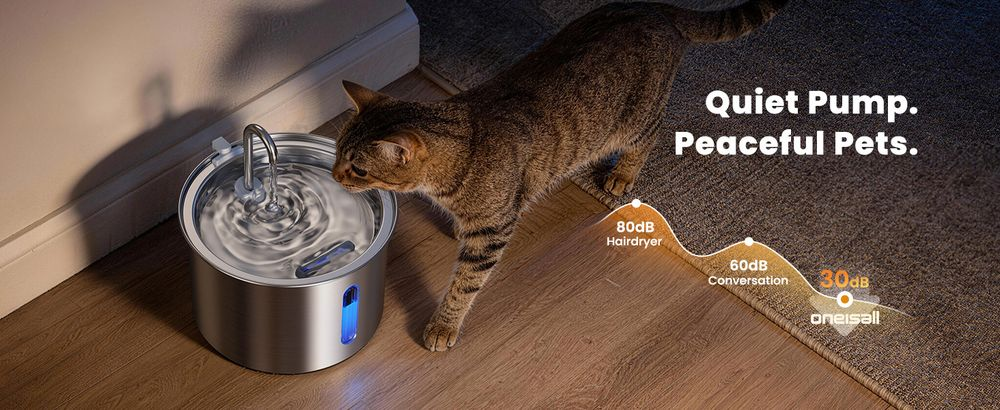  

### 4.2 容量 / 续航天数
- **主推：** 巨型数字（20 Cups、7L、7.17L、14 days）直接压在产品或画面上。产品取正面或顶视，配一句换算文字（“2 只猫可用 10 天”）。
- **可选：** 柱状图（容量 vs 天数，加宠物剪影）；体重/只数梯度；俯拍倾倒猫砂或粮食。
- **禁止：** 4 个以上数字堆在一起；数字由模型生成。
- **证据：** feeder B0C5X4N132 g06「20 Cups」压在透明粮桶上；B0GFDCYGFM g04「40% Bigger 32 Cups」；B0DZCHN51D g05「15 Days」；fountain B0D5B6RLYY g01「7L」大字 + a11 柱状图；B0DS2N3T3X a02 柱状图「60%」+ 狗剪影；B0BN2Z5CDC g02 用 3 个小卡片列「5 / 10 / 15 lbs → 天数」；litter Neakasa g05「7.17L」俯拍倾倒猫砂、a43「7–14 Days 11.2L」抽屉拉出；PETLIBRO B0GTM9P94B g09「2.9-gallon / 14 days」；oneisall Ease S1 g11「14 Days 11L」。

 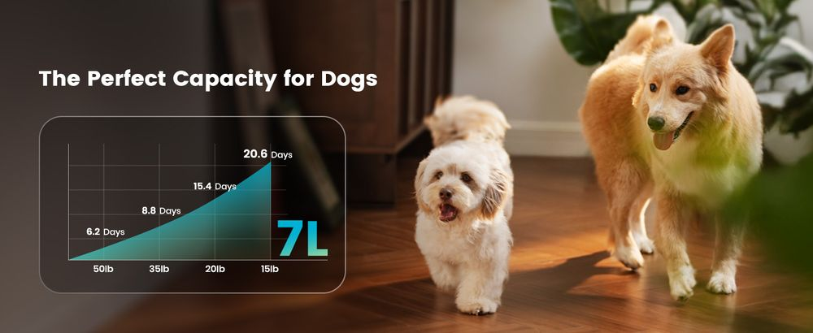 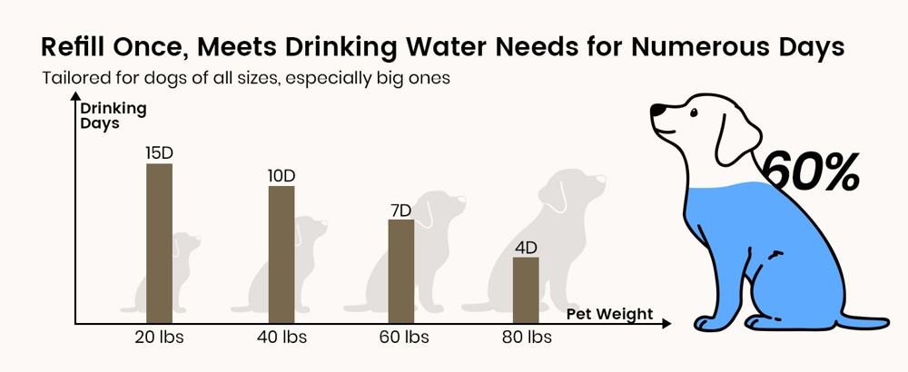    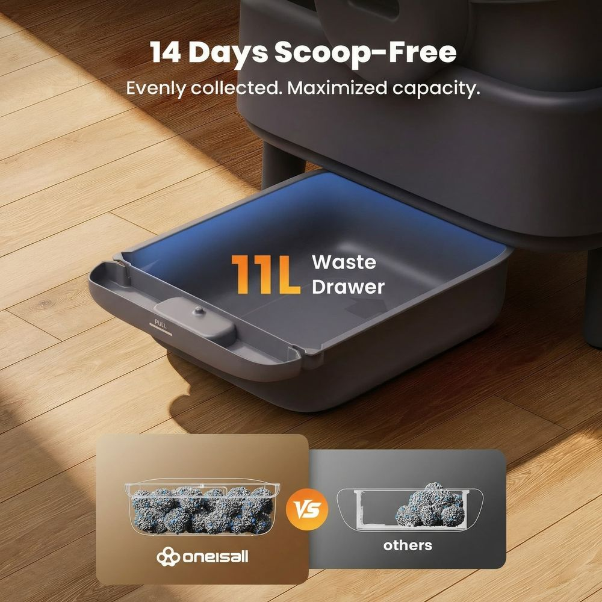

### 4.3 感应 / 智能 App / 远程
- **主推：** 欧美女性（或男性）在沙发、办公桌或通勤途中看手机，露出放松的微笑，背景虚化里有家和猫。手机界面后期合成，UI 用浮层卡片。
- **可选：** 只出手持手机的特写，配 3 个功能图标行；用分屏表现“远程 → 家里猫在吃”；猫砂盆用数据曲线（使用次数 / 时长）。
- **禁止：** 手机屏幕上出现模型生成的乱码；同一套图里出现 3 张以上 App 图。
- **证据：** feeder B0GFDCYGFM a02 女性看手机 + 参数小卡；B0DF2RPGDW g02 通勤女性；B0GFDH3WD5 a04 视频通话；B0DZCLG3SP a06 实时警报；litter PETLIBRO g06「Wi-Fi enabled control」手机特写，a23 女性在餐桌看「Monitor urinary habits」柱状图；oneisall Ease S1 g13 女性在笔记本旁看手机；Neakasa a38 只放 App 界面平铺（偏冷）。

 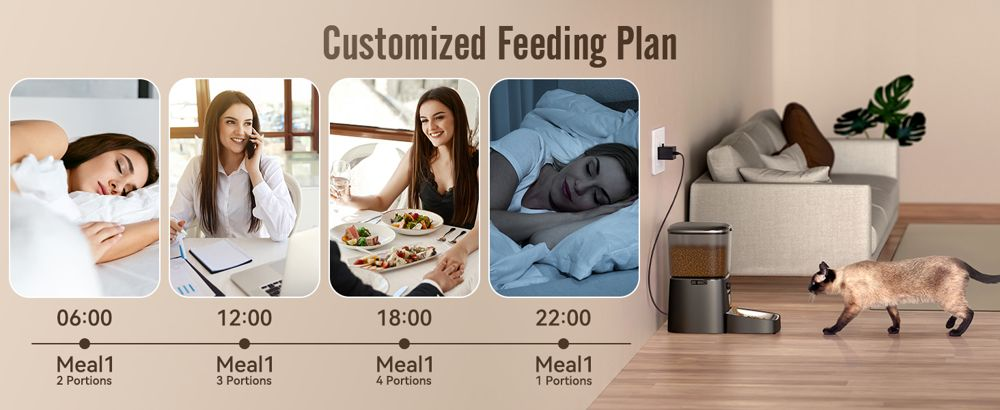 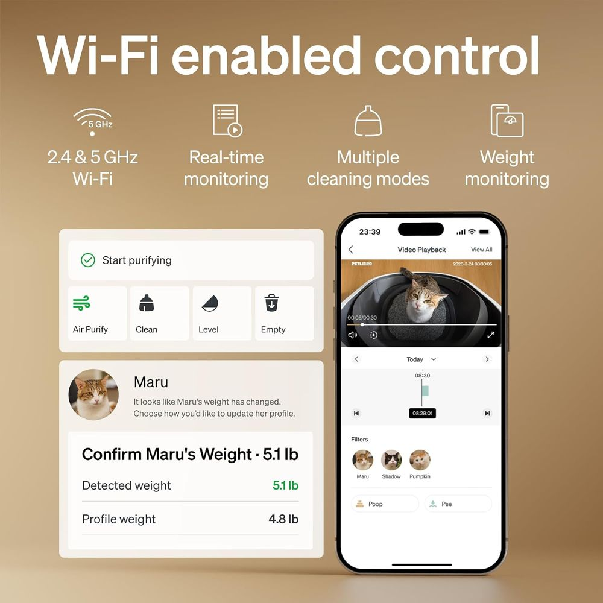 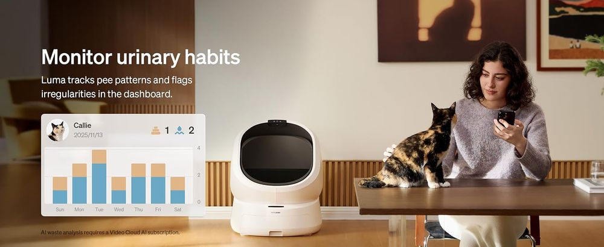 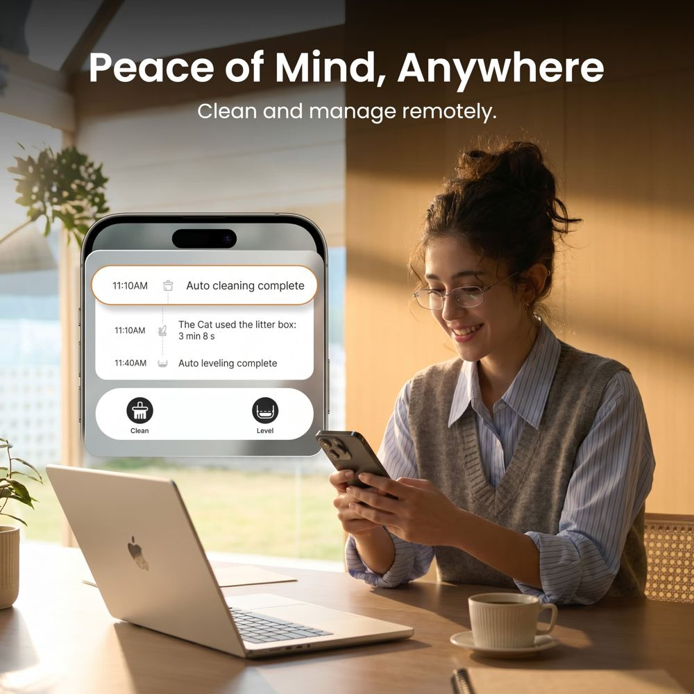 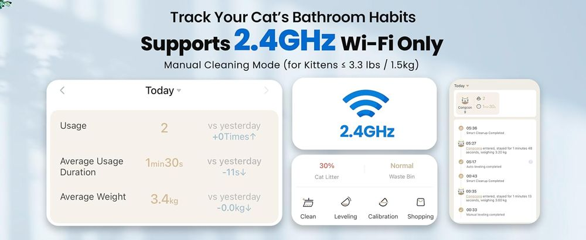

### 4.4 过滤 / 净水
- **主推：** 滤芯分层爆炸图，层片斜向飞散，每层配一个短标签，背景是浅暖色或浅灰纯底，标注 Illustration。
- **可选：** 产品透明化剖面，水流用蓝色箭头；放在水龙头下冲洗滤芯。
- **禁止：** 显微镜、实验室、细菌或“除菌 %”这类健康化学暗示（B0D5B6RLYY a06 的实验室画面是反例，不学）；写“除氯 / 软化水”的功效数字。
- **证据：** fountain B0FJX69D2R a13「Ultra Fresh」毛刷层飞散；B0DPMNQJ2N a05、B0C89MMFW1 a05 层片爆炸；B0BN2Z5CDC a09「3-layer filter system」；B0GYZQ79CY 主打无滤芯，用「Purely Fresh」分屏表现。

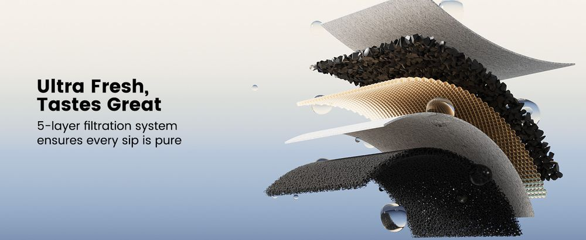 （右图为反例：实验室暗示）

### 4.5 易清洗 / 可拆部件
- **主推：** 手部操作特写：提起泵、拉出抽屉、在水槽冲洗。机位为 45° 俯拍，场景是厨房台面。或者用洗碗机内部俯拍。
- **可选：** VS 分屏（我们的部件少 vs 对手部件多，对手不得出现品牌）；2–3 步编号步骤图。
- **禁止：** 部件数量和实物不一致；画出不存在的拆卸方式。
- **证据：** fountain B0FJX69D2R a10/a14 洗碗机 + 手洗，a15「Crafted for Easier Cleaning」VS 分屏；B0BN2Z5CDC a04 洗碗机；B0FH691TR6 g07 女性在水槽清洗；feeder B0DZCHN51D a08 厨房水槽；B0GFDCYGFM g08 拆解平铺；litter oneisall Ease S1 g07「Deep Cleaning Made Easy」手提内胆、g10 硅胶垫；Neakasa a41 草地上冲洗猫砂床、M9 g07「Easy to Detach」3 步；PETLIBRO B0FKT2J6PV 抽屉特写，只出手。

 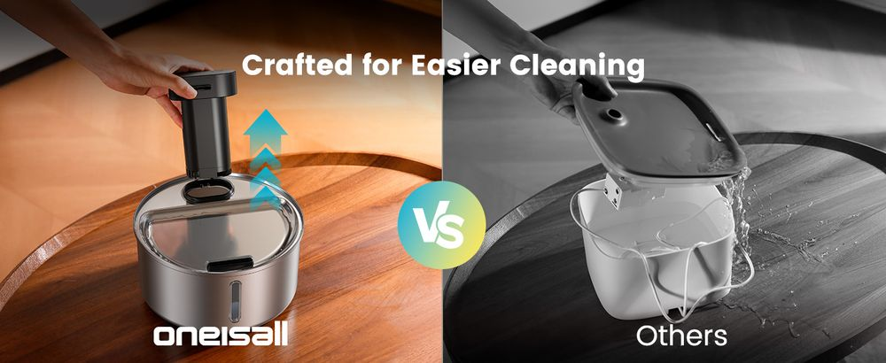    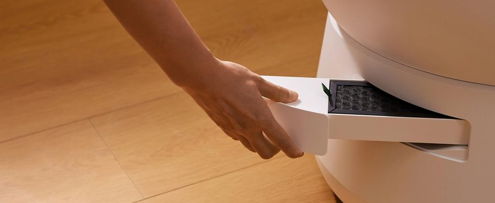 

### 4.6 材质（304 不锈钢等）
- **主推：** 金属微距特写：拉丝纹理清楚，加受控高光，表面可带水珠。「304」等材质字样做成大号字体后期排版（字体或浮雕效果）。猫舔水做辅助。
- **可选：** 和塑料对比分屏（对手不放品牌）；放材质证书（必须有真实证书才能用）。
- **禁止：** 写“抑菌 / 更健康”这类功效；证书造假；磨皮金属。
- **证据：** fountain B0FJX69D2R a11「SUS 304」水面微距；B0DPMNQJ2N a06 碗体 + 304 字样；B0C89MMFW1 g04 304 vs plastic；B0FJX69D2R a08 猫戴帽持证书（拟人）；feeder B0G4DX3QR8 a11「Cleaner Chin」304 碗加大字；litter oneisall Ease S1 g19 不锈钢筛网对比。

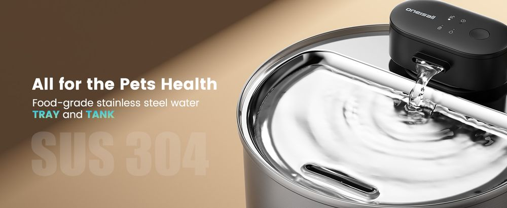   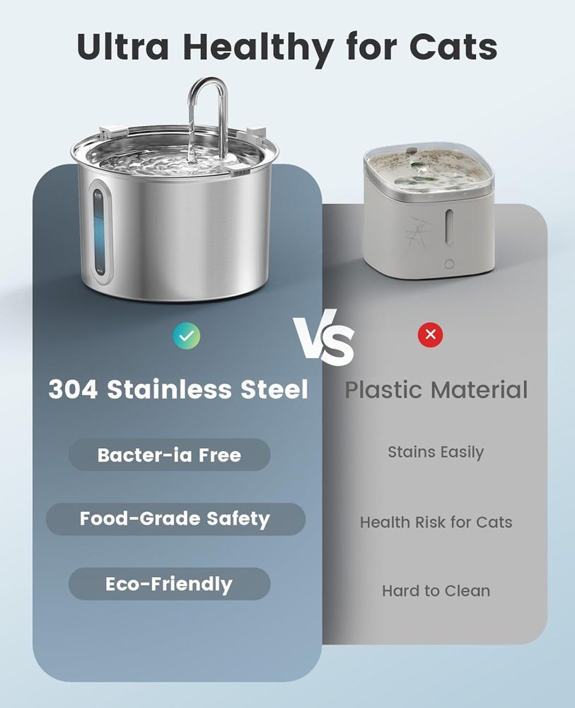 

### 4.7 水位 / 缺水提醒 / 自动断电
- **主推：** 产品近景，水位窗或指示灯发光（蓝 = 正常，红 = 缺水），背景浅色或暗场。可放一个红灯局部放大圈。
- **可选：** 双状态分屏（满水蓝 vs 缺水红）。
- **证据：** fountain B0BN2Z5CDC a07/g08 水位窗；B0DS2N3T3X a03「No need to lift the lid」蓝/红灯；B0D5B6RLYY a10「Alert and Auto Shut-Off」红灯。

  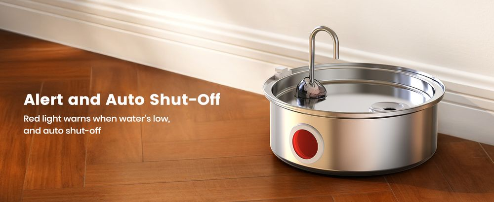

### 4.8 模式切换（水流 / 出粮模式）
- **主推：** **3 张卡片并排**（每种模式一张卡，卡里是同一机位的小场景，下方放图标和短标签）。这是允许使用卡片的典型情况。
- **可选：** 2 种模式时用左右分屏，中间不加卡片框。
- **证据：** fountain B0FJX69D2R a08「Explore the Favorite Flow」3 卡；B0D5B6RLYY a09 两模式分屏；B0BN2Z5CDC a08。

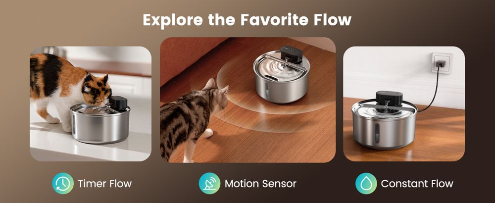 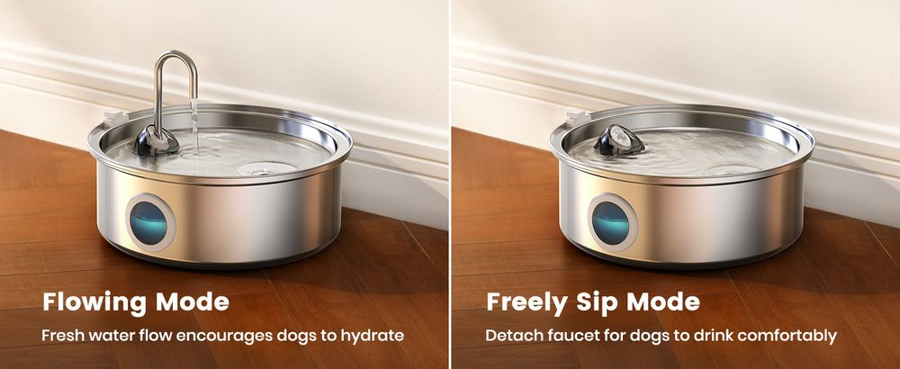

### 4.9 电源 / 电池续航 / 断电备份
- **主推：** 电池续航用巨型数字（30 days、100 days）加产品，场景是“插座够不到的地方”（窗台、走廊）。断电备份用夜间暗蓝场景，产品微亮，配电池图标。
- **证据：** fountain B0FJWV49LP g06「30 days」；B0FJX69D2R g04「Peace of Mind, No More Charging Hassles」；feeder B0DZCLG3SP a02「100」电池；B0GGZZJ3RV a04「100 Days」；B0G4DX3QR8 a10「Never Miss A Meal」夜间蓝；B0C5X2G933 g06 断电。

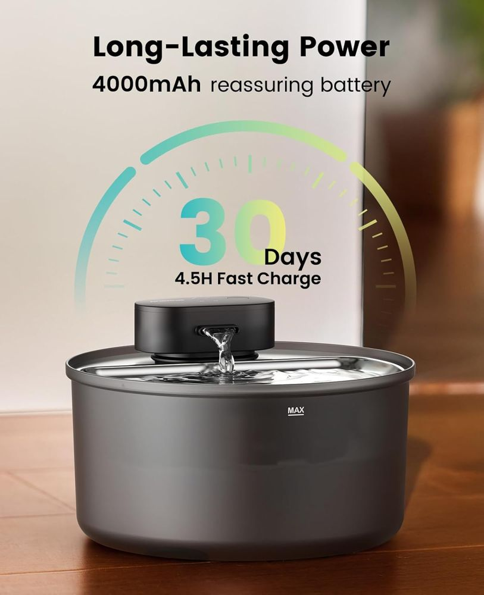  

### 4.10 防卡粮 / 出粮精准 / 颗粒兼容
- **主推：** 出粮转子或机构的悬浮爆炸图（浅暖色纯底或暗场），配粒径标注（0.2–0.7 in）。兼容性用 3–4 种粮袋或颗粒并排的图标行。
- **可选：** 双碗俯拍，中间放天平图形「Balanced」表示分量均等；喂食量表（表格卡片）。
- **禁止：** 虚构内部齿轮结构；出现真实粮食品牌的包装商标（参考图里的粮袋都要换成无牌包装）。
- **证据：** feeder B0GFDCYGFM a10「Meals On Time」转子爆炸；B0C5X2G933 a06「Every Kibble Hits the Bowl」；B0DPZV3S7T a03 四袋兼容；B0D4DL67CV a03「Fair Feeding」天平俯拍；B0GFDH3WD5 a12 推荐喂量表；B0C5X2G933 a10 芯片暗场「Feeding Plan Never Lost」。

   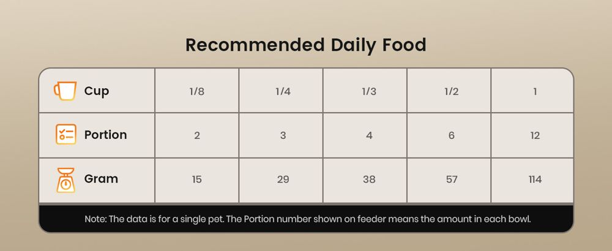 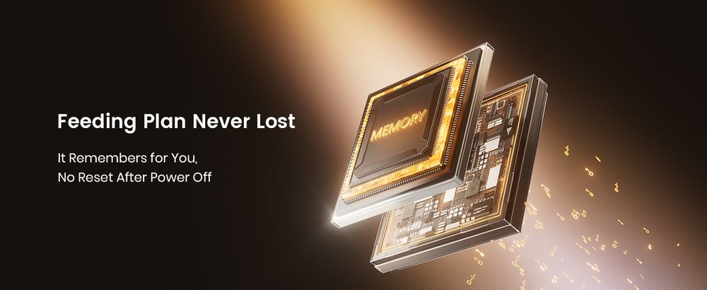

### 4.11 防臭 / 密封（猫砂盆）
- **主推：** 产品剖面或局部透视，用蓝色线条标出密封圈、封闭集便仓的位置（标 Illustration），配 “Sealed” 类结构性描述。也可以用生活场景：猫在旁边放松，人在近处做家务，暗示“家里闻不到”。
- **可选：** 3 个分区小图（防漏垫 / 360° 锁边 / 导液结构），PETLIBRO 的做法。
- **禁止：** 画绿色毒气或臭味波纹；写“去除 99% 异味 / 杀菌 / 负离子”等化学或健康功效；写 PETLIBRO 那种 “97% odor reduction” 的数字，除非有我方实测报告且 `AGENTS.md` 合规通过。
- **证据：** Neakasa B0DCFY8SB4 a40「Upgraded Seal」剖面蓝线、a39「Enhanced Odor Isolation」；PETLIBRO B0GTM9P94B g03「Always-on odor control 97%」（数字型，谨慎）、g08「Complete leak protection」分区；Neakasa M9 g05「PureTower」把耗材横放展示。

 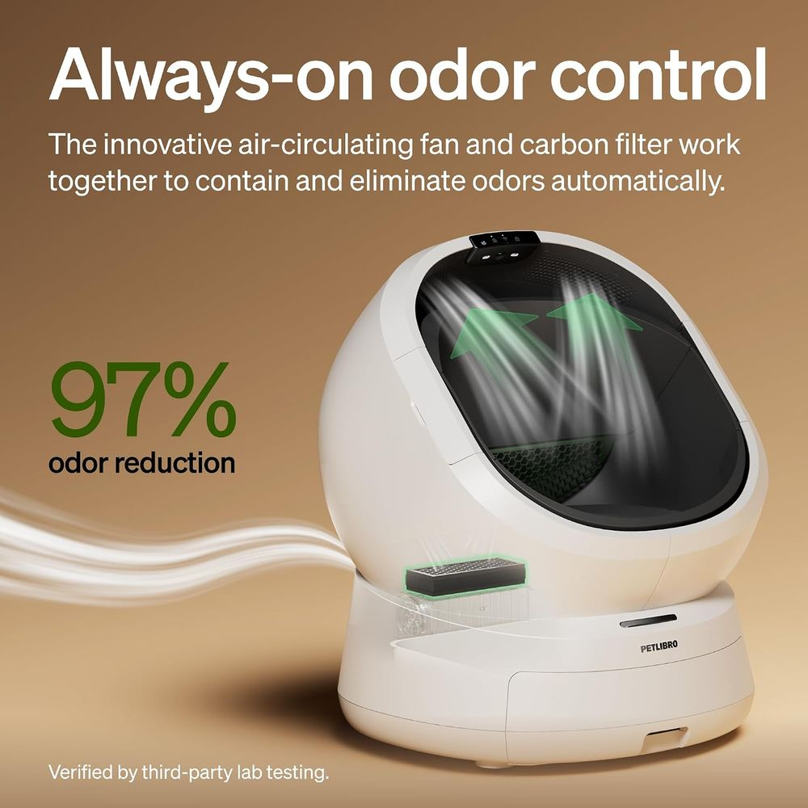 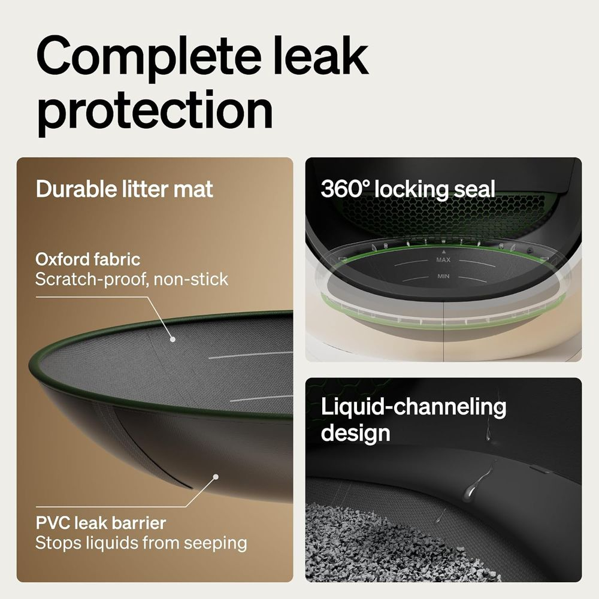 

### 4.12 安全传感（猫砂盆 / 防夹）
- **主推：** 产品半透视，传感器位置用发光点或红框标出（标 Illustration），同时有一只猫正在进入或站在边缘，机位是低位 3/4。
- **可选：** 暗场戏剧光加产品轮廓光（Neakasa M9「Safe by Design」）；把旋转角度画成刻度盘（「Controlled Rotation」）；图标行列出 4 项保护。
- **禁止：** 夸大传感器数量；画猫被夹的危险场景。
- **证据：** Neakasa B0DCFY8SB4 a37「High-Precision Detection」红框传感器，a36 旋转刻度；M9 g02 暗场；PETLIBRO g02「Multi-layer safety」猫进入；oneisall Ease S1 g04「Pet Safety First」夜间蓝光，猫低位走近，配 4 项图标。

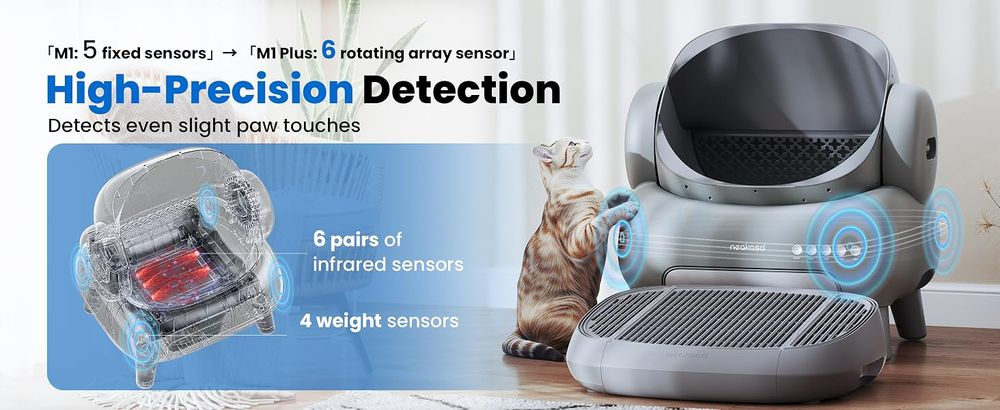    

### 4.13 自清洁周期 / 省猫砂
- **主推：** 猫砂颗粒宏观特写（筛网把结团和干净砂分开）加 hero number（「30% Litter Saving」）。时间设定用 3–4 个时间胶囊图标（5 / 10 / 15 分钟）配一只猫离开的场景。
- **可选：** 抽屉里装满封好的垃圾袋，配“14 天不铲”。
- **禁止：** 出现排泄物或脏污；剖面里画不存在的筛分结构。
- **证据：** oneisall Ease S1 g17「The Highest Litter Efficiency 30%」宏观颗粒，g12「Custom Cleaning, On Your Schedule」时间胶囊，g08「EaseClean™ 10s / 20s」；PETLIBRO B0FKT2J6PV 换袋：只拍腿 + 垃圾袋。

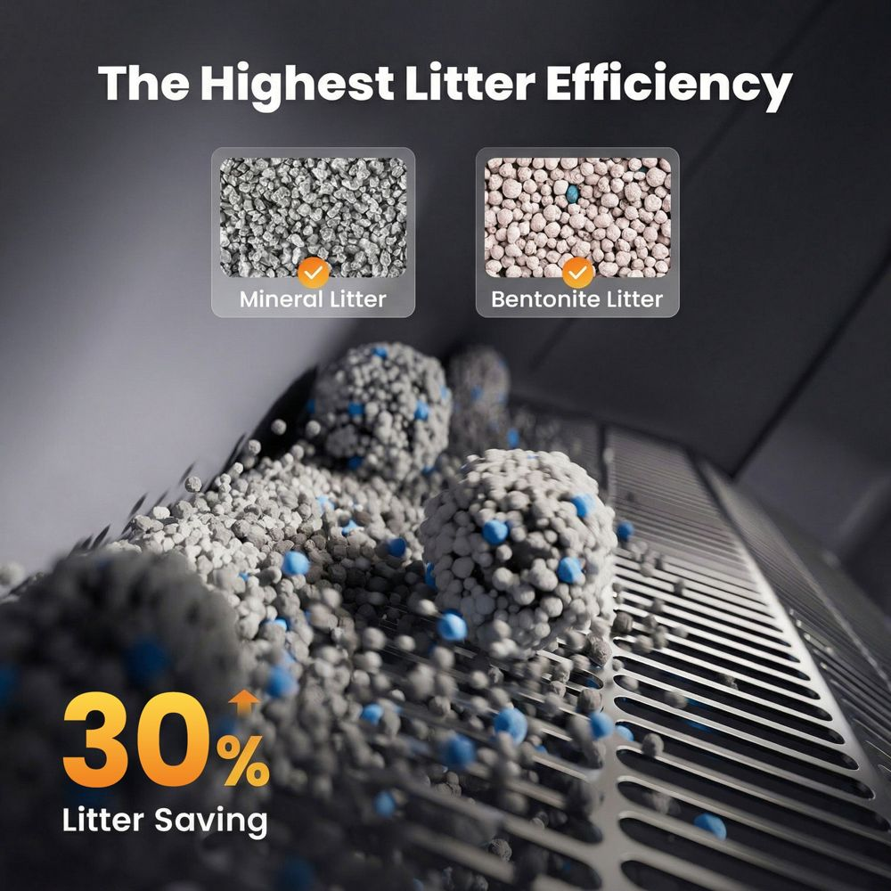  

### 4.14 尺寸 / 是否放得下 / 开放空间
- **主推：** 正交或 3/4 视图加尺寸线（in + cm），白底或浅灰底；猫砂盆再加一张“开顶俯拍，猫在里面转身”，配面积 hero number。
- **可选：** 放在洗衣机旁、走廊等真实空间，表现占地小（Neakasa M9 g06）；「Will it fit? Measure before you buy」三视图（Neakasa）。
- **证据：** Neakasa B0DCFY8SB4 a44、B0DK6RSFG2 g05/a07 三视图；M9 g06 洗衣机旁；oneisall Ease S1 g05「More Usable Space」顶视俯拍，g24「32% Open-Top Larger」，g31 尺寸；PETLIBRO g10「Large, open-top design」顶视猫；feeder B0GFDCYGFM g09、fountain B0FJX69D2R g07 参数图。

  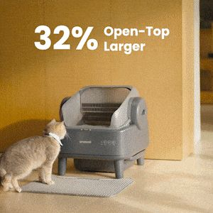 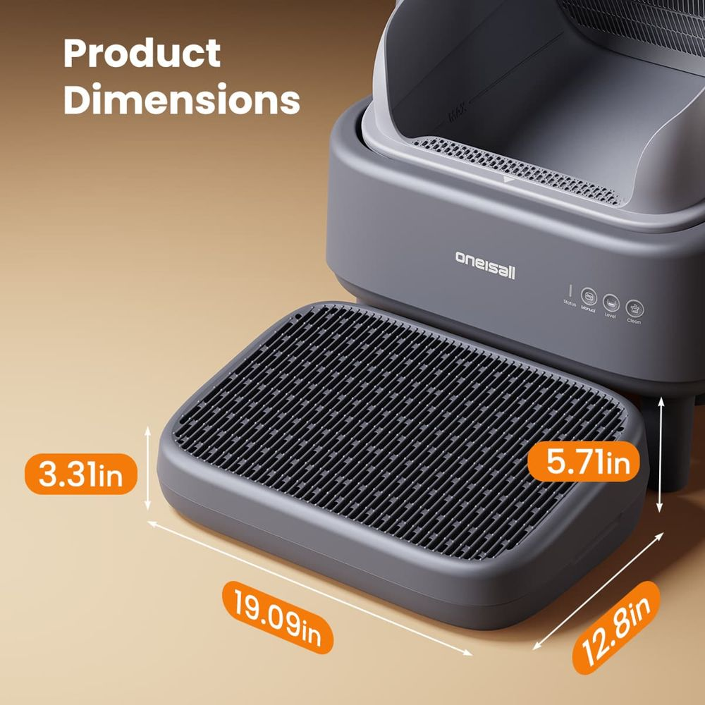 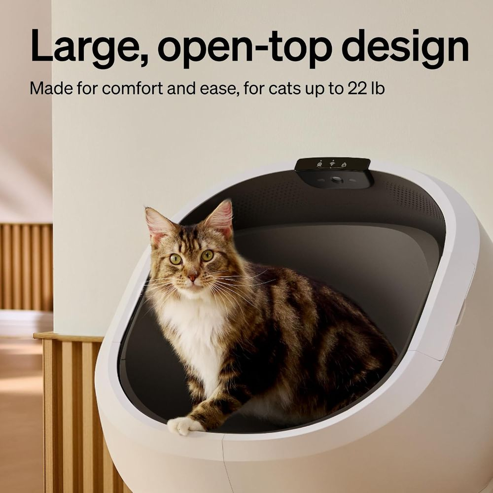

### 4.15 多宠
- **主推：** 俯拍双碗或双猫同时进食，间距标注（16–17 in）和「Balanced / 2X」；猫砂盆用 3 只不同体型的猫站成梯度，配体重范围。
- **可选：** 多猫识别：每只猫配一个头像标签和 App 卡片（PETLIBRO）；多宠家庭沙发群像。
- **证据：** feeder B0C5X2G933 a01「Dual Bowls Mealtime in Harmony」，B0DZCLG3SP a11「17 inches」俯拍，B0GFDCYGFM a09「15% Wider」；fountain B0D5B6RLYY g01 两只狗；litter Neakasa a42「Up to 3 cats 3.3–33 lbs」；PETLIBRO g05「Multi-pet recognition」。

 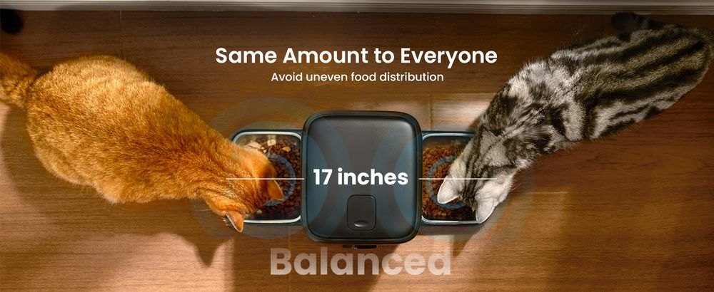 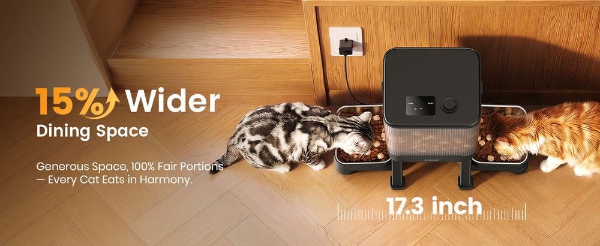 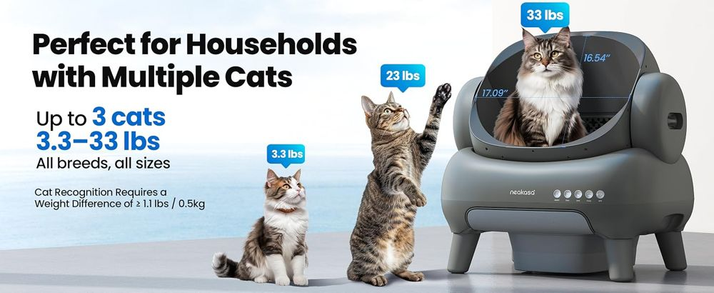 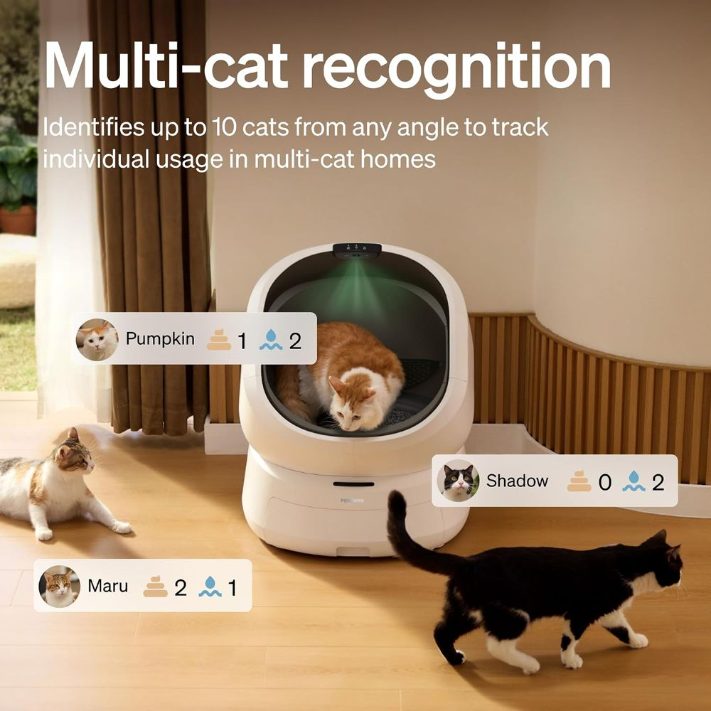

### 4.16 进食姿势 / 舒适
- **主推：** 侧面平视，猫低头进食，碗高或倾角用弧线和角度标注；「2X Higher」类数字。
- **证据：** feeder B0GFDCYGFM a08「Comfortable Eating Posture 2X」；B0GFD9YWF2 a03；litter oneisall Ease S1 g29「Comfort for All Cats」猫在舱内，加 2 张小图。

 

### 4.17 稳固 / 防偷吃 / 防打翻
- **主推：** 用动作抓拍：猫扒机身、站到机器上、伸爪掏粮口，产品纹丝不动。猫的表情要“偷看、得逞失败”。
- **证据：** feeder B0D4DL67CV a09「Security Pet-Proof Lock」黑猫掏食；B0DPZV3S7T g05「Superbly Stable」猫站上去；fountain B0C89MMFW1 g02「Safety Snap Lid」暹罗猫推盖。

 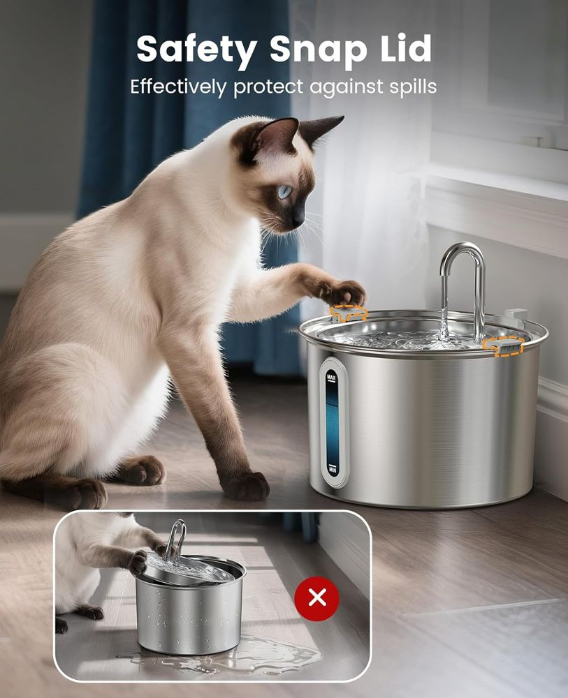

### 4.18 出行 / 多日无人 / 摆放灵活
- **主推：** 人拖着行李箱出门，猫在后面安心进食，配天数 hero number；无线产品用三联场景（客厅 / 卧室 / 厨房），这是允许用卡片的第二种情况。
- **证据：** feeder B0G4DX3QR8 a05「14-Day Hassle-Free Feeding」；fountain B0C89MMFW1 g03 海滩度假「24hrs running 7 days」；B0GYZQ79CY a10「Places Your Cats Prefer」三联。

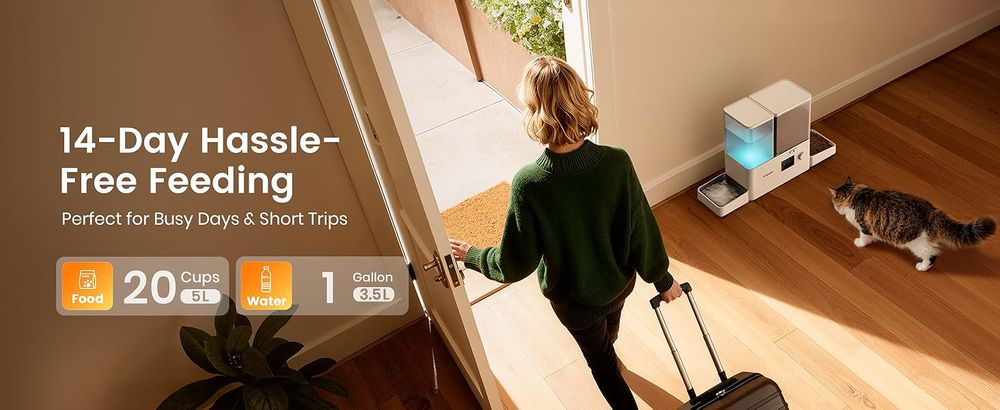 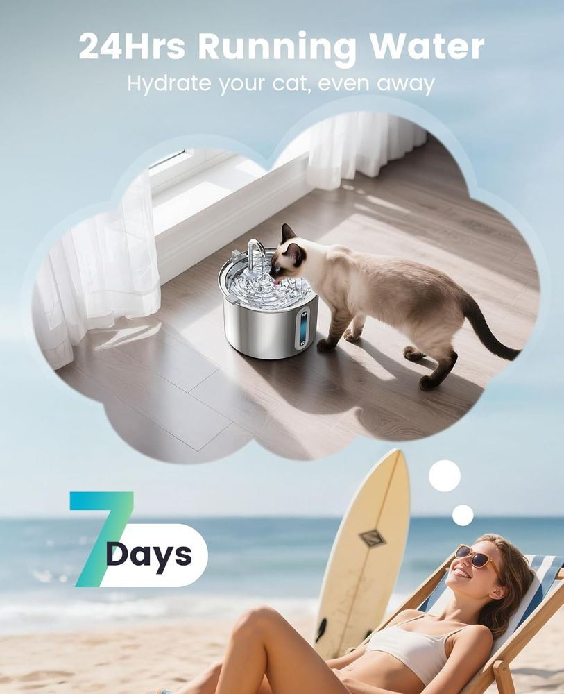 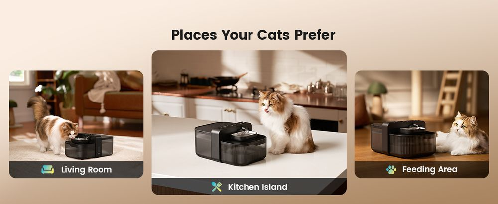

### 4.19 适配猫砂 / 粮食类型
- **主推：** 3–4 种颗粒宏观小方块排成网格，下方 ✔/✕ 标签，背景浅色纯底，旁边放产品。
- **证据：** Neakasa a47「Recommended litter」网格；PETLIBRO a30「Works with most litter types」；oneisall Ease S1 g18；feeder B0DPZV3S7T a03。

 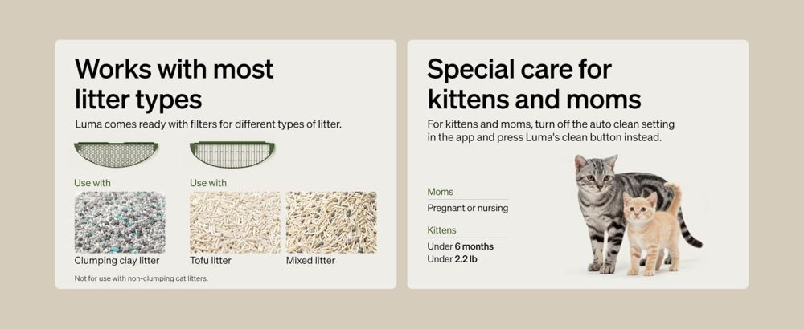

### 4.20 操作简单 / 按键
- **主推：** 手指按键微距，浅灰底，图标印刷要清楚。
- **证据：** Neakasa a45「Clear Functions, No Guesswork」；feeder B0DZCHN51D g07「Simple Setting」；B0DPZV3S7T a05 小男孩操作（POKPET 若用儿童，须为欧美儿童且有成人在场）。

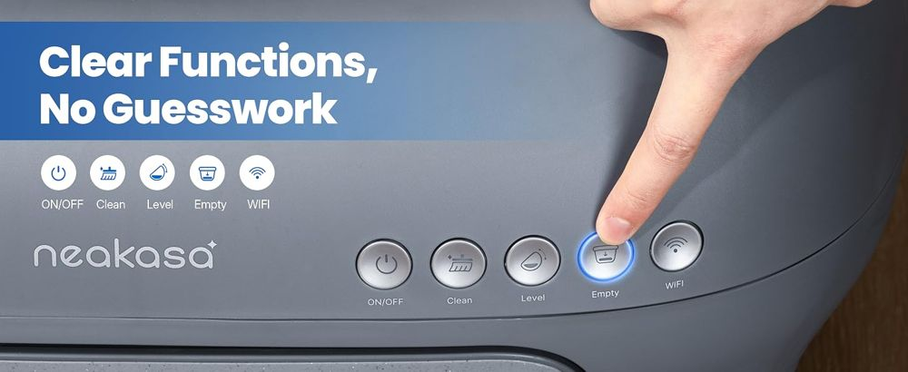 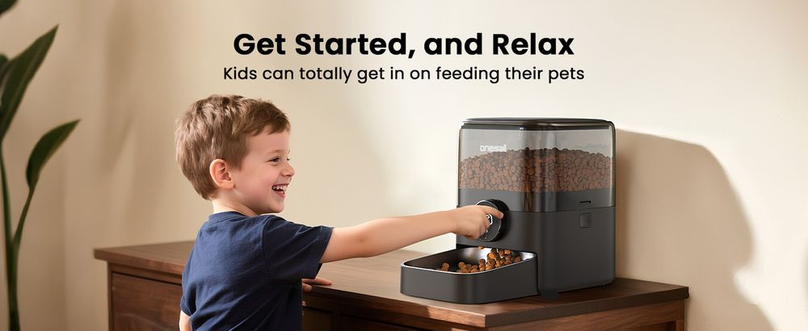

### 4.21 宠物爱用（情绪型卖点）
- **主推：** 近景或特写，宠物舔嘴、舌头卷水、眯眼，可加 2–3 张小图拼成连续动作。
- **证据：** fountain B0DPMNQJ2N a02「CAT'S LOVE IN IT」舔嘴大特写 + 3 小图；B0FJX69D2R a02–a06「Sip Where Cats Relax / Joyful / Secure / Unbothered / Sleep Soundly」用 5 个不同机位讲同一个情绪主题；feeder B0GFDH3WD5 a08 翻肚。

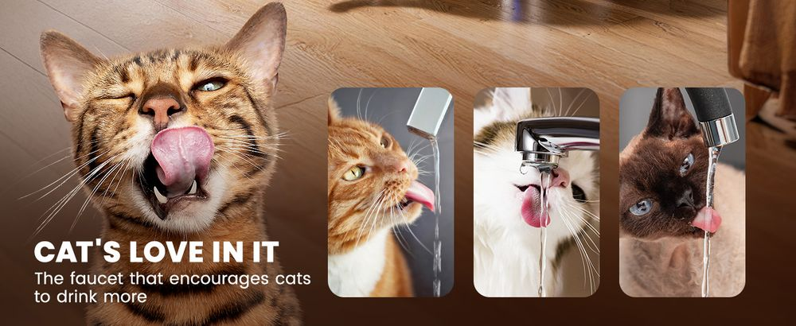 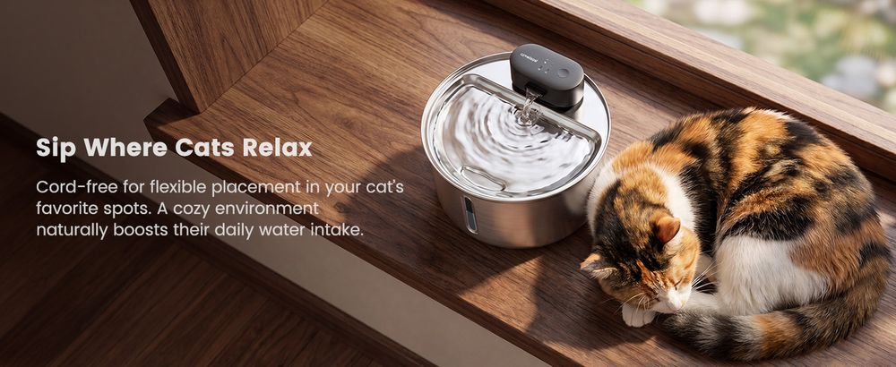 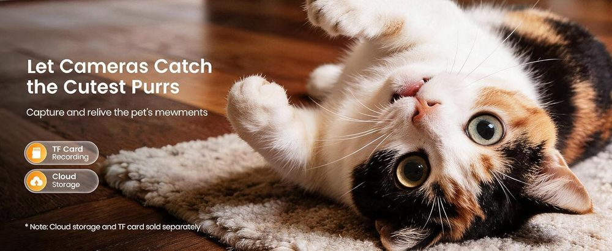

### 4.22 VS 对比（通用）
- **规则：** 左边是我方，用暖光、色彩和清晰画面；右边是“Others”，去饱和、偏灰，绝不放品牌、Logo 或可识别外观。对比项不超过 3 条。
- **证据：** fountain B0GYZQ79CY a01、a05「0 pump & parts vs 1 pump & 4 parts」；B0FJX69D2R g08「How We Stand Out」。

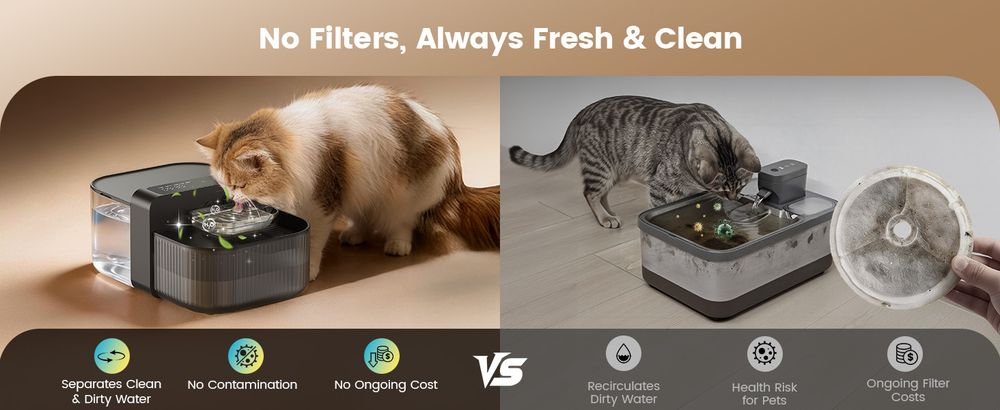

---

## 5. 机位库（同一套图不能重复）

| 代码 | 机位 | 用途 | 示例 |
|---|---|---|---|
| C1 | 3/4 前侧，俯视 15° | 主图、白底 | 所有主图 g01 |
| C2 | 正面平视 | 尺寸、参数 | Neakasa a44 |
| C3 | 正顶视 90° | 双碗间距、开顶空间、平铺包装清单 | D_overhead_17in、L_oneisall_space |
| C4 | 45° 俯拍台面 | 清洗、拆卸、手部操作 | F_dishwasher |
| C5 | 低位平视（宠物视线高度） | 喝水、进食、进入猫砂盆 | F_lifestyle_relax、L_oneisall_safety |
| C6 | 宠物面部特写 / 微距 | 舔嘴、情绪 | F_emotion_lick、XHS_003 |
| C7 | 材质微距 | 不锈钢、颗粒、水面 | F_steel_macro、L_oneisall_30pct |
| C8 | 宽幅环境中景（人 + 宠物 + 家） | 品牌开场、App、出行 | D_travel_human |
| C9 | 越肩 / 手持手机 POV | App 远程 | L_petlibro_app |
| C10 | 悬浮爆炸 / 剖面（渲染） | 过滤、转子、密封 | F_filter_layers、D_rotor_explode |
| C11 | 暗场轮廓光 3/4 | 静音、夜间、断电、科技感 | F_quiet_heronum、L_neakasa_m9_safe |
| C12 | 腿部 / 局部人物（无脸） | 换袋、走动、规模参照 | L_petlibro_legs |
| C13 | 抓拍动作（扑、扒、站） | 稳固、防偷吃、搞怪情绪 | D_lock、XHS_005 |
| C14 | 分屏 / 三联 | 模式、场景、VS | F_modes_split、F_places_3panel |

**规则：** 7 张主图至少用 6 种不同的机位代码；同一机位代码最多出现 2 次，且不能相邻。

---

## 5A. 图片尺寸规范（2026-11-15 用户确认，沿用最早 AGENTS.md 的比例）

| 图位 | 比例 | 交付尺寸 | 高清目标 | 说明 |
|---|---|---|---|---|
| 主图（第 1 张） | 1:1 方图 | 2000 × 2000 | 2508 × 2508 或更高 | 纯白底、无字、产品完整 |
| 副图（第 2–7 张） | **4:5 竖长图** | **1600 × 2000** | 2000 × 2500 或更高 | 一律做竖图，不再做方图 |
| A+ 电脑端 | 2.44:1 | 1464 × 600 | 2928 × 1200 | — |
| A+ 手机端 | 4:3 | 600 × 450 | 1200 × 900 | — |

- **A+ 每个模块都要同时交付电脑端（1464 × 600）和手机端（600 × 450）两版。** 手机端按 4:3 重新构图：文字放上方或下方，字号放大到手机上能看清，产品和宠物不能缩得太小，不能直接从电脑端裁切。
- 副图要按 4:5 竖幅独立构图（结构性缩放）：上方留文字区，产品和宠物放在中下部，不能把方图拉伸、裁切或补白得到竖图。
- 字号按画布宽度换算：第 6 节的 px 以 2000 px 宽为基准，1600 宽的副图按 0.8 倍换算（标题约 52–58 px，副标题不小于 29 px，hero number 约 88–128 px）。
- 生成工具原生出图尺寸不够时，如实标注哪些是放大得到的。

## 6. 版式与字体

- 标题：Avenir Next Bold，64–72 px（以 2000 px 宽画布计），最多 2 行，句首大写。
- 副标题：不小于 36 px，Avenir Next Medium/Regular，最多 2 行。
- 图标 + 短标签：图标 56–72 px，标签 28–32 px，每个标签不超过 3 个词，一行最多 4 个。
- Hero number：琥珀色 #F47A21，110–160 px，旁边配单位小字。一张图最多 1 个 hero number。
- 文字颜色：#0F2438。在暗场里反白（#FFFFFF），hero number 仍用琥珀色。
- 文字位置：放在画面留白最干净的一侧（通常是左上或上 1/3），不压在宠物脸上或产品关键部位上。
- 参考：oneisall 的标题都放在左上或顶部居中；PETLIBRO 用小写句子式标题，左上对齐，留白很大，编辑感强，可以学它的留白；Neakasa 用蓝色色条衬标题，偏工具感，不学。

## 7. 卡片规则

- **允许用卡片的情况：** ① 3 个并列项（模式、场景、套餐）；② 表格（喂食量、参数）；③ 背景纹理太复杂，文字对比度不足 4.5:1。
- **每套最多 1–2 个模块用卡片**，其余模块文字直接排在画面上。
- 卡片样式：白色或米白，透明度 85–95%，圆角 24–32 px，没有粗描边，阴影要轻。
- 反例：每张都加大卡片（旧版的问题）；Neakasa 在每张图都加蓝色色条，偏说明书风格。

---

## 8. 猫砂盆章节：三品牌对标

### 8.1 Neakasa（拼写确认：Neakasa）

| ASIN | 型号 | 主图 / A+ 张数 | 特点 |
|---|---|---|---|
| B0DCFY8SB4 | M1 Plus Open-Top（带猫阶梯） | 9 / 51 | 主图组是德语版；A+ 用剖面红框表现传感器、旋转刻度盘、3 只猫体重梯度、尺寸三视图、50dB 猫睡、手指按键 |
| B0DK6RSFG2 | M1 Plus Lite（白色） | 11 / 47 | 白色机身配冷白背景，色调最“干净”；2-Year 保修；App 界面 2.4GHz |
| B0HC6Y2MS3 | M9（球形舱） | 8 / 44 | 暗金戏剧光表现安全；PureTower 耗材横放；放在洗衣机旁表现小户型；幼猫护栏前后对比 |

**学到什么**
- 调色是**冷白、高亮、低饱和**（非白底图的亮度均值 0.68，饱和度 0.17，暖度 R−B 0.07），比 oneisall 冷很多，读起来像科技家电。POKPET **不照搬这个调色**，只在科技或剖面模块里借鉴它“干净的浅灰底”。
- 剖面和结构图最强：传感器用红框透视，旋转用刻度盘，密封用蓝线，都把内部原理讲得很清楚。POKPET 可以学这种画法，但必须基于真实结构并标 Illustration。
- 尺寸模块做成了“Will it fit? Measure before you buy”，是三视图加房间尺寸，值得学。
- 不学：每张图都加蓝色标题条；品牌模块（展会、达人墙、客服女性）太长；德语和英语混用。

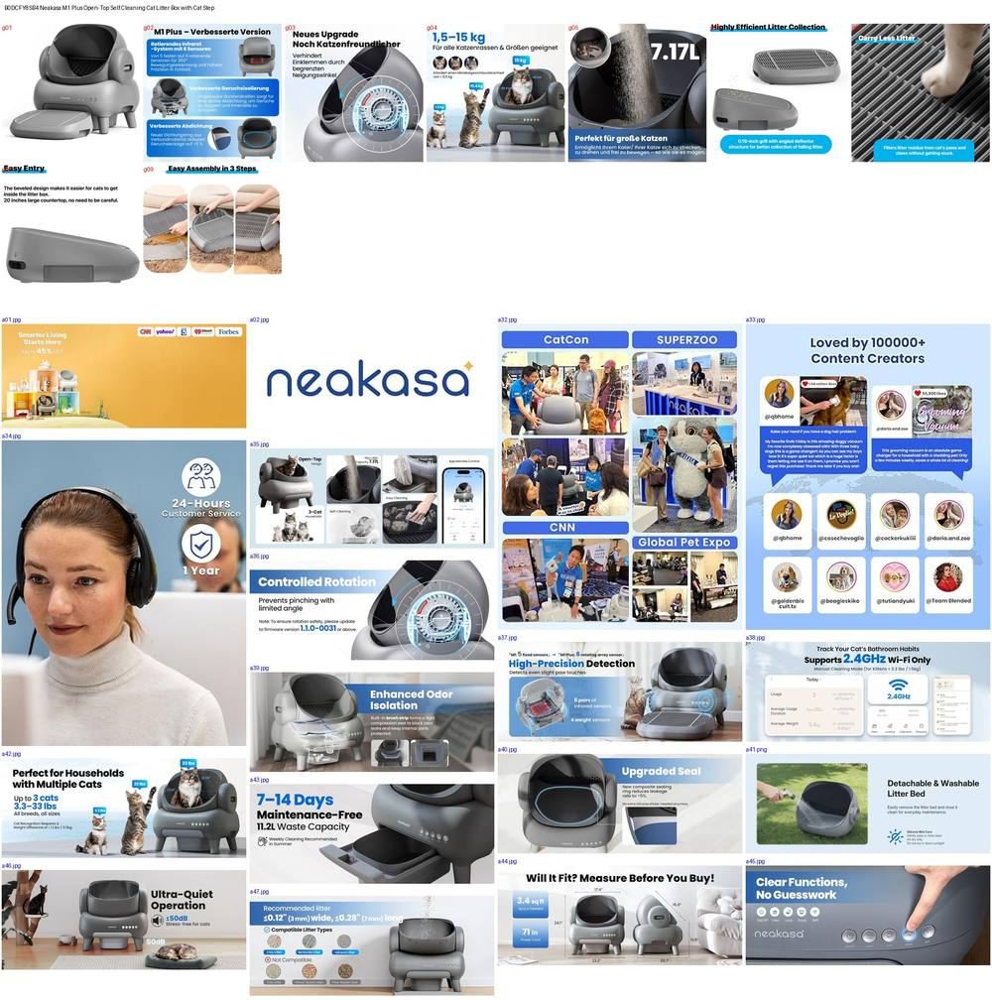 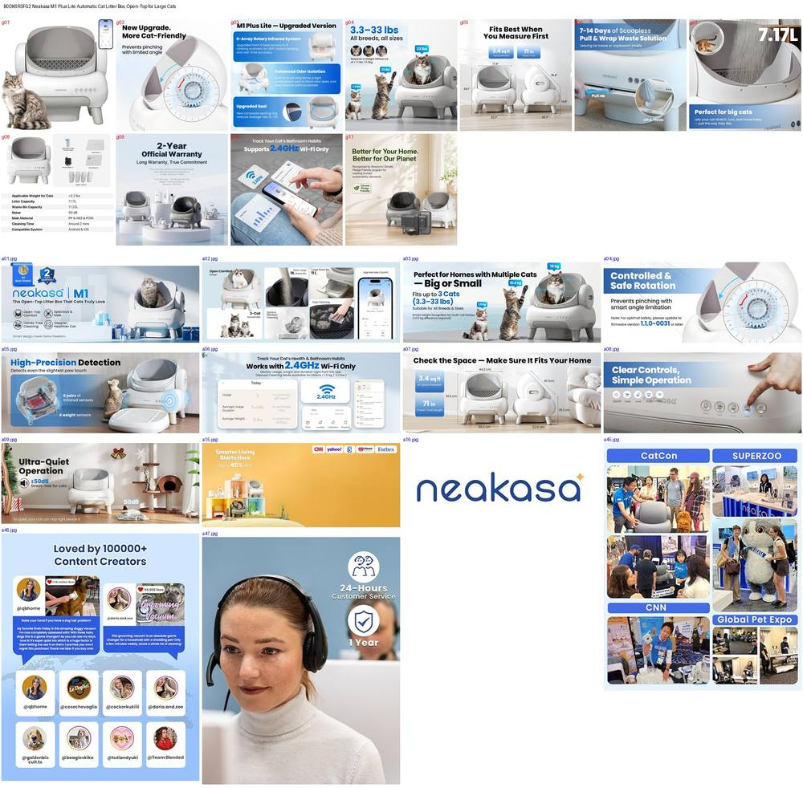 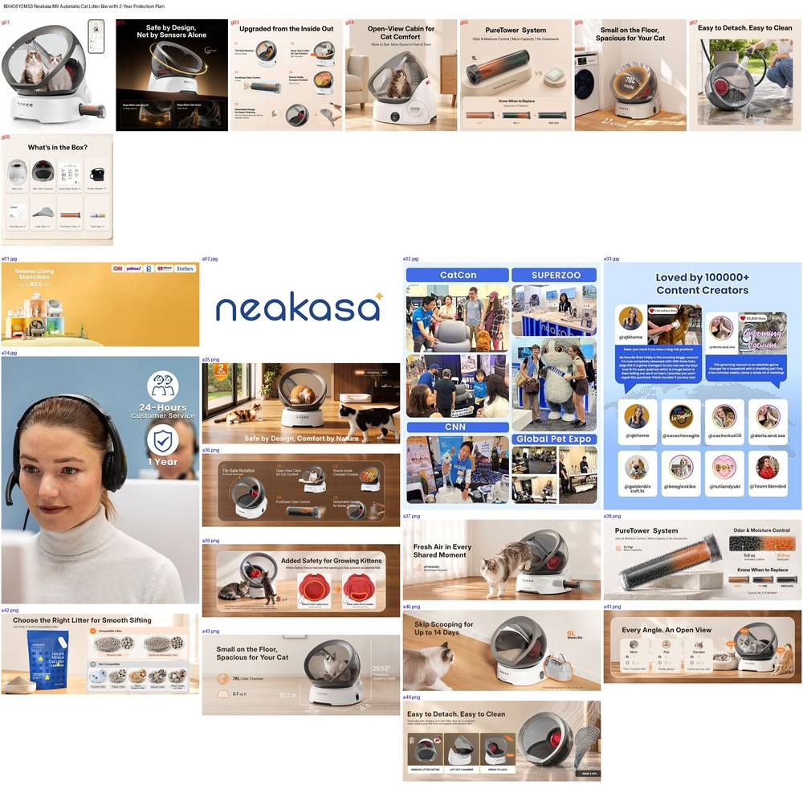

### 8.2 PETLIBRO（拼写确认：PETLIBRO）

| ASIN | 型号 | 主图 / A+ 张数 | 特点 |
|---|---|---|---|
| B0FKT2J6PV | Luma（AI 摄像头） | 10 / 40（含 2 张 COMING SOON 占位图） | 编辑感强的真实生活摄影：手挠猫下巴特写、腿部 + 垃圾袋、抽屉手部特写、木桌 + 猫；黑底配红点奖 / Wirecutter 引用 |
| B0GTM9P94B | AI-Camera 大开口款 | 28 / 36（主图组含多个颜色变体） | 97% hero number、多猫识别、App 特写、3 分区防漏、套餐表格卡片 |

**学到什么**
- 调色是**暖奶油色加木色，再配深棕暗部**（亮度均值 0.53，饱和度 0.32，R−B 0.16），和 oneisall 的暖调几乎一样，但对比更柔、更有“杂志感”。这和 POKPET 的暖调方向一致，可以直接参考。
- 版式克制：标题是小号句子式，左上对齐，大面积留白，几乎不用卡片；只在“套餐”和“兼容猫砂”上用卡片。这正好符合我们“卡片是例外”的规则。
- 人物只出局部（手、腿、背影），把真实感留给宠物和环境，很高级。猫砂盆这个品类尤其适合这种“不露脸”的处理。
- 不学：AI 健康分析、尿液习惯这类健康暗示（我们不能做健康声明）；没有实测支撑的 97% 除臭数字。

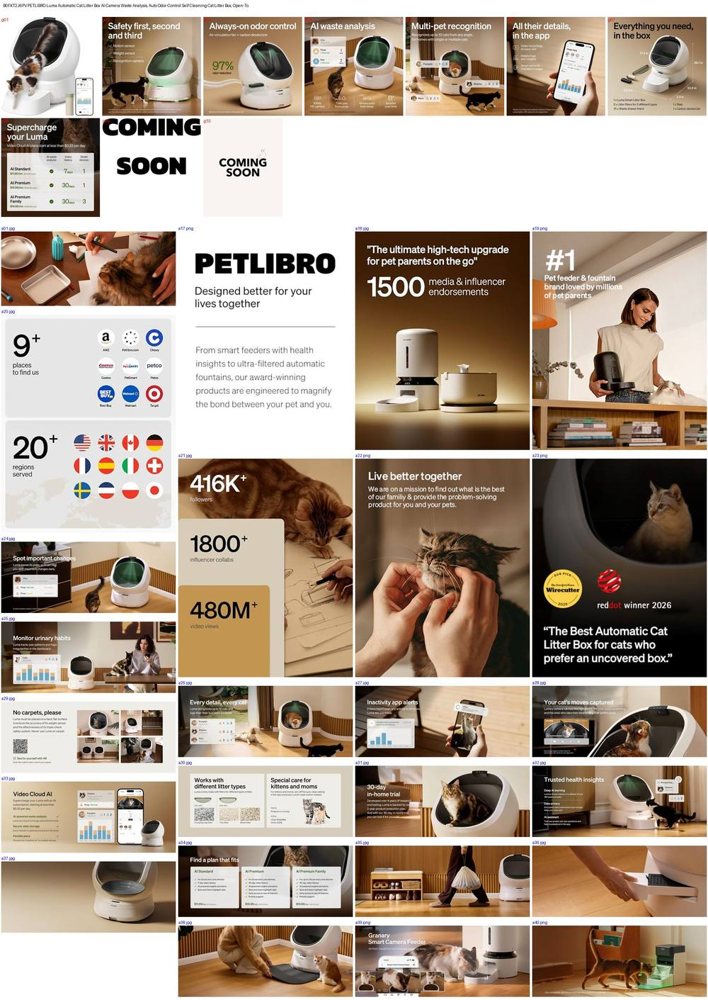 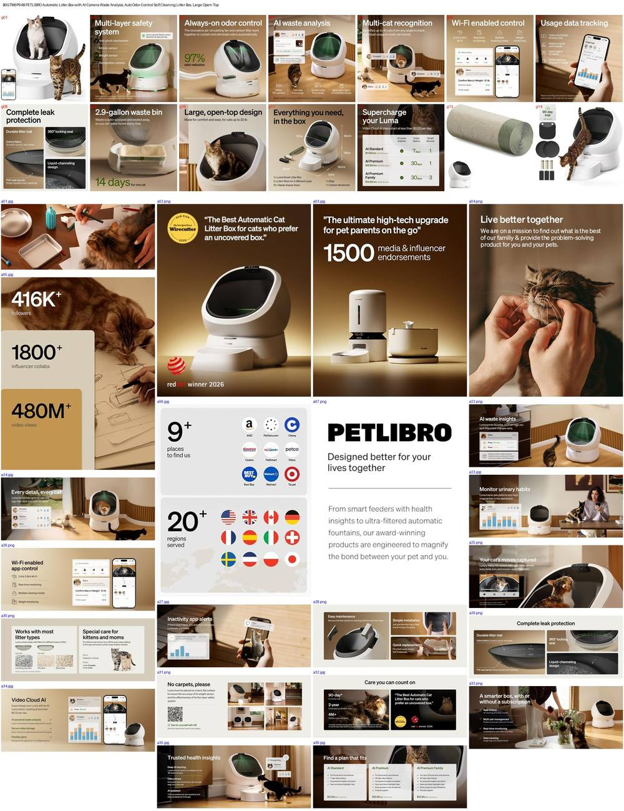

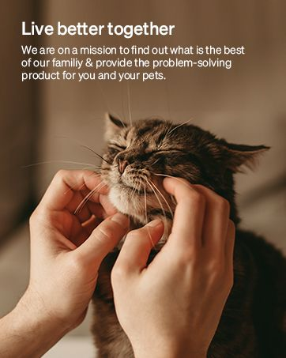 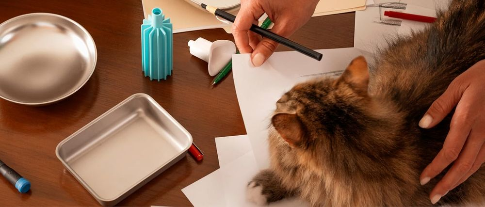  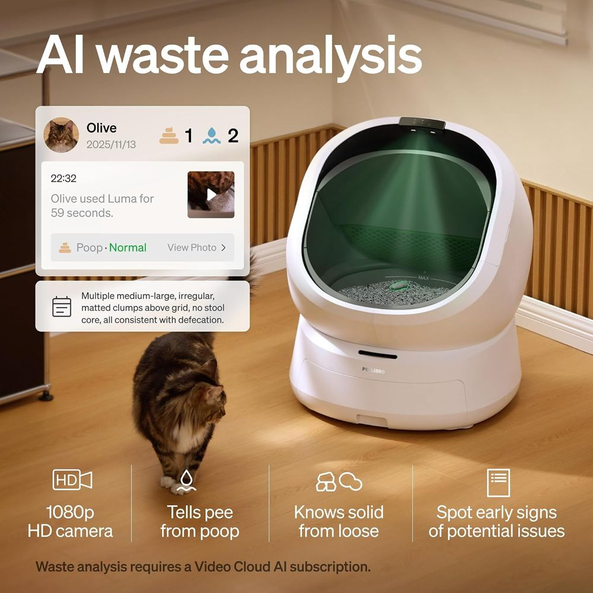

### 8.3 oneisall 猫砂盆（Ease S1 / Ease S1 Pro）

| 页面 | 来源 | 图库 / 页面图张数 | 特点 |
|---|---|---|---|
| Ease S1 | https://oneisall.com/products/oneisall-ease-s1-self-cleaning-litter-box | 56 / 116 | 深灰机身放在暖木客厅；低机位猫走近；开顶俯拍；14 天 11L 抽屉；30% 省砂宏观；45dB 夜景；后半部分是空气净化器套装 |
| Ease S1 Pro | https://oneisall.com/products/oneisall-ease-s1-pro-self-cleaning-litter-box | 34 / 116（官网接口返回 40 张，去重后存 34 张） | 和 S1 同一视觉体系 |

- **Amazon US 未找到 Ease S1 的主商品 ASIN**（多次用站内搜索、配件页反查、官网链接都没找到），所以用官网图库代替，没有虚构 ASIN。页面图（p 开头）大部分是全站通用素材，包括饮水器、喂食器、美容器，分析时只用了猫砂盆相关的部分。

**学到什么**
- 调色和自家饮水器、喂食器一致：暖木地板，琥珀高光，亮度均值 0.51，饱和度 0.31，R−B 0.15。高光更柔（p95 0.85），用柔光窗帘表现安静。POKPET 猫砂盆的调色以这个为主线。
- 版式和 oneisall 饮水器同一套：顶部居中白字或深字标题，下方 3–4 个图标行，hero number 用橙色。
- 卖点画法完整：安全 = 夜间蓝光 + 猫低位走近 + 4 个图标；空间 = 顶视俯拍 + 尺寸 + 32%；清洁 = 手提内胆；省砂 = 颗粒宏观 + 30%；App = 女性在笔记本旁。
- 不学：奖项和排行榜的蓝紫色海报（风格跳出）；空气净化器套装模块。

 

### 8.4 三品牌调色对比与 POKPET 取向

| 品牌 | 亮度均值 | 亮度标准差 | p5 | p95 | 饱和度 | R−B 暖度 | 白底占比 | 观感 |
|---|---:|---:|---:|---:|---:|---:|---:|---|
| Neakasa（3 款，170 张） | 0.677 | 0.216 | 0.205 | 0.942 | 0.172 | 0.070 | 24% | 冷白科技 |
| PETLIBRO（2 款，114 张） | 0.529 | 0.254 | 0.099 | 0.915 | 0.317 | 0.162 | 37% | 暖奶油编辑感 |
| oneisall Ease S1/Pro（322 张，含页面图） | 0.509 | 0.220 | 0.154 | 0.850 | 0.311 | 0.147 | 37% | 暖木、柔高光 |
| **POKPET 猫砂盆目标** | 0.50–0.60 | 0.20–0.27 | 0.08–0.16 | 0.85–0.93 | 0.24–0.34 | 0.10–0.18 | 25–35% | 暖调为主；剖面模块借用 Neakasa 的浅灰底 |

（非白底图的中位数，统计口径见第 9 节。）

### 8.5 猫砂盆专属规则
- 任何画面都不能出现排泄物、尿团、脏污或苍蝇；猫砂必须干净、颗粒清楚。
- 气味不能可视化（不画烟雾或波纹），只用“密封结构 + 放松的人和猫”来暗示。
- 场景优先放在洗衣房、浴室角落、走廊或客厅角落；光线柔和，不用直射硬光。
- 人物和猫砂盆保持社交距离：人可以在背景里看书、换袋（只拍腿和手），不近距离俯身去闻。
- 猫进入、离开、坐在舱内的状态要分开用在不同模块，不重复。

---

## 9. 调色规范（实测值）

统计方法：每张图缩到 200×200 后计算。L = 0.2126R + 0.7152G + 0.0722B，范围 0–1。饱和度 = (max−min)/max。暖度 = R−B 的平均值。白底图指 L>0.94 的像素占比 ≥35% 的图。

| 组别 | 样本 | 亮度均值 | 亮度标准差 | p5 | p95 | 饱和度 | R−B |
|---|---:|---:|---:|---:|---:|---:|---:|
| oneisall 饮水器，非白底 | 328 | 0.529 | 0.238 | 0.114 | 0.919 | 0.299 | 0.129 |
| oneisall 喂食器，非白底 | 299 | 0.549 | 0.249 | 0.107 | 0.940 | 0.335 | 0.160 |
| 饮水器 + 喂食器，生活场景（中亮度） | 544 | 0.573 | 0.247 | 0.127 | 0.942 | 0.283 | 0.147 |
| 饮水器 + 喂食器，暗场（L<0.35） | 83 | 0.303 | 0.179 | 0.071 | 0.628 | 0.506 | 0.151 |
| 饮水器 + 喂食器，白底 | 224 | 0.738 | 0.305 | 0.169 | 1.000 | 0.046 | 0.027 |

### 9.1 POKPET 目标值

| 模式 | 占比 | 亮度均值 | 亮度标准差 | p5（阴影） | p95（高光） | 饱和度 | R−B 暖度 | 补充说明 |
|---|---|---|---|---|---|---|---|---|
| **A. 暖调生活场景（主力）** | 55–70% | 0.50–0.65 | 0.22–0.30 | 0.06–0.14 | 0.88–0.97 | 0.22–0.32 | **+0.08~+0.15** | 观感约相当于 4300–4800K 的暖白平衡；高光区（L>0.9）的 R−B 保持在约 0.02–0.03，即高光中性、不发黄；侧窗光 45°，阴影带暖棕而不是灰黑 |
| **B. 暗场科技 / 夜景** | 10–15% | 0.27–0.33 | 0.16–0.20 | 0.04–0.09 | 0.55–0.70 | 可到 0.45–0.55（局部琥珀光或冰蓝光） | +0.10~+0.18 | 产品带轮廓光，背景深棕或深蓝灰，不用纯黑 |
| **C. 白底 / 浅色纯底** | 20–30% | 白底 ≥0.70 | — | — | 1.00 | ≤0.06 | ≈0（中性） | 主图必须用纯白 RGB 255；浅暖色纯底可到 R−B +0.03~+0.06 |

- **2026-11-15 修订：** A 档按小红书 15 张实测中位数下调（亮度约 0.55、暖度 R−B 约 +0.13、饱和度约 0.28、标准差约 0.24）。GPT v03 首版的生活场景暖度 0.20–0.28、饱和度 0.36–0.44、标准差只有约 0.19，整体发橙发闷，这就是要避免的“黄昏暖灯滤镜”。默认用**白天侧窗自然光**：有清楚的光斑和窗影投在墙面和地板上，白墙保持干净的白，绿植保持真实的绿；暖灯夜景只留给静音/夜间模块。
- 对比度：中等偏高（亮度标准差约 0.24），不要“灰蒙蒙”，也不要 HDR 感。
- 清晰度：宠物面部和毛发不能磨皮；背景虚化可以用，但不要虚到焦外全白。
- 自检：`python3 tools/grade_check.py <图片>`，越界项会标 `(!)`；暗场用 `--dark`。区间是按整套图的中位数定的：单张允许有 1–2 项轻微越界（参考图本身也会，例如 B0FJX69D2R a02 偏暗、偏饱和），但整套图的中位数必须落在区间内。

---

## 10. 宠物情绪库

| 情绪 | 画面 | 适配卖点 | 来源 |
|---|---|---|---|
| 舔嘴满足 | 舌头外露，眼睛半眯 | 爱用、口味、新鲜 | B0DPMNQJ2N a02、XHS_003 |
| 慵懒熟睡 | 下巴压爪，吐一点舌尖 | 静音、夜间 | XHS_002、B0GYZQ79CY a07 |
| 专注嗅探 | 鼻子贴近，耳朵前倾 | 新鲜、出粮 | XHS_004 |
| 奔跑兴奋 | 耳朵飞起，嘴大张 | 出行、品牌开场 | XHS_005 |
| 歪嘴放松 | 法斗式脸颊下垂 | 舒适、姿势 | XHS_007 |
| 扑人亲昵 | 跳起扑向主人 | 品牌情感 | XHS_008 |
| 偷看得逞失败 | 爪子伸进出粮口、眼神斜视 | 防偷吃、稳固 | B0D4DL67CV a09 |
| 翻肚卖萌 | 仰躺，爪子蜷起 | 摄像头、陪伴 | B0GFDH3WD5 a08 |
| 拟人道具 | 戴帽、举证书（轻度拟人） | 材质、品质 | B0FJX69D2R a08 |
| 探头好奇 | 从舱口探头 | 猫砂盆开放空间 | PETLIBRO B0FKT2J6PV |

- 每套图至少 2 张有表情，1 张可以夸张（拟人或抓拍），其余保持自然。
- 毛发标准按 `AGENTS.md` §0.4/§0.5：毛束、胡须、眼睛高光清楚，不蜡化。

      

## 11. 人物情绪

- 放松的笑：沙发看书、端咖啡，宠物在旁边（B0FH691TR6 g02、XHS_001 的空间感）。
- 安心：出门、通勤看手机时嘴角上扬（D_travel_human、B0DF2RPGDW g02）。
- 亲昵：脸贴宠物，有真实笑纹（XHS_006 / XHS_008 学情绪；**XHS_006 的模特是亚洲面孔，只学情绪，不学人选**）。
- 专注：手部操作时只出手（L_petlibro_drawer）。
- **模特只用欧美白人或欧美多族裔，不用亚洲面孔。** 不摆拍、不对镜头假笑；年龄 25–45 岁为主。

## 12. 真实场景规则

- 家里有生活痕迹：毯子、靠垫、书、绿植、咖啡杯、拖鞋、猫玩具，3–5 件就够，不要样板间。
- 材质：浅橡木或胡桃木地板、燕麦色布艺、米白墙、暖色台灯。
- 光：窗光加暖色补光，傍晚光感（oneisall 主调），夜景用暖台灯加冷窗。
- 小乱但不脏：可以有几颗洒落的猫粮、皱起的毯子；不能有污渍、毛团堆、排泄物。
- XHS_001 的做法：产品和宠物放在画面下 1/3，上方留墙做文字区。这是生活场景排版的首选。

## 13. 硬规则（不可违反）

1. 产品形态、颜色、接口、按键数量、Logo 位置必须和实物一致；没有资料的部位不画。
2. 不写健康、医疗、化学功效（除菌、抗病、泌尿健康、去异味百分比等），除非有实测报告且 `AGENTS.md` 合规通过。
3. 不虚构内部结构；剖面图和爆炸图标注 “Illustration”。
4. 所有文字后期排版，不让模型生成文字。
5. 如实标注原生尺寸、放大尺寸和重采样次数（`AGENTS.md` §0.3–§0.5）。
6. 不出现竞品商标、竞品外观、粮食或猫砂的真实品牌包装。
7. 不写没有证据的排名、奖项、销量数字。
8. 同一套图不重复机位（第 5 节）。
9. 卡片每套最多 1–2 个（第 7 节）。
10. 合规以 `AGENTS.md` 为准。

---

## 14. 观察表（逐个 listing）

### 14.1 饮水器（13 款）

| ASIN | 产品 | 主图/A+ | 卖点画法上最值得学的地方 |
|---|---|---|---|
| B0BN2Z5CDC | 2L 不锈钢 | 9/18 | 容量用 3 张小卡片按体重换算天数；水位窗特写；洗碗机俯拍；暗场 30dB |
| B0C89MMFW1 | 2L 带安全扣 | 8/15 | 暹罗猫推盖演示安全扣；海滩度假表示连续工作 7 天；304 vs plastic 分屏 |
| B0D5B6RLYY | 7L 狗用 PWF002 | 14/20 | 两只狗主图配大字「7L」；容量柱状图；两模式分屏；缺水红灯断电；实验室画面（反例） |
| B0DGQ82RXK | 2L 不锈钢 | 8/14 | 和 B0C89MMFW1 共用 A+；双饮水模式对比 |
| B0DPMNQJ2N | 不锈钢 PWF001 | 10/8 | 「CAT'S LOVE IN IT」舔嘴特写 + 3 小图；1.5W 用一杯咖啡类比能耗 |
| B0DS2N3T3X | 10L 大型犬 | 10/22 | 柱状图 + 狗剪影「60%」；蓝/红灯「不用掀盖」；宽深托盘用绿色描边；黄色促销底（不学） |
| B0FH691TR6 | 7L 宠物 | 13/20 | A+ 和 D5B6RLYY 相同；主图组：女主人沙发看书 + 狗、水槽清洗 |
| B0FJWV49LP | 3.2L 无线 | 10/18 | 「30 days」电池；透明水泵暗蓝渲染；毛刷过滤层飞散 |
| B0FJX69D2R | 3.2L 无线不锈钢 | 12/31 | 最完整的范本：5 张「Sip Where…」不同机位情绪系列；3 模式 3 卡；拟人猫持证书；VS 清洗；SUS304 微距 |
| B0FN7FQ7RJ | 2.2L 无线 | 13/27 | 黑色机身；20dB 暗场 hero number；三模式卡片 |
| B0GYZQ79CY | 3.5L 无滤芯 PW17 | 9/17 | 深色产品 + 图标条；「Places Your Cats Prefer」三联；0 pump vs 4 parts 对比；兽医形象（有健康暗示，谨慎） |
| B0H2MDWLM5 | 3.2L 无线（变体） | 12/33 | A+ 94% 同 B0FJX69D2R |
| B0H6M9Y6X9 | 2.2L 无线（变体） | 13/29 | A+ 93% 同 B0FN7FQ7RJ |

### 14.2 喂食器（13 款）

| ASIN | 产品 | 主图/A+ | 卖点画法上最值得学的地方 |
|---|---|---|---|
| B0C5X2G933 | 双猫定时，黑色 | 11/33 | 双碗俯拍 16in；天平「Balanced」；行李箱出行；断电；防偷吃黑猫；芯片暗场「Feeding plan never lost」；喂量表 |
| B0C5X4N132 | 5G WiFi 20 cups | 11/32 | 粮桶上直接压「20 Cups」巨型数字；女性用手机远程；颗粒 0.5in 机构图；3 重密封 |
| B0D4DL67CV | 双猫定时，白色 | 11/34 | 和 C5X2G933 同一套 A+，白色机身配暖色背景 |
| B0DF2RPGDW | 2.4G WiFi 3.5L | 9/30 | 通勤女性看手机；四宫格喂食计划；暹罗猫；App 界面多（过量，不学） |
| B0DPZV3S7T | 大颗粒 12 cups | 9/21 | 小男孩操作「Setup is easy」；猫站在机器上表现稳固；零食大特写；四袋兼容 |
| B0DZCHN51D | 双猫 20 cups | 11/18 | 「17 inches」俯拍双猫；「15 Days」巨型数字；厨房水槽清洗；手指按键 |
| B0DZCLG3SP | 无线 20 cups | 10/18 | 「100」电池续航；实时警报 App；俯拍 Balanced |
| B0G4DX3QR8 | 喂食 + 饮水 8.5L | 9/19 | 白机配暖橙墙；地面「Water / Food」大字；拖行李箱的女性；夜间蓝断电；「304」大字 |
| B0GFD9YWF2 | 双碗 32 cups | 9/20 | 2X 高碗姿势；40% 更大；15% 更宽俯拍；兽医抱猫（谨慎） |
| B0GFDCYGFM | 5G 32 cups | 10/19 | 产品顶部压「40%」hero number；转子爆炸图；2X 姿势；干燥剂 |
| B0GFDH3WD5 | 带摄像头 | 11/19 | 1080P；黑白夜视；女性视频通话；猫翻肚「Let cameras catch the cutest purrs」 |
| B0GGZZJ3RV | 无线 WiFi | 8/22 | 「100 Days」；零食大特写；厨房里女性看手机 |
| B0GV3BCPSR | 5G 喂食 + 饮水 | 10/24 | 和 G4DX3QR8 同系列，加了 App 模块 |

### 14.3 猫砂盆（三品牌）
见第 8 节：Neakasa 3 款（B0DCFY8SB4、B0DK6RSFG2、B0HC6Y2MS3），PETLIBRO 2 款（B0FKT2J6PV、B0GTM9P94B），oneisall 2 个官网页面（Ease S1、Ease S1 Pro）。

### 14.4 小红书（15 张）

**2026-11-15 追加的 7 张（XHS_009–015）都是宠物电器/饮水器案例，重点学光影和产品质感：**

| 编号 | 画面 | 学什么 |
|---|---|---|
| XHS_009 | 虎斑猫俯身舔水，脸占上半幅，舌尖碰到水面，水波和出水口特写 | 喝水瞬间的超近距离抓拍；宠物脸做主角，产品只露水盘一角；大号半透明数字压在底部 |
| XHS_010 | 白色饮水器放在落地窗边，强烈斜射阳光，猫背影望向窗外，半透明 UI 浮层 | 逆光窗景、长投影、金属高光；猫用背影也有故事感 |
| XHS_011 | 不锈钢方形饮水器靠墙，墙上树叶光影，猫从画面右侧走入只露半身 | 树影投墙（dappled light）、地板反射；宠物只露局部制造“入画”动感 |
| XHS_012 | 窗台阳光，猫低头喝水，前景虚化绿植，右下角手机 App 画面 | 前景虚化做层次，户外天空做背景，清新不发黄 |
| XHS_013 | 304 不锈钢产品放在大理石台面，盖子斜靠，3D 金属“304”字 | 材质模块：厨房瓷砖和木柜、冷暖平衡；立体金属数字代替平面 hero number |
| XHS_014 | 长毛虎斑猫坐在柜面上凝视出水，白墙插座，蕨类绿植 | 明亮白墙、中性白平衡；猫的毛发细节和专注神情 |
| XHS_015 | 滤芯各层悬浮爆炸，上方水柱倒入，下方水面 | 过滤模块：分层悬浮爆炸图、水的动态，深咖背景让材质发光（这条只学画法，不学“抑菌、防生物膜”这类功效文案） |

**从 15 张小红书总结出的 6 条要求（优先于 oneisall 的生活场景调色）：**
1. 光：白天侧窗自然光为主，要有可见的光斑、窗影或树影，不要整片均匀暖灯。
2. 色：白是白、绿是绿，整体暖但不发橙（R−B 约 +0.13）。
3. 宠物：做主角时至少占画面 40%，脸朝镜头或做出明确动作（舔水、凝视、走入）；广角近拍可以放大脸部表情。
4. 产品：金属质感靠高光和环境反射来体现，不靠提亮；产品可以退到前景一角，或者只露局部。
5. 层次：用前景虚化（绿植、窗帘）加中景主体加背景窗景，做出三层空间。
6. 字：大标题粗体压在干净的墙面或天空区域；也可以用半透明的大数字或 3D 金属数字。

**原有 8 张：**

| 编号 | 画面 | 学什么 |
|---|---|---|
| XHS_001 | 两狗 + 绿床放在下 1/3，上方留墙 | 生活场景留白排版 |
| XHS_002 | 低机位，查理王小猎犬半闭眼吐舌 | 慵懒情绪、低机位 |
| XHS_003 | 柯基近景喝水，舌头卷水 | 喝水瞬间抓拍 |
| XHS_004 | 杰克罗素嗅探垫 | 专注情绪、厨房生活感 |
| XHS_005 | 比格奔跑，耳朵飞起，广角低位 | 夸张动态、广角 |
| XHS_006 | 女性大笑，狗舔脸 | 人宠亲昵（模特为亚洲面孔，只学情绪） |
| XHS_007 | 法斗歪嘴躺在骨科床上 | 舒适、拟人表情 |
| XHS_008 | 两只狗扑向优雅女性，编辑感排版 | 情感收尾、杂志感 |

 

      

---

## 15. 文件索引

- 本标准：`UTA_STYLE_STANDARD.md`
- 文中嵌入的缩略图（约 1000 px JPG）：`uta_style_v3/assets/key/`（文中引用 103 张）
- 每个 listing 的整页总览：`uta_style_v3/assets/sheets/`（34 张）
- 参考原图：`refs/`（不建议推送，体积较大）
- 工具：`tools/amz.py`（抓取）、`tools/batch.py`、`tools/dl.py`（下载）、`tools/sheet.py`（拼总览图）、`tools/grade_check.py`（调色自检）
