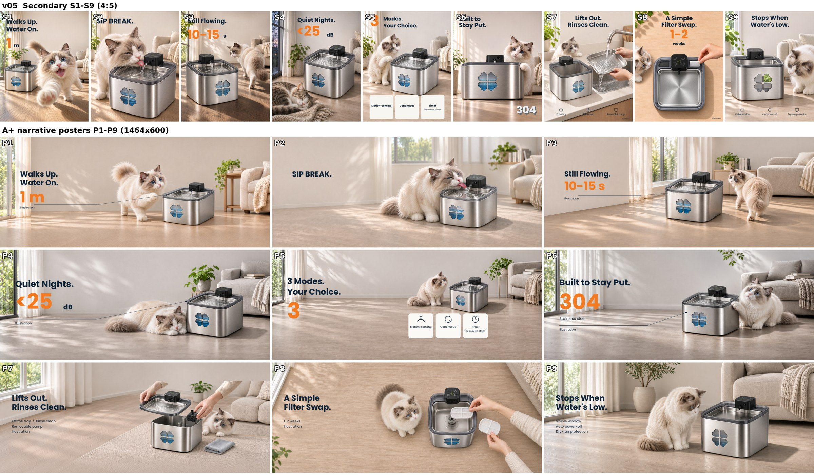

# v05 缩略图（GPT）

2026-11-15，由 ChatGPT AI 助手按当时最新的 UTA v3 生成。依据是第 6E 节叙事式 A+ 主框架、第 6F 节渲染明暗对比、第 6G 节视觉突出三要素。

状态：**待锦浩审核。**

## 尺寸

- S1–S9：`1122 × 1402`，比例 4:5。这是缩略图，没有放大到副图交付尺寸 `1600 × 2000`。
- P1–P9：大约 `1959 × 803`，比例 2.44:1，与 A+ 电脑端 `1464 × 600` 相同。实测 P1、P2 为 `1958 × 803`，P3 为 `1937 × 812`，其余为 `1959 × 803`。

## 总览

## 文件

- 副图分镜：`S1.png`–`S9.png`
- A+ 海报：`P1.png`–`P9.png`
- 总览：`overview_v05.jpg`
